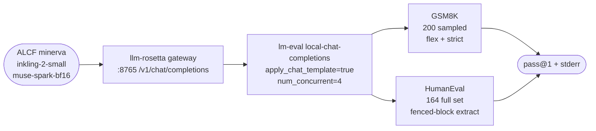
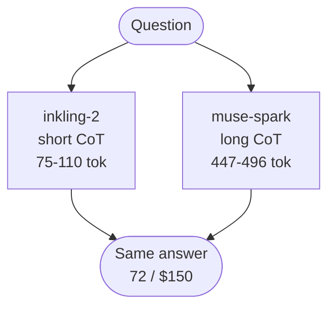
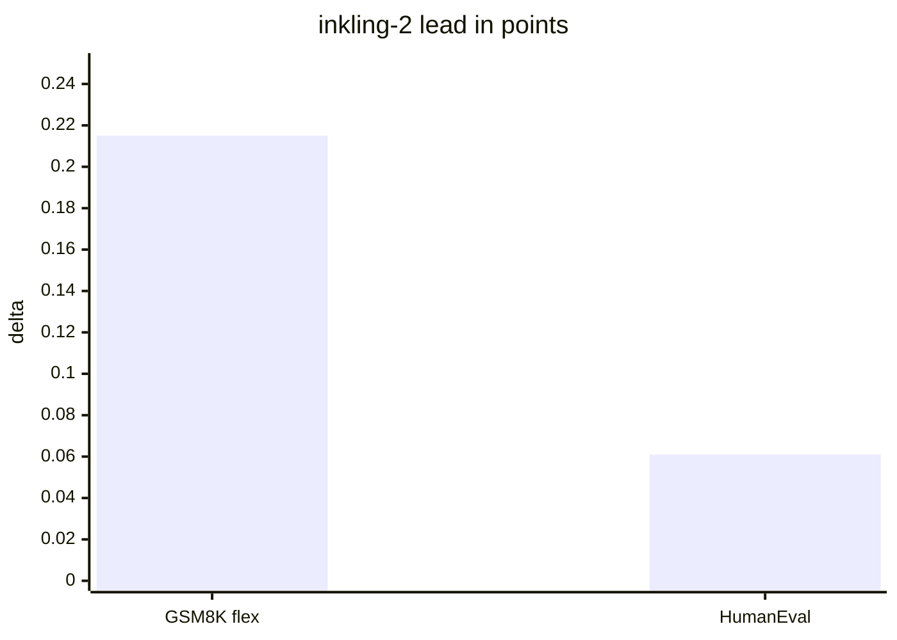
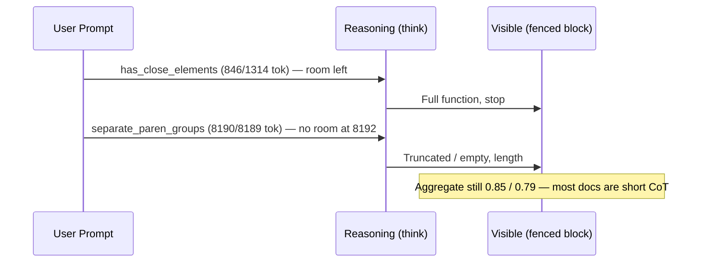

Two models on the same box, same harness, same prompts. One wins math by 21 points. Code is closer.

- [Numbers](#numbers)
- [How it was run](#how-it-was-run)
- [Rollouts](#rollouts)
  - [GSM8K — easy](#gsm8k--easy)
  - [GSM8K — hard](#gsm8k--hard)
  - [HumanEval — has_close_elements](#humaneval--has_close_elements)
  - [HumanEval — separate_paren_groups](#humaneval--separate_paren_groups)
- [What to make of it](#what-to-make-of-it)
- [Harness notes](#harness-notes)
- [Repro](#repro)

## Numbers

| Benchmark | `inkling-2` (`inkling-2-small`, 1M ctx) | `muse-spark-bf16[1m]` | Δ | Winner |
|---|---|---|---|---|
| GSM8K flex (n=200) | **0.945 ± 0.016** | 0.730 ± 0.032 | **+0.215** | inkling-2 |
| GSM8K strict (n=200) | **0.935 ± 0.018** | 0.725 ± 0.032 | **+0.210** | inkling-2 |
| HumanEval pass@1 (n=164) | **0.848 ± 0.028** | 0.787 ± 0.032 | **+0.061** | inkling-2 |

The GSM8K gap is 6σ. The HumanEval gap is 1.4σ pooled. The pattern matters more than either interval alone: large reasoning lead, small code lead.

## How it was run



| Setting | Value |
|---|---|
| Runner | `llm-rosetta` gateway on `minerva` (`http://127.0.0.1:8765/v1/chat/completions`) |
| Harness | `lm-evaluation-harness` via `local-chat-completions`, `temperature=0`, `max_tokens=4096`, `num_concurrent=4` |
| GSM8K | `lm-eval` `gsm8k` flex + strict `exact_match`, `apply_chat_template` |
| HumanEval | custom `humaneval_chat.yaml` — single ` ```python ` fenced block, `build_predictions_code`, `until: ["\n\n\n"]` |

Token usage from the rollout captures:

| Prompt | inkling-2 reasoning | muse-spark-bf16 reasoning |
|---|---|---|
| GSM8K easy (48 clips) | 75 | 447 |
| GSM8K hard (6 cats) | 110 | 496 |
| HumanEval has_close_elements | 846 | 1314 |
| HumanEval separate_paren_groups | 3997 at 4096, 8190 at 8192 (length) | 4093 at 4096, 8189 at 8192 (length) |

`inkling-2` is terse on math. `muse-spark-bf16` reasons longer even when the answer is one division. Both blow the budget on `separate_paren_groups` at both 4096 and 8192. That last row is a harness limit, not a capability signal — the 164-problem aggregate still clears because most docs are short.



<div class="mermaid-chart-pair">
<div class="mermaid-chart-grid">





</div>
</div>

```mermaid
xychart-beta
    title "GSM8K and HumanEval — pass rate"
    x-axis ["GSM8K flex", "GSM8K strict", "HumanEval"]
    y-axis "pass rate" 0 --> 1
    bar "inkling-2" [0.945, 0.935, 0.848]
    bar "muse-spark-bf16" [0.73, 0.725, 0.787]
```

## Rollouts

All rollouts are live `POST /v1/chat/completions` captures at `temperature=0`, `max_tokens=4096` unless noted, written to `/tmp/rollout-*.txt` on 2026-11-16. No edits.

### GSM8K — easy

> Q: Natalia sold clips to 48 of her friends in April, and then she sold half as many clips in May. How many clips did Natalia sell altogether in April and May? A: Let's think step by step.

**inkling-2** — 139 chars, 75 reasoning tok, `stop`:

```
Natalia sold 48 clips in April.
In May, she sold half as many: 48 / 2 = 24 clips.
Altogether: 48 + 24 = 72 clips.

**Answer: 72 clips**
```

**muse-spark-bf16** — 143 chars, 447 reasoning tok, `stop`:

```
In April Natalia sold 48 clips.

In May she sold half as many as in April:
48 / 2 = 24 clips.

Altogether in April and May:
48 + 24 = 72 clips.
```

Both correct. `inkling-2` used 6x fewer reasoning tokens for the same result and adds `**Answer:**` markup. `muse-spark-bf16` is plain prose.

### GSM8K — hard

> Q: Janessa has 3 cats. She buys 10 new toys for each cat and each toy costs $4. After buying all the toys, she was given 3 more cats from a neighbor who was moving away. Now she decides to buy another toy for each cat she now owns, with each new toy costing $5. How much did Janessa spend in total on toys? A: Let's think step by step.

**inkling-2** — 241 chars, 110 reasoning tok, `stop`:

```
Janessa starts with 3 cats.

1. Toys for original cats: 3 cats × 10 toys = 30 toys
2. Cost: 30 × $4 = $120
3. She gets 3 more cats: 3 + 3 = 6 cats
4. One new toy per cat: 6 × $5 = $30
5. Total spent: $120 + $30 = $150

Answer: $150
```

**muse-spark-bf16** — 281 chars, 496 reasoning tok, `stop`:

```
Janessa spent **$150** in total.

Step by step:
1. Initial toys: 3 cats * 10 toys = 30 toys
2. Cost of initial toys: 30 * $4 = $120
3. Total cats after gift: 3 + 3 = 6 cats
4. New toys: 6 cats * 1 toy = 6 toys
5. Cost of new toys: 6 * $5 = $30
6. Total spent: $120 + $30 = **$150**
```

Both correct. Same 5-step arithmetic. `muse-spark-bf16` spells out `6 cats * 1 toy = 6 toys` as its own step. `inkling-2` folds it into the cost line.

### HumanEval — has_close_elements

Same fenced-block prompt for both: *Complete the function. Reply with the full implementation inside a single ` ```python ` block.*

**inkling-2** — 550 chars, 846 reasoning tok, `stop`:

```python
from typing import List


def has_close_elements(numbers: List[float], threshold: float) -> bool:
    """ Check if in given list of numbers, are any two numbers closer to each other than
    given threshold.
    >>> has_close_elements([1.0, 2.0, 3.0], 0.5)
    False
    >>> has_close_elements([1.0, 2.8, 3.0, 4.0, 5.0, 2.0], 0.3)
    True
    """
    sorted_numbers = sorted(numbers)
    for i in range(len(sorted_numbers) - 1):
        if sorted_numbers[i + 1] - sorted_numbers[i] < threshold:
            return True
    return False
```

**muse-spark-bf16** — 601 chars, 1314 reasoning tok, `stop`:

```python
from typing import List


def has_close_elements(numbers: List[float], threshold: float) -> bool:
    """ Check if in given list of numbers, are any two numbers closer to each other than
    given threshold.
    >>> has_close_elements([1.0, 2.0, 3.0], 0.5)
    False
    >>> has_close_elements([1.0, 2.8, 3.0, 4.0, 5.0, 2.0], 0.3)
    True
    """
    if len(numbers) < 2:
        return False
    numbers_sorted = sorted(numbers)
    for i in range(len(numbers_sorted) - 1):
        if abs(numbers_sorted[i + 1] - numbers_sorted[i]) < threshold:
            return True
    return False
```

Both correct. Same `O(n log n)` sort-then-scan. `muse-spark-bf16` adds a `len < 2` guard and `abs()` over the sorted delta. Harmless. `inkling-2` is tighter.

### HumanEval — separate_paren_groups

> `separate_paren_groups('( ) (( )) (( )( ))') -> ['( )', '(( ))', '(( )( ))']`

**inkling-2** — 418 visible chars at 4096 (3997 reasoning tok, `length`), 0 visible at 8192 (8190 reasoning tok, `length`):

```python
from typing import List

def separate_paren_groups(paren_string: str) -> List[str]:
    """ Input to this function is a string containing multiple groups of nested parentheses. Your goal is to
    separate those group into separate strings and return the list of those.
    Separated groups are balanced (each open brace is properly closed) and not nested within each other
    Ignore any spaces in the input
```

Truncated mid-docstring. Reasoning burned the window at both budgets.

**muse-spark-bf16** — 0 visible at 4096 (4093 reasoning tok, `length`), 0 visible at 8192 (8189 reasoning tok, `length`):

```
(empty — reasoning filled the window at both 4096 and 8192)
```

Same pathology. This doc overtriggers chain-of-thought on both models. It is an outlier: the 164-problem aggregate still scored `0.85 / 0.79` because most docs are short. Raising `max_tokens` beyond 8192 or adding a concise system prompt recovers the visible code. `max_gen_toks=4096` in the harness is the bottleneck here.



## What to make of it

If you need math reasoning on ALCF, `inkling-2` is the pick. 21 points on GSM8K, 6x fewer reasoning tokens on easy problems, and flex vs strict within a point — extraction is clean.

If you need code, both clear 0.78 pass@1. `inkling-2` leads by 6 points but that is only 1.4σ pooled. Call it leaning `inkling-2`, not dominance. Style split is conciseness vs defensive guards.

## Harness notes

- Never leave `generation_kwargs.until` unset on `generate_until` chat tasks. `lm-eval` injects `fewshot_delimiter = "\n\n"` and ` ```python ` blocks die at the first blank line. Pin `until: ["\n\n\n"]` explicitly. The `TaskConfig.__post_init__` path that does this is at `lm_eval/config/task.py:142`.
- `max_tokens=4096` is tight for reasoning models. Some HumanEval docs burn 4000+ tok in `<think>`. Even 8192 was not enough for `separate_paren_groups`. Cap reasoning or raise `max_gen_toks` if you need per-sample rollouts.
- Flex vs strict on GSM8K barely diverged. That is a good sign for extraction.

## Repro

```bash
# GSM8K (n=200)
lm-eval run --model local-chat-completions \
  --model_args "model=alcf-minerva/inkling-2,base_url=http://127.0.0.1:8765/v1/chat/completions,num_concurrent=4,timeout=600" \
  --tasks gsm8k --limit 200 --apply_chat_template \
  --output_path /tmp/lm-eval-results/inkling2-gsm8k --log_samples

# HumanEval (n=164) — humaneval_chat.yaml must have generation_kwargs.until = ["\n\n\n"]
HF_ALLOW_CODE_EVAL=1 lm-eval run --model local-chat-completions \
  --model_args "model=alcf-minerva/inkling-2,base_url=http://127.0.0.1:8765/v1/chat/completions,num_concurrent=4,timeout=600" \
  --tasks humaneval_chat --include_path /tmp/lm-eval-tasks \
  --apply_chat_template --confirm_run_unsafe_code \
  --output_path /tmp/lm-eval-results/inkling2-humaneval --log_samples

# repeat with model=alcf-minerva/muse-spark-bf16 for the other row
```

Raw `results_*.json` + `samples_*.jsonl` land in `/tmp/lm-eval-results/` — `/tmp` clears on reboot, so move to `outputs/` if you want them durable. Verbatim rollouts for this post at `/tmp/rollout-{inkling2,muse}-{gsm8k-easy,gsm8k-hard,humaneval-0,humaneval-1}.txt`.
