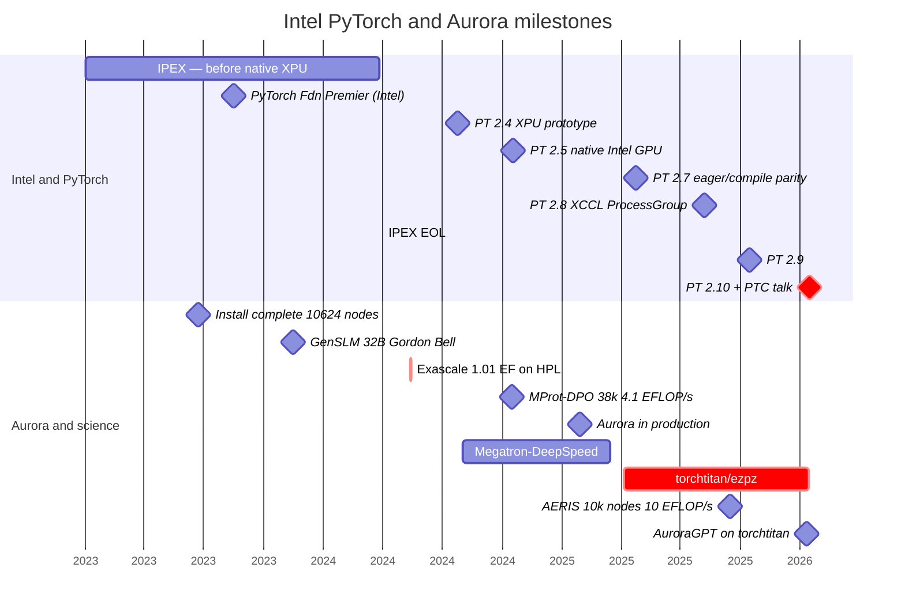
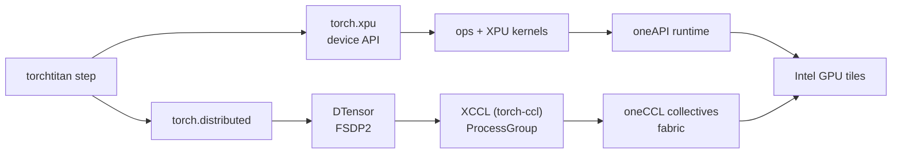
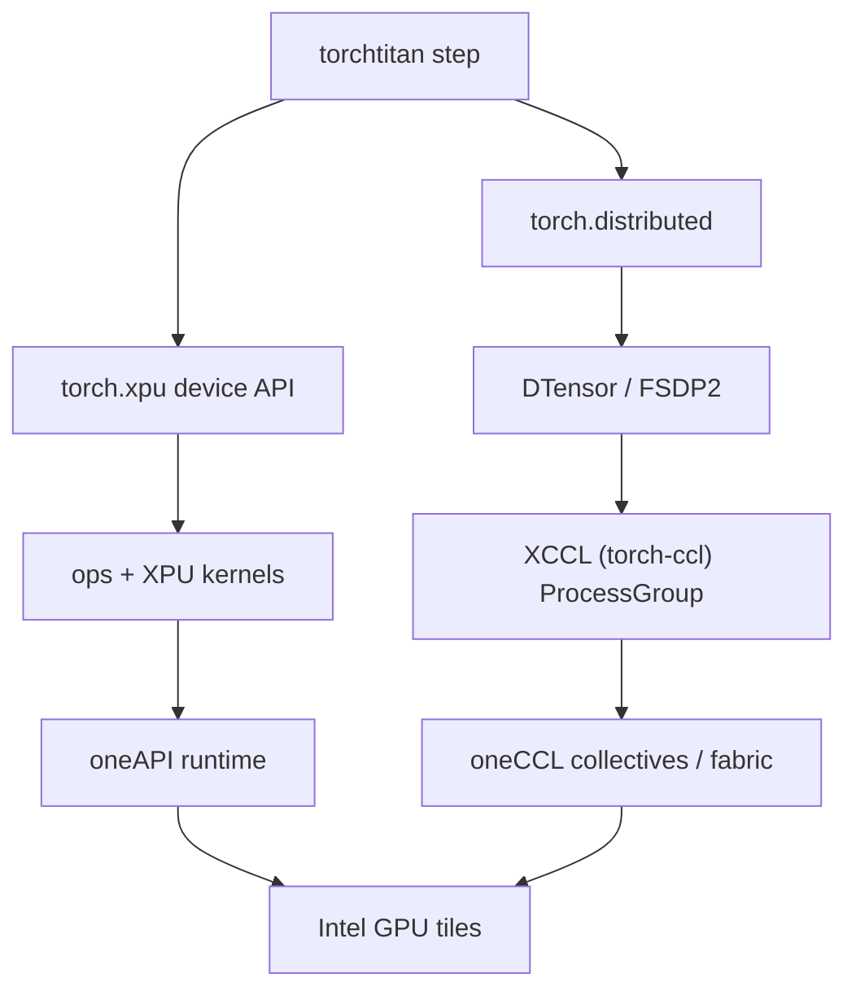
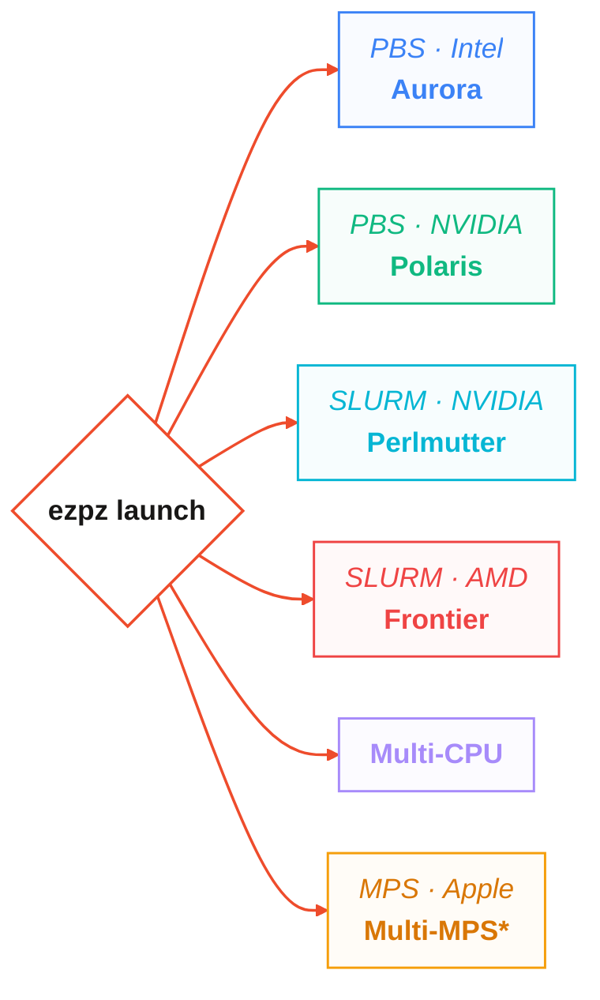
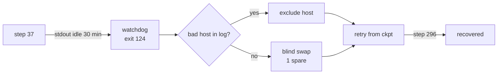
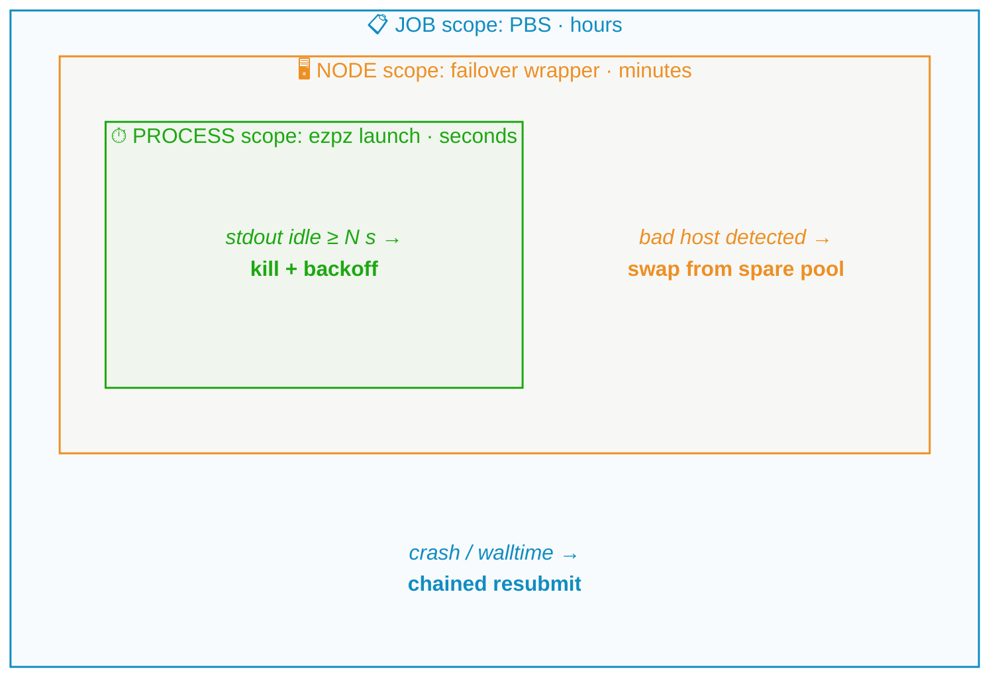

import Slide from '@/components/slides/Slide.astro'
import SpeakerNotes from '@/components/slides/SpeakerNotes.astro'

{/* ================================================================
    TALK ARC (18 slides, ~20 min + 5 Q&A)
    Thesis: Aurora jobs at ~120k GPU tiles made the backend visible — we trace
    a single XPU surface (torch.xpu → XCCL/oneCCL → DTensor/FSDP2),
    a fork-to-titan migration proved at 256→512 nodes, and the watchdog
    + failover machinery that keeps long jobs alive.
    Footer: official vector bottom-right (pytorchcon-na26-color.svg @ 2rem).
    Aurora: 10,624 nodes · 63,744 GPUs · 127,488 GPU tiles (12 per node).
    ================================================================ */}

{/* ── Title ───────────────────────────────────────────────────── */}
<Slide id="title-slide">


# Scaling PyTorch on Intel XPU

### Field notes from AI for Science on Aurora

<div class="title-authors">
    <span>Sam Foreman · Argonne National Laboratory</span>
    <span>Panagiotis Kourdis · Intel</span>
    <span>Tanima Dey · Intel</span>
</div>

<div class="title-conf-line">_PyTorch Conference · October 21, 2026 — San Jose_</div>

<a
    class="title-slide-qr"
    href="https://samf.sh/talks/2026/10/21"
    aria-label="QR code linking to these slides">
    
    <span>samf.sh/talks/2026/10/21</span>
</a>

<SpeakerNotes>
25 min total — 20 of slides, 5 for Q&A.
</SpeakerNotes>

</Slide>

{/* ── Prologue: what ALCF does ─────────────────────────────────── */}
<Slide id="context">

## Aurora at ALCF

<div class="context-layout">

| | |
| --- | --- |
| [**ALCF**](https://alcf.anl.gov) | DOE leadership computing — runs [`Aurora`](https://docs.alcf.anl.gov/aurora) + `Polaris` for open science |
| [**Aurora**](https://docs.alcf.anl.gov/aurora) | `10,624` nodes · `63,744` GPUs · `127,488` GPU tiles |
| **This talk** | Every team picked PyTorch anyway. How we closed the gap |

<figure class="context-hero">

<figcaption>Aurora's HPE Cray EX rows at the ALCF — 10,624 nodes, 63,744 GPUs. Photo: [Argonne / ALCF](https://www.alcf.anl.gov/sites/default/files/2025-08/34302D_110_LCF_Aurora_1600x900_0.jpg).</figcaption>
</figure>

</div>

<SpeakerNotes>
ALCF runs the machines so scientists don't have to — INCITE/ALCC allocations, not internal. Aurora is the exascale poster child: 10k nodes, Intel's first data-center GPU at DOE scale, and up before the XPU surface was ported in PyTorch. That collision — new hardware, same PyTorch — is the talk's reason to be. One minute, no deeper.
</SpeakerNotes>

</Slide>

{/* ── Frame: the 3-act contract ───────────────────────────────── */}
<Slide id="frame">

## Talk outline

| Act | Question | Reusable pattern |
| --- | --- | --- |
| **A · Needed** | What does a first-class XPU backend actually require? | The 3 breaks we fixed + the ladder that catches the next one |
| **B · Accomplished** | How do you leave a functional (but unmaintained) Megatron-DeepSpeed fork for composable PyTorch? | The 50-step gate + the 768-rank proof |
| **C · Remains** | What keeps a 14-day job alive at 60k → 120k GPU tiles? | Watchdog + bad-node quarantine + layered restarts |


<div class="frame-footer-spacer"></div>

<SpeakerNotes>
Set the contract: every act promises a reusable pattern, not a science result. The abstract's three bullets map 1:1 to A/B/C.
</SpeakerNotes>

</Slide>

{/* ── Prologue: why scale matters (60s) ───────────────────────── */}
<Slide id="prologue">

## Scientific AI workloads on Aurora

| Workload | What it taught us |
| --- | --- |
| [GenSLM](https://journals.sagepub.com/doi/10.1177/10943420231201154) — viral genomes | Portability before Aurora existed (Polaris + Cerebras → Gordon Bell) |
| [MProt-DPO](https://www.alcf.anl.gov/news/argonne-team-breaks-new-ground-ai-driven-protein-design) — protein design | 38,400 ranks · 4.11 EFLOP/s at 3,200 nodes |
| [AERIS](https://arxiv.org/abs/2509.13523) — weather diffusion | 10,080 nodes · 10.21 EFLOP/s · 90-day stable rollouts |
| [AuroraGPT](https://samf.sh/talks/2026/08/03/) — foundation LLM | 7.77T-token MDS reference → [torchtitan](https://github.com/saforem2/torchtitan/tree/ezpz) |

Aurora has **10,624 nodes · 63,744 GPUs · 127,488 GPU tiles**. In `FLAT` mode, **1 tile = 1 `torch.xpu` device**: 6 GPUs × 2 tiles = 12 devices per node.[^aurora]
[`ezpz`](https://github.com/saforem2/ezpz): same training program on `Intel`, `NVIDIA`, `AMD`.[^aurora]

[^aurora]: [ALCF Aurora](https://www.alcf.anl.gov/aurora) · [ALCF PyTorch tile-as-device configuration](https://docs.alcf.anl.gov/aurora/data-science/frameworks/pytorch/) · [ALCF support — Aurora](https://www.alcf.anl.gov/support-center/aurora) · [`torchtitan/ezpz`](https://github.com/saforem2/torchtitan/tree/ezpz) · [AuroraGPT companion](https://samf.sh/talks/2026/08/03/).

<SpeakerNotes>
Prologue in 60s: the workloads are the *reason* we needed the backend, not the talk's subject. GenSLM predates Aurora's XPU path; AERIS uses its own stack. Credit: MProt, GenSLM, and AERIS teams + ALCF + Intel.
</SpeakerNotes>

</Slide>

{/* ── A0: when the backend landed ───────────────────────────── */}
<Slide id="timeline">

## PyTorch XPU and Aurora timeline



<span class="timeline-caption"><span class="timeline-lanes">**Intel and PyTorch** — IPEX → PT 2.4–2.10+XPU (4 releases)</span> · <span class="timeline-lanes">**Aurora and science** — 10k nodes → 120k-tile workloads</span><br/>From [ezpz: distributed PyTorch across any hardware](https://samf.sh/posts/2026/01/10/) plus verified Aurora dates — on desktop the two lanes are the chart background; on phones scroll →.</span>

<SpeakerNotes>
60s. The punchline: Intel compressed 14 years of AMD-style work into 5 PT releases (2.4→2.8), and Aurora's science jobs landed right as that window opened — GenSLM before the XPU path, MProt/AERIS during it, AuroraGPT straddling the fork→titan cutover. Every PT milestone here has a oneCCL/env fix to tell if asked.
</SpeakerNotes>

</Slide>

{/* ── A1: what a first-class backend required ─────────────────── */}
<Slide id="backend-path">

## PyTorch XPU backend components

<div class="backend-mermaid-desktop">



</div>
<div class="backend-mermaid-mobile">



</div>

<div class="backend-caption">

Every edge is a place a job can pass a unit test and still die at scale.
`IPEX` shims → [native `torch.xpu`](https://pytorch.org/docs/stable/notes/xpu.html) + [`torch-ccl`/`XCCL`](https://github.com/intel/torch-ccl) + [`oneCCL`](https://github.com/oneapi-src/oneCCL) is the migration behind this diagram.

</div>

[^xpu]: [PyTorch XPU docs](https://pytorch.org/docs/stable/notes/xpu.html) · [Intel torch-ccl (XCCL)](https://github.com/intel/torch-ccl) · [oneAPI oneCCL](https://github.com/oneapi-src/oneCCL) · [PyTorch distributed overview](https://pytorch.org/docs/stable/distributed.html) · [The two timelines](https://samf.sh/posts/2026/01/10/#the-two-timelines) — source chronology for the previous slide.

<SpeakerNotes>
Co-authors: Panagiotis Kourdis and Tanima Dey, Intel — XCCL/`oneCCL` layer. Distinguish "API exists" from "collective scales and timeout fires."
</SpeakerNotes>

</Slide>

{/* ── A2: where it broke (3 concrete bugs) ────────────────────── */}
<Slide id="xpu-gaps" size="sm">

## XPU integration issues

| Symptom | Root cause | What we run now |
| --- | --- | --- |
| `torch 2.13`: `expected DTensor, got plain tensor` on FSDP wrap | Missing [pytorch#181519](https://github.com/pytorch/pytorch/pull/181519) | Fixed in `2.14.0+xpu` |
| `DeviceMesh` → `does not support splitting` | `ProcessGroupXCCL` inherits `supportsSplitting() == false` (see [pytorch#186548](https://github.com/pytorch/pytorch/issues/186548)) | Local shim · [pytorch#186548](https://github.com/pytorch/pytorch/issues/186548) |
| `train_timeout_seconds` is a no-op | `_set_pg_timeout` has no `xpu` branch — `XCCL` stores the timeout, never arms it | Watchdog heartbeat (Act C) + two-PR upstream |

Pattern: **works on CUDA, inherits a silent default on XPU.**

<SpeakerNotes>
Not missing kernels — missing dispatch branches. Every row is a real commit and issue.
</SpeakerNotes>

</Slide>

{/* ── A3: why we had to leave the fork ───────────────────────── */}
<Slide id="why-fork-broke">

## From Megatron-DeepSpeed to torchtitan

| [Megatron-DeepSpeed fork](https://github.com/microsoft/Megatron-DeepSpeed)[^mds] | [`torchtitan`](https://github.com/pytorch/torchtitan) + `DTensor` + `FSDP2` |
| --- | --- |
| `2B` to `7.77T` tokens shipped on the fork ([Aug talk](https://samf.sh/talks/2026/08/03/)) | Same run continues on `torchtitan` — `4.67T` at `256`→`512` nodes |
| Parallelism baked into the fork | [`DTensor`](https://pytorch.org/tutorials/intermediate/DTensor_tutorial.html) + [`FSDP2`](https://pytorch.org/blog/pytorch2-feature-class-of-2024/) as composable primitives |
| Every PT release → rebase + patch audit | XPU integration in upstreamable layers · [`torchtitan/ezpz`](https://github.com/saforem2/torchtitan/tree/ezpz) |

The fork didn't fail scientifically. It failed operationally — it couldn't carry the XPU work without re-patching every release.

[^mds]: [Megatron-DeepSpeed](https://github.com/microsoft/Megatron-DeepSpeed) · [torchtitan upstream](https://github.com/pytorch/torchtitan) · [AuroraGPT companion — the MDS receipt](https://samf.sh/talks/2026/08/03/).

<SpeakerNotes>
The 7.77T MDS run is the *baseline*, not a failure. The migration was about maintainability and XPU composability, not scientific correctness. The companion talk is the MDS receipt — the fork link here makes every named entity clickably sourced.
</SpeakerNotes>

</Slide>

{/* ── A4: one program across vendors ──────────────────────────── */}
<Slide id="portable-training">

## One training program across vendors

<div class="portable-demo">

<div class="portable-demo-col">

**Hello world:**

```python
# example.py
import torch
import ezpz
rank = ezpz.setup_torch()
world_size = ezpz.get_world_size()
dev = ezpz.get_torch_device()      # {xpu, cuda, cpu, ...}

# FSDP2 by default — accepts DeviceMesh
model = ezpz.wrap_model(torch.nn.Linear(128, 10).to(dev))

print(f"Hello from {rank}/{world_size}!")
```

```bash
$ ezpz launch python3 example.py
Hello from rank 0/24!
Hello from rank 1/24!
# ... etc
```

**Other examples:**

```bash
# your own script — no changes needed
ezpz launch python3 your_training_script.py

# full HF model + dataset via ezpz examples
ezpz launch python3 -m ezpz.examples.fsdp_tp \
    --dataset=allenai/olmo-mix-1124
    --model=meta-models/Muse-Spark-Open-816B-A42B \
    --local-batch-size=1
    # ...etc
```

</div>

<div class="portable-demo-col">

Same command on every machine — [`ezpz`](https://github.com/saforem2/ezpz) picks the backend.


*\*`mccl` — [mps-ddp/mccl](https://github.com/mps-ddp/mccl): `MPS` on Apple silicon — `ezpz launch` even on a laptop.*

</div>

</div>

<style>{`
  #portable-training .portable-demo-col em { font-size: 0.75em; color: var(--foreground2); line-height: 1.3; display: block; margin-block-start: 0.15lh; }
  #portable-training .portable-demo { align-items: start; }
  /* Title QR: on screen the pill sits inside the QR block's flow, but in
     print the 16:9 sheet is narrower and the pill's nowrap spills left over
     the author line. In print, center it under the QR code at half scale. */
  @media print {
    [data-deck-theme='pytorch'] #title-slide .title-slide-qr span {
      font-size: 0.52em !important;
      letter-spacing: 0;
      padding: 0.08ch 0.5ch;
    }
  }
`}</style>

<SpeakerNotes>
`AMD` uses the `CUDA` API in `PyTorch`; launch and env still differ. Show `ezpz` source if asked. The right column's point: any script, any HF dataset/model — same `ezpz launch` on Aurora, Polaris, Perlmutter, Frontier, and now Apple MPS via mccl.
</SpeakerNotes>

</Slide>

{/* ── A5: benchmark the real path ───────────────────────────── */}
<Slide id="measure-backend">

## Full-step benchmarking

1. Freeze build + model + batch + precision + node count
2. Run the **training step** (not a micro-kernel) on each backend
3. Measure step time · tokens/s · collective time · memory
4. Scale node count; **remeasure after every kernel or collective change**

> A passing unit test proves an op exists. A repeatable step proves it's useful at scale.

The `XCCL` timeout fix that Act C's ops story depends on, the `XPU`/`XCCL` scaling ladder at `Sunspot`, and the watchdog that saved `job 8505298` all passed this way.[^bench]

[^bench]: [PyTorch profiler (`torch.profiler`)](https://pytorch.org/tutorials/beginner/profiler.html) · [PyTorch `torch.xpu`](https://pytorch.org/docs/stable/notes/xpu.html)

<SpeakerNotes>
Real Aurora traces in the `Genesis` profiling deck if a visual is needed — no invented speedups.
</SpeakerNotes>

</Slide>

{/* ── B1: what moved ─────────────────────────────────────────── */}
<Slide id="what-moved" size="sm">

## Changes in the `torchtitan` training stack

| Layer | Before (MDS fork + [`ezpz`](https://github.com/saforem2/ezpz)) | After ([`torchtitan/ezpz`](https://github.com/saforem2/torchtitan/tree/ezpz)) |
| --- | --- | --- |
| Parallelism | Custom tensor-parallel + pipeline in fork | [`FSDP2`](https://pytorch.org/blog/pytorch2-feature-class-of-2024/) + [`DTensor`](https://pytorch.org/docs/stable/distributed.tensor.html) sharding |
| Collectives | DeepSpeed's `NCCL` assumptions | `XCCL` ([`torch-ccl`](https://github.com/intel/torch-ccl)) → [`oneCCL`](https://github.com/oneapi-src/oneCCL) |
| Kernels | Fork-local fused kernels | Upstreamable `XPU` kernels via `torch.xpu` — `layernorm+residual` moved; `attn`/`MLP`/`optimizer` stay in remaining-work[^kernels] |
| Launch | Already [`ezpz`](https://github.com/saforem2/ezpz) — scheduler → nodes → `MPI` | Same [`ezpz`](https://github.com/saforem2/ezpz)[^ezpz] — [`launch`](https://ezpz.cool/cli/launch/) + [`checkpoint-restart`](https://ezpz.cool/guides/checkpoint-restart/) |
| Checkpoint | `DeepSpeed` engine save | `DCP` ([`torch.distributed.checkpoint`](https://pytorch.org/docs/stable/distributed.checkpoint.html)) |

Same tokens, different owner per layer.

[^kernels]: `layernorm+residual` landed in `torch.xpu`; `attn`/`MLP`/`optimizer` remain — composable kernels must survive [`torch.compile`](https://pytorch.org/docs/stable/torch.compiler.html).
[^ezpz]: [`ezpz`](https://github.com/saforem2/ezpz) is the cross-workload launcher: `qsub`/`sbatch` → node list → `MPI` on Aurora+Sunspot/Polaris. Same before and after the framework switch.

<SpeakerNotes>
The table is the map. The next two slides verify it. Kernels footnote: one op moved upstream, the rest is honest remaining work.
</SpeakerNotes>

</Slide>

{/* ── B2: testing at every layer ─────────────────────────────── */}
<Slide id="layer-tests" size="sm">

## Testing at every layer

| Layer | Gate | Link |
| --- | --- | --- |
| Numerics | 50-step loss — `±0.10` on final + last-10 mean | [Production loss figure](https://samf.sh/talks/2026/08/03/) |
| Collectives | XCCL ladder `48 → 768` ranks, value-checked | [`ezpz/test_dist.py`](https://github.com/saforem2/ezpz/blob/main/ezpz/test_dist.py) |
| Parallelism | TP1 / TP2 / MoE on Aurora; parity on Sunspot | [`experiments/ezpz`](https://github.com/saforem2/torchtitan/tree/ezpz) |
| Portability | One gate on Aurora + Sunspot + Polaris + Perlmutter | [`ezpz`](https://github.com/saforem2/ezpz) |
| Orchestration | Failover harness — 9 fixtures | [Failover writeup](https://github.com/saforem2/torchtitan/blob/ezpz/torchtitan/experiments/ezpz/docs/experiments/agpt/aurora/20260523-failover-silent-hang-recovery-8505298.md) |

`±0.10` sits just above `~0.05` shuffle noise from the streaming loader — catches bad gradients without flaking on data order.

<SpeakerNotes>
The loss gate caught silent gradient bugs that loaded, sharded, and timed correctly.
</SpeakerNotes>

</Slide>

{/* ── B3: does the new stack train? ──────────────────────────── */}
<Slide id="migration-evidence">

## AuroraGPT: production training progress

<div class="project-figure">
    
</div>

Stage 2: **6.927T** cumulative tokens on 512 nodes · **6.085T** on 256 nodes.

<SpeakerNotes>
The chart shows six production and reference trajectories from the selected dashboard view. The separate 200-step LR 3.22e-5 probe is omitted: it ends at loss 5.998, above the main plot range, and does not show stage-2 progress. Stage-2 token counts include their stage-1 checkpoints. Loss changes across stage boundaries include a data-mix change; this is training loss, not a held-out quality comparison. The dashboard upstream was unavailable; all 58 registered W&B runs were checked directly and remain terminal, with the newest logged samples on September 17, 2026.

For more on the trials and tribulations of TorchTitan on Aurora, see [_Pre-Training LLMs on a Supercomputer_ — ATPESC August 2026](https://samf.sh/talks/2026/08/03/) · [`torchtitan/ezpz` experiments](https://github.com/saforem2/torchtitan/tree/ezpz) · [`ezpz`](https://github.com/saforem2/ezpz)
</SpeakerNotes>

</Slide>

{/* ── C1: a healthy process can still be a dead job ─────────── */}
<Slide id="operations">

## Detecting and recovering from stalled jobs

**Job `8505298`** — step 37, then silence. No traceback. Watchdog at 30 min (`exit 124`), wrapper swapped a node, relaunched. Attempt 2 reached step 296.



`_set_pg_timeout` has no `xpu` branch — timeout is stored, never enforced.[^hang]

[^hang]: [Failover incident — 8505298](https://github.com/saforem2/torchtitan/blob/ezpz/torchtitan/experiments/ezpz/docs/experiments/agpt/aurora/20260523-failover-silent-hang-recovery-8505298.md)

<SpeakerNotes>
Watchdog measures stdout progress, not the collective timeout. The `XPU` gaps slide names the missing branch.
</SpeakerNotes>

</Slide>

{/* ── C2: failure taxonomy ───────────────────────────────────── */}
<Slide id="failure-taxonomy">

## Failure modes at ~120k GPU tiles

| Mode | Signal | What helps | What doesn't |
| --- | --- | --- | --- |
| **Silent hang** | Stdout stalls, no error | Watchdog on log progress | `_set_pg_timeout` (`xpu` never arms) |
| **Lost collective** | Rank times out in `XCCL` | Node exclude + retry | Retrying on the same host |
| **Crash / OOM** | Traceback + exit code | Process restart from `ckpt` | Scheduler resubmit alone |
| **Stale FS / DCP** | Checkpoint read stalls | Async save + local staging | Sync save on shared `FS` at 10k ranks |

At this scale, **every job is a test of the recovery path**.[^tax]

[^tax]: [Failover incident — 8505298](https://github.com/saforem2/torchtitan/blob/ezpz/torchtitan/experiments/ezpz/docs/experiments/agpt/aurora/20260523-failover-silent-hang-recovery-8505298.md) · [ezpz docs](https://ezpz.cool)

<SpeakerNotes>
The taxonomy is the mental model. The next two slides cover the two rows you hit weekly.
</SpeakerNotes>

</Slide>

{/* ── C3: layered restarts ───────────────────────────────────── */}
<Slide id="layered-restarts">

## Process, node, and allocation restarts

| Layer | Scope | Trigger | Cost of being wrong |
| --- | --- | --- | --- |
| Process | 1 rank | Crash / OOM | Tokens since last ckpt |
| Node | 6 GPUs / 12 tiles | Hang on one host | 1 node's work + re-shard |
| Allocation | 10k nodes | Bad FS / scheduler | Whole-job walltime |

`ezpz` handles the outer two: [`checkpoint-restart`](https://ezpz.cool/guides/checkpoint-restart/) + node exclude + scheduler resubmit. DCP handles the inner save.

Long jobs are not an ops concern bolted on — they **are** the product. Design them first.

<div class="layered-visual">



<span class="layered-visual-caption">Nested recovery scopes — adapted from the [August talk](https://samf.sh/talks/2026/08/03/#32) (`#32`). Inner loops catch most failures; outer loops catch the rest.</span>

</div>

<SpeakerNotes>
Re-shard is not free — `DeviceMesh` rebuild is part of the cost model. The companion talk at `2026/08/03` has the interval math. The nested diagram is the same one from the August talk (#32) — three scopes, inner→outer time horizon.
</SpeakerNotes>

</Slide>

{/* ── C4: what's still hard ──────────────────────────────────── */}
<Slide id="remaining-work">

## Remaining XPU gaps

| Layer | Gap | What's needed |
| --- | --- | --- |
| Kernels | Fused attn + MLP + optimizer across XPU | A composable kernel story that survives `torch.compile` |
| Collectives | Tuning, diagnostics, **real timeouts** | `XCCL` timeout enforcement + `DTensor` split fix upstream |
| Checkpoints | Async `DCP` at 10k ranks without `FS` collapse | Local staging → async flush |
| Operations | Bad-node detection before walltime burns | Heartbeat at the `ProcessGroup` level, not stdout `grep` |

Bringing up the next accelerator: **test it with a restartable training job** — not isolated kernels.

[^dcp]: [Distributed Checkpoint (DCP)](https://pytorch.org/docs/stable/distributed.checkpoint.html) · [torch.compile on XPU](https://pytorch.org/docs/stable/torch.compiler.html)

<SpeakerNotes>
Honest about upstream vs local shim. The last line is the most actionable takeaway.
</SpeakerNotes>

</Slide>

{/* ── Takeaway ───────────────────────────────────────────────── */}
<Slide id="takeaways">

## Practices for accelerator bring-up

1. **Backend + distributed together:** `torch.xpu` without `XCCL` is a demo, not a trainer.
2. **One program, many launches:** [`ezpz`](https://github.com/saforem2/ezpz) owns the schedule, the model doesn't branch.
3. **A science baseline that survives the migration:** 7.77T → 4.674T on the same tokens axis.
4. **Measure the step, not the kernel:** the whole training step, at the job's real scale.
5. **Recovery before throughput:** checkpoint + watchdog + quarantine before you tune.

**GenSLM · MProt-DPO · AERIS · AuroraGPT** — not case studies, but the workloads that forced each layer.

_Patterns for running PyTorch at scale on a new accelerator._

<SpeakerNotes>
End on reusable patterns. Credit ALCF, Intel, PyTorch contributors verbally; the next slide has the links. Closing line mirrors the abstract verbatim for reviewers scoring against the submission.
</SpeakerNotes>

</Slide>

{/* ── QR: links ─────────────────────────────────────────────── */}
<Slide id="links">

## Links and further reading

<div class="links-grid">

| Stack | Link |
| --- | --- |
| [`ezpz`](https://github.com/saforem2/ezpz) | [Launch](https://ezpz.cool/cli/launch/) · [Checkpoint](https://ezpz.cool/guides/checkpoint-restart/) · [All docs](https://ezpz.cool) |
| [`torchtitan/ezpz`](https://github.com/saforem2/torchtitan/tree/ezpz) | [Experiments](https://github.com/saforem2/torchtitan/tree/ezpz/torchtitan/experiments/ezpz) · [Failover writeup](https://github.com/saforem2/torchtitan/blob/ezpz/torchtitan/experiments/ezpz/docs/experiments/agpt/aurora/20260523-failover-silent-hang-recovery-8505298.md) |
| PyTorch XPU | [`torch.xpu`](https://pytorch.org/docs/stable/notes/xpu.html) · [`DTensor`](https://pytorch.org/tutorials/intermediate/DTensor_tutorial.html) · [`FSDP2`](https://pytorch.org/blog/pytorch2-feature-class-of-2024/) · [DCP](https://pytorch.org/docs/stable/distributed.checkpoint.html) |
| Distributed | [`torch-ccl` / XCCL](https://github.com/intel/torch-ccl) · [`oneCCL`](https://github.com/oneapi-src/oneCCL) · [torch.distributed](https://pytorch.org/docs/stable/distributed.html) |
| System | [Aurora](https://www.alcf.anl.gov/aurora) · [ALCF support — Aurora](https://www.alcf.anl.gov/support-center/aurora) · [ALCF news — 120k-tile scale](https://www.alcf.anl.gov/news/aeris-earth-systems-model-pushes-ai-science-new-heights) |
| Science | [AuroraGPT companion](https://samf.sh/talks/2026/08/03/) · [AERIS](https://arxiv.org/abs/2509.13523) · [MProt-DPO](https://www.alcf.anl.gov/news/argonne-team-breaks-new-ground-ai-driven-protein-design) · [GenSLM](https://journals.sagepub.com/doi/10.1177/10943420231201154) |

</div>

**Elsewhere by Sam:** [ezpz: distributed PyTorch across any hardware](https://samf.sh/posts/2026/01/10/) (source chronology for the timeline) · [Running 50k Python processes on Aurora with `ezpz yeet`](https://samf.sh/posts/2026/05/01/) · [_Pre-Training LLMs on a Supercomputer_ — ATPESC Aug 2026](https://samf.sh/talks/2026/08/03/) · [BlendCorpus + TorchTitan @ ALCF](https://samf.sh/posts/2025/09/12/) · _Upcoming:_ SC publication on the AuroraGPT training system

_All links are in the deck at [`samf.sh/talks/2026/10/21`](https://samf.sh/talks/2026/10/21)._

<SpeakerNotes>
Point at this slide. Stay on it for Q&A — every project name is clickable and every claim has a receipt. Call out the elsewhere-by-Sam line if time: the two blog posts are the deeper write-ups behind the timeline and the Lustre/yeet sections.
</SpeakerNotes>

</Slide>

{/* ── Acknowledgements ─────────────────────────────────────── */}
<Slide id="acks">

## Acknowledgements

This work used resources of the **Argonne Leadership Computing Facility**, a DOE Office of Science user facility at Argonne National Laboratory, supported under contract **DE-AC02-06CH11357**.

**Aurora** was built in partnership with **HPE** and **Intel** — Intel Max 1550 XPU (`PVC`), `oneAPI` / `oneCCL` / `XCCL`, and the upstream `torch.xpu` work tracked in Act A. Thanks to the ALCF operations and support teams, the `PyTorch` and `torchtitan` maintainers, and the science teams behind `GenSLM`, `MProt-DPO`, `AERIS`, and `AuroraGPT`.

<div class="acks-grid">

| | |
| --- | --- |
| Facility | [ALCF](https://www.alcf.anl.gov) · [Aurora](https://www.alcf.anl.gov/aurora) · [Polaris](https://www.alcf.anl.gov/polaris) |
| Partners | [HPE](https://www.hpe.com) · [Intel](https://www.intel.com) (Max 1550 / `oneAPI` / `oneCCL`) · [PyTorch Foundation](https://pytorch.org/foundation) |
| Teams | `GenSLM` · `MProt-DPO` · `AERIS` · `AuroraGPT` <span class="ack-reference">— see <a href="#links">Links</a> for papers</span> |

</div>

<SpeakerNotes>
Read the DOE contract line — it's required on any ALCF-acknowledged talk. Keep it brief; the names are on screen.
</SpeakerNotes>

</Slide>

{/* ── Get time on Aurora ───────────────────────────────────── */}
<Slide id="allocations">

## Aurora allocation programs

Aurora and Polaris are **open to any researcher** through DOE's allocation programs — not just Argonne staff.

<div class="alloc-grid">

| Program | Best for | Cadence |
| --- | --- | --- |
| [**INCITE**](https://www.doeleadershipcomputing.org/proposal/call-for-proposals/) | Large, peer-reviewed science campaigns | Annual |
| [**ALCC**](https://www.doeleadershipcomputing.org/proposal/call-for-proposals/) | DOE-mission-aligned projects | Annual |
| [**Director's Discretionary (DD)**](https://www.alcf.anl.gov/directors-discretionary-allocation-program) | Porting, benchmarking, getting started — **start here** | Rolling, weeks |

</div>

If you'd like to get access, **reach out** — happy to help scope a DD proposal or connect you with ALCF staff. Find me after the talk or at `foremans@anl.gov` / [@saforem2](https://github.com/saforem2).

<div class="alloc-links">

[ALCF allocations overview](https://www.alcf.anl.gov/science/allocations) · [DD program details](https://www.alcf.anl.gov/directors-discretionary-allocation-program) · [ALCF support center](https://www.alcf.anl.gov/support-center)

</div>

<SpeakerNotes>
The pitch: INCITE/ALCC are the big annual calls, but DD is the on-ramp — a few hundred node-hours to port, benchmark, or reproduce something from this talk. Encourage people to come talk after.
</SpeakerNotes>

</Slide>

<style>{`
  #frame table { table-layout: fixed; width: 100%; font-size: 0.9em; }
  #frame th:first-child, #frame td:first-child { width: 18%; white-space: normal; }
  #frame th:nth-child(2), #frame td:nth-child(2) { width: 30%; min-width: 0; }
  #frame th:last-child, #frame td:last-child { width: 54%; }
  #frame th, #frame td { word-break: normal; overflow-wrap: break-word; hyphens: none; }
  #prologue table { table-layout: fixed; width: 100%; font-size: 0.86em; }
  #prologue th:first-child, #prologue td:first-child { width: 32%; white-space: normal; }
  #prologue th:last-child, #prologue td:last-child { width: 68%; }
  #prologue th, #prologue td { word-break: normal; overflow-wrap: break-word; hyphens: none; }
  #why-fork-broke table { width: 100%; table-layout: fixed; }
  #why-fork-broke th, #why-fork-broke td { width: 50%; word-break: normal; overflow-wrap: break-word; hyphens: none; }
  @media (max-width: 768px) {
    #why-fork-broke table { table-layout: fixed; font-size: 0.82em; }
    #why-fork-broke th, #why-fork-broke td { word-break: break-word; overflow-wrap: anywhere; }
    #why-fork-broke table { display: block; overflow-x: auto; -webkit-overflow-scrolling: touch; }
    #why-fork-broke th:first-child, #why-fork-broke td:first-child { width: 44% !important; }
    #why-fork-broke th:last-child, #why-fork-broke td:last-child { width: 56% !important; }
  }
  #what-moved table { table-layout: fixed; width: 100%; }
  #what-moved th:first-child, #what-moved td:first-child { width: 18%; }
  #what-moved th:nth-child(2), #what-moved td:nth-child(2) { width: 40%; }
  #what-moved th:last-child, #what-moved td:last-child { width: 42%; }
  #what-moved th, #what-moved td { word-break: normal; overflow-wrap: break-word; hyphens: none; }
  #xpu-gaps table { table-layout: fixed; width: 100%; }
  #xpu-gaps th:first-child, #xpu-gaps td:first-child { width: 36%; }
  #xpu-gaps th:nth-child(2), #xpu-gaps td:nth-child(2) { width: 32%; }
  #xpu-gaps th:last-child, #xpu-gaps td:last-child { width: 32%; }
  #xpu-gaps th, #xpu-gaps td { word-break: normal; overflow-wrap: break-word; hyphens: none; }
  #layer-tests table { table-layout: fixed; width: 100%; font-size: 0.88em; }
  #layer-tests th:first-child, #layer-tests td:first-child { width: 18%; }
  #layer-tests th:nth-child(2), #layer-tests td:nth-child(2) { width: 44%; }
  #layer-tests th:last-child, #layer-tests td:last-child { width: 38%; }
  #layer-tests th, #layer-tests td { word-break: normal; overflow-wrap: break-word; hyphens: none; }
  #failure-taxonomy table { table-layout: fixed; width: 100%; font-size: 0.86em; }
  #failure-taxonomy th:nth-child(1), #failure-taxonomy td:nth-child(1) { width: 16%; }
  #failure-taxonomy th:nth-child(2), #failure-taxonomy td:nth-child(2) { width: 24%; }
  #failure-taxonomy th:nth-child(3), #failure-taxonomy td:nth-child(3) { width: 30%; }
  #failure-taxonomy th:nth-child(4), #failure-taxonomy td:nth-child(4) { width: 30%; }
  #failure-taxonomy th, #failure-taxonomy td { word-break: normal; overflow-wrap: break-word; hyphens: none; }
  #layered-restarts table { table-layout: fixed; width: 100%; }
  #layered-restarts th:nth-child(1), #layered-restarts td:nth-child(1) { width: 14%; }
  #layered-restarts th:nth-child(2), #layered-restarts td:nth-child(2) { width: 18%; }
  #layered-restarts th:nth-child(3), #layered-restarts td:nth-child(3) { width: 28%; }
  #layered-restarts th:nth-child(4), #layered-restarts td:nth-child(4) { width: 40%; }
  #layered-restarts th, #layered-restarts td { word-break: normal; overflow-wrap: break-word; hyphens: none; }
  #remaining-work table { table-layout: fixed; width: 100%; }
  #remaining-work th, #remaining-work td { word-break: normal; overflow-wrap: break-word; hyphens: none; }
  #frame { padding-bottom: 2lh; }
  .frame-footer-spacer { height: 1.5lh; }
  .portable-split { display: grid; grid-template-columns: 50% 50%; gap: 1.5ch; align-items: start; width: 100%; }
  .portable-split pre { margin-block: 0; font-size: 0.76em; }
  .portable-split pre.astro-code { padding-block: 0.25lh; }
  .portable-split > div { min-width: 0; }
  .portable-split > div > ul { margin-block: 0.35lh 0; font-size: 0.76em; }
  .portable-split > div > ul > li { margin-block: 0.12lh 0; }
  .portable-demo { display: grid; grid-template-columns: 1fr 1fr; gap: 2.5ch; width: 100%; align-items: start; }
  .portable-demo-col { min-width: 0; }
  .portable-demo-col ul { margin-block: 0; }
  .portable-demo-col > ul > li:has(> p:only-child) > p { margin-block-end: 0.08lh; }
  .portable-demo-col li ul { margin-block-start: 0.12lh; }
  /* Align flush without hanging indent; reset text-indent on li
     itself so block children (pre/code) don't ghost-indent. */
  #portable-training .portable-demo-col li { text-indent: 0 !important; padding-inline-start: 0 !important; }
  #portable-training .portable-demo-col li > p { text-indent: 0 !important; padding-inline-start: 0 !important; }
  #portable-training .portable-demo-col li > ul { padding-inline-start: 0 !important; margin-inline-start: 0 !important; }
  .portable-demo-col pre.astro-code { font-size: 0.72em; padding-block: 0.25lh; --pre-background: transparent !important; background: var(--background0) !important; width: 100%; max-width: 100%; }
  .portable-demo-col pre.astro-code::before { border-color: oklch(from var(--lang-badge, var(--material-pink)) l c h / 0.28); }
  .portable-demo-col pre.astro-code code { background: transparent !important; }
  .portable-demo-col pre { margin-block: 0.15lh 0; }
  #portable-training { --portable-bottom-pad: 3lh; }
  #portable-training .slide-inner { padding-block-end: var(--portable-bottom-pad); overflow: auto; justify-content: flex-start; }
  @media print { #portable-training { --portable-bottom-pad: 0; } }
  #portable-training .portable-demo-col > p { margin-block: 0.35lh 0; }
  #portable-training .portable-demo-col > p:has(> strong) { font-size: 0.92em; margin-block: 0.25lh 0.15lh; }
  #portable-training .portable-demo-col pre + p > strong { margin-block-start: 0.2lh; display: inline-block; }
  .portable-demo-col > p { font-size: 0.82em; line-height: 1.4; margin-block: 0.25lh 0; }
  #portable-training h2 { margin-block-end: 0.3lh; }
  @media (max-width: 768px) { .portable-demo { grid-template-columns: 1fr; } }
  #portable-training .slide-inner { gap: 0.3lh; }
  #backend-path .mermaid { font-size: 1.15em; margin-block: 0.7lh; }
  #backend-path .backend-mermaid-mobile { display: none; }
  @media (max-width: 768px) {
    #backend-path .backend-mermaid-desktop { display: none; }
    #backend-path .backend-mermaid-mobile { display: block; }
    #backend-path .backend-mermaid-mobile .mermaid { font-size: 0.92em; margin-block: 0.5lh; }
  }
  #operations .mermaid { font-size: 1.05em; margin-block: 0.7lh; }
  .backend-caption { margin-block-start: 0.8lh; line-height: 1.4; }
  @media (max-width: 768px) { .portable-split { grid-template-columns: 1fr; } }
  #portable-training > .slide-inner > ul { margin-bottom: 0.5lh; }
  .project-figure { display: flex; flex-direction: column; align-items: center; width: 100%; max-height: 13lh; margin: 0; }
  .project-figure img { width: 100%; max-height: 13lh; object-fit: contain; }
  #migration-evidence .project-figure { max-height: none; flex: 1; min-height: 0; margin-block: 0.2lh; }
  #migration-evidence .project-figure img { max-height: none; flex: 1; min-height: 0; width: 100%; height: 100%; object-fit: contain; }
  .project-figure figcaption, .application-hero figcaption, .application-split figcaption { margin-top: 0.3lh; font-size: 0.66em; color: var(--foreground2); }
  .application-hero { width: 100%; margin: 0 0 0.4lh; }
  .application-hero img { display: block; width: 100%; max-height: 14lh; object-fit: contain; margin-inline: auto; }
  .application-split { display: grid; grid-template-columns: 0.85fr 1.15fr; align-items: center; gap: 2ch; }
  .application-split figure { min-width: 0; margin: 0; }
  .application-split img { display: block; width: 100%; max-height: 11lh; object-fit: contain; }
  .application-split video { display: block; width: 100%; max-height: 11lh; object-fit: contain; background: #050505; }
  .mprot-media { min-width: 0; }
  .mprot-video-grid { display: grid; grid-template-columns: repeat(2, minmax(0, 1fr)); align-items: center; gap: 1ch; }
  .mprot-video-grid figure { min-width: 0; margin: 0; }
  .mprot-video-grid video { aspect-ratio: 16 / 10; }
  .mprot-video-grid figcaption { min-height: 2.4lh; }
  .mprot-image-credit { margin: 0.3lh 0 0; font-size: 0.58em; color: var(--foreground2); }
  #auroragpt-reference-figure { max-height: 17lh; }
  #auroragpt-reference-figure img { max-height: 15lh; }
  .context-hero { margin: 0.25lh 0 0; width: 100%; flex: 1; min-height: 0; display: flex; flex-direction: column; }
  .context-hero img { width: 100%; flex: 1; min-height: 0; max-height: none; object-fit: contain; display: block; }
  .context-hero figcaption { font-size: 0.56em; color: var(--foreground2); margin-block-start: 0.15lh; line-height: 1.3; flex: none; }
  #context table { font-size: 0.96em; }
  #context .slide-inner { gap: 0.25lh; }
  #timeline .timeline-caption { font-size: 0.95em; line-height: 1.35; color: var(--foreground2); }
  #timeline .mermaid { margin-block-end: 0.5lh; }
  #timeline .mermaid svg { max-height: 44vh !important; }
  @media (max-width: 768px) {
      #timeline .mermaid { overflow-x: auto !important; overflow-y: hidden !important; overscroll-behavior-x: contain; -webkit-overflow-scrolling: touch; padding-block-end: 0.5lh; }
      #timeline .mermaid svg { min-width: 680px !important; max-height: none !important; height: auto !important; width: auto !important; max-width: none !important; }
      #timeline .sectionTitle { display: none !important; }
      #timeline .mermaid .grid .tick line { opacity: 0.28 !important; }
      #timeline .mermaid .taskText, #timeline .mermaid .taskTextOutsideRight, #timeline .mermaid .taskTextOutsideLeft { font-size: 0.72rem !important; }
      #timeline .mermaid .tick text { font-size: 0.72rem !important; }
      #timeline .mermaid .titleText { font-size: 0.9rem !important; }
  }
  /* (migrated: #operations .mermaid sizing now unified under #backend-path rule above) */
  .links-grid { width: 100%; }
  .links-grid table { width: 100%; font-size: 0.82em; }
  .links-grid td:first-child { white-space: nowrap; font-weight: 600; }
  .layered-visual { width: 100%; margin-block-start: 0.4lh; }
  .layered-visual .mermaid { margin-block: 0.3lh 0; }
  .layered-visual .mermaid svg { max-height: 28vh !important; }
  .layered-visual-caption { display: block; font-size: 0.62em; color: var(--foreground2); margin-block-start: 0.2lh; line-height: 1.3; }
  /* Figcaption/caption code + links shouldn't get the body inline-chip
     highlight — it sprays pink/red across every token in a caption. */
  .layered-visual-caption code, .layered-visual-caption a > code {
      background: none !important; color: inherit !important;
      text-decoration: none !important; padding: 0 !important; border: none !important;
  }
  .layered-visual-caption a { color: var(--foreground2) !important; text-decoration: underline dotted; }
  .layered-visual-caption a:hover { color: var(--url, var(--accent)) !important; }
  .acks-grid { width: 100%; margin-block-start: 0.4lh; }
  .acks-grid table { width: 100%; font-size: 0.78em; }
  .acks-grid td:first-child { white-space: nowrap; font-weight: 600; }
  .alloc-grid { width: 100%; margin-block-start: 0.3lh; }
  .alloc-grid table { width: 100%; font-size: 0.84em; }
  .alloc-links { margin-block-start: 0.4lh; font-size: 0.82em; line-height: 1.4; }
  @media (max-width: 768px) {
    #prologue table, #frame table { font-size: 0.7em; }
    .links-grid table { font-size: 0.68em; }
    .application-split { grid-template-columns: 1fr; }
  }
  .mermaid .nodeLabel, .mermaid .nodeLabel * {
    font-family: inherit !important;
    font-size: inherit !important;
    line-height: inherit !important;
    letter-spacing: normal !important;
  }
  /* Natural columns without the old percentage allocations. */
  [is-~='slide'] .slide-inner table {
    display: table !important;
    align-self: flex-start;
    flex: none;
    width: fit-content !important;
    min-width: min(72%, 720px) !important;
    max-width: 92% !important;
    table-layout: auto !important;
    font-size: 1.05em !important;
  }
  [is-~='slide'] .slide-inner table :is(th, td) {
    width: auto !important;
    min-width: 0 !important;
    max-width: 52ch !important;
    word-break: normal !important;
    overflow-wrap: normal !important;
  }
  #acks .acks-grid td:last-child { max-width: none !important; }
  #acks .ack-reference { white-space: nowrap; }
  [is-~='slide'] :is(pre, code),
  [is-~='slide'] :is(pre, code) * {
    font-family: var(--code-font-family, 'mIosevka-Term Web', monospace) !important;
  }
  #context .slide-inner > h2:first-child {
    font-size: 1.8em;
    margin-block-end: 0.65lh;
  }
  #context .context-layout {
    display: grid;
    grid-template-columns: minmax(0, 1fr) minmax(0, 1.35fr);
    gap: 3ch;
    align-items: center;
    flex: none;
    min-height: 0;
    width: 100%;
  }
  #context .context-layout table {
    width: 100% !important;
    min-width: 0 !important;
    max-width: 100% !important;
    align-self: center;
  }
  #context .context-hero {
    display: flex;
    flex: none;
    min-height: 0;
    width: 100%;
    max-height: none;
    margin: 0;
  }
  #context .context-hero img {
    flex: none;
    width: 100%;
    height: auto;
    max-height: 54vh;
    object-fit: contain;
  }
  @media screen and (max-width: 768px) {
    #context .context-layout { grid-template-columns: 1fr; gap: 1lh; }
    #context .context-hero img { max-height: 36vh; }
  }
  #migration-evidence .slide-inner { padding-bottom: 90px !important; }
  @media print {
    #timeline .mermaid svg {
      height: 390px !important;
      max-height: 390px !important;
    }
    #migration-evidence .slide-inner { padding-bottom: 78px !important; }
  }
`}</style>
