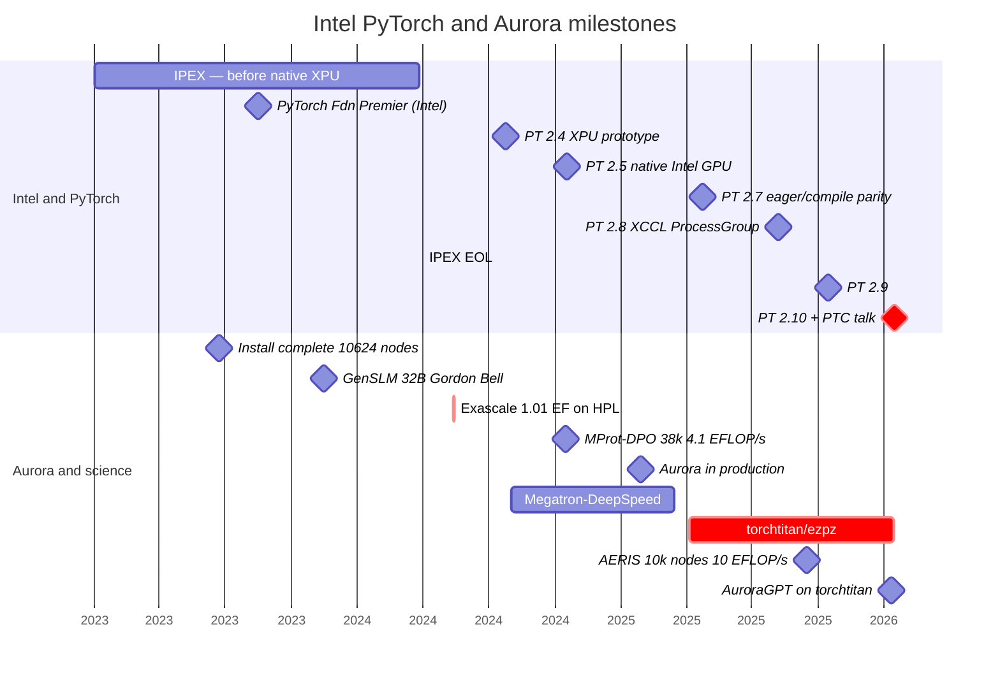
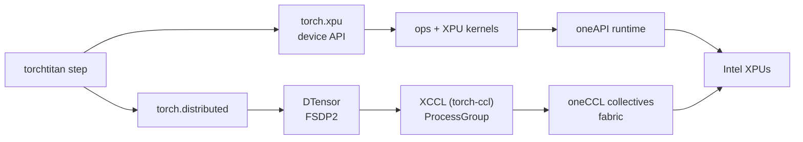
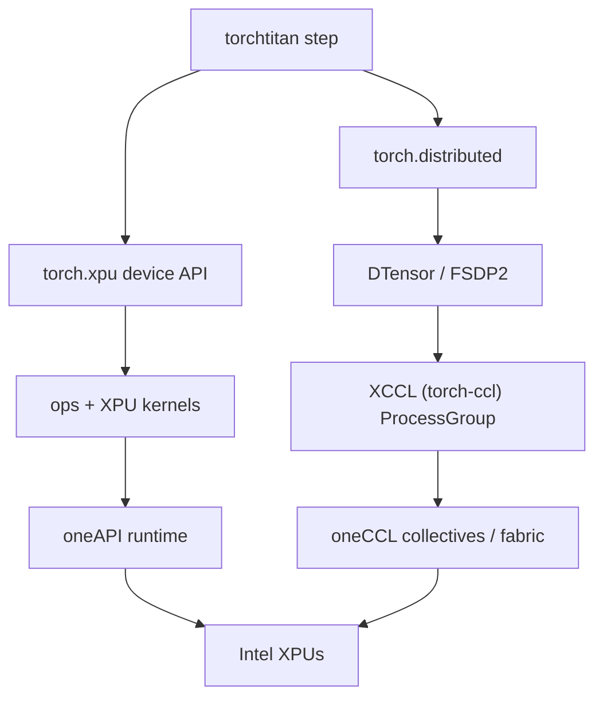
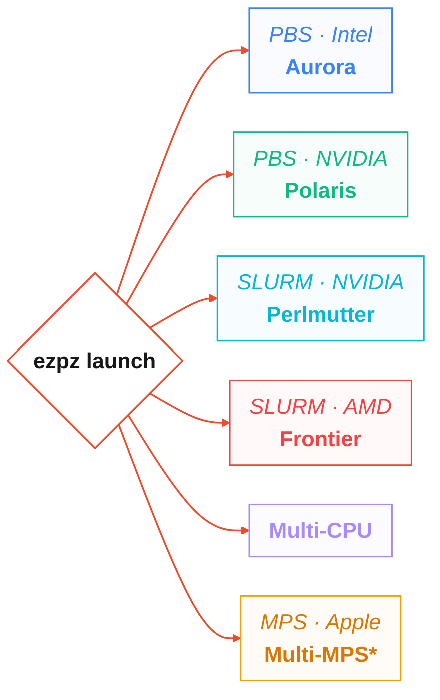
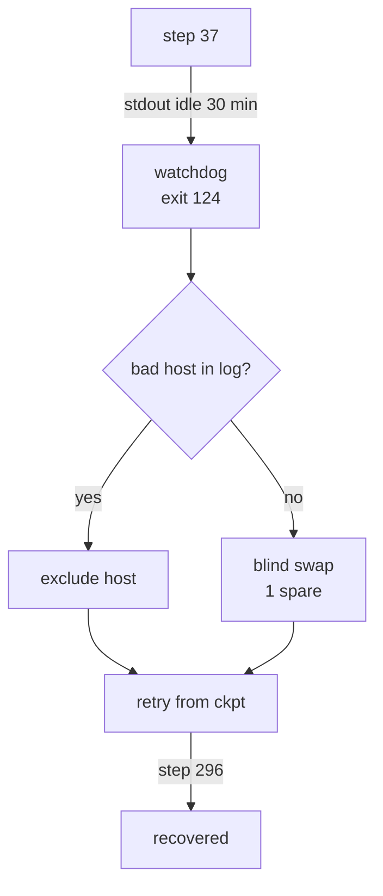
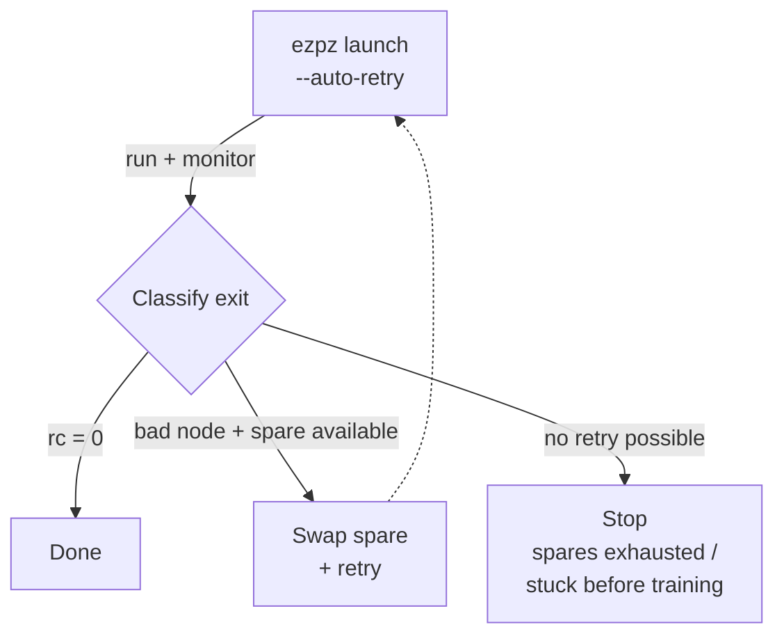
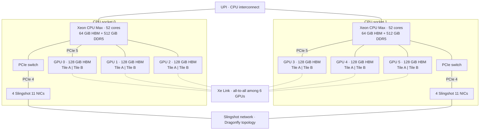

import Slide from '@/components/slides/Slide.astro'
import SpeakerNotes from '@/components/slides/SpeakerNotes.astro'

{/* ================================================================
    TALK ARC (18 slides, ~20 min + 5 Q&A)
    Thesis: Aurora jobs at ~120k GPU tiles made the backend visible — we trace
    a single XPU surface (torch.xpu → XCCL/oneCCL → DTensor/FSDP2),
    a fork-to-titan migration proved at 256→512 nodes, and the watchdog
    + failover machinery that keeps long jobs alive.
    Footer: official vector bottom-right (pytorchcon-na26-color.svg @ 2rem).
    Aurora: 10,624 nodes · 63,744 GPUs · 127,488 GPU tiles (12 per node).
    ================================================================ */}

{/* ── Title ───────────────────────────────────────────────────── */}
<Slide id="title-slide">


# Scaling PyTorch on Intel XPU

### Field notes from AI for Science on Aurora

<div class="title-authors">
    <span>Sam Foreman · Argonne National Laboratory</span>
    <span>Panagiotis Kourdis · Intel</span>
    <span>Tanima Dey · Intel</span>
</div>

<div class="title-conf-line">_PyTorch Conference · October 21, 2026 — San Jose_</div>

<a
    class="title-slide-qr"
    href="https://samf.sh/talks/2026/10/21"
    aria-label="QR code linking to these slides">
    
    <span>samf.sh/talks/2026/10/21</span>
</a>

<div class="title-affiliations" aria-label="Author affiliations">
    
    
</div>

<SpeakerNotes>
25 min total — 20 of slides, 5 for Q&A.
</SpeakerNotes>

</Slide>

{/* ── Prologue: what ALCF does ─────────────────────────────────── */}
<Slide id="context">

## Aurora at ALCF

<div class="context-layout">

| | |
| --- | --- |
| [**ALCF**](https://alcf.anl.gov) | DOE leadership computing — runs [`Aurora`](https://docs.alcf.anl.gov/aurora) + `Polaris` for open science |
| [**Aurora**](https://docs.alcf.anl.gov/aurora) | `10,624` nodes · `127,488` XPUs |
| **This talk** | Running `PyTorch` on `Aurora`: backend fixes, training, and recovery |

<figure class="context-hero">

<figcaption>Aurora at the ALCF. Photo: [Argonne / ALCF](https://www.alcf.anl.gov/sites/default/files/2025-08/34302D_110_LCF_Aurora_1600x900_0.jpg).</figcaption>
</figure>

</div>

<span class="context-xpu-definition">Here, **XPU** = one GPU tile exposed as a `torch.xpu` device in `FLAT` mode. **12 XPUs per node.**</span>

<SpeakerNotes>
`Aurora` has 10,624 nodes, 63,744 GPUs, and 127,488 GPU tiles. `INCITE`, `ALCC`, and `DD` provide research allocations. The talk covers the backend fixes, migration to `torchtitan`, and recovery work.
</SpeakerNotes>

</Slide>

{/* ── Frame: the 3-act contract ───────────────────────────────── */}


<Slide id="frame">

## Talk outline

| Part | Question | Implementation |
| --- | --- | --- |
| **A · Needed** | What does it take to build a GPU that runs PyTorch?<br/><em>What about 100,000 of them, together?</em> | <del>[`IPEX`](https://github.com/intel/intel-extension-for-pytorch)</del> (legacy) · [`torch-xpu-ops`](https://github.com/intel/torch-xpu-ops) · <span class="stack-name-nowrap">[`XCCL / torch-ccl`](https://github.com/intel/torch-ccl)</span><br/>[`oneAPI`](https://www.intel.com/content/www/us/en/developer/tools/oneapi/overview.html) · [`oneCCL`](https://github.com/oneapi-src/oneCCL) · [`SYCL`](https://www.khronos.org/sycl/) |
| **B · Accomplished** | How do you run AI for Science campaigns at scale?<br/><em>On a brand-new, rapidly evolving software stack?</em> | [`ezpz`](https://github.com/saforem2/ezpz) · [`Megatron-DeepSpeed`](https://github.com/microsoft/Megatron-DeepSpeed) · [`torchtitan/ezpz`](https://github.com/saforem2/torchtitan/tree/ezpz)<br/>`DTensor` · `FSDP2` |
| **C · Remains** | What keeps a 14-day job alive at 60k → 120k XPUs? | <em>Nobody knows!</em><br/>Best bets: [`ezpz checkpoint-restart`](https://ezpz.cool/guides/checkpoint-restart/) · watchdog · node exclusion · scheduler resubmit |


<SpeakerNotes>
The three sections cover backend fixes, the migration from `Megatron-DeepSpeed`, and long-running job recovery.
</SpeakerNotes>

</Slide>

{/* ── Prologue: why scale matters (60s) ───────────────────────── */}
<Slide id="prologue">

## Scientific AI on Aurora

| Workload | Scale / result |
| --- | --- |
| [GenSLM](https://journals.sagepub.com/doi/10.1177/10943420231201154) — viral genomes | Polaris + Cerebras · Gordon Bell |
| [MProt-DPO](https://www.alcf.anl.gov/news/argonne-team-breaks-new-ground-ai-driven-protein-design) — protein design | 38,400 ranks · 4.11 EFLOP/s at 3,200 nodes |
| [AERIS](https://arxiv.org/abs/2509.13523) — weather diffusion | 10,080 nodes · 10.21 EFLOP/s · 90-day stable rollouts |
| [AuroraGPT](https://samf.sh/talks/2026/08/03/) — foundation LLM | 7.77T-token `MDS` reference → [torchtitan](https://github.com/saforem2/torchtitan/tree/ezpz) |

[`ezpz`](https://github.com/saforem2/ezpz): same training program on `Intel`, `NVIDIA`, `AMD`.[^aurora]

[^aurora]: [ALCF Aurora](https://www.alcf.anl.gov/aurora) · [ALCF PyTorch tile-as-device configuration](https://docs.alcf.anl.gov/aurora/data-science/frameworks/pytorch/) · [ALCF support — Aurora](https://www.alcf.anl.gov/support-center/aurora) · [`torchtitan/ezpz`](https://github.com/saforem2/torchtitan/tree/ezpz) · [AuroraGPT companion](https://samf.sh/talks/2026/08/03/).

<SpeakerNotes>
`GenSLM` predates the native `XPU` backend. `AERIS` uses its own training stack. Credit the individual science teams, `ALCF`, and `Intel`.
</SpeakerNotes>

</Slide>

{/* ── A0: when the backend landed ───────────────────────────── */}
<Slide id="timeline">

## PyTorch XPU and Aurora timeline

<div class="timeline-mobile" aria-label="Key milestones from 2023 to 2026">
  <div><strong>2023</strong><span>IPEX before native XPU · Aurora installation complete · GenSLM Gordon Bell</span></div>
  <div><strong>2024</strong><span>PyTorch 2.4 XPU prototype → 2.5 native Intel GPU · Aurora reaches exascale</span></div>
  <div><strong>2025</strong><span>PyTorch eager/compile parity and XCCL ProcessGroup · Aurora enters production · AERIS at 10k nodes</span></div>
  <div><strong>2026</strong><span>PyTorch 2.10 + XPU · AuroraGPT on torchtitan/ezpz</span></div>
</div>



<span class="timeline-caption"><span class="timeline-lanes">**Intel and PyTorch** — IPEX → PT 2.4–2.10+XPU (4 releases)</span> · <span class="timeline-lanes">**Aurora and science** — 10k nodes → 120k-XPU workloads</span><br/>From [ezpz: distributed PyTorch across any hardware](https://samf.sh/posts/2026/01/10/) plus verified Aurora dates.</span>

<SpeakerNotes>
The upper lane tracks `Intel` and `PyTorch`; the lower lane tracks `Aurora` and the science workloads. The linked write-up contains the release chronology.
</SpeakerNotes>

</Slide>

{/* ── A1: what a first-class backend required ─────────────────── */}
<Slide id="backend-path">

## PyTorch XPU backend components

<div class="backend-mermaid-desktop">



</div>
<div class="backend-mermaid-mobile">



</div>

<div class="backend-caption">

Test the device API, kernels, and collectives together.
`IPEX` shims → [native `torch.xpu`](https://pytorch.org/docs/stable/notes/xpu.html) + [`torch-ccl`/`XCCL`](https://github.com/intel/torch-ccl) + [`oneCCL`](https://github.com/oneapi-src/oneCCL)

</div>

[^xpu]: [PyTorch XPU docs](https://pytorch.org/docs/stable/notes/xpu.html) · [Intel torch-ccl (XCCL)](https://github.com/intel/torch-ccl) · [oneAPI oneCCL](https://github.com/oneapi-src/oneCCL) · [PyTorch distributed overview](https://pytorch.org/docs/stable/distributed.html) · [The two timelines](https://samf.sh/posts/2026/01/10/#the-two-timelines)

<SpeakerNotes>
Co-authors: Panagiotis Kourdis and Tanima Dey, Intel — XCCL/`oneCCL` layer. Distinguish "API exists" from "collective scales and timeout fires."
</SpeakerNotes>

</Slide>

{/* ── A2: where it broke (3 concrete bugs) ────────────────────── */}
<Slide id="xpu-gaps" size="sm">

## XPU integration issues

| Symptom | Root cause | What we run now |
| --- | --- | --- |
| `torch 2.13`: `expected DTensor, got plain tensor` on FSDP wrap | Missing [pytorch#181519](https://github.com/pytorch/pytorch/pull/181519) | Fixed in `2.14.0+xpu` |
| `DeviceMesh` → `does not support splitting` | `ProcessGroupXCCL` inherits `supportsSplitting() == false` (see [pytorch#186548](https://github.com/pytorch/pytorch/issues/186548)) | Local shim · [pytorch#186548](https://github.com/pytorch/pytorch/issues/186548) |
| `train_timeout_seconds` is a no-op | `_set_pg_timeout` has no `xpu` branch — `XCCL` stores the timeout, never arms it | Watchdog heartbeat (Act C) + two-PR upstream |

The `CUDA` path worked. The `XPU` path inherited defaults that needed fixing.

<SpeakerNotes>
Not missing kernels — missing dispatch branches. Every row is a real commit and issue.
</SpeakerNotes>

</Slide>

{/* ── A3: why we had to leave the fork ───────────────────────── */}
<Slide id="why-fork-broke">

## From Megatron-DeepSpeed to torchtitan

| [Megatron-DeepSpeed fork](https://github.com/microsoft/Megatron-DeepSpeed)[^mds] | [`torchtitan`](https://github.com/pytorch/torchtitan) + `DTensor` + `FSDP2` |
| --- | --- |
| `2B` trained to `7.77T` tokens ([Aug talk](https://samf.sh/talks/2026/08/03/)) | Same run continues on `torchtitan` — `4.67T` at `256`→`512` nodes |
| Parallelism baked into the fork | [`DTensor`](https://pytorch.org/tutorials/intermediate/DTensor_tutorial.html) + [`FSDP2`](https://pytorch.org/blog/pytorch2-feature-class-of-2024/) as composable primitives |
| Every PT release → rebase + patch audit | XPU integration in separate layers · [`torchtitan/ezpz`](https://github.com/saforem2/torchtitan/tree/ezpz) |

The fork trained the `2B` model to **7.77T tokens**. Each `PyTorch` upgrade required another rebase and patch audit.

[^mds]: [Megatron-DeepSpeed](https://github.com/microsoft/Megatron-DeepSpeed) · [torchtitan upstream](https://github.com/pytorch/torchtitan) · [AuroraGPT companion — `MDS` training](https://samf.sh/talks/2026/08/03/).

<SpeakerNotes>
The `Megatron-DeepSpeed` fork trained the `2B` reference to 7.77T tokens. The move to `torchtitan` reduced the framework-specific maintenance. The table separates the completed run from the later continuations.
</SpeakerNotes>

</Slide>

{/* ── A4: one program across vendors ──────────────────────────── */}
<Slide id="portable-training">

## One training program across vendors

<div class="portable-demo">

<div class="portable-demo-col">

**Hello world:**

```python
# example.py
import torch
import ezpz
rank = ezpz.setup_torch()
world_size = ezpz.get_world_size()
dev = ezpz.get_torch_device()      # {xpu, cuda, cpu, ...}
# FSDP2 by default — accepts DeviceMesh
model = ezpz.wrap_model(torch.nn.Linear(128, 10).to(dev))
print(f"Hello from {rank}/{world_size}!")
```

```bash
$ ezpz launch python3 example.py
Hello from rank 0/24!
Hello from rank 1/24!
# ... etc
```

<details class="portable-extra">
<summary>Other examples</summary>

```bash
# your own script — no changes needed
ezpz launch python3 your_training_script.py
# full HF model + dataset via ezpz examples
ezpz launch python3 -m ezpz.examples.fsdp_tp \
    --dataset=allenai/olmo-mix-1124
    --model=meta-models/Muse-Spark-Open-816B-A42B \
    --local-batch-size=1
    # ...etc
```
</details>

</div>

<div class="portable-demo-col">

Same command on every machine — [`ezpz`](https://github.com/saforem2/ezpz) picks the backend.


*\*`mccl` — [mps-ddp/mccl](https://github.com/mps-ddp/mccl): `MPS` on Apple silicon — `ezpz launch` even on a laptop.*

</div>

</div>


<style>{`
  #session-feedback .slide-inner { align-items: center; text-align: center; }
  #session-feedback .session-feedback-qr { display: flex; flex: 1; min-height: 0; justify-content: center; align-items: center; width: 100%; background: none; }
  #session-feedback .session-feedback-qr img { display: block; width: auto; height: auto; max-width: 100%; max-height: 58vh; object-fit: contain; background: white; }

  #portable-training .portable-demo-col em { font-size: 0.75em; color: var(--foreground2); line-height: 1.3; display: block; margin-block-start: 0.15lh; }
  #portable-training .portable-demo { align-items: start; }
  #portable-training .portable-demo-col:last-child { align-self: center; }
  @media screen and (min-width: 769px) {
    #portable-training .portable-demo-col pre.astro-code { font-size: 0.72em; }
  }
  /* Title QR: on screen the pill sits inside the QR block's flow, but in
     print the 16:9 sheet is narrower and the pill's nowrap spills left over
     the author line. In print, center it under the QR code at half scale. */
  @media print {
    [data-deck-theme='pytorch'] #title-slide .title-slide-qr span {
      font-size: 0.52em !important;
      letter-spacing: 0;
      padding: 0.08ch 0.5ch;
    }
  }
`}</style>

<SpeakerNotes>
`AMD` uses the `CUDA` API in `PyTorch`; launch and environment settings still differ. `ezpz launch` handles the machine-specific launch path. `mccl` supplies the distributed `MPS` backend on Apple silicon.
</SpeakerNotes>

</Slide>

{/* ── A5: benchmark the real path ───────────────────────────── */}
<Slide id="measure-backend">

## Benchmark the training step

1. Fix the build, model, batch size, precision, and node count.
2. Run the same training step on each backend.
3. Measure step time, tokens/s, collective time, and memory.
4. Increase node count. Rerun after kernel or collective changes.

> An op test can pass while the distributed training step hangs.

Check loss and throughput at each node count. Test timeout and recovery behavior separately.[^bench]

[^bench]: [PyTorch profiler (`torch.profiler`)](https://pytorch.org/tutorials/beginner/profiler.html) · [PyTorch `torch.xpu`](https://pytorch.org/docs/stable/notes/xpu.html)

<SpeakerNotes>
Record the build, model, batch size, precision, and node count with each measurement. Check loss as well as throughput.
</SpeakerNotes>

</Slide>

{/* ── B1: what moved ─────────────────────────────────────────── */}
<Slide id="what-moved" size="sm">

## Changes in the `torchtitan` training stack

| Layer | Before (MDS fork + [`ezpz`](https://github.com/saforem2/ezpz)) | After ([`torchtitan/ezpz`](https://github.com/saforem2/torchtitan/tree/ezpz)) |
| --- | --- | --- |
| Parallelism | Custom tensor-parallel + pipeline in fork | [`FSDP2`](https://pytorch.org/blog/pytorch2-feature-class-of-2024/) + [`DTensor`](https://pytorch.org/docs/stable/distributed.tensor.html) sharding |
| Collectives | DeepSpeed's `NCCL` assumptions | `XCCL` ([`torch-ccl`](https://github.com/intel/torch-ccl)) → [`oneCCL`](https://github.com/oneapi-src/oneCCL) |
| Kernels | Fork-local fused kernels | `XPU` kernels via `torch.xpu` — `layernorm+residual` moved; `attn`/`MLP`/`optimizer` remain[^kernels] |
| Launch | Already [`ezpz`](https://github.com/saforem2/ezpz) — scheduler → nodes → `MPI` | Same [`ezpz`](https://github.com/saforem2/ezpz)[^ezpz] — [`launch`](https://ezpz.cool/cli/launch/) + [`checkpoint-restart`](https://ezpz.cool/guides/checkpoint-restart/) |
| Checkpoint | `DeepSpeed` engine save | `DCP` ([`torch.distributed.checkpoint`](https://pytorch.org/docs/stable/distributed.checkpoint.html)) |

`ezpz` stayed in place. Parallelism, collectives, and checkpoints moved out of the fork.

[^kernels]: `layernorm+residual` landed in `torch.xpu`; `attn`/`MLP`/`optimizer` remain — composable kernels must survive [`torch.compile`](https://pytorch.org/docs/stable/torch.compiler.html).
[^ezpz]: [`ezpz`](https://github.com/saforem2/ezpz) is the cross-workload launcher: `qsub`/`sbatch` → node list → `MPI` on Aurora+Sunspot/Polaris. Same before and after the framework switch.

<SpeakerNotes>
`layernorm+residual` moved upstream. Fused attention, MLP, and optimizer kernels remain. `ezpz` handled launch before and after the migration.
</SpeakerNotes>

</Slide>

{/* ── B2: testing at every layer ─────────────────────────────── */}
<Slide id="layer-tests" size="sm">

## Testing at every layer

| Layer | Gate | Link |
| --- | --- | --- |
| Numerics | 50-step loss — `±0.10` on final + last-10 mean | [Production loss figure](https://samf.sh/talks/2026/08/03/) |
| Collectives | XCCL ladder `48 → 768` ranks, value-checked | [`ezpz/test_dist.py`](https://github.com/saforem2/ezpz/blob/main/ezpz/test_dist.py) |
| Parallelism | TP1 / TP2 / MoE on Aurora; parity on Sunspot | [`experiments/ezpz`](https://github.com/saforem2/torchtitan/tree/ezpz) |
| Portability | One gate on Aurora + Sunspot + Polaris + Perlmutter | [`ezpz`](https://github.com/saforem2/ezpz) |
| Orchestration | Failover harness — 9 fixtures | [Failover writeup](https://github.com/saforem2/torchtitan/blob/ezpz/torchtitan/experiments/ezpz/docs/experiments/agpt/aurora/20260523-failover-silent-hang-recovery-8505298.md) |

The streaming loader contributes `~0.05` loss variation from shuffle order. The 50-step check uses a `±0.10` tolerance.

<SpeakerNotes>
The loss gate caught silent gradient bugs that loaded, sharded, and timed correctly.
</SpeakerNotes>

</Slide>

{/* ── B3: does the new stack train? ──────────────────────────── */}
<Slide id="migration-evidence">

## AuroraGPT: production training progress

<div class="project-figure">
    <picture>
        <source media="(max-width: 768px)" srcset="/talks/2026-10-21/figures/agpt-2b-progress-mobile.svg" />
        
    </picture>
    <div class="plot-legend-mobile" aria-label="Chart series: shown tokens and raw training loss">
        <span class="plot-legend-heading">Shown tokens / raw loss</span>
        <span class="plot-legend-row"><span class="plot-swatch plot-reference">2B MDS reference</span><span>7.771T / 2.033</span></span>
        <span class="plot-legend-row"><span class="plot-swatch plot-stage-one">2B 256N stage 1</span><span>4.674T / 2.652</span></span>
        <span class="plot-legend-row"><span class="plot-swatch plot-stage-one plot-dashed">2B 512N stage 1</span><span>4.674T / 2.687</span></span>
        <span class="plot-legend-row"><span class="plot-swatch plot-stage-two">2B 256N stage 2</span><span>6.085T / 2.469</span></span>
        <span class="plot-legend-row"><span class="plot-swatch plot-stage-two plot-dashed">2B 512N stage 2</span><span>6.927T / 2.481</span></span>
        <span class="plot-legend-note">Solid: 256 nodes · dashed: 512 nodes. Training mixes differ.</span>
    </div>
</div>

Stage 2: **6.927T** cumulative tokens on 512 nodes · **6.085T** on 256 nodes.

<div class="production-pointer">

[Production runs and training logs](https://github.com/saforem2/torchtitan/blob/ezpz/torchtitan/experiments/ezpz/docs/production/README.md) · Paper forthcoming at the **TPC workshop, SC26**.

</div>

<SpeakerNotes>
The chart shows five production and reference trajectories from the selected dashboard view. The separate 200-step LR 3.22e-5 probe is omitted: it ends at loss 5.998, above the main plot range, and does not show stage-2 progress. Stage-2 token counts include their stage-1 checkpoints. Loss changes across stage boundaries include a data-mix change; this is training loss, not a held-out quality comparison. The dashboard upstream was unavailable; all 58 registered W&B runs were checked directly and remain terminal, with the newest logged samples on September 17, 2026.

For more on the trials and tribulations of TorchTitan on Aurora, see [_Pre-Training LLMs on a Supercomputer_ — ATPESC August 2026](https://samf.sh/talks/2026/08/03/) · [`torchtitan/ezpz` experiments](https://github.com/saforem2/torchtitan/tree/ezpz) · [`ezpz`](https://github.com/saforem2/ezpz)
</SpeakerNotes>

</Slide>

{/* ── C1: a healthy process can still be a dead job ─────────── */}
<Slide id="operations">

## Detecting and recovering from stalled jobs

**Job `8505298`** — step 37, then silence. No traceback. Watchdog at 30 min (`exit 124`), wrapper swapped a node, relaunched. Attempt 2 reached step 296.



<div class="operations-mobile" aria-label="Stalled job recovery flow">
    <div><strong>Step 37</strong><span>Training output stops for 30 minutes.</span></div>
    <div><strong>Watchdog</strong><span>Exits with code <code>124</code>.</span></div>
    <div><strong>Check the log</strong><span>Bad host found → exclude it. No bad host → swap in one spare.</span></div>
    <div><strong>Retry</strong><span>Resume from the checkpoint.</span></div>
    <div><strong>Recovered</strong><span>Attempt 2 reaches step 296.</span></div>
</div>

`_set_pg_timeout` has no `xpu` branch — timeout is stored, never enforced.[^hang]

[^hang]: [Failover incident — 8505298](https://github.com/saforem2/torchtitan/blob/ezpz/torchtitan/experiments/ezpz/docs/experiments/agpt/aurora/20260523-failover-silent-hang-recovery-8505298.md)

<SpeakerNotes>
Watchdog measures stdout progress, not the collective timeout. The `XPU` gaps slide names the missing branch.
</SpeakerNotes>

</Slide>

{/* ── C2: failure taxonomy ───────────────────────────────────── */}
<Slide id="failure-taxonomy">

## Failure modes at ~120k XPUs

| Mode | Signal | What helps | What doesn't |
| --- | --- | --- | --- |
| **Silent hang** | Stdout stalls, no error | Watchdog on log progress | `_set_pg_timeout` (`xpu` never arms) |
| **Lost collective** | Rank times out in `XCCL` | Node exclude + retry | Retrying on the same host |
| **Crash / OOM** | Traceback + exit code | Process restart from `ckpt` | Scheduler resubmit alone |
| **Stale FS / DCP** | Checkpoint read stalls | Async save + local staging | Sync save on shared `FS` at 10k ranks |

Test node exclusion, checkpoint reload, and scheduler resubmission before a long run.[^tax]

[^tax]: [Failover incident — 8505298](https://github.com/saforem2/torchtitan/blob/ezpz/torchtitan/experiments/ezpz/docs/experiments/agpt/aurora/20260523-failover-silent-hang-recovery-8505298.md) · [ezpz docs](https://ezpz.cool)

<SpeakerNotes>
The taxonomy is the mental model. The next two slides cover the two rows you hit weekly.
</SpeakerNotes>

</Slide>

{/* ── C3: layered restarts ───────────────────────────────────── */}
<Slide id="layered-restarts">

## Process, node, and allocation restarts

<div class="recovery-summary">
<div>

| Layer | Scope | Trigger | Cost of being wrong |
| --- | --- | --- | --- |
| Process | 1 rank | Crash / OOM | Tokens since last ckpt |
| Node | 12 XPUs | Hang on one host | 1 node's work + re-shard |
| Allocation | 10k nodes | Bad FS / scheduler | Whole-job walltime |

</div>
<div class="recovery-explanation">

`ezpz` handles node and allocation restarts: [`checkpoint-restart`](https://ezpz.cool/guides/checkpoint-restart/) + node exclude + scheduler resubmit. `DCP` writes the checkpoints.

Test each restart path before committing a full allocation.

</div>
</div>

<div class="layered-visual">



<span class="layered-visual-caption">Exit trailer + crash patterns + idle watchdog (`exit 124`) determine the next action.</span>

</div>

<SpeakerNotes>
Re-shard is not free: DeviceMesh rebuild is part of the cost model. The table distinguishes recovery scopes; the diagram shows the auto-retry control flow adapted from the TPC workshop paper. After each attempt, parse the exit trailer and match crash patterns, including SIGTERM and the idle watchdog's exit 124. A successful exit terminates the loop. When a bad node is identified and a spare is available, swap it and retry. Stop when no retry is possible, including exhausted spares or failure before training. This is a summary, not a claim that every nonzero exit is a bad node.
</SpeakerNotes>

</Slide>

{/* ── C4: what's still hard ──────────────────────────────────── */}
<Slide id="remaining-work">

## Remaining XPU gaps

| Layer | Gap | What's needed |
| --- | --- | --- |
| Kernels | Fused attn + MLP + optimizer across XPU | Composable kernels compatible with `torch.compile` |
| Collectives | Tuning, diagnostics, **real timeouts** | `XCCL` timeout enforcement + `DTensor` split fix upstream |
| Checkpoints | Async `DCP` at 10k ranks without `FS` collapse | Local staging → async flush |
| Operations | Detect bad nodes during the run | Heartbeat at the `ProcessGroup` level, not stdout `grep` |

Run the training step, save a checkpoint, interrupt the job, and resume it.

[^dcp]: [Distributed Checkpoint (DCP)](https://pytorch.org/docs/stable/distributed.checkpoint.html) · [torch.compile on XPU](https://pytorch.org/docs/stable/torch.compiler.html)

<SpeakerNotes>
Honest about upstream vs local shim. The last line is the most actionable takeaway.
</SpeakerNotes>

</Slide>

{/* ── Takeaway ───────────────────────────────────────────────── */}
<Slide id="takeaways">

## Bringing up the next accelerator

1. Test compute and collectives together.
2. Use the same training program on each machine.
3. Compare loss against the reference run.
4. Measure full training steps at scale.
5. Interrupt, restart, and check the resumed loss.

<SpeakerNotes>
Run the same training code on each machine. Check loss against the reference. Measure complete steps at the target scale. Test checkpoint reload and recovery before the long run.
</SpeakerNotes>

</Slide>

{/* ── QR: links ─────────────────────────────────────────────── */}
<Slide id="links">

## Links and further reading

<div class="links-grid">

| Stack | Link |
| --- | --- |
| [`ezpz`](https://github.com/saforem2/ezpz) | [Launch](https://ezpz.cool/cli/launch/) · [Checkpoint](https://ezpz.cool/guides/checkpoint-restart/) · [All docs](https://ezpz.cool) |
| [`torchtitan/ezpz`](https://github.com/saforem2/torchtitan/tree/ezpz) | [Experiments](https://github.com/saforem2/torchtitan/tree/ezpz/torchtitan/experiments/ezpz) · [Failover writeup](https://github.com/saforem2/torchtitan/blob/ezpz/torchtitan/experiments/ezpz/docs/experiments/agpt/aurora/20260523-failover-silent-hang-recovery-8505298.md) |
| PyTorch XPU | [`torch.xpu`](https://pytorch.org/docs/stable/notes/xpu.html) · [`DTensor`](https://pytorch.org/tutorials/intermediate/DTensor_tutorial.html) · [`FSDP2`](https://pytorch.org/blog/pytorch2-feature-class-of-2024/) · [DCP](https://pytorch.org/docs/stable/distributed.checkpoint.html) |
| Distributed | [`torch-ccl` / XCCL](https://github.com/intel/torch-ccl) · [`oneCCL`](https://github.com/oneapi-src/oneCCL) · [torch.distributed](https://pytorch.org/docs/stable/distributed.html) |
| System | [Aurora](https://www.alcf.anl.gov/aurora) · [ALCF support — Aurora](https://www.alcf.anl.gov/support-center/aurora) · [ALCF news — 120k-tile scale](https://www.alcf.anl.gov/news/aeris-earth-systems-model-pushes-ai-science-new-heights) |
| Science | [AuroraGPT companion](https://samf.sh/talks/2026/08/03/) · [AERIS](https://arxiv.org/abs/2509.13523) · [MProt-DPO](https://www.alcf.anl.gov/news/argonne-team-breaks-new-ground-ai-driven-protein-design) · [GenSLM](https://journals.sagepub.com/doi/10.1177/10943420231201154) |

</div>

<p class="links-reading">Further reading: [`ezpz` portability](https://samf.sh/posts/2026/01/10/) · [Launching 50k processes](https://samf.sh/posts/2026/05/01/) · [Data and training at ALCF](https://samf.sh/posts/2025/09/12/)</p>

<SpeakerNotes>
The table links the stack, systems, and science references. The three write-ups below cover portability, large process launches, and data and training at ALCF. The AuroraGPT companion talk is linked in the Science row; the upcoming TPC paper is called out on the production chart slide.
</SpeakerNotes>

</Slide>

{/* ── Acknowledgements ─────────────────────────────────────── */}
<Slide id="acks">

## Acknowledgements

This work used resources of the **Argonne Leadership Computing Facility**, a DOE Office of Science user facility at Argonne National Laboratory, supported under contract **DE-AC02-06CH11357**.

**Aurora** was built in partnership with **HPE** and **Intel** — Intel Max 1550 XPU (`PVC`), `oneAPI` / `oneCCL` / `XCCL`, and the upstream `torch.xpu` work tracked in Act A. Thanks to the ALCF operations and support teams, the `PyTorch` and `torchtitan` maintainers, and the science teams behind `GenSLM`, `MProt-DPO`, `AERIS`, and `AuroraGPT`.

<div class="acks-grid">

| | |
| --- | --- |
| Facility | [ALCF](https://www.alcf.anl.gov) · [Aurora](https://www.alcf.anl.gov/aurora) · [Polaris](https://www.alcf.anl.gov/polaris) |
| Partners | [HPE](https://www.hpe.com) · [Intel](https://www.intel.com) (Max 1550 / `oneAPI` / `oneCCL`) · [PyTorch Foundation](https://pytorch.org/foundation) |
| Teams | `GenSLM` · `MProt-DPO` · `AERIS` · `AuroraGPT` <span class="ack-reference">— see <a href="#links">Links</a> for papers</span> |

</div>

<SpeakerNotes>
DOE contract: DE-AC02-06CH11357. Acknowledge the `ALCF` operations and support teams, `Intel`, the `PyTorch` and `torchtitan` maintainers, and the science teams.
</SpeakerNotes>

</Slide>

{/* ── Get time on Aurora ───────────────────────────────────── */}
<Slide id="allocations">

## Aurora allocation programs

**Anyone** (!) can apply for time on any of the `ALCF` systems, including our [AI Testbed](https://www.alcf.anl.gov/alcf-ai-testbed)!

<div class="alloc-grid">

| Program | Best for | Cadence |
| --- | --- | --- |
| [**INCITE**](https://www.doeleadershipcomputing.org/proposal/call-for-proposals/) | Large, peer-reviewed science campaigns | Annual |
| [**ALCC**](https://www.doeleadershipcomputing.org/proposal/call-for-proposals/) | DOE-mission-aligned projects | Annual |
| [**Director's Discretionary (DD)**](https://www.alcf.anl.gov/directors-discretionary-allocation-program) | Porting, benchmarking, getting started — **start here** | Rolling, weeks |

</div>

For a `DD` proposal, find me after the talk: `foremans@anl.gov` / [@saforem2](https://github.com/saforem2).

<div class="alloc-links">

[ALCF allocations overview](https://www.alcf.anl.gov/science/allocations) · [DD program details](https://www.alcf.anl.gov/directors-discretionary-allocation-program) · [ALCF support center](https://www.alcf.anl.gov/support-center)

</div>

<SpeakerNotes>
`DD` allocations support porting, benchmarking, and initial experiments. `INCITE` and `ALCC` are annual calls.
</SpeakerNotes>

</Slide>

<Slide id="next-systems">

## Next at ALCF: Solstice and Equinox

Announced with NVIDIA and Oracle:

| System | Planned accelerators |
| --- | --- |
| **Equinox** | **10,000** NVIDIA Blackwell GPUs |
| **Solstice** | **100,000** NVIDIA Blackwell GPUs |

The hardware, fabrics, launchers, networks, and file systems keep changing.

The same training code still needs to launch, communicate, checkpoint, and recover at scale.

<div class="alloc-links">

[NVIDIA / Oracle / DOE announcement · October 2025](https://nvidianews.nvidia.com/news/nvidia-oracle-us-department-of-energy-ai-supercomputer-scientific-discovery)

</div>

<SpeakerNotes>
The GPU counts are announced plans. Check device support, collectives, launch, data loading, checkpoint I/O, and recovery on each system. Do not infer production availability from the announcement.
</SpeakerNotes>

</Slide>

<Slide id="aurora-node">

## Backup: inside an Aurora node

<div class="node-mobile" aria-label="Aurora node topology summary">
  <div><strong>CPU socket 0</strong><span>Xeon CPU Max · 3 GPUs · 4 Slingshot NICs</span></div>
  <div><strong>CPU socket 1</strong><span>Xeon CPU Max · 3 GPUs · 4 Slingshot NICs</span></div>
  <p>Each GPU has <strong>2 tiles</strong> and 128 GiB HBM. The six GPUs connect through Xe Link; the CPUs connect through UPI.</p>
</div>



**6 GPUs × 2 tiles = 12 `torch.xpu` devices** in `FLAT` mode. GPU Max 1550 (`PVC`), 768 GiB GPU HBM per node.

<div class="node-source">

Logical schematic, not a wiring diagram. Xe Link connections grouped. [ALCF node topology](https://docs.alcf.anl.gov/aurora/images/aurora_node_dataflow.png) · [Machine overview](https://docs.alcf.anl.gov/aurora/) · [PyTorch tile configuration](https://docs.alcf.anl.gov/aurora/data-science/frameworks/pytorch/)

</div>

<SpeakerNotes>
Two CPU sockets, three GPUs per socket, two tiles per GPU. The tile labels are local to each GPU; they are not runtime device ordinals. In FLAT mode PyTorch exposes the 12 tiles as devices. Xe Link connects all six GPUs; the central label groups those connections and is not a physical switch. Each CPU connects to a PCIe switch serving four Slingshot NICs. GPU traffic can reach the NICs without copying through host memory. The GPU memory total is 6 times 128 GiB, or 768 GiB.
</SpeakerNotes>

</Slide>

<Slide id="session-feedback">

## Session feedback

Scan to share feedback with us and the organizers.

<a class="session-feedback-qr" href="https://sfeedback.com/9H5heU" aria-label="Give feedback on this session">
    
</a>

</Slide>

<style>{`
  #aurora-node { --mermaid-max-height: 57vh; }
  .node-mobile, .timeline-mobile { display: none; }
  #aurora-node .mermaid { margin-block: 0.2lh; }
  #aurora-node .slide-inner > p { font-size: 0.85em; margin-block: 0.3lh; }
  #aurora-node .node-source { font-size: 0.6em; line-height: 1.3; }

  #title-slide .title-affiliations { position: absolute !important; width: max-content; right: auto; left: 4ch; bottom: 24px; display: flex; align-items: center; gap: 32px; padding: 0; background: transparent; }
  #title-slide .title-affiliations img { display: block; height: auto; object-fit: contain; filter: none !important; margin: 0; }
  #title-slide .title-anl-logo { width: 170px; }
  #title-slide .title-intel-logo { width: 96px; }
  @media print {
    #title-slide .title-affiliations { left: 4ch !important; bottom: 20px !important; gap: 26px; padding: 0; }
    #title-slide .title-anl-logo { width: 140px; }
    #title-slide .title-intel-logo { width: 78px; }
  }

  #frame .frame-legacy-note { font-size: 0.65em; margin-block-start: 0.3lh; }
  #frame .stack-name-nowrap { white-space: nowrap; }
  #frame table { table-layout: fixed; width: 100%; font-size: 0.9em; }
  #frame th:first-child, #frame td:first-child { width: 18%; white-space: normal; }
  #frame th:nth-child(2), #frame td:nth-child(2) { width: 30%; min-width: 0; }
  #frame th:last-child, #frame td:last-child { width: 54%; }
  #frame th, #frame td { word-break: normal; overflow-wrap: break-word; hyphens: none; }
  #prologue table { table-layout: fixed; width: 100%; font-size: 0.86em; }
  #prologue th:first-child, #prologue td:first-child { width: 32%; white-space: normal; }
  #prologue th:last-child, #prologue td:last-child { width: 68%; }
  #prologue th, #prologue td { word-break: normal; overflow-wrap: break-word; hyphens: none; }
  #why-fork-broke table { width: 100%; table-layout: fixed; }
  #why-fork-broke th, #why-fork-broke td { width: 50%; word-break: normal; overflow-wrap: break-word; hyphens: none; }
  @media (max-width: 768px) {
    #why-fork-broke table { table-layout: fixed; font-size: 0.82em; }
    #why-fork-broke th, #why-fork-broke td { word-break: break-word; overflow-wrap: anywhere; }
    #why-fork-broke table { display: block; overflow-x: auto; -webkit-overflow-scrolling: touch; }
    #why-fork-broke th:first-child, #why-fork-broke td:first-child { width: 44% !important; }
    #why-fork-broke th:last-child, #why-fork-broke td:last-child { width: 56% !important; }
  }
  #what-moved table { table-layout: fixed; width: 100%; }
  #what-moved th:first-child, #what-moved td:first-child { width: 18%; }
  #what-moved th:nth-child(2), #what-moved td:nth-child(2) { width: 40%; }
  #what-moved th:last-child, #what-moved td:last-child { width: 42%; }
  #what-moved th, #what-moved td { word-break: normal; overflow-wrap: break-word; hyphens: none; }
  #xpu-gaps table { table-layout: fixed; width: 100%; }
  #xpu-gaps th:first-child, #xpu-gaps td:first-child { width: 36%; }
  #xpu-gaps th:nth-child(2), #xpu-gaps td:nth-child(2) { width: 32%; }
  #xpu-gaps th:last-child, #xpu-gaps td:last-child { width: 32%; }
  #xpu-gaps th, #xpu-gaps td { word-break: normal; overflow-wrap: break-word; hyphens: none; }
  #layer-tests table { table-layout: fixed; width: 100%; font-size: 0.88em; }
  #layer-tests th:first-child, #layer-tests td:first-child { width: 18%; }
  #layer-tests th:nth-child(2), #layer-tests td:nth-child(2) { width: 44%; }
  #layer-tests th:last-child, #layer-tests td:last-child { width: 38%; }
  #layer-tests th, #layer-tests td { word-break: normal; overflow-wrap: break-word; hyphens: none; }
  #failure-taxonomy table { table-layout: fixed; width: 100%; font-size: 0.86em; }
  #failure-taxonomy th:nth-child(1), #failure-taxonomy td:nth-child(1) { width: 16%; }
  #failure-taxonomy th:nth-child(2), #failure-taxonomy td:nth-child(2) { width: 24%; }
  #failure-taxonomy th:nth-child(3), #failure-taxonomy td:nth-child(3) { width: 30%; }
  #failure-taxonomy th:nth-child(4), #failure-taxonomy td:nth-child(4) { width: 30%; }
  #failure-taxonomy th, #failure-taxonomy td { word-break: normal; overflow-wrap: break-word; hyphens: none; }
  #layered-restarts table { table-layout: fixed; width: 100%; }
  #layered-restarts th:nth-child(1), #layered-restarts td:nth-child(1) { width: 14%; }
  #layered-restarts th:nth-child(2), #layered-restarts td:nth-child(2) { width: 18%; }
  #layered-restarts th:nth-child(3), #layered-restarts td:nth-child(3) { width: 28%; }
  #layered-restarts th:nth-child(4), #layered-restarts td:nth-child(4) { width: 40%; }
  #layered-restarts th, #layered-restarts td { word-break: normal; overflow-wrap: break-word; hyphens: none; }
  #remaining-work table { table-layout: fixed; width: 100%; }
  #remaining-work th, #remaining-work td { word-break: normal; overflow-wrap: break-word; hyphens: none; }
  #frame { padding-bottom: 2lh; }
  .frame-footer-spacer { height: 1.5lh; }
  .portable-split { display: grid; grid-template-columns: 50% 50%; gap: 1.5ch; align-items: start; width: 100%; }
  .portable-split pre { margin-block: 0; font-size: 0.76em; }
  .portable-split pre.astro-code { padding-block: 0.25lh; }
  .portable-split > div { min-width: 0; }
  .portable-split > div > ul { margin-block: 0.35lh 0; font-size: 0.76em; }
  .portable-split > div > ul > li { margin-block: 0.12lh 0; }
  .portable-demo { display: grid; grid-template-columns: 1fr 1fr; gap: 2.5ch; width: 100%; align-items: start; }
  .portable-demo-col { min-width: 0; }
  .portable-demo-col ul { margin-block: 0; }
  .portable-demo-col > ul > li:has(> p:only-child) > p { margin-block-end: 0.08lh; }
  .portable-demo-col li ul { margin-block-start: 0.12lh; }
  /* Align flush without hanging indent; reset text-indent on li
     itself so block children (pre/code) don't ghost-indent. */
  #portable-training .portable-demo-col li { text-indent: 0 !important; padding-inline-start: 0 !important; }
  #portable-training .portable-demo-col li > p { text-indent: 0 !important; padding-inline-start: 0 !important; }
  #portable-training .portable-demo-col li > ul { padding-inline-start: 0 !important; margin-inline-start: 0 !important; }
  .portable-demo-col pre.astro-code { font-size: 0.72em; padding-block: 0.25lh; --pre-background: transparent !important; background: var(--background0) !important; width: 100%; max-width: 100%; }
  .portable-demo-col pre.astro-code::before { border-color: oklch(from var(--lang-badge, var(--material-pink)) l c h / 0.28); }
  .portable-demo-col pre.astro-code code { background: transparent !important; }
  .portable-demo-col pre { margin-block: 0.15lh 0; }
  #portable-training { --portable-bottom-pad: 3lh; }
  #portable-training .slide-inner { padding-block-end: var(--portable-bottom-pad); overflow: auto; justify-content: flex-start; }
  @media print { #portable-training { --portable-bottom-pad: 0; } }
  #portable-training .portable-demo-col > p { margin-block: 0.35lh 0; }
  #portable-training .portable-demo-col > p:has(> strong) { font-size: 0.92em; margin-block: 0.25lh 0.15lh; }
  #portable-training .portable-demo-col pre + p > strong { margin-block-start: 0.2lh; display: inline-block; }
  .portable-demo-col > p { font-size: 0.82em; line-height: 1.4; margin-block: 0.25lh 0; }
  #portable-training h2 { margin-block-end: 0.3lh; }
  @media (max-width: 768px) { .portable-demo { grid-template-columns: 1fr; } }
  #portable-training .slide-inner { gap: 0.3lh; }
  #backend-path .mermaid { font-size: 1.15em; margin-block: 0.7lh; }
  #backend-path .backend-mermaid-mobile { display: none; }
  @media (max-width: 768px) {
    #backend-path .backend-mermaid-desktop { display: none; }
    #backend-path .backend-mermaid-mobile { display: block; }
    #backend-path .backend-mermaid-mobile .mermaid { font-size: 0.92em; margin-block: 0.5lh; }
  }
  #operations .mermaid { font-size: 1.05em; margin-block: 0.7lh; }
  .operations-mobile, .plot-legend-mobile { display: none; }
  .backend-caption { margin-block-start: 0.8lh; line-height: 1.4; }
  @media (max-width: 768px) { .portable-split { grid-template-columns: 1fr; } }
  #portable-training > .slide-inner > ul { margin-bottom: 0.5lh; }
  .project-figure { display: flex; flex-direction: column; align-items: center; width: 100%; max-height: 13lh; margin: 0; }
  .project-figure img { width: 100%; max-height: 13lh; object-fit: contain; }
  #migration-evidence .project-figure { max-height: none; flex: 1; min-height: 0; margin-block: 0.2lh; }
  #migration-evidence .project-figure img { max-height: none; flex: 1; min-height: 0; width: 100%; height: 100%; object-fit: contain; }
  .project-figure figcaption, .application-hero figcaption, .application-split figcaption { margin-top: 0.3lh; font-size: 0.66em; color: var(--foreground2); }
  .application-hero { width: 100%; margin: 0 0 0.4lh; }
  .application-hero img { display: block; width: 100%; max-height: 14lh; object-fit: contain; margin-inline: auto; }
  .application-split { display: grid; grid-template-columns: 0.85fr 1.15fr; align-items: center; gap: 2ch; }
  .application-split figure { min-width: 0; margin: 0; }
  .application-split img { display: block; width: 100%; max-height: 11lh; object-fit: contain; }
  .application-split video { display: block; width: 100%; max-height: 11lh; object-fit: contain; background: #050505; }
  .mprot-media { min-width: 0; }
  .mprot-video-grid { display: grid; grid-template-columns: repeat(2, minmax(0, 1fr)); align-items: center; gap: 1ch; }
  .mprot-video-grid figure { min-width: 0; margin: 0; }
  .mprot-video-grid video { aspect-ratio: 16 / 10; }
  .mprot-video-grid figcaption { min-height: 2.4lh; }
  .mprot-image-credit { margin: 0.3lh 0 0; font-size: 0.58em; color: var(--foreground2); }
  #auroragpt-reference-figure { max-height: 17lh; }
  #auroragpt-reference-figure img { max-height: 15lh; }
  .context-hero { margin: 0.25lh 0 0; width: 100%; flex: 1; min-height: 0; display: flex; flex-direction: column; }
  .context-hero img { width: 100%; flex: 1; min-height: 0; max-height: none; object-fit: contain; display: block; }
  .context-hero figcaption { font-size: 0.56em; color: var(--foreground2); margin-block-start: 0.15lh; line-height: 1.3; flex: none; }
  #context .context-xpu-definition { font-size: 0.7em; margin-block-start: 0.4lh; }
  #context table { font-size: 0.96em; }
  #context .slide-inner { gap: 0.25lh; }
  #timeline .timeline-mobile-hint { display: none; }
  @media screen and (max-width: 768px) {
    #timeline .timeline-mobile-hint { display: inline; }
  }
  #timeline .timeline-caption { font-size: 0.95em; line-height: 1.35; color: var(--foreground2); }
  #timeline .mermaid { margin-block-end: 0.5lh; }
  #timeline .mermaid svg { max-height: 44vh !important; }
  @media (max-width: 768px) {
      #timeline .mermaid { overflow-x: auto !important; overflow-y: hidden !important; overscroll-behavior-x: contain; -webkit-overflow-scrolling: touch; padding-block-end: 0.5lh; }
      #timeline .mermaid svg { min-width: 680px !important; max-height: none !important; height: auto !important; width: auto !important; max-width: none !important; }
      #timeline .sectionTitle { display: none !important; }
      #timeline .mermaid .grid .tick line { opacity: 0.28 !important; }
      #timeline .mermaid .taskText, #timeline .mermaid .taskTextOutsideRight, #timeline .mermaid .taskTextOutsideLeft { font-size: 0.72rem !important; }
      #timeline .mermaid .tick text { font-size: 0.72rem !important; }
      #timeline .mermaid .titleText { font-size: 0.9rem !important; }
  }
  /* (migrated: #operations .mermaid sizing now unified under #backend-path rule above) */
  .links-grid { width: 100%; }
  .links-grid table { width: 100%; font-size: 0.82em; }
  .links-grid td:first-child { white-space: nowrap; font-weight: 600; }
  .layered-visual { width: 100%; margin-block-start: 0.4lh; }
  .layered-visual .mermaid { margin-block: 0.3lh 0; }
  .layered-visual .mermaid svg { max-height: 28vh !important; }
  #layered-restarts .layered-visual { --mermaid-max-height: 36vh; }
  html[data-webtui-theme='pytorch'] #layered-restarts .mermaid .node.retry-done rect { fill: #e8faf3 !important; stroke: #16a678 !important; }
  html[data-webtui-theme='pytorch'] #layered-restarts .mermaid .node.retry-stop rect { fill: #fff0ee !important; stroke: #ee4c2c !important; }
  #layered-restarts .recovery-summary { display: grid; grid-template-columns: minmax(0, 1.6fr) minmax(0, 1fr); gap: 3ch; align-items: center; width: 100%; }
  #layered-restarts .recovery-summary table { font-size: 0.85em !important; min-width: 0 !important; max-width: 100% !important; width: 100% !important; }
  #layered-restarts .recovery-explanation { font-size: 0.85em; }
  @media screen and (max-width: 768px) { #layered-restarts .recovery-summary { grid-template-columns: 1fr; gap: 0.5lh; } }
  #layered-restarts .slide-inner > p { font-size: 0.85em; }
  .layered-visual-caption { display: block; width: 100%; text-align: center; font-size: 0.62em; color: var(--foreground2); margin-block-start: 0.2lh; line-height: 1.3; }
  /* Figcaption/caption code + links shouldn't get the body inline-chip
     highlight — it sprays pink/red across every token in a caption. */
  .layered-visual-caption code, .layered-visual-caption a > code {
      background: none !important; color: inherit !important;
      text-decoration: none !important; padding: 0 !important; border: none !important;
  }
  .layered-visual-caption a { color: var(--foreground2) !important; text-decoration: underline dotted; }
  .layered-visual-caption a:hover { color: var(--url, var(--accent)) !important; }
  .acks-grid { width: 100%; margin-block-start: 0.4lh; }
  .acks-grid table { width: 100%; font-size: 0.78em; }
  .acks-grid td:first-child { white-space: nowrap; font-weight: 600; }
  .alloc-grid { width: 100%; margin-block-start: 0.3lh; }
  .alloc-grid table { width: 100%; font-size: 0.84em; }
  .alloc-links { margin-block-start: 0.4lh; font-size: 0.82em; line-height: 1.4; }
  @media (max-width: 768px) {
    #prologue table, #frame table { font-size: 0.7em; }
    .links-grid table { font-size: 0.68em; }
    .application-split { grid-template-columns: 1fr; }
  }
  /* The 3-column outline cannot stay a readable table at phone width.
     Turn each act into a compact card and keep the column meaning visible. */
  @media screen and (max-width: 600px) {
    #frame table,
    #frame table tbody,
    #frame table tr,
    #frame table th,
    #frame table td {
      display: block !important;
      width: 100% !important;
      max-width: none !important;
      box-sizing: border-box;
    }
    #frame table { border: 0; font-size: 0.95em !important; }
    #frame thead { position: absolute; width: 1px; height: 1px; overflow: hidden; clip-path: inset(50%); white-space: nowrap; }
    #frame tbody tr { border: 1px solid var(--pt-card-border); margin-block: 0.7lh; padding: 0.35lh 1ch; }
    #frame tbody td { border: 0; padding: 0.25lh 0; }
    #frame tbody td:first-child { font-weight: 700; }
    #frame tbody td:nth-child(2)::before,
    #frame tbody td:nth-child(3)::before {
      display: block;
      margin-block-end: 0.15lh;
      color: var(--foreground2);
      font-size: 0.78em;
      font-weight: 600;
      text-transform: uppercase;
      letter-spacing: 0.04em;
    }
    #frame tbody td:nth-child(2)::before { content: 'Question'; }
    #frame tbody td:nth-child(3)::before { content: 'Implementation'; }
  }
  .mermaid .nodeLabel, .mermaid .nodeLabel * {
    font-family: inherit !important;
    font-size: inherit !important;
    line-height: inherit !important;
    letter-spacing: normal !important;
  }
  /* Natural columns without the old percentage allocations. */
  [is-~='slide'] .slide-inner table {
    display: table !important;
    align-self: flex-start;
    flex: none;
    width: fit-content !important;
    min-width: min(72%, 720px) !important;
    max-width: 92% !important;
    table-layout: auto !important;
    font-size: 1.05em !important;
  }
  [is-~='slide'] .slide-inner table :is(th, td) {
    width: auto !important;
    min-width: 0 !important;
    max-width: 52ch !important;
    word-break: normal !important;
    overflow-wrap: normal !important;
  }
  #acks .acks-grid td:last-child { max-width: none !important; }
  #acks .ack-reference { white-space: nowrap; }
  [is-~='slide'] :is(pre, code),
  [is-~='slide'] :is(pre, code) * {
    font-family: var(--code-font-family, 'mIosevka-Term Web', monospace) !important;
  }
  #context .slide-inner > h2:first-child {
    font-size: 1.8em;
    margin-block-end: 0.65lh;
  }
  #context .context-layout {
    display: grid;
    grid-template-columns: minmax(0, 1fr) minmax(0, 1.35fr);
    gap: 3ch;
    align-items: center;
    flex: none;
    min-height: 0;
    width: 100%;
  }
  #context .context-layout table {
    width: 100% !important;
    min-width: 0 !important;
    max-width: 100% !important;
    align-self: center;
  }
  #context .context-hero {
    display: flex;
    flex: none;
    min-height: 0;
    width: 100%;
    max-height: none;
    margin: 0;
  }
  #context .context-hero img {
    flex: none;
    width: 100%;
    height: auto;
    max-height: 54vh;
    object-fit: contain;
  }
  @media screen and (max-width: 768px) {
    #context .context-layout { grid-template-columns: 1fr; gap: 1lh; }
    #context .context-hero img { max-height: 36vh; }
    #migration-evidence .project-figure picture {
      display: block;
      width: 100%;
      aspect-ratio: 720 / 640;
      overflow: hidden;
    }
    #migration-evidence .project-figure img { display: block; width: 100%; height: auto; max-height: none; }
    #migration-evidence .plot-legend-mobile { display: grid; width: 100%; gap: 0.25lh; font-size: 0.95em; line-height: 1.2; }
    #migration-evidence .plot-legend-heading { font-weight: 700; margin-block-end: 0.1lh; }
    #migration-evidence .plot-legend-row { display: grid; grid-template-columns: minmax(0, 1fr) auto; gap: 0.4ch; align-items: baseline; }
    #migration-evidence .plot-legend-row > :last-child { font-variant-numeric: tabular-nums; }
    #migration-evidence .plot-swatch { display: inline-flex; align-items: center; gap: 0.5ch; min-width: 0; }
    #migration-evidence .plot-swatch::before { content: ''; display: inline-block; flex: none; width: 1.4ch; border-top: 2px solid currentColor; }
    #migration-evidence .plot-reference { color: #555; }
    #migration-evidence .plot-reference::before, #migration-evidence .plot-dashed::before { border-top-style: dashed; }
    #migration-evidence .plot-stage-one { color: #1674b4; }
    #migration-evidence .plot-stage-two { color: #ce347b; }
    #migration-evidence .plot-legend-note { color: var(--foreground2); font-size: 0.84em; margin-block-start: 0.15lh; }
    #operations .mermaid { display: none; }
    #operations .operations-mobile { display: grid; gap: 0.38lh; margin-block: 0.45lh; width: 100%; }
    #operations .operations-mobile > div { display: grid; grid-template-columns: 7ch minmax(0, 1fr); gap: 0.8ch; align-items: baseline; padding: 0.35lh 0.6ch; border-left: 3px solid var(--red); background: var(--background1); line-height: 1.25; }
    #operations .operations-mobile strong { color: var(--foreground0); }
  }
  #migration-evidence .production-pointer { font-size: 0.75em; line-height: 1.35; margin-block-start: 0.25lh; }
  #migration-evidence .slide-inner { padding-bottom: 90px !important; }
  @media screen and (max-width: 600px) {
    #timeline .mermaid, #aurora-node .mermaid { display: none; }
    #timeline .timeline-mobile, #aurora-node .node-mobile { display: grid; width: 100%; gap: 0.55lh; }
    #timeline .timeline-mobile > div, #aurora-node .node-mobile > div {
      display: grid; grid-template-columns: 4.5ch minmax(0, 1fr); gap: 1ch;
      padding: 0.55lh 0.8ch; border-left: 3px solid var(--red);
      background: var(--background1); line-height: 1.35;
    }
    #aurora-node .node-mobile > div { grid-template-columns: 1fr; gap: 0.1lh; }
    #aurora-node .node-mobile > p { margin: 0.2lh 0; line-height: 1.35; }
    #timeline .timeline-caption { font-size: 0.78em; margin-block-start: 0.3lh; }
    #migration-evidence .slide-inner { padding-bottom: 3.5lh !important; }
    #migration-evidence .project-figure { display: block; flex: none; width: 100%; height: auto; max-height: none; margin: 0.2lh 0 0.6lh; }
    #migration-evidence .project-figure picture { display: block; width: 100%; }
    #migration-evidence .project-figure img { display: block; width: 100%; height: auto; max-height: none; }
  }
  @media print {
    #timeline .mermaid svg {
      height: 390px !important;
      max-height: 390px !important;
    }
    #migration-evidence .slide-inner { padding-bottom: 78px !important; }
  }
`}</style>
