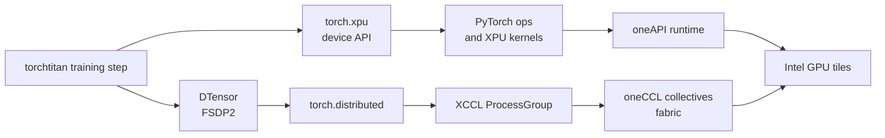
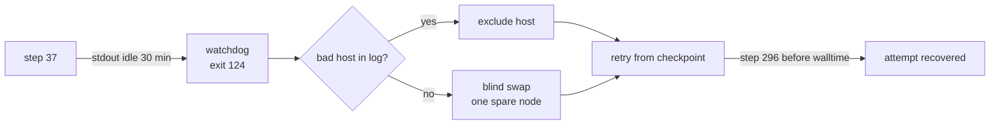

import Slide from '@/components/slides/Slide.astro'
import SpeakerNotes from '@/components/slides/SpeakerNotes.astro'

<Slide id="title-slide">

# Scaling PyTorch on Intel XPU

### Field notes from AI for Science on Aurora

Sam Foreman · Argonne National Laboratory
Panagiotis Kourdis · Intel
Tanima Dey · Intel

_PyTorch Conference · October 21, 2026_

<SpeakerNotes>
The program gives us 25 minutes. Aim for about 20 minutes of slides and leave
five for questions. Confirm the speaker handoffs before rehearsal.
</SpeakerNotes>

</Slide>

<Slide id="why-this-work">

## Four scientific workloads, one scaling problem

| Project | Science | Result |
| --- | --- | --- |
| [GenSLM](https://journals.sagepub.com/doi/10.1177/10943420231201154) | Viral evolution | Genome language models identified SARS-CoV-2 variants of concern |
| [MProt-DPO](https://www.alcf.anl.gov/news/argonne-team-breaks-new-ground-ai-driven-protein-design) | Protein design | Multimodal DPO at exaflop scale |
| [AERIS](https://arxiv.org/abs/2509.13523) | Weather and climate | Global forecasts; training across 10,080 Aurora nodes |
| [AuroraGPT](https://samf.sh/talks/2026/08/03/) | Scientific foundation models | A 2B reference run consumed 7.77T tokens; production moved to `torchtitan` |

These projects did **not** all use the same training code. Together they
exposed the backend, distributed, and operational work needed at scale.

<SpeakerNotes>
Open with the science, then explain why this is a PyTorch talk. GenSLM predates
Aurora and is not an Intel XPU case study. AERIS also has a separate training
stack. MProt-DPO and AuroraGPT provide the direct Aurora examples.
</SpeakerNotes>

</Slide>

<Slide id="genslm">

## GenSLM: genome-scale models for viral evolution

<div class="application-split genslm-layout">
    <figure>
        <video
            class="genslm-video"
            data-autoplay
            controls
            loop
            muted
            playsinline
            preload="metadata"
            poster="/assets/genslm-variants.jpeg"
            aria-label="GenSLM latent-space visualization colored by sequence length"
        >
            <source src="/assets/genslm-latent-420p.mp4" type="video/mp4" media="(max-width: 768px)" />
            <source src="/assets/genslm-latent-720p.mp4" type="video/mp4" />
        </video>
        <figcaption>
            GenSLM latent-space visualization, colored by sequence length. Still:
            Bharat Kale, Max Zvyagin, and Michael E. Papka, Argonne National Laboratory.
        </figcaption>
    </figure>
    <div>
        <p>Pretrained on <strong>110M+ prokaryotic gene sequences</strong>,
        then fine-tuned on <strong>1.5M SARS-CoV-2 genomes</strong> to
        identify variants of concern.[^genslm-paper]</p>
        <p>The team scaled its end-to-end workflow across
        <strong>560 Polaris nodes</strong> and Cerebras CS-2 systems.[^genslm-alcf]</p>
        <p><strong>2022 ACM Gordon Bell Special Prize</strong> for HPC-Based
        COVID-19 Research.[^genslm-award]</p>
    </div>
</div>

[^genslm-paper]: [Zvyagin et al., *GenSLMs*](https://journals.sagepub.com/doi/10.1177/10943420231201154).
[^genslm-alcf]: [ALCF project report](https://ar22.alcf.anl.gov/science/highlights/ramanathan).
[^genslm-award]: [Argonne Leadership Computing Facility](https://www.alcf.anl.gov/news/argonne-led-team-wins-gordon-bell-special-prize-hpc-based-covid-19-research).

<SpeakerNotes>
This is the cross-hardware precedent, not a claim that GenSLM ran on Aurora's
XPU backend. Keep the scientific result in view and move on quickly.
</SpeakerNotes>

</Slide>

<Slide id="mprot">

## MProt-DPO: protein design at exaflop scale

<div class="application-split mprot-layout">
    <div class="mprot-media">
        <div class="mprot-video-grid">
            <figure>
                <video
                    data-autoplay
                    controls
                    loop
                    muted
                    playsinline
                    preload="metadata"
                    poster="/assets/mprot-designed-proteins.jpg"
                    aria-label="MProt-DPO model attention visualization across transformer layers"
                >
                    <source src="/assets/mprot-attention.mp4" type="video/mp4" />
                </video>
                <figcaption>Model attention across layers</figcaption>
            </figure>
            <figure>
                <video
                    data-autoplay
                    controls
                    loop
                    muted
                    playsinline
                    preload="metadata"
                    poster="/assets/mprot-designed-proteins.jpg"
                    aria-label="MProt-DPO protein-design latent-space visualization"
                >
                    <source src="/assets/mprot-latent-space.mp4" type="video/mp4" />
                </video>
                <figcaption>Protein-design latent visualization</figcaption>
            </figure>
        </div>
        <p class="mprot-image-credit">Generated malate dehydrogenase design. Image: Arvind Ramanathan / Argonne.</p>
    </div>
    <div>
        <p>MProt-DPO combines protein sequences, experimental measurements,
        molecular simulations, and text. Preference feedback steers later
        designs toward desired properties.</p>
        <p><strong>3.5B</strong> parameters<br />
        <strong>38,400</strong> XPU ranks<br />
        <strong>4.11 EFLOP/s</strong> sustained mixed precision on Aurora.[^mprot]</p>
    </div>
</div>

[^mprot]: [Dharuman et al., *MProt-DPO*](https://doi.org/10.1109/SC41406.2024.00013); [ALCF project summary](https://www.alcf.anl.gov/news/argonne-team-breaks-new-ground-ai-driven-protein-design).

<SpeakerNotes>
The figure is reused from the existing MProt-DPO slides. Check the paper's
GPU/rank terminology when speaking: the chart counts 38,400 XPU ranks across
3,200 Aurora nodes. The result is a team accomplishment.
</SpeakerNotes>

</Slide>

<Slide id="aeris">

## AERIS: diffusion training across Aurora

<figure class="application-hero">
    
    <figcaption>
        Hurricane Laura tracks at 7, 5, and 3 days before landfall; red shows
        AERIS and black shows ERA5.
    </figcaption>
</figure>

**10,080 nodes · 10.21 sustained mixed-precision EFLOP/s · 95.5% weak
scaling efficiency.**[^aeris]

The model produces global forecasts and remains stable in rollouts to
**90 days**. It uses its own training stack.[^aeris-image]

[^aeris]: [Hatanpää et al., *AERIS*](https://arxiv.org/abs/2509.13523).
[^aeris-image]: [AERIS forecast figure and study](https://arxiv.org/abs/2509.13523).

<SpeakerNotes>
Do not present AERIS as a TorchTitan result. It is evidence that the machine,
precision, scaling, and restart problems extend beyond an LLM stack.
</SpeakerNotes>

</Slide>

<Slide id="auroragpt">

## AuroraGPT: from reference run to a new stack

<figure class="project-figure" id="auroragpt-reference-figure">
    
    <figcaption>
        One continuous 2B Megatron-DeepSpeed reference run: **7.77T tokens**.
        The production stack then moved to XPU-enabled `torchtitan`.
    </figcaption>
</figure>

[^agpt]: [AuroraGPT production talk and run evidence](https://samf.sh/talks/2026/08/03/).

<SpeakerNotes>
This chart belongs to the Megatron-DeepSpeed reference, not the newer
TorchTitan runs. The migration slide later explains what changed.
</SpeakerNotes>

</Slide>

<Slide id="backend-path">

## What a first-class XPU backend required

Aurora has **10,624 nodes and 63,744 Intel GPU cards**.[^aurora-scale]



IPEX and external oneCCL bindings filled early gaps. Native `torch.xpu` and
XCCL moved more of the path into PyTorch; end-to-end validation still mattered.

[^aurora-scale]: [ALCF Aurora system and AERIS report](https://www.alcf.anl.gov/news/aeris-earth-systems-model-pushes-ai-science-new-heights).

<SpeakerNotes>
Panagiotis and Tanima can adjust ownership and exact PyTorch version/history
for the Intel integration section. Distinguish API availability from measured
performance and job reliability.
</SpeakerNotes>

</Slide>

<Slide id="portable-training">

## One training program across vendors

```python
import torch
import torch.distributed as dist

device = torch.device("xpu" if torch.xpu.is_available() else "cuda")
backend = "xccl" if device.type == "xpu" else "nccl"

dist.init_process_group(backend=backend)
torch.set_default_device(device)
```

In production, [`ezpz`](https://github.com/saforem2/ezpz) chooses the device,
backend, ranks, and scheduler launch. The **model and training step** remain
the same across Intel, NVIDIA, and AMD systems.

<SpeakerNotes>
This is deliberately a schematic excerpt, not a complete launch recipe.
The AMD path also uses the CUDA API in PyTorch; the launcher and environment
still differ by machine. Show the ezpz source or a real launch command if the
audience wants the implementation details.
</SpeakerNotes>

</Slide>

<Slide id="measure-the-backend">

## Benchmark the path the job actually uses

1. Pin the software build, model, batch, precision, and node count.
2. Run the same training step on each backend.
3. Measure step time, tokens/s, memory, and collective time.
4. Scale the node count; remeasure after every kernel or collective change.

**A passing unit test tells us an operation exists.** A repeatable training
run tells us whether it is useful at scale.

<SpeakerNotes>
Ask the Intel speakers for one concrete XCCL collective comparison or tuning
result. Do not invent a speedup. The Genesis profiling deck has real Aurora
traces if a measurement visual is needed.
</SpeakerNotes>

</Slide>

<Slide id="migration" size="sm">

## We moved AuroraGPT from MDS to `torchtitan`

| Megatron-DeepSpeed fork | `torchtitan` + `DTensor` + FSDP2 |
| --- | --- |
| Production reference run | New production training stack |
| Parallelism in a specialized fork | Composable PyTorch parallelism |
| Local patches to maintain | XPU integration plus upstream sync |

The migration meant testing **correctness, throughput, and restart behavior**
at every layer, from fused kernels and collectives through orchestration.

<SpeakerNotes>
The reference run established a scientific baseline. We did not replace it
with an unmeasured framework switch. The fork still has a maintenance cost;
avoid implying every XPU change is already upstream.
</SpeakerNotes>

</Slide>

<Slide id="migration-evidence">

## Validate the new stack with training runs

<div class="project-figure">
    
</div>

The 2B reference and newer 2B/20B `torchtitan` runs share one tokens axis.
Different models and data mixes make this a production record, not an isolated
framework benchmark.

<SpeakerNotes>
The source figure includes different model sizes and data mixtures. Use it as
evidence that the new stack trains real production models, not as a claim of
TorchTitan being faster or better by itself. Update the figure before the
conference if newer runs change the story.
</SpeakerNotes>

</Slide>

<Slide id="operations">

## A healthy process can still be a dead job

**AuroraGPT job `8505298`:** training reached step 37, then stopped making
progress without a traceback. The stdout-idle watchdog fired after 30
minutes; the wrapper swapped a node and relaunched. The second attempt
reached step 296 before walltime.[^hang]



Recovery has three scopes: **process retry · node failover · scheduler
resubmit**. Checkpointing determines how much work a restart loses.

[^hang]: [Production failover incident writeup](https://github.com/saforem2/torchtitan/blob/ezpz/torchtitan/experiments/ezpz/docs/experiments/agpt/aurora/20260523-failover-silent-hang-recovery-8505298.md).

<SpeakerNotes>
This is a documented production incident, not a hypothetical. Make clear that
the watchdog observed missing stdout progress, not a reliable collective
timeout. A later slide names that backend gap explicitly.
</SpeakerNotes>

</Slide>

<Slide id="remaining-work">

## What still needs work

| Layer | Remaining gap |
| --- | --- |
| Kernels | Fused operations across the model and optimizer path |
| Collectives | Tuning, diagnostics, and reliable timeouts |
| Checkpoints | Async saves without saturating the shared filesystem |
| Operations | Progress detection, bad-node failover, layered restarts |

The next accelerator team should test these with **a real, restartable
training job**, not just a collection of isolated kernels.

<SpeakerNotes>
Leave time to distinguish what works today from what is in progress. The
checkpoint problem is especially visible at many ranks sharing a filesystem.
</SpeakerNotes>

</Slide>

<Slide id="takeaways">

## What we would do again

1. Bring up the PyTorch device and distributed path together.
2. Keep one model program across vendors; isolate launch and backend choices.
3. Preserve a scientific baseline through every framework migration.
4. Measure the whole step before tuning kernels or collectives.
5. Design checkpoint and recovery paths before the long run.

**GenSLM · MProt-DPO · AERIS · AuroraGPT** show what scientific teams can
build when the accelerator and the training operation both hold up.

<SpeakerNotes>
Finish on the practices another accelerator team can copy. Credit the
project teams, ALCF, Intel, and PyTorch contributors verbally or on a final
acknowledgment slide once the co-speakers confirm names.
</SpeakerNotes>

</Slide>

<style>{`
  #why-this-work table { font-size: 0.86em; }
  #why-this-work table td:first-child { white-space: nowrap; }
  #migration table { width: 100%; table-layout: fixed; }
  #migration table th, #migration table td { width: 50%; }
  .project-figure { display: flex; flex-direction: column; align-items: center; width: 100%; max-height: 13lh; margin: 0; }
  .project-figure img { width: 100%; max-height: 13lh; object-fit: contain; }
  .project-figure figcaption, .application-hero figcaption, .application-split figcaption { margin-top: 0.3lh; font-size: 0.66em; color: var(--foreground2); }
  .application-hero { width: 100%; margin: 0 0 0.4lh; }
  .application-hero img { display: block; width: 100%; max-height: 14lh; object-fit: contain; margin-inline: auto; }
  .application-split { display: grid; grid-template-columns: 0.85fr 1.15fr; align-items: center; gap: 2ch; }
  .application-split figure { min-width: 0; margin: 0; }
  .application-split img { display: block; width: 100%; max-height: 11lh; object-fit: contain; }
  .application-split video { display: block; width: 100%; max-height: 11lh; object-fit: contain; background: #050505; }
  .mprot-media { min-width: 0; }
  .mprot-video-grid { display: grid; grid-template-columns: repeat(2, minmax(0, 1fr)); align-items: center; gap: 1ch; }
  .mprot-video-grid figure { min-width: 0; margin: 0; }
  .mprot-video-grid video { aspect-ratio: 16 / 10; }
  .mprot-video-grid figcaption { min-height: 2.4lh; }
  .mprot-image-credit { margin: 0.3lh 0 0; font-size: 0.58em; color: var(--foreground2); }
  .genslm-layout { grid-template-columns: 1.3fr 0.7fr; }
  .genslm-layout video { max-height: 15lh; }
  .mprot-layout { grid-template-columns: 1fr; gap: 0.5lh; }
  .mprot-video-grid video { max-height: 13lh; }
  #auroragpt-reference-figure { max-height: 17lh; }
  #auroragpt-reference-figure img { max-height: 15lh; }
  #operations .mermaid { width: 100%; }
  .path-grid { display: grid; grid-template-columns: repeat(2, 1fr); gap: 1lh 2ch; }
  .path-grid div { display: flex; flex-direction: column; gap: 0.25lh; padding: 0.6lh 1.5ch; border: 1px solid var(--foreground2); border-radius: 0.5ch; }
  .path-grid span { font-size: 0.85em; }
  .recovery-flow { display: flex; align-items: center; justify-content: space-between; gap: 1ch; margin: 2lh 0; font-size: 1.15em; font-weight: 700; }
  @media (max-width: 768px) {
    #why-this-work table { font-size: 0.7em; }
    .path-grid { grid-template-columns: 1fr; }
    .recovery-flow { flex-wrap: wrap; justify-content: center; }
    .application-split { grid-template-columns: 1fr; }
  }
`}</style>
