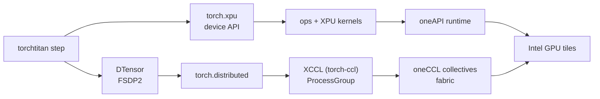
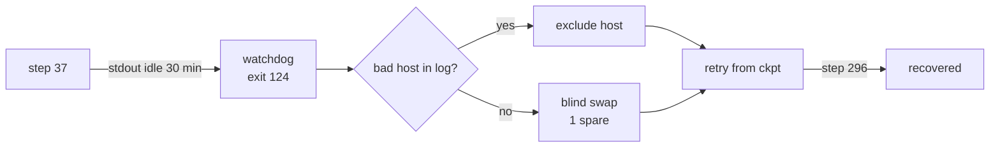

import Slide from '@/components/slides/Slide.astro'
import SpeakerNotes from '@/components/slides/SpeakerNotes.astro'

{/* ================================================================
    TALK ARC (20 slides, ~20 min + 5 Q&A)
    Thesis: Aurora at ~120k XPUs made the backend visible — we trace
    a single XPU surface (torch.xpu → XCCL/oneCCL → DTensor/FSDP2),
    a fork-to-titan migration proved at 256→512 nodes, and the watchdog
    + failover machinery that keeps long jobs alive.
    Footer: official vector bottom-right (pytorchcon-na26-color.svg @ 2rem).
    Aurora: 10,624 nodes · 63,744 tiles (≈120k XPUs incl. tile count per PVC).
    ================================================================ */}

{/* ── Title ───────────────────────────────────────────────────── */}
<Slide id="title-slide">

# Scaling PyTorch on Intel XPU

### Field notes from AI for Science on Aurora

<div class="title-authors">
    <span>Sam Foreman · Argonne National Laboratory</span>
    <span>Panagiotis Kourdis · Intel</span>
    <span>Tanima Dey · Intel</span>
</div>

_PyTorch Conference · October 21, 2026 — San Jose_

<SpeakerNotes>
25 minutes total: ~20 of slides, 5 for Q&A. Confirm handoffs with Panagiotis and Tanima before rehearsal — P+T own the XCCL/oneCCL layer, Sam owns migration + ops.
</SpeakerNotes>

</Slide>

{/* ── Frame: the 3-act contract ───────────────────────────────── */}
<Slide id="frame">

## The arc

| Act | Question | You will steal |
| --- | --- | --- |
| **A · Needed** | What does a first-class XPU backend actually require? | The 3 breaks we fixed + the ladder that catches the next one |
| **B · Accomplished** | How do you leave a Megatron-DeepSpeed fork for composable PyTorch? | The 50-step gate + the 768-rank proof |
| **C · Remains** | What keeps a 14-day job alive at 60k XPUs? | Watchdog + bad-node quarantine + layered restarts |

One science prologue, then systems all the way down.

<SpeakerNotes>
Set the contract: every act promises a stealable pattern, not a science result. The abstract's three bullets map 1:1 to A/B/C.
</SpeakerNotes>

</Slide>

{/* ── Prologue: why scale matters (60s) ───────────────────────── */}
<Slide id="prologue">

## Why Aurora needed a real backend

| Workload | What it taught us |
| --- | --- |
| [GenSLM](https://journals.sagepub.com/doi/10.1177/10943420231201154) — viral genomes | Portability before Aurora existed (Polaris + Cerebras → Gordon Bell) |
| [MProt-DPO](https://www.alcf.anl.gov/news/argonne-team-breaks-new-ground-ai-driven-protein-design) — protein design | 38,400 ranks · 4.11 EFLOP/s at 3,200 nodes |
| [AERIS](https://arxiv.org/abs/2509.13523) — weather diffusion | 10,080 nodes · 10.21 EFLOP/s · 90-day stable rollouts |
| [AuroraGPT](https://samf.sh/talks/2026/08/03/) — foundation LLM | 7.77T-token MDS reference → [torchtitan](https://github.com/saforem2/torchtitan/tree/ezpz) |

Aurora is **10,624 nodes · 63,744 tiles** — ~120k XPUs at 2 tiles/GPU.[^aurora]
[ezpz](https://github.com/saforem2/ezpz) is the glue: same training program on Intel, NVIDIA, and AMD.

[^aurora]: [ALCF Aurora](https://www.alcf.anl.gov/aurora) · [ALCF support — Aurora](https://www.alcf.anl.gov/support-center/aurora) · [AuroraGPT companion talk](https://samf.sh/talks/2026/08/03/).

<SpeakerNotes>
Prologue in 60s: the workloads are the *reason* we needed the backend, not the talk's subject. GenSLM predates Aurora's XPU path; AERIS uses its own stack. Credit: MProt, GenSLM, and AERIS teams + ALCF + Intel.
</SpeakerNotes>

</Slide>

{/* ── A1: what a first-class backend required ─────────────────── */}
<Slide id="backend-path">

## A first-class XPU backend — the actual surface



Every edge is a place a job can pass a unit test and still die at scale.
IPEX shims → [native `torch.xpu`](https://pytorch.org/docs/stable/notes/xpu.html) + [`torch-ccl`/XCCL](https://github.com/intel/torch-ccl) + [`oneCCL`](https://github.com/oneapi-src/oneCCL) is the migration behind this diagram.

[^xpu]: [PyTorch XPU docs](https://pytorch.org/docs/stable/notes/xpu.html) · [Intel torch-ccl (XCCL)](https://github.com/intel/torch-ccl) · [oneAPI oneCCL](https://github.com/oneapi-src/oneCCL) · [PyTorch distributed overview](https://pytorch.org/docs/stable/distributed.html)

<SpeakerNotes>
Panagiotis/Tanima can correct ownership and timeline. Distinguish "API exists" from "collective scales and timeout fires."
</SpeakerNotes>

</Slide>

{/* ── A2: where it broke (3 concrete bugs) ────────────────────── */}
<Slide id="xpu-gaps" size="sm">

## Three XPU breaks — same pattern every time

| Symptom | Root cause | What we run now |
| --- | --- | --- |
| `torch 2.13`: `expected DTensor, got plain tensor` on FSDP wrap | Missing [pytorch#181519](https://github.com/pytorch/pytorch/pull/181519) | Fixed in `2.14.0+xpu` · A/B on Sunspot job `12477670` |
| `DeviceMesh` → `does not support splitting` | `ProcessGroupXCCL` inherits [`supportsSplitting() == false`](https://github.com/pytorch/pytorch/issues/186548) | Local shim · [pytorch#186548](https://github.com/pytorch/pytorch/issues/186548) |
| `train_timeout_seconds` is a no-op | `_set_pg_timeout` has no `xpu` branch — XCCL stores the timeout, never arms it | Watchdog heartbeat (Act C) + two-PR upstream |

Pattern: **works on CUDA, inherits a silent default on XPU.**

<SpeakerNotes>
The point is the *shape* of XPU gaps: not missing kernels, but missing dispatch branches. Every row is a real commit/issue, not a hypothetical.
</SpeakerNotes>

</Slide>

{/* ── A3: why we had to leave the fork ───────────────────────── */}
<Slide id="why-fork-broke">

## Why the fork broke

| A Megatron-DeepSpeed fork | `torchtitan` + `DTensor` + `FSDP2` |
| --- | --- |
| 7.77T-token reference did ship (on [`2B MDS`](https://samf.sh/talks/2026/08/03/)) | New production stack — same tokens, composable path |
| Parallelism baked into the fork | [`DTensor`](https://pytorch.org/tutorials/intermediate/DTensor_tutorial.html) + [`FSDP2`](https://pytorch.org/blog/pytorch2-feature-class-of-2024/) as composable primitives |
| Every PT release → rebase + patch audit | XPU integration in upstreamable layers |

The fork didn't fail scientifically. It failed operationally — it couldn't carry the XPU work without re-patching every release.

<SpeakerNotes>
The 7.77T MDS run is the *baseline*, not a failure. The migration was about maintainability and XPU composability, not scientific correctness.
</SpeakerNotes>

</Slide>

{/* ── A4: one program across vendors ──────────────────────────── */}
<Slide id="portable-training">

## One training program across vendors

```python
import torch
import torch.distributed as dist

device = torch.device("xpu" if torch.xpu.is_available() else "cuda")
backend = "xccl" if device.type == "xpu" else "nccl"

dist.init_process_group(backend=backend)
torch.set_default_device(device)
```

The model code doesn't branch. The *launch* does — and that's [`ezpz`](https://github.com/saforem2/ezpz)'s job:

[`ezpz launch`](https://ezpz.cool/cli/launch/) — ranks, bindings, hostfiles · [`ezpz test-dist`](https://github.com/saforem2/ezpz/blob/main/ezpz/test_dist.py) — smoke on any fabric · [`DTensor` tutorial](https://pytorch.org/tutorials/intermediate/DTensor_tutorial.html)

<SpeakerNotes>
AMD uses the CUDA API in PyTorch; launch/env still differ. Show ezpz source if asked.
</SpeakerNotes>

</Slide>

{/* ── A5: environment IS backend ─────────────────────────────── */}
<Slide id="environment">

## The environment is part of the backend

Live Sunspot production env (`job 12478562`):

```bash
export CCL_PROCESS_LAUNCHER=pmix
export CCL_OP_SYNC=1
export CCL_ATL_SYNC_COLL=1
export ZE_FLAT_DEVICE_HIERARCHY=FLAT
# CCL_KVS_MODE=pmi — only on Aurora next-eval queue
```

Two release trees: login `torch 2.10` vs compute `2.13` — a login-node probe lies.

XCCL mesh ladder that gates every change: **48 → 192 → 384 → 768 ranks**, value-checked, must exit `0`.

<SpeakerNotes>
KVS guidance came from ALCF. Intel should correct the tuning story live; the point is that env *is* the backend at 10k nodes.
</SpeakerNotes>

</Slide>

{/* ── A6: benchmark the real path ───────────────────────────── */}
<Slide id="measure-backend">

## Benchmark the path the job actually uses

1. Freeze build + model + batch + precision + node count
2. Run the **training step** (not a micro-kernel) on each backend
3. Measure step time · tokens/s · collective time · memory
4. Scale node count; **remeasure after every kernel or collective change**

> A passing unit test proves an op exists. A repeatable step proves it's useful at scale.

This is how the `2.13 → 2.14.0+xpu` fix, the ladder, and Act C's watchdog were all validated.

<SpeakerNotes>
Don't invent a speedup. The Genesis profiling deck has real Aurora traces if a visual is needed.
</SpeakerNotes>

</Slide>

{/* ── B1: what moved ─────────────────────────────────────────── */}
<Slide id="what-moved" size="sm">

## What moved: MDS → `torchtitan`

| Layer | Before (MDS fork) | After ([`torchtitan/ezpz`](https://github.com/saforem2/torchtitan/tree/ezpz)) |
| --- | --- | --- |
| Parallelism | Custom tensor-parallel + pipeline in fork | [`FSDP2`](https://pytorch.org/blog/pytorch2-feature-class-of-2024/) + [`DTensor`](https://pytorch.org/docs/stable/distributed.tensor.html) sharding |
| Collectives | DeepSpeed's NCCL assumptions | [XCCL](https://github.com/intel/torch-ccl) (`ProcessGroupXCCL`) → [oneCCL](https://github.com/oneapi-src/oneCCL) |
| Kernels | Fork-local fused kernels | Upstreamable XPU kernels via `torch.xpu` |
| Launch | Fork's scheduler coupling | [`ezpz`](https://github.com/saforem2/ezpz) — [`ezpz launch`](https://ezpz.cool/cli/launch/) + [`checkpoint-restart`](https://ezpz.cool/guides/checkpoint-restart/) |
| Checkpoint | DeepSpeed engine's save | [`torch.distributed.checkpoint`](https://pytorch.org/docs/stable/distributed.checkpoint.html) (DCP) |

Not a rebrand — a different place for every decision to live.

<SpeakerNotes>
The table is the map. The next two slides are how we knew the map was correct.
</SpeakerNotes>

</Slide>

{/* ── B2: testing at every layer ─────────────────────────────── */}
<Slide id="layer-tests" size="sm">

## Testing at every layer

| Layer | Gate | Link |
| --- | --- | --- |
| Numerics | 50-step loss — `±0.10` on final + last-10 mean | [Production loss figure](https://samf.sh/talks/2026/08/03/) |
| Collectives | XCCL ladder `48 → 768` ranks, value-checked | [`ezpz/test_dist.py`](https://github.com/saforem2/ezpz/blob/main/ezpz/test_dist.py) |
| Parallelism | TP1 / TP2 / MoE on Aurora; parity on Sunspot | [`experiments/ezpz`](https://github.com/saforem2/torchtitan/tree/ezpz) |
| Portability | One gate on Aurora + Sunspot + Polaris + Perlmutter | [`ezpz`](https://github.com/saforem2/ezpz) |
| Orchestration | Failover harness — 9 fixtures | [Failover writeup](https://github.com/saforem2/torchtitan/blob/ezpz/torchtitan/experiments/ezpz/docs/experiments/agpt/aurora/20260523-failover-silent-hang-recovery-8505298.md) |

The `±0.10` tolerance sits just above the `~0.05` shuffle noise of the streaming loader — tight enough to catch a bad gradient, loose enough to not flake on data order.

<SpeakerNotes>
The loss gate is the hero: it caught silent gradient bugs that loaded, sharded, and even timed correctly.
</SpeakerNotes>

</Slide>

{/* ── B3: does the new stack train? ──────────────────────────── */}
<Slide id="migration-evidence">

## Does the new stack train? Production says yes.

<div class="project-figure">
    
</div>

`torchtitan` 2B at 256 and 512 nodes both hit **4.674T** tokens. Not a benchmark — a continuation of the 7.77T `MDS` reference with a new mix.

[SAMF companion — AuroraGPT on 50k ranks](https://samf.sh/talks/2026/08/03/) · [`torchtitan/ezpz` experiments](https://github.com/saforem2/torchtitan/tree/ezpz) · [`ezpz`](https://github.com/saforem2/ezpz)

<SpeakerNotes>
Don't claim torchtitan is faster. Claim it trains real production models with the same science baseline.
</SpeakerNotes>

</Slide>

{/* ── C1: a healthy process can still be a dead job ─────────── */}
<Slide id="operations">

## A healthy process can still be a dead job

**Job `8505298`** — step 37, then silence. No traceback. Watchdog at 30 min (`exit 124`), wrapper swapped a node, relaunched. Attempt 2 reached step 296.



The backend bug that enables this: `_set_pg_timeout` has no `xpu` branch — timeout is stored, never enforced.[^hang]

[^hang]: [Failover incident — 8505298](https://github.com/saforem2/torchtitan/blob/ezpz/torchtitan/experiments/ezpz/docs/experiments/agpt/aurora/20260523-failover-silent-hang-recovery-8505298.md)

<SpeakerNotes>
Watchdog measures stdout progress, not the collective timeout. The XPU gaps slide names the missing branch.
</SpeakerNotes>

</Slide>

{/* ── C2: failure taxonomy ───────────────────────────────────── */}
<Slide id="failure-taxonomy">

## Failure taxonomy at ~120k XPUs

| Mode | Signal | What helps | What doesn't |
| --- | --- | --- | --- |
| **Silent hang** | Stdout stalls, no error | Watchdog on log progress | `_set_pg_timeout` (`xpu` never arms) |
| **Lost collective** | Rank times out in `XCCL` | Node exclude + retry | Retrying on the same host |
| **Crash / OOM** | Traceback + exit code | Process restart from ckpt | Scheduler resubmit alone |
| **Stale FS / DCP** | Checkpoint read stalls | Async save + local staging | Sync save on shared FS at 10k ranks |

At this scale, **every job is a test of the recovery path**.

<SpeakerNotes>
The taxonomy is the mental model. The next two slides are the two rows you hit weekly.
</SpeakerNotes>

</Slide>

{/* ── C3: layered restarts ───────────────────────────────────── */}
<Slide id="layered-restarts">

## Layered restarts — the actual system

| Layer | Scope | Trigger | Cost of being wrong |
| --- | --- | --- | --- |
| Process | 1 rank | Crash / OOM | Tokens since last ckpt |
| Node | 12 XPUs | Hang on one host | 1 node's work + re-shard |
| Allocation | 10k nodes | Bad FS / scheduler | Whole-job walltime |

`ezpz` handles the outer two: [`checkpoint-restart`](https://ezpz.cool/guides/checkpoint-restart/) + node exclude + scheduler resubmit. DCP handles the inner save.

Long jobs aren't an ops concern bolted on — they **are** the product. Design them first.

<SpeakerNotes>
The re-shard is not free — DeviceMesh rebuild is part of the cost model. The checkpoint talk at 2026/08/03 has the interval math.
</SpeakerNotes>

</Slide>

{/* ── C4: what's still hard ──────────────────────────────────── */}
<Slide id="remaining-work">

## What remains

| Layer | Gap | What we'd steal |
| --- | --- | --- |
| Kernels | Fused attn + MLP + optimizer across XPU | A composable kernel story that survives `torch.compile` |
| Collectives | Tuning, diagnostics, **real timeouts** | XCCL timeout enforcement + `DTensor` split fix upstream |
| Checkpoints | Async DCP at 10k ranks without FS collapse | Local staging → async flush |
| Operations | Bad-node detection before walltime burns | Heartbeat at the `ProcessGroup` level, not stdout grep |

If you bring up the next accelerator, **test it with a restartable training job** — not isolated kernels.

[^dcp]: [Distributed Checkpoint (DCP)](https://pytorch.org/docs/stable/distributed.checkpoint.html) · [torch.compile on XPU](https://pytorch.org/docs/stable/torch.compiler.html)

<SpeakerNotes>
Be honest about what's upstream vs local shim. The "test with a real job" line is the talk's most actionable takeaway.
</SpeakerNotes>

</Slide>

{/* ── Takeaway ───────────────────────────────────────────────── */}
<Slide id="takeaways">

## What we would do again

1. **Backend + distributed together** — `torch.xpu` without `XCCL` is a demo, not a trainer.
2. **One program, many launches** — [`ezpz`](https://github.com/saforem2/ezpz) owns the schedule, the model doesn't branch.
3. **A science baseline that survives the migration** — 7.77T → 4.674T on the same tokens axis.
4. **Measure the step, not the kernel** — the whole training step, at the job's real scale.
5. **Recovery before throughput** — checkpoint + watchdog + quarantine before you tune.

**GenSLM · MProt-DPO · AERIS · AuroraGPT** — not case studies, but the workloads that forced each layer.

<SpeakerNotes>
End on stealable patterns. Credit ALCF, Intel, PyTorch contributors verbally; the next slide has the links.
</SpeakerNotes>

</Slide>

{/* ── QR: links ─────────────────────────────────────────────── */}
<Slide id="links">

## Steal this

<div class="links-grid">

| Stack | Link |
| --- | --- |
| [`ezpz`](https://github.com/saforem2/ezpz) | [Launch](https://ezpz.cool/cli/launch/) · [Checkpoint](https://ezpz.cool/guides/checkpoint-restart/) · [All docs](https://ezpz.cool) |
| [`torchtitan/ezpz`](https://github.com/saforem2/torchtitan/tree/ezpz) | [Experiments](https://github.com/saforem2/torchtitan/tree/ezpz/torchtitan/experiments/ezpz) · [Failover writeup](https://github.com/saforem2/torchtitan/blob/ezpz/torchtitan/experiments/ezpz/docs/experiments/agpt/aurora/20260523-failover-silent-hang-recovery-8505298.md) |
| PyTorch XPU | [`torch.xpu`](https://pytorch.org/docs/stable/notes/xpu.html) · [`DTensor`](https://pytorch.org/tutorials/intermediate/DTensor_tutorial.html) · [`FSDP2`](https://pytorch.org/blog/pytorch2-feature-class-of-2024/) · [DCP](https://pytorch.org/docs/stable/distributed.checkpoint.html) |
| Distributed | [`torch-ccl` / XCCL](https://github.com/intel/torch-ccl) · [`oneCCL`](https://github.com/oneapi-src/oneCCL) · [torch.distributed](https://pytorch.org/docs/stable/distributed.html) |
| System | [Aurora](https://www.alcf.anl.gov/aurora) · [ALCF support — Aurora](https://www.alcf.anl.gov/support-center/aurora) · [ALCF news — 120k-XPU scale](https://www.alcf.anl.gov/news/aeris-earth-systems-model-pushes-ai-science-new-heights) |
| Science | [AuroraGPT companion](https://samf.sh/talks/2026/08/03/) · [AERIS](https://arxiv.org/abs/2509.13523) · [MProt-DPO](https://www.alcf.anl.gov/news/argonne-team-breaks-new-ground-ai-driven-protein-design) · [GenSLM](https://journals.sagepub.com/doi/10.1177/10943420231201154) |

</div>

_All links are in the deck at [`samf.sh/talks/2026/10/21`](https://samf.sh/talks/2026/10/21)._

<SpeakerNotes>
Point at this slide. Stay on it for Q&A — every project name is clickable and every claim has a receipt.
</SpeakerNotes>

</Slide>

<style>{`
  #frame table { font-size: 0.9em; }
  #prologue table { font-size: 0.86em; }
  #prologue table td:first-child { white-space: nowrap; }
  #why-fork-broke table, #what-moved table { width: 100%; table-layout: fixed; }
  #why-fork-broke table th, #why-fork-broke table td,
  #what-moved table th, #what-moved table td { width: 50%; }
  .project-figure { display: flex; flex-direction: column; align-items: center; width: 100%; max-height: 13lh; margin: 0; }
  .project-figure img { width: 100%; max-height: 13lh; object-fit: contain; }
  .project-figure figcaption, .application-hero figcaption, .application-split figcaption { margin-top: 0.3lh; font-size: 0.66em; color: var(--foreground2); }
  .application-hero { width: 100%; margin: 0 0 0.4lh; }
  .application-hero img { display: block; width: 100%; max-height: 14lh; object-fit: contain; margin-inline: auto; }
  .application-split { display: grid; grid-template-columns: 0.85fr 1.15fr; align-items: center; gap: 2ch; }
  .application-split figure { min-width: 0; margin: 0; }
  .application-split img { display: block; width: 100%; max-height: 11lh; object-fit: contain; }
  .application-split video { display: block; width: 100%; max-height: 11lh; object-fit: contain; background: #050505; }
  .mprot-media { min-width: 0; }
  .mprot-video-grid { display: grid; grid-template-columns: repeat(2, minmax(0, 1fr)); align-items: center; gap: 1ch; }
  .mprot-video-grid figure { min-width: 0; margin: 0; }
  .mprot-video-grid video { aspect-ratio: 16 / 10; }
  .mprot-video-grid figcaption { min-height: 2.4lh; }
  .mprot-image-credit { margin: 0.3lh 0 0; font-size: 0.58em; color: var(--foreground2); }
  #auroragpt-reference-figure { max-height: 17lh; }
  #auroragpt-reference-figure img { max-height: 15lh; }
  #operations .mermaid { width: 100%; }
  .links-grid { width: 100%; }
  .links-grid table { width: 100%; font-size: 0.82em; }
  .links-grid td:first-child { white-space: nowrap; font-weight: 600; }
  @media (max-width: 768px) {
    #prologue table, #frame table { font-size: 0.7em; }
    .links-grid table { font-size: 0.68em; }
    .application-split { grid-template-columns: 1fr; }
  }
`}</style>
