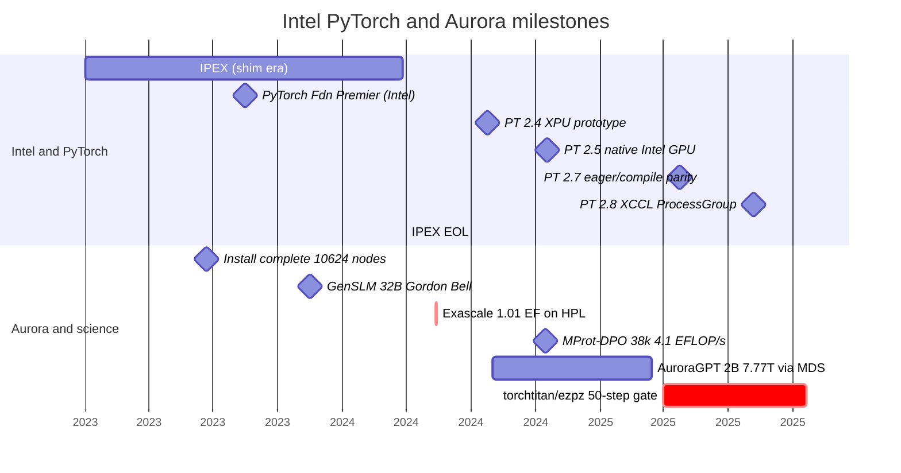
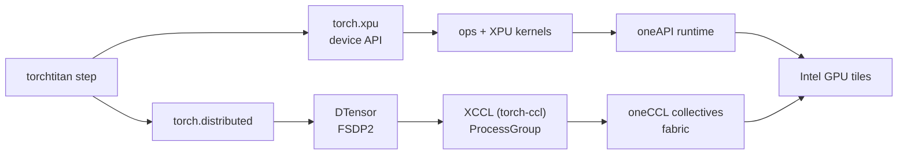
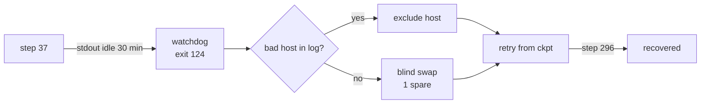

import Slide from '@/components/slides/Slide.astro'
import SpeakerNotes from '@/components/slides/SpeakerNotes.astro'

{/* ================================================================
    TALK ARC (18 slides, ~20 min + 5 Q&A)
    Thesis: Aurora at ~120k XPUs made the backend visible — we trace
    a single XPU surface (torch.xpu → XCCL/oneCCL → DTensor/FSDP2),
    a fork-to-titan migration proved at 256→512 nodes, and the watchdog
    + failover machinery that keeps long jobs alive.
    Footer: official vector bottom-right (pytorchcon-na26-color.svg @ 2rem).
    Aurora: 10,624 nodes · 63,744 tiles (≈120k XPUs incl. tile count per PVC).
    ================================================================ */}

{/* ── Title ───────────────────────────────────────────────────── */}
<Slide id="title-slide">

# Scaling PyTorch on Intel XPU

### Field notes from AI for Science on Aurora

<div class="title-authors">
    <span>Sam Foreman · Argonne National Laboratory</span>
    <span>Panagiotis Kourdis · Intel</span>
    <span>Tanima Dey · Intel</span>
</div>

<div class="title-conf-line">_PyTorch Conference · October 21, 2026 — San Jose_</div>

<a
    class="title-slide-qr"
    href="https://samf.sh/talks/2026/10/21"
    aria-label="QR code linking to these slides">
    
    <span>samf.sh/talks/2026/10/21</span>
</a>

<SpeakerNotes>
25 min total — 20 of slides, 5 for Q&A.
</SpeakerNotes>

</Slide>

{/* ── Prologue: what ALCF does ─────────────────────────────────── */}
<Slide id="context">

## Why this matters at PyTorch Conference

| | |
| --- | --- |
| **ALCF** | One of three DOE computing facilities (`ALCF` at Argonne, `OLCF` at Oak Ridge, `NERSC` at Berkeley) — runs large-scale science on `Aurora` (`10,624` nodes · `63,744` tiles) and `Polaris` for the open research community |
| **Aurora** | DOE's exascale pathfinder — Intel GPUs at scale before the `XPU` story was settled in upstream PyTorch. Every science team that trained on `Aurora` hit the same missing backend at the same time |
| **Why PyTorch** | The framework every science team picked anyway — genomics, proteins, weather, LLMs. This talk is how it caught up to the machine |

Aurora made the `XPU` gap impossible to ignore. The science in Act A is why it existed in the first place.

<SpeakerNotes>
ALCF runs the machines so scientists don't have to — INCITE/ALCC allocations, not internal. Aurora is the exascale poster child: 10k nodes, Intel's first data-center GPU at DOE scale, and up before the XPU surface was ported in PyTorch. That collision — new hardware, same PyTorch — is the talk's reason to be. One minute, no deeper.
</SpeakerNotes>

</Slide>

{/* ── Frame: the 3-act contract ───────────────────────────────── */}
<Slide id="frame">

## The arc

| Act | Question | You will steal |
| --- | --- | --- |
| **A · Needed** | What does a first-class XPU backend actually require? | The 3 breaks we fixed + the ladder that catches the next one |
| **B · Accomplished** | How do you leave a Megatron-DeepSpeed fork for composable PyTorch? | The 50-step gate + the 768-rank proof |
| **C · Remains** | What keeps a 14-day job alive at 60k XPUs (half Aurora) → 120k tiles? | Watchdog + bad-node quarantine + layered restarts |


<div class="frame-footer-spacer"></div>

<SpeakerNotes>
Set the contract: every act promises a stealable pattern, not a science result. The abstract's three bullets map 1:1 to A/B/C.
</SpeakerNotes>

</Slide>

{/* ── Prologue: why scale matters (60s) ───────────────────────── */}
<Slide id="prologue">

## Why Aurora needed a real backend

| Workload | What it taught us |
| --- | --- |
| [GenSLM](https://journals.sagepub.com/doi/10.1177/10943420231201154) — viral genomes | Portability before Aurora existed (Polaris + Cerebras → Gordon Bell) |
| [MProt-DPO](https://www.alcf.anl.gov/news/argonne-team-breaks-new-ground-ai-driven-protein-design) — protein design | 38,400 ranks · 4.11 EFLOP/s at 3,200 nodes |
| [AERIS](https://arxiv.org/abs/2509.13523) — weather diffusion | 10,080 nodes · 10.21 EFLOP/s · 90-day stable rollouts |
| [AuroraGPT](https://samf.sh/talks/2026/08/03/) — foundation LLM | 7.77T-token MDS reference → [torchtitan](https://github.com/saforem2/torchtitan/tree/ezpz) |

Aurora is **10,624 nodes · 63,744 tiles** — ~120k XPUs at 2 tiles/GPU.[^aurora]
[`ezpz`](https://github.com/saforem2/ezpz): same training program on `Intel`, `NVIDIA`, `AMD`.[^aurora]

[^aurora]: [ALCF Aurora](https://www.alcf.anl.gov/aurora) · [ALCF support — Aurora](https://www.alcf.anl.gov/support-center/aurora) · [`torchtitan/ezpz`](https://github.com/saforem2/torchtitan/tree/ezpz) · [AuroraGPT companion](https://samf.sh/talks/2026/08/03/).

<SpeakerNotes>
Prologue in 60s: the workloads are the *reason* we needed the backend, not the talk's subject. GenSLM predates Aurora's XPU path; AERIS uses its own stack. Credit: MProt, GenSLM, and AERIS teams + ALCF + Intel.
</SpeakerNotes>

</Slide>

{/* ── A0: when the backend landed ───────────────────────────── */}
<Slide id="timeline">

## When the backend landed



<span class="timeline-caption">Condensed from the [two-timelines post](https://samf.sh/posts/2026/01/10/#the-two-timelines) plus verified Aurora dates — the two lanes overlap: Intel shipped the `XPU` surface in 4 releases, Aurora's jobs forced it to scale.</span>

<SpeakerNotes>
60s. The punchline: Intel compressed 14 years of AMD-style work into 5 PT releases (2.4→2.8), and Aurora's science jobs landed right as that window opened — GenSLM before the XPU path, MProt/AERIS during it, AuroraGPT straddling the fork→titan cutover. Every PT milestone here has a oneCCL/env fix to tell if asked.
</SpeakerNotes>

</Slide>

{/* ── A1: what a first-class backend required ─────────────────── */}
<Slide id="backend-path">

## A first-class XPU backend — the actual surface



<div class="backend-caption">

Every edge is a place a job can pass a unit test and still die at scale.
`IPEX` shims → [native `torch.xpu`](https://pytorch.org/docs/stable/notes/xpu.html) + [`torch-ccl`/`XCCL`](https://github.com/intel/torch-ccl) + [`oneCCL`](https://github.com/oneapi-src/oneCCL) is the migration behind this diagram.

</div>

[^xpu]: [PyTorch XPU docs](https://pytorch.org/docs/stable/notes/xpu.html) · [Intel torch-ccl (XCCL)](https://github.com/intel/torch-ccl) · [oneAPI oneCCL](https://github.com/oneapi-src/oneCCL) · [PyTorch distributed overview](https://pytorch.org/docs/stable/distributed.html) · [The two timelines](https://samf.sh/posts/2026/01/10/#the-two-timelines) — source chronology for the previous slide.

<SpeakerNotes>
Co-authors: Panagiotis Kourdis and Tanima Dey, Intel — XCCL/`oneCCL` layer. Distinguish "API exists" from "collective scales and timeout fires."
</SpeakerNotes>

</Slide>

{/* ── A2: where it broke (3 concrete bugs) ────────────────────── */}
<Slide id="xpu-gaps" size="sm">

## Three XPU breaks — same pattern every time

| Symptom | Root cause | What we run now |
| --- | --- | --- |
| `torch 2.13`: `expected DTensor, got plain tensor` on FSDP wrap | Missing [pytorch#181519](https://github.com/pytorch/pytorch/pull/181519) | Fixed in `2.14.0+xpu` · A/B on Sunspot job `12477670` |
| `DeviceMesh` → `does not support splitting` | `ProcessGroupXCCL` inherits `supportsSplitting() == false` (see [pytorch#186548](https://github.com/pytorch/pytorch/issues/186548)) | Local shim · [pytorch#186548](https://github.com/pytorch/pytorch/issues/186548) |
| `train_timeout_seconds` is a no-op | `_set_pg_timeout` has no `xpu` branch — `XCCL` stores the timeout, never arms it | Watchdog heartbeat (Act C) + two-PR upstream |

Pattern: **works on CUDA, inherits a silent default on XPU.**

<SpeakerNotes>
Not missing kernels — missing dispatch branches. Every row is a real commit and issue.
</SpeakerNotes>

</Slide>

{/* ── A3: why we had to leave the fork ───────────────────────── */}
<Slide id="why-fork-broke">

## Why the fork broke

| [Megatron-DeepSpeed fork](https://github.com/microsoft/Megatron-DeepSpeed)[^mds] | [`torchtitan`](https://github.com/pytorch/torchtitan) + `DTensor` + `FSDP2` |
| --- | --- |
| 7.77T-token reference did ship (on [`2B MDS`](https://samf.sh/talks/2026/08/03/)) | New production stack — same tokens, composable path |
| Parallelism baked into the fork | [`DTensor`](https://pytorch.org/tutorials/intermediate/DTensor_tutorial.html) + [`FSDP2`](https://pytorch.org/blog/pytorch2-feature-class-of-2024/) as composable primitives |
| Every PT release → rebase + patch audit | XPU integration in upstreamable layers · [`torchtitan/ezpz`](https://github.com/saforem2/torchtitan/tree/ezpz) |

The fork didn't fail scientifically. It failed operationally — it couldn't carry the XPU work without re-patching every release.

[^mds]: [Megatron-DeepSpeed](https://github.com/microsoft/Megatron-DeepSpeed) · [torchtitan upstream](https://github.com/pytorch/torchtitan) · [AuroraGPT companion — the MDS receipt](https://samf.sh/talks/2026/08/03/).

<SpeakerNotes>
The 7.77T MDS run is the *baseline*, not a failure. The migration was about maintainability and XPU composability, not scientific correctness. The companion talk is the MDS receipt — the fork link here makes every named entity clickably sourced.
</SpeakerNotes>

</Slide>

{/* ── A4: one program across vendors ──────────────────────────── */}
<Slide id="portable-training">

## One training program across vendors

<div class="portable-grid">
<div class="portable-quad">

- [`ezpz launch`](https://ezpz.cool/cli/launch/): ranks, bindings, hostfiles
- [`ezpz test`](https://github.com/saforem2/ezpz): smoke on any fabric
- [`DTensor` tutorial](https://pytorch.org/tutorials/intermediate/DTensor_tutorial.html)

</div>
<div class="portable-quad">

```python
# example.py
import ezpz
rank = ezpz.setup_torch()
world_size = ezpz.get_world_size()
print(f"Hello from {rank}/{world_size}!")
```

</div>
<div class="portable-quad">

| Machine | Stack | Scheduler | Lab |
| --- | --- | --- | --- |
| Aurora | `XPU` + `XCCL` | `PBS` | `ANL` |
| Polaris | `CUDA` + `NCCL` | `PBS` | `ANL` |
| Perlmutter | `CUDA` + `NCCL` | `SLURM` | `LBNL` |
| Frontier | `AMD` + `RCCL` | `SLURM` | `ORNL` |

</div>
<div class="portable-quad">

```bash
$ ezpz launch python3 example.py
Hello from rank 0/24!
Hello from rank 1/24!
# ... etc
```

</div>
</div>

<SpeakerNotes>
`AMD` uses the `CUDA` API in `PyTorch`; launch and env still differ. Show `ezpz` source if asked.
</SpeakerNotes>

</Slide>

{/* ── A5: benchmark the real path ───────────────────────────── */}
<Slide id="measure-backend">

## Benchmark the path the job actually uses

1. Freeze build + model + batch + precision + node count
2. Run the **training step** (not a micro-kernel) on each backend
3. Measure step time · tokens/s · collective time · memory
4. Scale node count; **remeasure after every kernel or collective change**

> A passing unit test proves an op exists. A repeatable step proves it's useful at scale.

The `XCCL` timeout fix that Act C's ops story depends on, the `XPU`/`XCCL` scaling ladder at `Sunspot`, and the watchdog that saved `job 8505298` all passed this way.[^bench]

[^bench]: [PyTorch profiler (`torch.profiler`)](https://pytorch.org/tutorials/beginner/profiler.html) · [PyTorch `torch.xpu`](https://pytorch.org/docs/stable/notes/xpu.html)

<SpeakerNotes>
Real Aurora traces in the `Genesis` profiling deck if a visual is needed — no invented speedups.
</SpeakerNotes>

</Slide>

{/* ── B1: what moved ─────────────────────────────────────────── */}
<Slide id="what-moved" size="sm">

## What moved: MDS → `torchtitan`

| Layer | Before (MDS fork + [`ezpz`](https://github.com/saforem2/ezpz)) | After ([`torchtitan/ezpz`](https://github.com/saforem2/torchtitan/tree/ezpz)) |
| --- | --- | --- |
| Parallelism | Custom tensor-parallel + pipeline in fork | [`FSDP2`](https://pytorch.org/blog/pytorch2-feature-class-of-2024/) + [`DTensor`](https://pytorch.org/docs/stable/distributed.tensor.html) sharding |
| Collectives | DeepSpeed's `NCCL` assumptions | `XCCL` ([`torch-ccl`](https://github.com/intel/torch-ccl)) → [`oneCCL`](https://github.com/oneapi-src/oneCCL) |
| Kernels | Fork-local fused kernels | Upstreamable `XPU` kernels via `torch.xpu` — `layernorm+residual` moved; `attn`/`MLP`/`optimizer` stay in remaining-work[^kernels] |
| Launch | Already [`ezpz`](https://github.com/saforem2/ezpz) — scheduler → nodes → `MPI` | Same [`ezpz`](https://github.com/saforem2/ezpz)[^ezpz] — [`launch`](https://ezpz.cool/cli/launch/) + [`checkpoint-restart`](https://ezpz.cool/guides/checkpoint-restart/) |
| Checkpoint | `DeepSpeed` engine save | `DCP` ([`torch.distributed.checkpoint`](https://pytorch.org/docs/stable/distributed.checkpoint.html)) |

Same tokens, different owner per layer.

[^kernels]: `layernorm+residual` landed in `torch.xpu`; `attn`/`MLP`/`optimizer` remain — composable kernels must survive [`torch.compile`](https://pytorch.org/docs/stable/torch.compiler.html).
[^ezpz]: [`ezpz`](https://github.com/saforem2/ezpz) is the cross-workload launcher: `qsub`/`sbatch` → node list → `MPI` on Aurora+Sunspot/Polaris. Same before and after the framework switch.

<SpeakerNotes>
The table is the map. The next two slides verify it. Kernels footnote: one op moved upstream, the rest is honest remaining work.
</SpeakerNotes>

</Slide>

{/* ── B2: testing at every layer ─────────────────────────────── */}
<Slide id="layer-tests" size="sm">

## Testing at every layer

| Layer | Gate | Link |
| --- | --- | --- |
| Numerics | 50-step loss — `±0.10` on final + last-10 mean | [Production loss figure](https://samf.sh/talks/2026/08/03/) |
| Collectives | XCCL ladder `48 → 768` ranks, value-checked | [`ezpz/test_dist.py`](https://github.com/saforem2/ezpz/blob/main/ezpz/test_dist.py) |
| Parallelism | TP1 / TP2 / MoE on Aurora; parity on Sunspot | [`experiments/ezpz`](https://github.com/saforem2/torchtitan/tree/ezpz) |
| Portability | One gate on Aurora + Sunspot + Polaris + Perlmutter | [`ezpz`](https://github.com/saforem2/ezpz) |
| Orchestration | Failover harness — 9 fixtures | [Failover writeup](https://github.com/saforem2/torchtitan/blob/ezpz/torchtitan/experiments/ezpz/docs/experiments/agpt/aurora/20260523-failover-silent-hang-recovery-8505298.md) |

`±0.10` sits just above `~0.05` shuffle noise from the streaming loader — catches bad gradients without flaking on data order.

<SpeakerNotes>
The loss gate caught silent gradient bugs that loaded, sharded, and timed correctly.
</SpeakerNotes>

</Slide>

{/* ── B3: does the new stack train? ──────────────────────────── */}
<Slide id="migration-evidence">

## Does the new stack train? Production says yes.

<div class="project-figure">
    
</div>

`torchtitan` 2B at 256 and 512 nodes both hit **4.674T** tokens. Not a benchmark — a continuation of the 7.77T `MDS` reference with a new mix.

[SAMF companion — AuroraGPT on 50k ranks](https://samf.sh/talks/2026/08/03/) · [`torchtitan/ezpz` experiments](https://github.com/saforem2/torchtitan/tree/ezpz) · [`ezpz`](https://github.com/saforem2/ezpz)

<SpeakerNotes>
`torchtitan` trains real production models on the same science baseline — not a throughput claim.
</SpeakerNotes>

</Slide>

{/* ── C1: a healthy process can still be a dead job ─────────── */}
<Slide id="operations">

## A healthy process can still be a dead job

**Job `8505298`** — step 37, then silence. No traceback. Watchdog at 30 min (`exit 124`), wrapper swapped a node, relaunched. Attempt 2 reached step 296.



`_set_pg_timeout` has no `xpu` branch — timeout is stored, never enforced.[^hang]

[^hang]: [Failover incident — 8505298](https://github.com/saforem2/torchtitan/blob/ezpz/torchtitan/experiments/ezpz/docs/experiments/agpt/aurora/20260523-failover-silent-hang-recovery-8505298.md)

<SpeakerNotes>
Watchdog measures stdout progress, not the collective timeout. The `XPU` gaps slide names the missing branch.
</SpeakerNotes>

</Slide>

{/* ── C2: failure taxonomy ───────────────────────────────────── */}
<Slide id="failure-taxonomy">

## Failure taxonomy at ~120k XPUs

| Mode | Signal | What helps | What doesn't |
| --- | --- | --- | --- |
| **Silent hang** | Stdout stalls, no error | Watchdog on log progress | `_set_pg_timeout` (`xpu` never arms) |
| **Lost collective** | Rank times out in `XCCL` | Node exclude + retry | Retrying on the same host |
| **Crash / OOM** | Traceback + exit code | Process restart from `ckpt` | Scheduler resubmit alone |
| **Stale FS / DCP** | Checkpoint read stalls | Async save + local staging | Sync save on shared `FS` at 10k ranks |

At this scale, **every job is a test of the recovery path**.[^tax]

[^tax]: [Failover incident — 8505298](https://github.com/saforem2/torchtitan/blob/ezpz/torchtitan/experiments/ezpz/docs/experiments/agpt/aurora/20260523-failover-silent-hang-recovery-8505298.md) · [ezpz docs](https://ezpz.cool)

<SpeakerNotes>
The taxonomy is the mental model. The next two slides cover the two rows you hit weekly.
</SpeakerNotes>

</Slide>

{/* ── C3: layered restarts ───────────────────────────────────── */}
<Slide id="layered-restarts">

## Layered restarts — the actual system

| Layer | Scope | Trigger | Cost of being wrong |
| --- | --- | --- | --- |
| Process | 1 rank | Crash / OOM | Tokens since last ckpt |
| Node | 12 XPUs | Hang on one host | 1 node's work + re-shard |
| Allocation | 10k nodes | Bad FS / scheduler | Whole-job walltime |

`ezpz` handles the outer two: [`checkpoint-restart`](https://ezpz.cool/guides/checkpoint-restart/) + node exclude + scheduler resubmit. DCP handles the inner save.

Long jobs are not an ops concern bolted on — they **are** the product. Design them first.

<SpeakerNotes>
Re-shard is not free — `DeviceMesh` rebuild is part of the cost model. The companion talk at `2026/08/03` has the interval math.
</SpeakerNotes>

</Slide>

{/* ── C4: what's still hard ──────────────────────────────────── */}
<Slide id="remaining-work">

## What remains

| Layer | Gap | What we'd steal |
| --- | --- | --- |
| Kernels | Fused attn + MLP + optimizer across XPU | A composable kernel story that survives `torch.compile` |
| Collectives | Tuning, diagnostics, **real timeouts** | `XCCL` timeout enforcement + `DTensor` split fix upstream |
| Checkpoints | Async `DCP` at 10k ranks without `FS` collapse | Local staging → async flush |
| Operations | Bad-node detection before walltime burns | Heartbeat at the `ProcessGroup` level, not stdout `grep` |

Bringing up the next accelerator: **test it with a restartable training job** — not isolated kernels.

[^dcp]: [Distributed Checkpoint (DCP)](https://pytorch.org/docs/stable/distributed.checkpoint.html) · [torch.compile on XPU](https://pytorch.org/docs/stable/torch.compiler.html)

<SpeakerNotes>
Honest about upstream vs local shim. The last line is the most actionable takeaway.
</SpeakerNotes>

</Slide>

{/* ── Takeaway ───────────────────────────────────────────────── */}
<Slide id="takeaways">

## What we would do again

1. **Backend + distributed together** — `torch.xpu` without `XCCL` is a demo, not a trainer.
2. **One program, many launches** — [`ezpz`](https://github.com/saforem2/ezpz) owns the schedule, the model doesn't branch.
3. **A science baseline that survives the migration** — 7.77T → 4.674T on the same tokens axis.
4. **Measure the step, not the kernel** — the whole training step, at the job's real scale.
5. **Recovery before throughput** — checkpoint + watchdog + quarantine before you tune.

**GenSLM · MProt-DPO · AERIS · AuroraGPT** — not case studies, but the workloads that forced each layer.

_Patterns for running PyTorch at scale on a new accelerator._

<SpeakerNotes>
End on stealable patterns. Credit ALCF, Intel, PyTorch contributors verbally; the next slide has the links. Closing line mirrors the abstract verbatim for reviewers scoring against the submission.
</SpeakerNotes>

</Slide>

{/* ── QR: links ─────────────────────────────────────────────── */}
<Slide id="links">

## Steal this

<div class="links-grid">

| Stack | Link |
| --- | --- |
| [`ezpz`](https://github.com/saforem2/ezpz) | [Launch](https://ezpz.cool/cli/launch/) · [Checkpoint](https://ezpz.cool/guides/checkpoint-restart/) · [All docs](https://ezpz.cool) |
| [`torchtitan/ezpz`](https://github.com/saforem2/torchtitan/tree/ezpz) | [Experiments](https://github.com/saforem2/torchtitan/tree/ezpz/torchtitan/experiments/ezpz) · [Failover writeup](https://github.com/saforem2/torchtitan/blob/ezpz/torchtitan/experiments/ezpz/docs/experiments/agpt/aurora/20260523-failover-silent-hang-recovery-8505298.md) |
| PyTorch XPU | [`torch.xpu`](https://pytorch.org/docs/stable/notes/xpu.html) · [`DTensor`](https://pytorch.org/tutorials/intermediate/DTensor_tutorial.html) · [`FSDP2`](https://pytorch.org/blog/pytorch2-feature-class-of-2024/) · [DCP](https://pytorch.org/docs/stable/distributed.checkpoint.html) |
| Distributed | [`torch-ccl` / XCCL](https://github.com/intel/torch-ccl) · [`oneCCL`](https://github.com/oneapi-src/oneCCL) · [torch.distributed](https://pytorch.org/docs/stable/distributed.html) |
| System | [Aurora](https://www.alcf.anl.gov/aurora) · [ALCF support — Aurora](https://www.alcf.anl.gov/support-center/aurora) · [ALCF news — 120k-XPU scale](https://www.alcf.anl.gov/news/aeris-earth-systems-model-pushes-ai-science-new-heights) |
| Science | [AuroraGPT companion](https://samf.sh/talks/2026/08/03/) · [AERIS](https://arxiv.org/abs/2509.13523) · [MProt-DPO](https://www.alcf.anl.gov/news/argonne-team-breaks-new-ground-ai-driven-protein-design) · [GenSLM](https://journals.sagepub.com/doi/10.1177/10943420231201154) |

</div>

_All links are in the deck at [`samf.sh/talks/2026/10/21`](https://samf.sh/talks/2026/10/21)._

<SpeakerNotes>
Point at this slide. Stay on it for Q&A — every project name is clickable and every claim has a receipt.
</SpeakerNotes>

</Slide>

<style>{`
  #frame table { table-layout: fixed; width: 100%; font-size: 0.9em; }
  #frame th:first-child, #frame td:first-child { width: 18%; white-space: normal; }
  #frame th:nth-child(2), #frame td:nth-child(2) { width: 30%; min-width: 0; }
  #frame th:last-child, #frame td:last-child { width: 54%; }
  #frame th, #frame td { word-break: normal; overflow-wrap: break-word; hyphens: none; }
  #prologue table { table-layout: fixed; width: 100%; font-size: 0.86em; }
  #prologue th:first-child, #prologue td:first-child { width: 32%; white-space: normal; }
  #prologue th:last-child, #prologue td:last-child { width: 68%; }
  #prologue th, #prologue td { word-break: normal; overflow-wrap: break-word; hyphens: none; }
  #why-fork-broke table { width: 100%; table-layout: fixed; }
  #why-fork-broke th, #why-fork-broke td { width: 50%; word-break: normal; overflow-wrap: break-word; hyphens: none; }
  #what-moved table { table-layout: fixed; width: 100%; }
  #what-moved th:first-child, #what-moved td:first-child { width: 18%; }
  #what-moved th:nth-child(2), #what-moved td:nth-child(2) { width: 40%; }
  #what-moved th:last-child, #what-moved td:last-child { width: 42%; }
  #what-moved th, #what-moved td { word-break: normal; overflow-wrap: break-word; hyphens: none; }
  #xpu-gaps table { table-layout: fixed; width: 100%; }
  #xpu-gaps th:first-child, #xpu-gaps td:first-child { width: 36%; }
  #xpu-gaps th:nth-child(2), #xpu-gaps td:nth-child(2) { width: 32%; }
  #xpu-gaps th:last-child, #xpu-gaps td:last-child { width: 32%; }
  #xpu-gaps th, #xpu-gaps td { word-break: normal; overflow-wrap: break-word; hyphens: none; }
  #layer-tests table { table-layout: fixed; width: 100%; font-size: 0.88em; }
  #layer-tests th:first-child, #layer-tests td:first-child { width: 18%; }
  #layer-tests th:nth-child(2), #layer-tests td:nth-child(2) { width: 44%; }
  #layer-tests th:last-child, #layer-tests td:last-child { width: 38%; }
  #layer-tests th, #layer-tests td { word-break: normal; overflow-wrap: break-word; hyphens: none; }
  #failure-taxonomy table { table-layout: fixed; width: 100%; font-size: 0.86em; }
  #failure-taxonomy th:nth-child(1), #failure-taxonomy td:nth-child(1) { width: 16%; }
  #failure-taxonomy th:nth-child(2), #failure-taxonomy td:nth-child(2) { width: 24%; }
  #failure-taxonomy th:nth-child(3), #failure-taxonomy td:nth-child(3) { width: 30%; }
  #failure-taxonomy th:nth-child(4), #failure-taxonomy td:nth-child(4) { width: 30%; }
  #failure-taxonomy th, #failure-taxonomy td { word-break: normal; overflow-wrap: break-word; hyphens: none; }
  #layered-restarts table { table-layout: fixed; width: 100%; }
  #layered-restarts th:nth-child(1), #layered-restarts td:nth-child(1) { width: 14%; }
  #layered-restarts th:nth-child(2), #layered-restarts td:nth-child(2) { width: 18%; }
  #layered-restarts th:nth-child(3), #layered-restarts td:nth-child(3) { width: 28%; }
  #layered-restarts th:nth-child(4), #layered-restarts td:nth-child(4) { width: 40%; }
  #layered-restarts th, #layered-restarts td { word-break: normal; overflow-wrap: break-word; hyphens: none; }
  #remaining-work table { table-layout: fixed; width: 100%; }
  #remaining-work th, #remaining-work td { word-break: normal; overflow-wrap: break-word; hyphens: none; }
  #frame { padding-bottom: 2lh; }
  .frame-footer-spacer { height: 1.5lh; }
  .portable-split { display: grid; grid-template-columns: 50% 50%; gap: 1.5ch; align-items: start; width: 100%; }
  .portable-split pre { margin-block: 0; font-size: 0.76em; }
  .portable-split pre.astro-code { padding-block: 0.25lh; }
  .portable-split > div { min-width: 0; }
  .portable-split > div > ul { margin-block: 0.35lh 0; font-size: 0.76em; }
  .portable-split > div > ul > li { margin-block: 0.12lh 0; }
  .portable-grid { display: grid; grid-template-columns: 1fr 1fr; gap: 0.5lh 2ch; width: 100%; align-items: start; }
  .portable-quad { min-width: 0; }
  #portable-training .portable-grid { gap: 0.4lh 2ch; }
  #portable-training h2 { margin-block-end: 0.3lh; }
  #portable-training table { font-size: 0.74em; }
  #portable-training .portable-grid pre { font-size: 0.68em; }
  #portable-training h2 { margin-block-end: 0.4lh; }
  .portable-grid table { font-size: 0.72em; margin: 0; }
  .portable-grid pre { margin: 0; font-size: 0.66em; }
  .portable-grid pre.astro-code { padding-block: 0.2lh; }
  .portable-grid ul { margin: 0.2lh 0 0; font-size: 0.68em; }
  .portable-grid li { margin-block: 0.08lh; }
  .portable-grid .portable-quad ul { margin: 0.2lh 0 0; font-size: 0.68em; }
  .portable-grid .portable-quad li { margin-block: 0.08lh; }
  @media (max-width: 768px) { .portable-grid { grid-template-columns: 1fr; } }
  #portable-training table { font-size: 0.84em; }
  #portable-training table { margin-block-end: 0.35lh; }
  #portable-training .slide-inner { gap: 0.3lh; }
  #backend-path .mermaid { font-size: 1.15em; margin-block: 0.7lh; }
  .backend-caption { margin-block-start: 0.8lh; line-height: 1.4; }
  @media (max-width: 768px) { .portable-split { grid-template-columns: 1fr; } }
  #portable-training > .slide-inner > ul { margin-bottom: 0.5lh; }
  .project-figure { display: flex; flex-direction: column; align-items: center; width: 100%; max-height: 13lh; margin: 0; }
  .project-figure img { width: 100%; max-height: 13lh; object-fit: contain; }
  .project-figure figcaption, .application-hero figcaption, .application-split figcaption { margin-top: 0.3lh; font-size: 0.66em; color: var(--foreground2); }
  .application-hero { width: 100%; margin: 0 0 0.4lh; }
  .application-hero img { display: block; width: 100%; max-height: 14lh; object-fit: contain; margin-inline: auto; }
  .application-split { display: grid; grid-template-columns: 0.85fr 1.15fr; align-items: center; gap: 2ch; }
  .application-split figure { min-width: 0; margin: 0; }
  .application-split img { display: block; width: 100%; max-height: 11lh; object-fit: contain; }
  .application-split video { display: block; width: 100%; max-height: 11lh; object-fit: contain; background: #050505; }
  .mprot-media { min-width: 0; }
  .mprot-video-grid { display: grid; grid-template-columns: repeat(2, minmax(0, 1fr)); align-items: center; gap: 1ch; }
  .mprot-video-grid figure { min-width: 0; margin: 0; }
  .mprot-video-grid video { aspect-ratio: 16 / 10; }
  .mprot-video-grid figcaption { min-height: 2.4lh; }
  .mprot-image-credit { margin: 0.3lh 0 0; font-size: 0.58em; color: var(--foreground2); }
  #auroragpt-reference-figure { max-height: 17lh; }
  #auroragpt-reference-figure img { max-height: 15lh; }
  #timeline .timeline-caption { font-size: 0.95em; line-height: 1.35; color: var(--foreground2); }
  #timeline .mermaid { margin-block-end: 0.5lh; }
  #timeline .mermaid svg { max-height: 44vh !important; }
  #operations .mermaid { width: 100%; }
  .links-grid { width: 100%; }
  .links-grid table { width: 100%; font-size: 0.82em; }
  .links-grid td:first-child { white-space: nowrap; font-weight: 600; }
  @media (max-width: 768px) {
    #prologue table, #frame table { font-size: 0.7em; }
    .links-grid table { font-size: 0.68em; }
    .application-split { grid-template-columns: 1fr; }
  }
`}</style>
