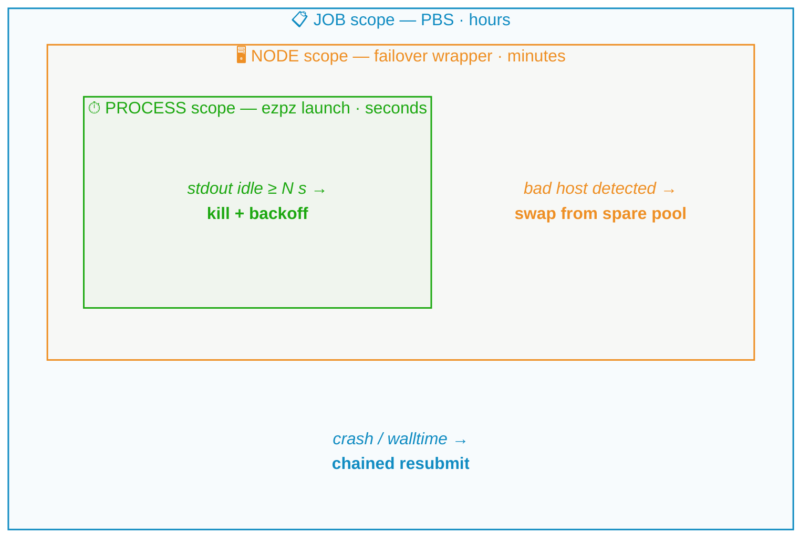
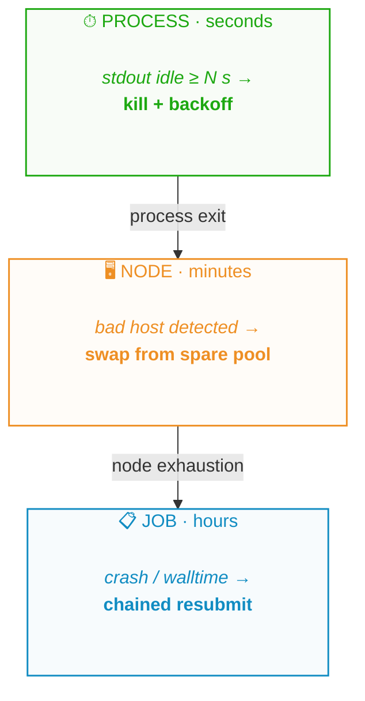
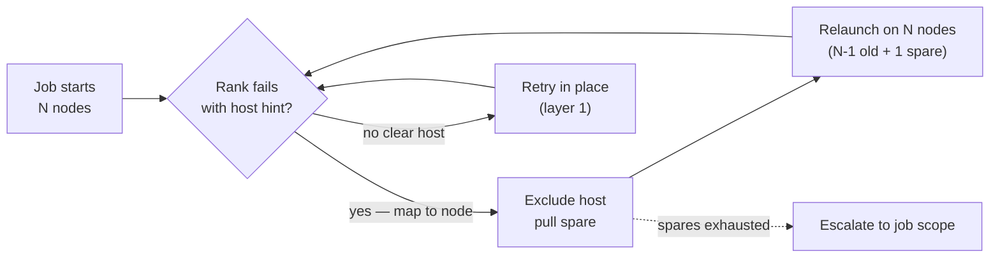
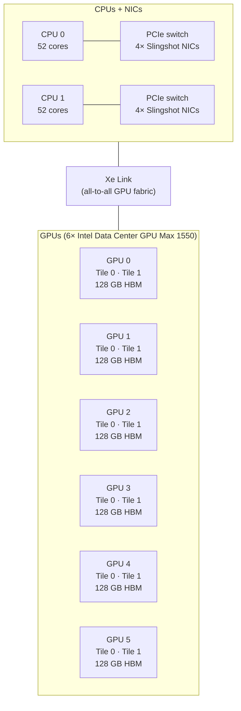

import Slide from '@/components/slides/Slide.astro'
import SpeakerNotes from '@/components/slides/SpeakerNotes.astro'
import Cols from '@/components/slides/Cols.astro'
import Col from '@/components/slides/Col.astro'

export const ASSETS = 'https://samforeman.me/assets'

{/* ================================================================
    DEPEND Annual Retreat · 2026-10-30 · 45 min + Q&A
    Title: Towards Resilient Training and Fault-Tolerant Software at ALCF

    AUDIENCE: DEPEND faculty + grad students. They know fault tolerance
    cold — Paxos, checkpoint/restart theory, MTTF models — but most have
    not run a 2k-node training job for days and watched it fail in
    novel ways. The job is to make ALCF-scale training legible as a
    dependability problem and to hand them real failure data + open
    questions worth collaborating on.

    GOAL (in the attendee's words): "that was interesting — they're doing
    cool, credible resilient-training-at-scale work at ALCF." Not a sales
    pitch. A systems talk with numbers.

    ARC (3 acts, ~45 min):
      I  Scale makes failure the default  (10 min)
         The math of MTBF at 2k nodes + what the big labs saw (Llama 3,
         OPT, BLOOM) → why dependability is a first-order training concern.
      II What actually fails at ALCF       (15 min)
         Empirical taxonomy from real Aurora/AuroraGPT runs. Lustre melt,
         CCL, watchdog kills, silent bad steps.
      III How we keep jobs alive today     (15 min)
         Three-scope recovery cascade (process → node → job), async
         checkpointing, and the measured cost. Then: what's still open.

    Leave 5 min for Q&A. Speaker notes carry timing pins.

    STATUS: SCAFFOLD. Every slide renders; prose is drafted; figures are
    mermaid/tables so there is no missing-asset build break. The author
    should replace bracketed placeholders with their preferred anecdotes
    and verify any number they plan to quote on stage.

    Figures: none required beyond mermaid. Optional polish — drop real
    Aurora hero photo, SFT survival trace, or checkpoint-overhead chart
    into ./figures/ and reference them.
 ================================================================ */}

{/* ── Title ───────────────────────────────────────────────────── */}
<Slide id="title-slide">

# Towards Resilient Training and Fault-Tolerant Software at ALCF

### Reliability as a first-order design problem for AI-for-Science at scale

    Sam Foreman · Argonne National Laboratory

_DEPEND Annual Retreat · October 30, 2026 — UIUC_

<a
    class="title-slide-qr"
    href="https://samf.sh/talks/2026/10/30"
    aria-label="QR code linking to these slides">
    Interactive version: live diagrams + links
    
    samf.sh/talks/2026/10/30
</a>

<SpeakerNotes>
45 min + Q&A. Goal: the hallway takeaway is "that was interesting — ALCF is doing cool, credible resilient-training work at real scale and there are meaty open problems here."

Open with who you are in one line (ALCF, AuroraGPT / ezpz), then hand the room the contract: I — why scale forces the dependability question, II — what actually fails on Aurora, III — how we keep jobs alive and what we haven't solved. Tell them up front which parts carry real operational numbers and which are open questions you'd like their help on.

~2 min on this slide.
</SpeakerNotes>

</Slide>

{/* ── Context: ALCF + Aurora in one slide ─────────────────────── */}
<Slide id="context">

## ALCF and Aurora

[**Aurora**](https://docs.alcf.anl.gov/aurora) — `10,624` nodes · `127,488` XPUs (12 tiles / node in `FLAT` mode) · HPE Cray EX · Slingshot-11 · [system paper](https://arxiv.org/abs/2509.08207). DOE open science at the [ALCF](https://alcf.anl.gov) (with `Polaris`: 560× A100).

My corner: AI-for-Science campaigns (`AuroraGPT`, `MProt-DPO`, `AERIS`) and the glue between PyTorch and the machine — [`ezpz`](https://github.com/saforem2/ezpz) / [`torchtitan/ezpz`](https://github.com/saforem2/torchtitan/tree/ezpz).

**XPU** = one GPU tile exposed as `torch.xpu` in `FLAT` mode — **12 / node**. `Polaris` runs the same software at smaller *N* — fewer surprises, same bugs.

<SpeakerNotes>
Set scale once and move on. 10,624 nodes is the number that makes every rare event common. Polaris contrast is useful later — same training code, smaller N, fewer surprises — so name it here.

~2 min. Don't linger on hardware; this crowd knows what an interconnect is.
</SpeakerNotes>

</Slide>

{/* ── Talk outline ────────────────────────────────────────────── */}
<Slide id="frame">

## What we'll cover

- **I · Inevitable** — *Why does scale force dependability into the design?*
    - The MTBF math at 2k nodes + what Llama 3 / OPT / BLOOM actually ate.

- **II · Observed** — *What really fails on Aurora?*
    - An empirical taxonomy from real runs — not a textbook list.

- **III · Alive** — *How do we keep a multi-day job running?*
    - A 3-scope recovery cascade, its measured cost, and the open problems.

By the end: where the interesting research lives, and where we'd love collaborators.

<SpeakerNotes>
This is the contract slide. Read it literally — then keep the promise. I = the inevitability argument (with numbers). II = the empirical part (what broke). III = the systems answer (how we recover) plus the honest "what we haven't solved."

~1 min.
</SpeakerNotes>

</Slide>

{/* ── Why DEPEND should care ──────────────────────────────────── */}
<Slide id="why-depend">

## Why this is a DEPEND talk

**Training is a dependability problem now:**

- Long, tightly-coupled, all-reduce-bound — one dead rank stalls everyone
- State: TBs of model + optimizer; checkpoint is the *only* safe harbor
- Naïve restart cost: hours × thousands of nodes — wasted

**The tension:** failure rate scales with *N*; recovery cost scales with *state*. As models grow, both get worse — together.

**Why Aurora is a good lens:**

- New hardware + new `torch.xpu` — every layer can break, so we saw everything
- Real production jobs at 512–3,200 nodes, not just benchmarks
- Live failure data: hangs, bad nodes, Lustre stalls, loss spikes
- Portable stack (`ezpz`) → compare Intel / NVIDIA / AMD profiles

<SpeakerNotes>
Bridge slide: you're telling a systems crowd "this is your kind of problem, just wearing an ML costume." Name the tension explicitly: failure probability ∝ N, recovery cost ∝ state size, and both N and state are growing.

~2 min.
</SpeakerNotes>

</Slide>

{/* ── I-1: the inevitability math ─────────────────────────────── */}
<Slide id="inevitable-math">

## At scale, failure is math

Even with a generous **MTBF of 3 years per node** (~26k h), a **2,048-node** run (~25k `torch.xpu`s — ~20% of Aurora) has a

> **system MTBF ≈ 13 hours**

About once a day on a multi-day run — and that's before you count software. At 10k nodes it'd be ~2.5 h, but we don't actually run 10k for weeks; the 2k figure is the honest one.

| Campaign | Scale | What they reported |
| --- | --- | --- |
| **Llama 3 405B** (Meta, 2024)[^llama3] | 16K H100 · 54 days | **419** interruptions — ~1 / 3 h, 78% hardware, mostly HBM/NIC |
| **OPT-175B** (Meta, 2022)[^opt] | ~1K A100 · 2 months | **35** manual restarts + 100+ cycled hosts |
| **BLOOM-176B** (BigScience, 2022)[^bloom] | 384 A100 · 3.5 months | Frequent loss spikes; embedding-norm + checkpoint cadence as mitigation |
| **GLM-130B** (Zeng et al., 2023)[^glm] | 96 → 392 DGX-A100 | Spikes "increasingly frequent" at scale; some recover, some go to NaN |

[^llama3]: [Llama 3 herd of models](https://arxiv.org/abs/2407.21783) §3.3.2 *Training reliability*.
[^opt]: [OPT-175B chronicles](https://github.com/facebookresearch/metaseq/blob/main/projects/OPT/chronicles/OPT175B_Logbook.pdf) (Zhang et al., 2022).
[^bloom]: [BLOOM: 176B open-access multilingual LM](https://arxiv.org/abs/2211.05100) (BigScience, 2022).
[^glm]: [GLM-130B](https://arxiv.org/abs/2210.02414) (Zeng et al., ICLR 2023).

<SpeakerNotes>
You don't need the audience to believe your MTBF number — you need them to feel the shape: even excellent per-node reliability collapses at 2k nodes. Llama 3's 1-per-3h is the canonical anchor; OPT/BLOOM/GLM show it's not a Meta-specific story. The 13 h figure is for a realistic 2k-node allocation (20% of Aurora, ~25k XPUs); the 2.5 h at 10k is what a full-machine reservation would see — rare, but sets the scale.

Pause on the 13 h number and note it's the honest one — we don't run 10k for two weeks. Then: every system in the table was NVIDIA. Aurora's numbers are similar in magnitude but different in composition — which is the next section.

~3 min. This is the most citable slide in the deck; get the references right.
</SpeakerNotes>

</Slide>

{/* ── I-2: scheduling tension ─────────────────────────────────── */}
<Slide id="scheduling-tension">

## And the scheduler makes it worse

We get **big, short, shared** allocations. Training wants **long, tightly-coupled, stateful**.

- **Too big** — `INCITE` = ≥ 20% of Aurora (~2k nodes)[^incite] → huge batch, worse optimization[^zhang25]
- **Too short** — walltime is hours, runs are weeks; every restart boundary can silently fail
- **Too shared** — Lustre is communal; import storms stall you *and* your neighbors
- **Too stuck** — no preemption/migration, so one bad node holds 10k hostage unless *you* route around it

[^incite]: [ALCF INCITE program](https://www.alcf.anl.gov/alcf-incite-program).
[^zhang25]: Zhang et al., critical batch size — see `ezpz` LR-finder notes; McCandlish et al. (2018).

**Resilience isn't a feature at Aurora scale — it's the thing that decides whether the science finishes.**

<SpeakerNotes>
This is where the HPC crowd nods and the DEPEND crowd leans in. You're describing a mismatch between the facility's allocation model (big, short, shared) and the workload's needs (long, tightly-coupled, stateful). The last row — no preemption — is the one that forces user-level fault tolerance.

~2 min.
</SpeakerNotes>

</Slide>

{/* ── II-1: transition ────────────────────────────────────────── */}
<Slide id="observed" variant="dark">

## Part II — What actually fails

### What we've actually seen break

_An empirical taxonomy from Aurora operations — real runs, not a textbook._

<SpeakerNotes>
Transition. Tell them what this section is and isn't: not an exhaustive FMEA, but what has actually paged us in the last 12–18 months of AuroraGPT / Aurora campaigns. You're trading completeness for honesty.

~30s.
</SpeakerNotes>

</Slide>

{/* ── II-2: failure taxonomy ──────────────────────────────────── */}
<Slide id="failure-taxonomy">

## What actually fails: a taxonomy

| Scope | Examples we've seen | Typical symptom | Who recovers |
| --- | --- | --- | --- |
| **Hardware** | HBM ECC, GPU hang, NIC reset, node crash | Rank disappears · NCCL timeout · `SIGSEGV`/`SIGABRT` | Scheduler + spare nodes |
| **Fabric** | Slingshot transient, oneCCL/MPI transport wedge | `ALLGATHER` hangs · collective timeout (default 600s) | Watchdog kill → retry |
| **Storage** | Lustre import stall, metadata storm | Ranks block on ckpt / data load · stdout goes quiet | Watchdog; backoff; resubmit |
| **Software stack** | `torch.xpu` kernel gap, XCCL collective bug, DeepSpeed fragility at scale | Deterministic crash at same step · `CheckpointError` (routing nondeterminism) | Pin / patch; exclude op |
| **Training dynamics** | Loss spike → NaN, silent bad step (no crash, wrong answer) | Diverging norm · eval regression with no error | Spike detector; rollback to last good ckpt |

**Pattern:** inner layers catch most events; silent data / training faults are the hardest because nothing crashes.

<SpeakerNotes>
Walk the table bottom-to-top or top-to-bottom, your call — but land on the last row. Everything above it is at least detectable (something crashes or hangs). The bottom row — silent bad steps, slow divergence — is where DEPEND folks will recognize Byzantine / fail-silent vs. fail-stop and start asking good questions.

Have 1–2 concrete job IDs or dates ready verbally even if you don't put them on the slide. "SFT run that took 3 SIGABRTs" is more credible than a generic row.

~4 min. This is the densest slide; don't rush the last row.
</SpeakerNotes>

</Slide>

{/* ── II-3: vignettes ─────────────────────────────────────────── */}
<Slide id="vignettes">

## Three vignettes from real runs

<Cols>
<Col>

**1. The bf16 cliff — 80B, every optimizer dead by step 14**
- At `dim=9216`, bf16: `mano` diverged at step 5, AdamW at 9, SophiaG at 14 — grad NaN while loss still looked flat
- Same corner, three optimizers ⇒ **physics, not tuning** (two triggers: `LBS>1` and large `dp_degree`)
- Stable today only at `TP=4 · LBS=1 · GBS=372` (9.8% MFU) — still hunting a scalable fix

**2. The async-collective hang — `CCL_OP_SYNC` matters**
- `FSDP2 + TP>1` with oneCCL hung forever on async collectives; NCCL-style default doesn't hold on XPU
- Fix: `ezpz` now forces `CCL_OP_SYNC=1` for that config (`3904431`) — documented, not optional
- Lesson: vendor-default collectives aren't vendor-portable

</Col>
<Col>

**3. SFT that wouldn't die — 32N, 3 `SIGABRT`s, 4 attempts**
- 32-node SFT (`tulu_math_uc_mix`, 4.5B tokens): oneCCL transport fault at 32N, three different hosts
- Each crash → watchdog kill → spare-node swap → resume from last durable checkpoint
- Final loss **0.77**, asset `checkpoint-729-hf` reused by GRPO the next day — no human in the loop

> Freshest real incidents you can name on stage — swap any one if you have a newer story with a number.

</Col>
</Cols>

<SpeakerNotes>
Vignettes 1 and 2 are more recent than the old Lustre/NCCL pair — they show a numerical cliff (1) and a portability bug (2) alongside the recovery machinery (3). If you have a still-fresher incident (e.g., large-node GRPO, 20B/512N recovery), swap 2 or 3; keep 1 — the bf16 cliff is the most DEPEND-flavored.

~3 min. One minute per story, not bullet recitation. The bf16 cliff's punchline is "same failure, three optimizers → not tuning."
</SpeakerNotes>

</Slide>

{/* ── III-1: transition ───────────────────────────────────────── */}
<Slide id="alive" variant="dark">

## Part III — How we keep jobs alive

### Three scopes, three loops — and what they still miss

<SpeakerNotes>
Transition into the systems answer. Frame it as: we didn't design this top-down — we grew it by closing the loop on each class of failure from the taxonomy. Three scopes fell out naturally.

~30s.
</SpeakerNotes>

</Slide>

{/* ── III-2: the cascade ──────────────────────────────────────── */}
<Slide id="restart-cascade">

## Three layers of recovery

Each layer operates at a different scope and timescale. Inner loops catch most failures; outer loops catch the rest.

**Read it inside-out:** process hang → node swap → job resubmit. Each escalation is more expensive and rarer.

<SpeakerNotes>
This diagram is the conceptual anchor of Part III. Read it inside-out in your narration: the innermost loop (seconds) handles the common case (a collective wedges, stdout goes quiet), the middle loop (minutes) handles the bad-host case, the outer loop (hours) handles "we need a new PBS allocation entirely."

Name the concrete mechanism for each: ezpz watchdog, failover wrapper + spare pool, PBS chained resubmit + checkpoint restart. Promise to detail each next.

~2 min.
</SpeakerNotes>

</Slide>

{/* ── III-3: process scope ────────────────────────────────────── */}
<Slide id="layer-process">

## Layer 1 — Process scope (seconds)

**Hang without a crash** → NCCL's 600s timeout fires, but the job just idles and burns allocation.

**Fix — stdout-idle watchdog** (`ezpz launch`): no output for *N* seconds (default 30 min with `--auto-retry`) → kill `mpiexec` (124), backoff, retry in place. Same path for NCCL kills and walltime crashes.

- Catches hangs that silence logging (fabric wedge, Lustre stall)
- Costs one interval + backoff — seconds to minutes, not hours
- Too short = kills healthy long steps; too long = wastes time (tune per job)

<SpeakerNotes>
This is the layer most DEPEND folks will recognize as a heartbeat / failure detector. Call it that explicitly — "this is our application-level heartbeat; stdout is the heartbeat signal because it's the one thing every training step touches."

Mention the failure mode it doesn't catch: silent bad steps where stdout keeps flowing but the math is wrong. That's the hard problem you return to later.

~3 min.
</SpeakerNotes>

</Slide>

{/* ── III-4: node scope ───────────────────────────────────────── */}
<Slide id="layer-node">

## Layer 2 — Node scope (minutes)

**Problem:** a single bad host poisons every retry. Re-running on the same allocation just re-hits the same HBM fault or flaky NIC.

**Mechanism — bad-node failover:**

- Host mapping from rank → node via `PBS_NODEFILE` / `hostfile`; CCL/MPI error often names the offender
- Spare pool sized as ~1–2% of allocation (e.g., 20 spares for a 1k-node run) — cheap vs. the cost of a full resubmit
- Exclusion list persists across retries within the same PBS job

<SpeakerNotes>
This is the "this is just RAID for nodes" slide — say that. DEPEND knows spare-disk / hot-spare patterns; you're applying the same idea to compute nodes. The interesting bit is the host-identification problem: not every failure names its host cleanly, so you have to decide when you have enough signal to exclude.

If you have a number — "this saved us X hours on the 2B 512-node chain" — put it here. One measured anecdote beats a generic claim.

~3 min.
</SpeakerNotes>

</Slide>

{/* ── III-5: job scope ────────────────────────────────────────── */}
<Slide id="layer-job">

## Layer 3 — Job scope (hours)

**Job's over** — walltime expired, allocation ended, or spares exhausted.

**Fix — checkpoint-restart + chained resubmit:** async writes `model + optimizer + RNG + dataloader` (&lt; 5% step-time cost). Each checkpoint is a durable asset (e.g., `checkpoint-729-hf`) that SFT/GRPO can branch from. Job *N* submits *N+1* at launch — if *N* dies, *N+1* resumes from the latest one, no human needed.

**Checkpoint interval is a policy choice:** too frequent → I/O tax; too sparse → expected lost work on failure grows. Young's formula (1974) and Daly (2006) give the optimum — but they assume known MTBF and negligible detection delay. At Aurora scale, neither holds cleanly.

<SpeakerNotes>
This is the outermost loop. Emphasize two things: (1) checkpoint is the ONLY durable boundary — everything else is best-effort; (2) chained resubmit is what turns a collection of PBS jobs into a single logical training run.

The callout is your bridge to the open-problems section: even the classic checkpoint-interval math breaks down when MTBF is short and failure detection is itself noisy. That's a research question, not a solved problem.

~3 min.
</SpeakerNotes>

</Slide>

{/* ── Checkpoint deep dive ────────────────────────────────────── */}
<Slide id="checkpoint-detail">

## Checkpointing: the durable boundary

<Cols>
<Col>

**What we save:**

- Weights (sharded, `DTensor`/`FSDP2`-aware) + optimizer state (~2× model size)
- RNG, dataloader cursor, LR scheduler, step count

**Cost:**

- `42 GB` per checkpoint at 7B bf16 (14 weights + 28 optimizer)
- Async hides most of it; final `fsync` + metadata still blocks
- Shared Lustre — contention is real

</Col>
<Col>

**What we don't yet do well:**

- **Which one is good?** A NaN 100 steps ago poisons every later one
- **Is it good?** Cheap probe before committing the chain?
- **Where does it live?** Burst buffer → Lustre → HPSS — who decides?
- **Determinism tax** — bit-identical resume costs real speed (next slide)

> **For DEPEND:** classic recovery-point selection, but correctness is statistical, not boolean.

</Col>
</Cols>

<SpeakerNotes>
You can cut this slide if you're long, but it's the one that makes checkpointing feel like a research problem rather than an engineering chore. The left column is "here's what we do," the right is "here's what we don't know how to do well." The last line is for the DEPEND crowd — they know recovery points; you're adding "but the correctness oracle is noisy."

~2 min if kept; skip cleanly if time is tight.
</SpeakerNotes>

</Slide>

{/* ── Evidence: SFT survived ──────────────────────────────────── */}
<Slide id="evidence-sft">

## Evidence: a job that survived

**AuroraGPT-2B SFT on `tulu_math_uc_mix` — 32 nodes, GBS 6,144, 3 epochs (~4.5B tokens)**

| Attempt | What happened | Outcome |
| --- | --- | --- |
| 1 | `SIGABRT` in oneCCL transport (scale-only, 32N) | Watchdog kill → node swap → resume |
| 2 | `SIGABRT` again, different host | Same path |
| 3 | `SIGABRT`, third host | Same path |
| 4 | Clean run to completion | **Final loss 0.77** · `checkpoint-729-hf` as durable asset |

- **No human intervention** between attempts — all three scopes handled it
- Downstream GRPO branched from `checkpoint-729-hf` the next day
- The "failures" were real oneCCL bugs at this scale, not flaky infra — fixing them is parallel work

> Swap in your freshest survival story. One table with attempt-level detail beats three vague anecdotes.

<SpeakerNotes>
This is your credibility slide. You're showing that the cascade actually works on a real production run, with enough detail (4 attempts, 3 SIGABRTs, final loss number) that the audience trusts it's not a cartoon.

If you have a more recent or larger-scale example (e.g., a 512-node pre-training chain that survived N restarts), prefer it — bigger N is more interesting to this crowd. Keep the table shape.

~2 min.
</SpeakerNotes>

</Slide>

{/* ── Determinism tradeoff ────────────────────────────────────── */}
<Slide id="determinism">

## The determinism tax

Speed, reproducibility, and reliability pull in three directions.

| Mode | Throughput | Resume | Debug |
| --- | --- | --- | --- |
| **Non-deterministic** (default) | Fastest — async reductions | Loss may wobble | Same seed ≠ same path |
| **Deterministic** (fixed reductions, `CUBLAS_WORKSPACE_CONFIG`, …) | **10–30% slower** | Bit-identical, invisible | Bisect to the bad step |

**We train fast, checkpoint smart** — non-deterministically for speed, but save RNG + reduction order so *rollback* is reproducible.

> **Open:** selective determinism — only on the recovery path, or only the suspect collective — without paying full price?

<SpeakerNotes>
This slide is catnip for a dependability audience because it's the classic "reproducibility vs. availability" tradeoff in new clothes. Frame it as: we want the performance of non-determinism and the debuggability of determinism, and right now we pay for one or the other.

The open question at the bottom is a genuine invitation — if someone in the room works on deterministic replay, record/replay, or selective instrumentation, this is their hook.

~2 min.
</SpeakerNotes>

</Slide>

{/* ── What still breaks ───────────────────────────────────────── */}
<Slide id="still-breaks">

## What still breaks

What the three layers *don't* handle — and why each is a research problem.

| Gap | Why it's hard | Done looks like |
| --- | --- | --- |
| **Silent bad steps** — wrong grad, slow drift, no crash | No oracle; NaN is late, eval is costly/noisy | Cheap online anomaly detector |
| **Loss-spike oracle** — rollback or ride it out? | Spikes can self-heal *or* go terminal; threshold is workload-specific | Learned classifier: rollback vs. continue |
| **Checkpoint interval at scale** | Young's optimum assumes known MTBF; ours drifts with scale, code, Lustre | Adaptive interval from observed failures |
| **Is this checkpoint good?** | Eval on every ckpt costs tokens/time | Lightweight probe, high recall for poison |
| **Heterogeneous reliability** — XPU vs. H100 vs. MI300 differ | Portable stack surfaces it, policy doesn't adapt | Per-platform model tuning watchdog/spare/ckpt |

<SpeakerNotes>
This is the "honest" slide — and for DEPEND, it's the most important one in the talk. You're not selling a solved system; you're mapping the frontier and naming the gaps in a way that a dependability researcher can see where they'd plug in.

Read the left column, pause on the middle, land on the right. The right column is written as "what done looks like" deliberately — it's a call for collaboration phrased as a spec.

~4 min. Don't rush this; this is what they'll ask about in Q&A.
</SpeakerNotes>

</Slide>

{/* ── Open questions / invitation ─────────────────────────────── */}
<Slide id="open-questions">

## Open questions — where we'd love collaborators

**If you work on any of these, let's talk after:**

1. **Honest heartbeats** — stdout + NCCL timeouts are crude and late. What's the right in-band signal for a wedged collective at 10k ranks?

2. **Cheap correctness oracles** — bad grad or poisoned checkpoint without a full eval? Checksums, invariants, shadow passes.

3. **Adaptive checkpointing** — MTBF drifts with scale, code, Lustre weather. How do we learn the schedule online?

4. **Selective determinism** — deterministic resume without deterministic training. Record just enough to replay the failure.

5. **Cross-platform reliability** — same workload, three accelerators, three failure modes. Can one model predict and adapt?

6. **Resilience-aware scheduling** — if the scheduler *knew* the job was long and tightly-coupled, what would it do? Preemption? Migration? Reservation?

<SpeakerNotes>
This is the invitation slide. Read it as "here are six PhD-sized problems that our operational data can ground." You're not asking for help as a favor — you're offering a real-scale testbed (Aurora) and real failure traces in exchange for their expertise.

Leave this up during Q&A if there's a lull — it's a better conversation starter than a blank "Questions?" slide.

~3 min, or 1 min + carry into Q&A.
</SpeakerNotes>

</Slide>

{/* ── Takeaways ───────────────────────────────────────────────── */}
<Slide id="takeaways">

## Takeaways

1. **At 2k nodes, failure is the default** — even heroic per-node MTBF collapses system-wide (~1 per day; ~2.5 h at 10k). Design for it.

2. **Most failures are mundane; the hard ones are silent** — hardware/NIC/fabric are noisy and detectable; bad grads and slow drift aren't.

3. **Recovery wants layers** — process (seconds) → node (minutes) → job (hours). Each catches what the inner one can't.

4. **Checkpoint is the only safe harbor** — interval, validation, and cost dominate reliability. Async helps; provenance doesn't yet exist.

5. **The open problems are dependability problems** — detection, oracles, adaptive policies, determinism, cross-platform models, scheduling.

<SpeakerNotes>
Five bullets, five sentences. Don't add a sixth. This is the slide people photograph.

Re-state the three-scope mantra one last time — it's the thing you want them to remember in the hallway. End on the collaboration note, not a summary.

~1.5 min.
</SpeakerNotes>

</Slide>

{/* ── Links ───────────────────────────────────────────────────── */}
<Slide id="links">

## Links and artifacts

| Artifact | URL |
| --- | --- |
| These slides | [`samf.sh/talks/2026/10/30`](https://samf.sh/talks/2026/10/30) |
| Portable training (`ezpz`) | [`github.com/saforem2/ezpz`](https://github.com/saforem2/ezpz) — same program on Intel / NVIDIA / AMD |
| `torchtitan` on XPU | [`github.com/saforem2/torchtitan/tree/ezpz`](https://github.com/saforem2/torchtitan/tree/ezpz) |
| Checkpoint-restart guide | [`ezpz.cool/guides/checkpoint-restart`](https://ezpz.cool/guides/checkpoint-restart/) |
| Aurora system paper | [`arxiv.org/abs/2509.08207`](https://arxiv.org/abs/2509.08207) |
| Aurora docs | [`docs.alcf.anl.gov/aurora`](https://docs.alcf.anl.gov/aurora) |

QR on the title slide goes to the live deck — mermaid diagrams are interactive and every citation is a real link.

<SpeakerNotes>
Quick links slide. Don't read it — just leave it up for 15 seconds so people can snap it, then move to thanks/Q&A.

~30s.
</SpeakerNotes>

</Slide>

{/* ── Acks / close ────────────────────────────────────────────── */}
<Slide id="acks">

## Thanks — and let's talk

Thanks to the ALCF operations team, the AuroraGPT crew, and the Intel `torch.xpu` / oneCCL teams — none of this runs without them.

**I'd especially love to hear from you if:**

- You've built failure detectors, checkpoint oracles, or adaptive recovery policies and want a 2k-node testbed (full-machine if the science needs it)
- You think about scheduling, silent errors, or heterogeneous reliability
- You just want the failure traces — we can share what we're allowed to

| | |
| --- | --- |
| **Sam Foreman** | `samf@anl.gov` · [`samf.sh`](https://samf.sh) · [`github.com/saforem2`](https://github.com/saforem2) |
| **ALCF** | [`alcf.anl.gov`](https://alcf.anl.gov) · [`docs.alcf.anl.gov`](https://docs.alcf.anl.gov) |

<SpeakerNotes>
Close warm, not formal. Re-state the invitation from the open-questions slide in human terms: "if any of that sounded like your work, come find me — we have the machine and the traces, you have the ideas."

Leave this up for Q&A. The open-questions slide is a good fallback if someone asks "what's next?"

~1 min + Q&A.
</SpeakerNotes>

</Slide>

{/* ── Appendix: Aurora node ───────────────────────────────────── */}
<Slide id="aurora-node">

## Appendix — Aurora node

Two CPU sockets · three GPUs/socket · two tiles/GPU = **12 XPUs / node**

Logical schematic, not a wiring diagram. [ALCF node topology](https://docs.alcf.anl.gov/aurora/images/aurora_node_dataflow.png) · [Aurora system paper](https://arxiv.org/abs/2509.08207) · [Tile-as-device config](https://docs.alcf.anl.gov/aurora/data-science/frameworks/pytorch/)

<SpeakerNotes>
Appendix — only show if someone asks "what's in a node?" 12 tiles/node is the number that turns 10,624 nodes into 127,488 XPUs.

~30s if shown.
</SpeakerNotes>

</Slide>

{/* ── Appendix: Young/Daly reference ──────────────────────────── */}
<Slide id="appendix-checkpoint-math" size="sm">

## Appendix — Checkpoint-interval math (Young / Daly)

Classic result: optimum checkpoint interval

> **T* ≈ √(2 · C · MTBF)**  (Young, 1974) · refined by Daly (2006) for failure-during-checkpoint

where **C** = checkpoint write time, **MTBF** = mean time between failures.

| Assumption | Holds at Aurora scale? |
| --- | --- |
| MTBF is known and stationary | **No** — varies with N, code version, Lustre load, even time of day |
| Failures are independent, memoryless (exponential) | **Roughly** for hardware; **no** for software regressions (correlated, bursty) |
| Detection is instant | **No** — NCCL timeout is 600s; watchdog is 30 min by default |
| Checkpoint cost C is constant | **No** — shared Lustre BW is contended; async hides most but not `fsync` |

**Implication:** the closed-form optimum is a starting guess, not a policy. We need an *adaptive* interval learned from the observed failure process.

<SpeakerNotes>
Appendix — pull up if someone asks about checkpoint frequency. The point is: the textbook answer exists, but its assumptions break in exactly the ways that make Aurora interesting.

~1 min if shown.
</SpeakerNotes>

</Slide>

