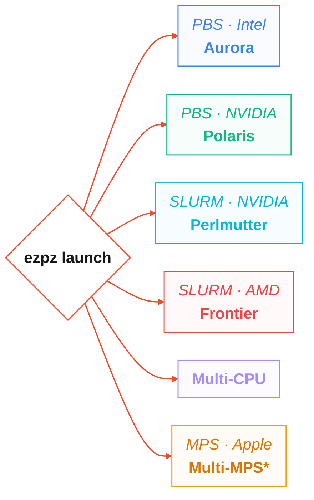
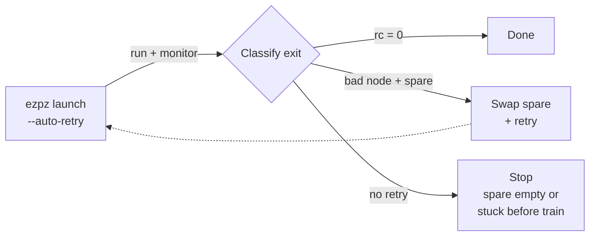
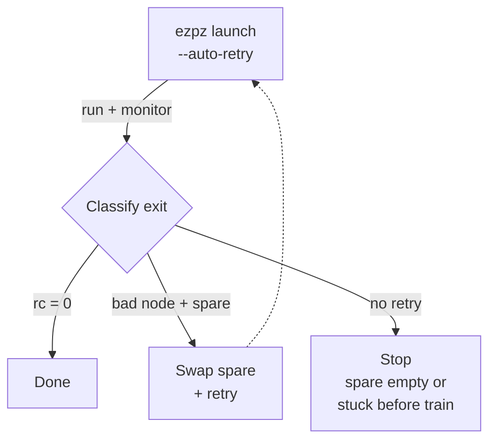
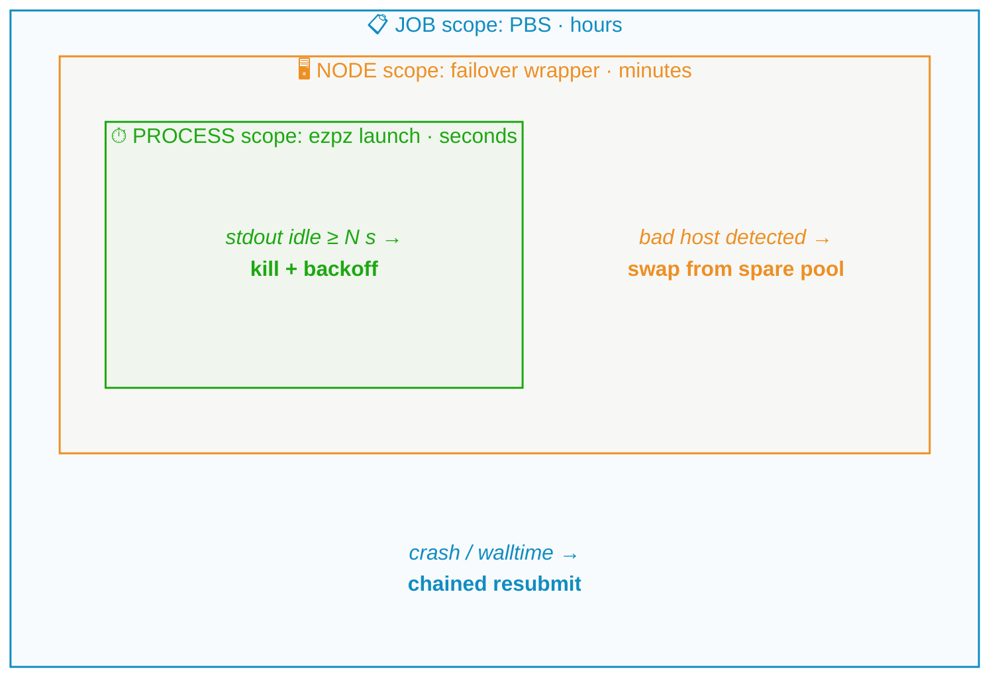
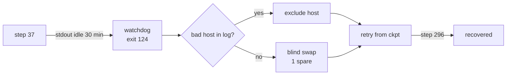
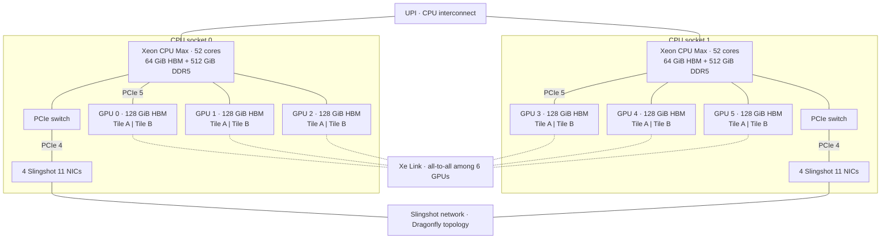

import Slide from '@/components/slides/Slide.astro'
import SpeakerNotes from '@/components/slides/SpeakerNotes.astro'
import Cols from '@/components/slides/Cols.astro'
import Col from '@/components/slides/Col.astro'

export const ASSETS = 'https://samforeman.me/assets'

{/* ================================================================
    DEPEND Annual Retreat · 2026-10-30 · 45 min + Q&A
    Title: Towards Resilient Training and Fault-Tolerant Software at ALCF

    AUDIENCE: DEPEND faculty + grad students. They know fault tolerance
    cold — Paxos, checkpoint/restart theory, MTTF models — but most have
    not run a 2k-node training job for days and watched it fail in
    novel ways. The job is to make ALCF-scale training legible as a
    dependability problem and to hand them real failure data + open
    questions worth collaborating on.

    GOAL (in the attendee's words): "that was interesting — they're doing
    cool, credible resilient-training-at-scale work at ALCF." Not a sales
    pitch. A systems talk with numbers.

    ARC (3 acts, ~45 min):
      I  Scale makes failure the default  (10 min)
         The math of MTBF at 2k nodes + what the big labs saw (Llama 3,
         OPT, BLOOM) → why dependability is a first-order training concern.
      II What actually fails at ALCF       (15 min)
         Empirical taxonomy from real Aurora/AuroraGPT runs. Lustre melt,
         CCL, watchdog kills, silent bad steps.
      III How we keep jobs alive today     (15 min)
         Three-scope recovery cascade (process → node → job), async
         checkpointing, and the measured cost. Then: what's still open.

    Leave 5 min for Q&A. Speaker notes carry timing pins.

    STATUS: SCAFFOLD. Every slide renders; prose is drafted; figures are
    mermaid/tables so there is no missing-asset build break. The author
    should replace bracketed placeholders with their preferred anecdotes
    and verify any number they plan to quote on stage.

    Figures: none required beyond mermaid. Optional polish — drop real
    Aurora hero photo, SFT survival trace, or checkpoint-overhead chart
    into ./figures/ and reference them.
 ================================================================ */}

{/* ── Title ───────────────────────────────────────────────────── */}
<Slide id="title-slide">

# Towards Resilient Training and Fault-Tolerant Software at ALCF

### Reliability as a first-order design problem for AI-for-Science at scale

<div class="title-authors">
    <span>Sam Foreman · Argonne National Laboratory</span>
</div>

<div class="title-conf-line">_DEPEND Annual Retreat · October 30, 2026 — UIUC_</div>

<a
    class="title-slide-qr"
    href="https://samf.sh/talks/2026/10/30"
    aria-label="QR code linking to these slides">
    <span class="title-qr-print-note">Interactive version: live diagrams + links</span>
    
    <span>samf.sh/talks/2026/10/30</span>
</a>


<SpeakerNotes>
45 min + Q&A. Goal: the hallway takeaway is "that was interesting — ALCF is doing cool, credible resilient-training work at real scale and there are meaty open problems here."

Open with who you are in one line (ALCF, AuroraGPT / ezpz), then hand the room the contract: I — why scale forces the dependability question, II — what actually fails on Aurora, III — how we keep jobs alive and what we haven't solved. Tell them up front which parts carry real operational numbers and which are open questions you'd like their help on.

~2 min on this slide.
</SpeakerNotes>

</Slide>

{/* ── Context: ALCF + Aurora in one slide ─────────────────────── */}
<Slide id="context">

## ALCF and Aurora

- **Aurora** — `10,624` nodes · `127,488` XPUs (12 tiles / node in `FLAT` mode) · HPE Cray EX · Slingshot-11 · [system paper](https://arxiv.org/abs/2509.08207)
- **ALCF** — DOE open science · [`Aurora`](https://docs.alcf.anl.gov/aurora) + [`Polaris`](https://docs.alcf.anl.gov/polaris) (560× A100)
- **My corner** — AI-for-Science campaigns (`AuroraGPT`, `MProt-DPO`, `AERIS`) and the glue between PyTorch and the machine: [`ezpz`](https://github.com/saforem2/ezpz) / [`torchtitan/ezpz`](https://github.com/saforem2/torchtitan/tree/ezpz)

<span class="context-xpu-definition">`XPU` is one GPU tile exposed as `torch.xpu` in `FLAT` mode. **12 / node.** `Polaris` runs the same software at smaller *N* — fewer surprises, same bugs.</span>

<SpeakerNotes>
Set scale once and move on. 10,624 nodes is the number that makes every rare event common. Polaris contrast is useful later — same training code, smaller N, fewer surprises — so name it here.

~2 min. Don't linger on hardware; this crowd knows what an interconnect is.
</SpeakerNotes>

</Slide>

{/* ── Talk outline ────────────────────────────────────────────── */}
<Slide id="frame">

## Outline

- **I · Inevitable** — *Why does scale force dependability into the design?*
    - The MTBF math at 2k nodes and what Llama 3 / OPT / BLOOM ate.


- **II · Observed** — *What really fails on Aurora?*


- **III · Alive** — *How do we keep a multi-day job running?*
    - A 3-scope recovery cascade, its measured cost, and the open problems.

<SpeakerNotes>
This is the contract slide. Read it literally — then keep the promise. I = the inevitability argument (with numbers). II = the empirical part (what broke). III = the systems answer (how we recover) plus the honest "what we haven't solved."

~1 min.
</SpeakerNotes>

</Slide>

{/* ── Why DEPEND should care ──────────────────────────────────── */}
<Slide id="why-depend">

## Training is a dependability workload

<div class="why-depend-grid">

<div>

**Training is a dependability problem now:**

- Long, tightly coupled, all-reduce bound. One dead rank stalls everyone.
- State: TBs of model + optimizer. Checkpoint is the *only* safe harbor.
- Naïve restart cost: hours × thousands of nodes, wasted.

**The tension:** failure rate scales with *N*. Recovery cost scales with *state*. As models grow both get worse together.

</div>

<div>

**Why Aurora is a good lens:**

- New hardware + new `torch.xpu`. Every layer can break, so we saw everything.
- Real production jobs at 512–3,200 nodes, not just benchmarks
- Live failure data: hangs, bad nodes, Lustre stalls, loss spikes
- Portable stack (`ezpz`) → compare Intel / NVIDIA / AMD profiles

</div>

</div>

<SpeakerNotes>
Bridge slide: you're telling a systems crowd "this is your kind of problem, just wearing an ML costume." Name the tension explicitly: failure probability ∝ N, recovery cost ∝ state size, and both N and state are growing.

~2 min.
</SpeakerNotes>

</Slide>

{/* ── I-1: the inevitability math ─────────────────────────────── */}
<Slide id="inevitable-math">

## At scale, failure is math

Even with a generous **MTBF of 3 years per node** (~26k h), a **2,048-node** run (~25k `torch.xpu`s — ~20% of Aurora) has a

> **system MTBF ≈ 13 hours**

About once a day on a multi-day run.

| Campaign | Scale | What they reported |
| --- | --- | --- |
| **Llama 3 405B** (Meta, 2024)[^llama3] | 16K H100 · 54 days | **419** interruptions — ~1 / 3 h, 78% hardware, mostly HBM/NIC |
| **OPT-175B** (Meta, 2022)[^opt] | ~1K A100 · 2 months | **35** manual restarts + 100+ cycled hosts |
| **BLOOM-176B** (BigScience, 2022)[^bloom] | 384 A100 · 3.5 months | Frequent loss spikes; embedding-norm + checkpoint cadence as mitigation |
| **GLM-130B** (Zeng et al., 2023)[^glm] | 96 → 392 DGX-A100 | Spikes "increasingly frequent" at scale; some recover, some go to NaN |

[^llama3]: [Llama 3 herd of models](https://arxiv.org/abs/2407.21783) §3.3.2 *Training reliability*.
[^opt]: [OPT-175B chronicles](https://github.com/facebookresearch/metaseq/blob/main/projects/OPT/chronicles/OPT175B_Logbook.pdf) (Zhang et al., 2022).
[^bloom]: [BLOOM: 176B open-access multilingual LM](https://arxiv.org/abs/2211.05100) (BigScience, 2022).
[^glm]: [GLM-130B](https://arxiv.org/abs/2210.02414) (Zeng et al., ICLR 2023).

<SpeakerNotes>
You don't need the audience to believe your MTBF number — you need them to feel the shape: even excellent per-node reliability collapses at 2k nodes. Llama 3's 1-per-3h is the canonical anchor; OPT/BLOOM/GLM show it's not a Meta-specific story. The 13 h figure is for a realistic 2k-node allocation (20% of Aurora, ~25k XPUs). The 2.5 h at 10k is what a full-machine job would see, if you ever got one. Caveat out loud: we don't run 10k for weeks. Then: every system in the table was NVIDIA. Aurora's numbers are similar in magnitude but different in composition, which is the next section.

~3 min. This is the most citable slide in the deck; get the references right.
</SpeakerNotes>

</Slide>

{/* ── I-2: scheduling tension ─────────────────────────────────── */}
<Slide id="scheduling-tension">

## And the scheduler makes it worse

We get **big, short, shared** allocations. Training wants **long, tightly-coupled, stateful**.

- **Too big.** `INCITE` is ≥ 20% of Aurora (~2k nodes)[^incite]. That forces a huge batch and worse optimization[^zhang25].
- **Too short.** Walltime is hours, runs are weeks. Every restart boundary can silently fail.
- **Too shared.** Lustre is communal. Import storms stall you *and* your neighbors.
- **Too stuck.** No preemption or migration. One bad node holds 10k hostage unless you route around it.

[^incite]: [ALCF INCITE program](https://www.alcf.anl.gov/alcf-incite-program).
[^zhang25]: Zhang et al., critical batch size — see `ezpz` LR-finder notes; McCandlish et al. (2018).

<SpeakerNotes>
This is where the HPC crowd nods and the DEPEND crowd leans in. You're describing a mismatch between the facility's allocation model (big, short, shared) and the workload's needs (long, tightly-coupled, stateful). The last row — no preemption — is the one that forces user-level fault tolerance.

~2 min.
</SpeakerNotes>

</Slide>

{/* ── II-1: transition ────────────────────────────────────────── */}
<Slide id="observed" variant="dark">

## Part II — What actually fails

### What we've actually seen break

Five scopes, 2,048 nodes, ~25k XPU. What we saw.

<SpeakerNotes>
Transition. Tell them what this section is and isn't: not an exhaustive FMEA, but what has actually paged us in the last 12–18 months of AuroraGPT / Aurora campaigns. You're trading completeness for honesty.

~30s.
</SpeakerNotes>

</Slide>

{/* ── II-2: failure taxonomy ──────────────────────────────────── */}
<Slide id="failure-taxonomy">

## What actually fails: a taxonomy

| Scope | Examples we've seen | Typical symptom | Who recovers |
| --- | --- | --- | --- |
| **Hardware** | HBM ECC, GPU hang, NIC reset, node crash | Rank disappears · NCCL timeout · `SIGSEGV`/`SIGABRT` | Scheduler + spare nodes |
| **Fabric** | Slingshot transient, oneCCL/MPI transport wedge | `ALLGATHER` hangs · collective timeout (default 600s) | Watchdog kill → retry |
| **Storage** | Lustre import stall, metadata storm | Ranks block on ckpt / data load · stdout goes quiet | Watchdog; backoff; resubmit |
| **Software stack** | `torch.xpu` kernel gap, XCCL collective bug, DeepSpeed fragility at scale | Deterministic crash at same step · `CheckpointError` (routing nondeterminism) | Pin / patch; exclude op |
| **Training dynamics** | Loss spike → NaN, silent bad step (no crash, wrong answer) | Diverging norm · eval regression with no error | Spike detector; rollback to last good ckpt |

**Pattern:** inner layers catch most events; silent data / training faults are the hardest because nothing crashes.

<SpeakerNotes>
Walk the table bottom-to-top or top-to-bottom, your call — but land on the last row. Everything above it is at least detectable (something crashes or hangs). The bottom row — silent bad steps, slow divergence — is where DEPEND folks will recognize Byzantine / fail-silent vs. fail-stop and start asking good questions.

Have 1–2 concrete job IDs or dates ready verbally even if you don't put them on the slide. "SFT run that took 3 SIGABRTs" is more credible than a generic row.

~4 min. This is the densest slide; don't rush the last row.
</SpeakerNotes>

</Slide>

{/* ── II-3: stories ────────────────────────────────────────────── */}
<Slide id="vignettes">

## What it looks like in practice

<div class="vignettes-grid">

<div class="vignette-card">

**① SFT that wouldn't die — 32N, 3 crashes, 4 tries**

32-node SFT (`tulu_math_uc_mix`, 4.5B tokens). OneCCL fault at 32N, three hosts. Each crash → watchdog kill, spare swap, resume from last checkpoint. Finished at **0.77**. GRPO reused `checkpoint-729-hf` the next day. No human.

</div>

<div class="vignette-card">

**② One line fixed a hang — `CCL_OP_SYNC=1`**

`FSDP2 + TP>1` on XPU hung forever on async collectives. NCCL default doesn't hold on XPU. Fix was one line: `ezpz` now forces `CCL_OP_SYNC=1` (`3904431`). Documented, not optional.

</div>

<div class="vignette-card">

**③ 20B beats 2B — recovery that pays in science**

Same data, bigger model. 512N (20B) beats 256N (2B) per token. HellaSwag **0.635 vs 0.555**. Only possible because the run finished. Better models, not just better uptime.

</div>

</div>

<SpeakerNotes>
Three stories, one point: recovery isn't just infra — it's what makes the science finish. Keep each to 60s, not bullet recitation.

~3 min.
</SpeakerNotes>

</Slide>

<Slide id="portable-training">

## One training program across vendors

<div class="portable-demo">

<div class="portable-demo-col">

**Hello world:**

```python
# example.py
import torch
import ezpz
rank = ezpz.setup_torch()
world_size = ezpz.get_world_size()
dev = ezpz.get_torch_device()      # {xpu, cuda, cpu, ...}
# FSDP2 by default — accepts DeviceMesh
model = ezpz.wrap_model(torch.nn.Linear(128, 10).to(dev))
print(f"Hello from {rank}/{world_size}!")
```

```bash
$ ezpz launch python3 example.py
Hello from rank 0/24!
Hello from rank 1/24!
# ... etc
```

<details class="portable-extra">
<summary>Other examples</summary>

```bash
# your own script — no changes needed
ezpz launch python3 your_training_script.py
# full HF model + dataset via ezpz examples
ezpz launch python3 -m ezpz.examples.fsdp_tp \
    --dataset=allenai/olmo-mix-1124
    --model=meta-models/Muse-Spark-Open-816B-A42B \
    --local-batch-size=1
    # ...etc
```
</details>

</div>

<div class="portable-demo-col">

Same command on every machine: [`ezpz`](https://github.com/saforem2/ezpz) picks the backend.


*\*`mccl` ([mps-ddp/mccl](https://github.com/mps-ddp/mccl)): `MPS` on Apple silicon, so `ezpz launch` works even on a laptop.*

</div>

</div>


<SpeakerNotes>
`AMD` uses the `CUDA` API in `PyTorch`; launch and environment settings still differ. `ezpz launch` handles the machine-specific launch path. `mccl` supplies the distributed `MPS` backend on Apple silicon.
</SpeakerNotes>

</Slide>

{/* ── II-5: the charts — eval proof + production progress */}
<Slide id="eval-proof">

## Recovery matters: 20B beats 2B per token

Same data, larger model. 512N (20B) wouldn't have finished without this stack.

<div class="eval-proof-layout">

<figure class="eval-proof-progress">


<figcaption>**Left:** training loss vs tokens — 512N stage 2 to **6.927T** (solid 256N, dashed 512N; mixes differ).</figcaption>

</figure>

<div class="eval-proof-evals">

<div class="eval-proof-legend">

<span><i style="border-color:#2196f3;border-style:dashed"></i> 2B MDS ref</span>
<span><i style="border-color:#ef5350"></i> 2B v2 256N</span>
<span><i style="border-color:#b71c1c"></i> 2B v2 512N</span>
<span><i style="border-color:#1b8a3a"></i> 20B v2 512N</span>

</div>

<div class="eval-proof-grid">


</div>

<span class="eval-proof-caption">**Right:** lm-eval accuracy vs tokens — 20B leads at matched tokens (HellaSwag **0.635 vs 0.555**).</span>

</div>

</div>

<SpeakerNotes>

Point at HellaSwag — 0.635 vs 0.555 at matched tokens. Same data; the only difference is the model made it to the end. That's why recovery is a science problem, not an ops footnote. Left is the familiar loss curve; right is the pay-off — four eval tasks that all move together for the larger model.

~1.5 min.

</SpeakerNotes>

</Slide>

{/* ── III-1: transition ───────────────────────────────────────── */}
<Slide id="alive" variant="dark">

## Part III — How we keep jobs alive

### Three scopes, three loops — and what they still miss

<SpeakerNotes>
Transition into the systems answer. Frame it as: we didn't design this top-down — we grew it by closing the loop on each class of failure from the taxonomy. Three scopes fell out naturally.

~30s.
</SpeakerNotes>

</Slide>

{/* ── III-2: the cascade — PTC proven layout: LR desktop, TB mobile */}
<Slide id="restart-cascade">

## Three layers of recovery

Each layer operates at a different scope and timescale. Inner loops catch most failures; outer loops catch the rest.

<div class="layered-visual">

<div class="layered-lr">



</div>
<div class="layered-tb">



</div>

<span class="layered-visual-caption">Exit code + log pattern + watchdog (`124`) → next action. [Failover writeup](https://github.com/saforem2/torchtitan/blob/ezpz/torchtitan/experiments/ezpz/docs/experiments/agpt/aurora/20260523-failover-silent-hang-recovery-8505298.md).</span>

</div>

<SpeakerNotes>
This diagram is the conceptual anchor of Part III. Read it inside-out in your narration: the innermost loop (seconds) handles the common case (a collective wedges, stdout goes quiet), the middle loop (minutes) handles the bad-host case, the outer loop (hours) handles "we need a new PBS allocation entirely."

Name the concrete mechanism for each: ezpz watchdog, failover wrapper + spare pool, PBS chained resubmit + checkpoint restart. Promise to detail each next.

~2 min.
</SpeakerNotes>

</Slide>

{/* ── III-3: process scope ────────────────────────────────────── */}
<Slide id="layer-process">

## Layer 1 — Process scope (seconds)

NCCL's 600s timeout fires but the job just idles and burns allocation. Hang without a crash.

**Fix. Stdout-idle watchdog** (`ezpz launch`). No output for *N* seconds (30 min with `--auto-retry`). Kill `mpiexec` (124), backoff, retry in place.

<div class="layer-process-diagram">



</div>

- Catches hangs that silence logging — fabric wedge, Lustre stall
- Costs one interval + backoff (seconds to minutes, not hours)

<SpeakerNotes>
Heartbeat / failure detector — stdout is the heartbeat because it's the one thing every training step touches. Diagram shows where this sits (innermost loop).

~2 min.
</SpeakerNotes>

</Slide>

{/* ── III-4: node scope ───────────────────────────────────────── */}
<Slide id="layer-node">

## Layer 2 — Node scope (minutes)

One bad host poisons every retry. Same allocation hits the same HBM fault or flaky NIC.

**Fix — bad-node failover.** Job `8505298`: step 37, then silence. No traceback. Watchdog at 30 min (124), wrapper swapped a node, relaunched — attempt 2 reached step 296.



<div class="operations-mobile" aria-label="Stalled job recovery flow">
    <div><strong>Step 37</strong><span>Training output stops for 30 minutes.</span></div>
    <div><strong>Watchdog</strong><span>Exits with code <code>124</code>.</span></div>
    <div><strong>Check the log</strong><span>Bad host found → exclude it. No bad host → swap in one spare.</span></div>
    <div><strong>Retry</strong><span>Resume from the checkpoint.</span></div>
    <div><strong>Recovered</strong><span>Attempt 2 reaches step 296.</span></div>
</div>

`_set_pg_timeout` has no `xpu` branch: timeout is stored, never enforced.[^hang]

[^hang]: [Failover incident: 8505298](https://github.com/saforem2/torchtitan/blob/ezpz/torchtitan/experiments/ezpz/docs/experiments/agpt/aurora/20260523-failover-silent-hang-recovery-8505298.md)

- Host mapping from rank → node via `PBS_NODEFILE` / `hostfile`; CCL/MPI error often names the offender
- Spare pool sized as ~1–2% of allocation (e.g., 20 spares for a 1k-node run) — cheap vs. the cost of a full resubmit
- Exclusion list persists across retries within the same PBS job

<SpeakerNotes>
This is the "this is just RAID for nodes" slide — say that. DEPEND knows spare-disk / hot-spare patterns; you're applying the same idea to compute nodes. The interesting bit is the host-identification problem: not every failure names its host cleanly, so you have to decide when you have enough signal to exclude.

If you have a number — "this saved us X hours on the 2B 512-node chain" — put it here. One measured anecdote beats a generic claim.

~3 min.
</SpeakerNotes>

</Slide>

{/* ── III-5: job scope ────────────────────────────────────────── */}
<Slide id="layer-job">

## Layer 3 — Job scope (hours)

Walltime expired. Allocation ended. Spares exhausted. Job's over.

**Fix. Checkpoint-restart + chained resubmit.** Async writes `model + optimizer + RNG + dataloader`. Under 5% step cost. Each checkpoint is a durable asset (`checkpoint-729-hf`). Job *N* submits *N+1* at launch. If *N* dies, *N+1* resumes from the latest one. No human needed.

Young's formula (1974) and Daly's refinement give the optimal checkpoint interval, but they assume known MTBF and instant detection. At Aurora neither holds.

<SpeakerNotes>
This is the outermost loop. Emphasize two things: (1) checkpoint is the ONLY durable boundary — everything else is best-effort; (2) chained resubmit is what turns a collection of PBS jobs into a single logical training run.

The callout is your bridge to the open-problems section: even the classic checkpoint-interval math breaks down when MTBF is short and failure detection is itself noisy. That's a research question, not a solved problem.

~3 min.
</SpeakerNotes>

</Slide>

{/* ── Checkpoint deep dive ────────────────────────────────────── */}
<Slide id="checkpoint-detail">

## Checkpointing: what it really costs

Per-save stall on Sunspot. **3.75s sync → 1.05s async** at 23 GB. **23.6s → 5.4s** at 232 GB.

<figure class="checkpoint-figure">


<figcaption>`async-ckpt` stages to `/tmp`, fans out to Lustre. `DCP` is sharded, `.complete` gates resume. Hard part is correctness. NaN 100 steps ago poisons later ones. [Guide](https://ezpz.cool/guides/checkpoint-restart/).</figcaption>

</figure>

- First cut hid 5s: `stage` alone looked 12× cheaper. Real win is `stage + drain` vs `save`.
- `try_finalize_if_ready` stamps `.complete` when all ranks report done. Stale `fsync` is what hurts Lustre.

<SpeakerNotes>
You can cut this slide if you're long, but it's the one that makes checkpointing feel like a research problem rather than an engineering chore. The left column is "here's what we do," the right is "here's what we don't know how to do well." The last line is for the DEPEND crowd — they know recovery points; you're adding "but the correctness oracle is noisy."

~2 min if kept; skip cleanly if time is tight.
</SpeakerNotes>

</Slide>

{/* ── Evidence: SFT survived ──────────────────────────────────── */}
<Slide id="evidence-sft">

## Evidence: a job that survived

**AuroraGPT-2B SFT on `tulu_math_uc_mix` — 32 nodes, GBS 6,144, 3 epochs (~4.5B tokens)**

<Cols>
<Col>

| Attempt | What happened | Outcome |
| --- | --- | --- |
| 1 | `SIGABRT` in oneCCL transport (scale-only, 32N) | Watchdog kill → node swap → resume |
| 2 | `SIGABRT` again, different host | Same path |
| 3 | `SIGABRT`, third host | Same path |
| 4 | Clean run to completion | **Final loss 0.77** · `checkpoint-729-hf` as durable asset |

- **No human intervention** between attempts — all three scopes handled it
- Downstream GRPO branched from `checkpoint-729-hf` the next day

</Col>
<Col>

<figure class="evidence-figure">


<figcaption>Loss vs step — `SIGABRT` crashes marked (dashed). Watchdog + swap + resume each time.</figcaption>

</figure>

</Col>
</Cols>

<SpeakerNotes>
This is your credibility slide. You're showing that the cascade actually works on a real production run, with enough detail (4 attempts, 3 SIGABRTs, final loss number) that the audience trusts it's not a cartoon.

If you have a more recent or larger-scale example (e.g., a 512-node pre-training chain that survived N restarts), prefer it — bigger N is more interesting to this crowd. Keep the table shape.

~2 min.
</SpeakerNotes>

</Slide>

{/* ── Determinism tradeoff ────────────────────────────────────── */}
<Slide id="determinism">

## The determinism tax

Speed, reproducibility, and reliability pull in three directions.

| Mode | Throughput | Resume | Debug |
| --- | --- | --- | --- |
| **Non-deterministic** (default) | Fastest — async reductions | Loss may wobble | Same seed ≠ same path |
| **Deterministic** (fixed reductions, `CUBLAS_WORKSPACE_CONFIG`, …) | **10–30% slower** | Bit-identical, invisible | Bisect to the bad step |

**We train fast, checkpoint smart.** Non-deterministic for speed. RNG + reduction order saved, so rollback is reproducible.

> **Open:** selective determinism — only on the recovery path, or only on the suspect collective — without paying full price?

<SpeakerNotes>
This slide is catnip for a dependability audience because it's the classic "reproducibility vs. availability" tradeoff in new clothes. Frame it as: we want the performance of non-determinism and the debuggability of determinism, and right now we pay for one or the other.

The open question at the bottom is a genuine invitation — if someone in the room works on deterministic replay, record/replay, or selective instrumentation, this is their hook.

~2 min.
</SpeakerNotes>

</Slide>

{/* ── What still breaks ───────────────────────────────────────── */}
<Slide id="still-breaks">

## What still breaks

What the three layers *don't* handle — and why each is a research problem.

| Gap | Why it's hard | Done looks like |
| --- | --- | --- |
| **Silent bad steps** — wrong grad, slow drift, no crash | No oracle; NaN is late, eval is costly/noisy | Cheap online anomaly detector |
| **Loss-spike oracle** — rollback or ride it out? | Spikes can self-heal *or* go terminal; threshold is workload-specific | Learned classifier: rollback vs. continue |
| **Checkpoint interval at scale** | Young's optimum assumes known MTBF; ours drifts with scale, code, Lustre | Adaptive interval from observed failures |
| **Is this checkpoint good?** | Eval on every ckpt costs tokens/time | Lightweight probe, high recall for poison |
| **Heterogeneous reliability** — XPU vs. H100 vs. MI300 differ | Portable stack surfaces it, policy doesn't adapt | Per-platform model tuning watchdog/spare/ckpt |

<SpeakerNotes>
This is the "honest" slide — and for DEPEND, it's the most important one in the talk. You're not selling a solved system; you're mapping the frontier and naming the gaps in a way that a dependability researcher can see where they'd plug in.

Read the left column, pause on the middle, land on the right. The right column is written as "what done looks like" deliberately — it's a call for collaboration phrased as a spec.

~4 min. Don't rush this; this is what they'll ask about in Q&A.
</SpeakerNotes>

</Slide>

{/* ── Open questions / invitation ─────────────────────────────── */}
<Slide id="open-questions">

## Open questions

<Cols>
<Col>

1. **Honest heartbeats.** Stdout + NCCL timeouts are crude and late. Right in-band signal for a wedged collective at 10k?

2. **Cheap correctness oracles.** Bad grad or poisoned checkpoint without a full eval. Checksums, invariants, shadow passes.

3. **Adaptive checkpointing.** MTBF drifts with scale, code, Lustre weather. Learn the schedule online.

</Col>
<Col>

4. **Selective determinism.** Deterministic resume without deterministic training. Record just enough to replay the failure.

5. **Cross-platform reliability.** Same workload, three accelerators, three failure modes. One model to predict and adapt?

6. **Resilience-aware scheduling.** If the scheduler knew the job was long and tightly coupled, what would it do?

<figure class="open-questions-meme">


<figcaption>Even the AI that wrote this stack deleted prod jobs once.</figcaption>

</figure>

</Col>
</Cols>

<SpeakerNotes>
This is the invitation slide. Read it as "here are six PhD-sized problems that our operational data can ground." You're not asking for help as a favor — you're offering a real-scale testbed (Aurora) and real failure traces in exchange for their expertise.

Leave this up during Q&A if there's a lull — it's a better conversation starter than a blank "Questions?" slide.

~3 min, or 1 min + carry into Q&A.
</SpeakerNotes>

</Slide>


{/* ── Takeaways ───────────────────────────────────────────────── */}
<Slide id="takeaways">

## Takeaways

1. At 2k nodes failure is the default. Even heroic per-node MTBF collapses system wide. About 1 per day. About 2.5 h at 10k. Design for it.

2. Most failures are mundane. The hard ones are silent. Hardware, NIC, fabric are noisy. Bad grads and slow drift are not.

3. Recovery wants layers. Process in seconds. Node in minutes. Job in hours. Each catches what the inner one cannot.

4. Checkpoint is the only safe harbor. Interval, validation, cost dominate reliability. Async helps. Provenance does not yet exist.

5. The open problems are dependability problems. Detection, oracles, adaptive policies, determinism, cross-platform models, scheduling.

<SpeakerNotes>
Five bullets, five sentences. Don't add a sixth. This is the slide people photograph.

Re-state the three-scope mantra one last time — it's the thing you want them to remember in the hallway. End on the collaboration note, not a summary.

~1.5 min.
</SpeakerNotes>

</Slide>

{/* ── Links ───────────────────────────────────────────────────── */}
<Slide id="links">

## Links and artifacts

| Artifact | URL |
| --- | --- |
| These slides | [`samf.sh/talks/2026/10/30`](https://samf.sh/talks/2026/10/30) |
| Portable training (`ezpz`) | [`github.com/saforem2/ezpz`](https://github.com/saforem2/ezpz) — same program on Intel / NVIDIA / AMD |
| `torchtitan` on XPU | [`github.com/saforem2/torchtitan/tree/ezpz`](https://github.com/saforem2/torchtitan/tree/ezpz) |
| Checkpoint-restart guide | [`ezpz.cool/guides/checkpoint-restart`](https://ezpz.cool/guides/checkpoint-restart/) |
| TPC paper | [`github.com/saforem2/aurora-gpt-tpc-sc26`](https://github.com/saforem2/aurora-gpt-tpc-sc26) · Aurora system paper [`arxiv.org/abs/2509.08207`](https://arxiv.org/abs/2509.08207) |
| Aurora docs | [`docs.alcf.anl.gov/aurora`](https://docs.alcf.anl.gov/aurora) |

<span class="links-qr-note">QR on the title slide goes to the live deck — mermaid diagrams are interactive and every citation is a real link.</span>

<SpeakerNotes>
Quick links slide. Don't read it — just leave it up for 15 seconds so people can snap it, then move to thanks/Q&A.

~30s.
</SpeakerNotes>

</Slide>

{/* ── Acks / close ────────────────────────────────────────────── */}
<Slide id="acks">

## Thanks — and let's talk

This work used resources of the **Argonne Leadership Computing Facility**, a DOE Office of Science user facility at Argonne National Laboratory, supported under contract **DE-AC02-06CH11357**.

**Aurora** was built with **HPE** and **Intel**. Thanks to the ALCF operations and support teams, the Intel `torch.xpu` / oneCCL teams, and the science crews behind `GenSLM`, `MProt-DPO`, `AERIS`, and `AuroraGPT`.

<div class="acks-contacts">

| | |
| --- | --- |
| **Sam Foreman** | `foremans@anl.gov` · [`samf.sh`](https://samf.sh) · [`github.com/saforem2`](https://github.com/saforem2) |
| **ALCF** | [`alcf.anl.gov`](https://alcf.anl.gov) · [`docs.alcf.anl.gov`](https://docs.alcf.anl.gov) |

</div>

<SpeakerNotes>
Close warm, not formal. Re-state the invitation from the open-questions slide in human terms: "if any of that sounded like your work, come find me — we have the machine and the traces, you have the ideas."

Leave this up for Q&A. The open-questions slide is a good fallback if someone asks "what's next?"

~1 min + Q&A.
</SpeakerNotes>

</Slide>

{/* ── Appendix: Aurora node — polished pattern from PTC talk ────── */}
<Slide id="aurora-node">

## Appendix — Inside an Aurora node

<div class="node-mobile" aria-label="Aurora node topology summary">
  <div><strong>CPU socket 0</strong><span>Xeon CPU Max · 3 GPUs · 4 Slingshot NICs</span></div>
  <div><strong>CPU socket 1</strong><span>Xeon CPU Max · 3 GPUs · 4 Slingshot NICs</span></div>
  <p>Each GPU has <strong>2 tiles</strong> and 128 GiB HBM. Six GPUs connect through Xe Link; CPUs connect through UPI.</p>
</div>



<span class="node-source">Logical schematic, not a wiring diagram. [ALCF node topology](https://docs.alcf.anl.gov/aurora/images/aurora_node_dataflow.png) · [Aurora system paper](https://arxiv.org/abs/2509.08207) · [Tile-as-device config](https://docs.alcf.anl.gov/aurora/data-science/frameworks/pytorch/)</span>

<SpeakerNotes>
Appendix — only show if someone asks "what's in a node?" 12 tiles/node is the number that turns 10,624 nodes into 127,488 XPUs.

~30s if shown.
</SpeakerNotes>

</Slide>

{/* ── Appendix: Young/Daly reference ──────────────────────────── */}
<Slide id="appendix-checkpoint-math" size="sm">

## Appendix — Checkpoint-interval math (Young / Daly)

Classic result: optimum checkpoint interval

> **T* ≈ √(2 · C · MTBF)**  (Young, 1974) · refined by Daly (2006) for failure-during-checkpoint

where **C** = checkpoint write time, **MTBF** = mean time between failures.

| Assumption | Holds at Aurora scale? |
| --- | --- |
| MTBF is known and stationary | **No** — varies with N, code version, Lustre load, even time of day |
| Failures are independent, memoryless (exponential) | **Roughly** for hardware; **no** for software regressions (correlated, bursty) |
| Detection is instant | **No** — NCCL timeout is 600s; watchdog is 30 min by default |
| Checkpoint cost C is constant | **No** — shared Lustre BW is contended; async hides most but not `fsync` |

**Implication:** the closed-form optimum is a starting guess, not a policy. We need an *adaptive* interval learned from the observed failure process.

<SpeakerNotes>
Appendix — pull up if someone asks about checkpoint frequency. The point is: the textbook answer exists, but its assumptions break in exactly the ways that make Aurora interesting.

~1 min if shown.
</SpeakerNotes>

</Slide>

<style>{`
  /* Title slide QR + lockup */
  #title-slide .title-slide-qr {
    position: absolute;
    top: 2lh;
    right: 4ch;
    display: flex;
    flex-direction: column;
    align-items: center;
    gap: 0.25lh;
    text-decoration: none;
    color: var(--foreground0);
  }
  #title-slide .title-slide-qr img {
    width: 11ch;
    height: 11ch;
    display: block;
  }
  html[data-webtui-theme='alcf'] :is(.title-slide-qr) img {
    filter: brightness(0) invert(1);
  }
  html[data-webtui-theme='custom-dark']
    :is(.title-slide-qr) img,
  html[data-webtui-theme='catppuccin']
    :is(.title-slide-qr) img {
    filter: invert(1);
  }
  #title-slide .title-slide-qr span {
    font-size: 0.75em;
    color: var(--foreground1);
    white-space: nowrap;
  }
  @media (max-width: 768px) {
    #title-slide .title-slide-qr { display: none; }
  }
  #title-slide .title-affiliations { display: none !important; }
  /* ALCF pins title to flex-start + 2lh top pad. Force center with max-spec. */
  html[data-webtui-theme='alcf'] body #title-slide .slide-inner {
    justify-content: safe center !important;
    padding-block-start: 0 !important;
  }
  /* Ghost ANL|ALCF in mid-slide is slides.css ::before injecting
     /alcf-template/argonne-alcf-lockup.png as background-image. Kill it on title. */
  html[data-webtui-theme='alcf'] #title-slide::before { display: none !important; background: none !important; }
  /* Footer on navy: hide via :has — check both html and main scoping variants */
  html[data-webtui-theme='alcf']:has(#title-slide[data-current]) .alcf-footer,
  html[data-webtui-theme='alcf']:has(main:has(#title-slide[data-current])) .alcf-footer { display: none !important; }

  /* why-depend: own grid so we don't fight Cols.astro's min-width:min-content */
  #why-depend .why-depend-grid { display: grid; grid-template-columns: 1fr 1fr; gap: 2.5ch; width: 100%; max-width: 100%; align-items: start; }
  #why-depend .why-depend-grid > div { min-width: 0; overflow-wrap: anywhere; word-break: break-word; }
  @media (max-width: 768px) { #why-depend .why-depend-grid { grid-template-columns: 1fr; gap: 1lh; } }
  /* checkpoint-detail: keep centered, no overscan */
  #checkpoint-detail .checkpoint-figure { width: 100%; max-width: 100%; overflow: visible; }
  #checkpoint-detail .checkpoint-figure img { width: 100%; max-height: 52vh; object-fit: contain; display: block; }
  /* eval-proof: left = progress chart, right = 4-row eval column */
  #eval-proof .slide-inner { justify-content: flex-start; }
  #eval-proof .eval-proof-layout { display: grid; grid-template-columns: 1.35fr 1fr; gap: 2ch; width: 100%; align-items: start; flex: 1; min-height: 0; margin-block: 0.5lh 0; }
  #eval-proof .eval-proof-progress { margin: 0; display: flex; flex-direction: column; min-width: 0; }
  #eval-proof .eval-proof-progress img { width: 100%; height: auto; max-height: 60vh; object-fit: contain; display: block; }
  #eval-proof .eval-proof-progress figcaption { font-size: 0.62em; line-height: 1.3; margin-block-start: 0.3lh; color: var(--foreground2); }
  #eval-proof .eval-proof-evals { display: flex; flex-direction: column; gap: 0.4lh; min-width: 0; min-height: 0; align-self: stretch; }
  #eval-proof .eval-proof-legend { display: flex; flex-wrap: wrap; gap: 0.5ch 1.2ch; font-size: 0.62em; color: var(--foreground2); line-height: 1.4; }
  #eval-proof .eval-proof-legend span { display: inline-flex; align-items: center; gap: 0.4ch; white-space: nowrap; }
  #eval-proof .eval-proof-legend i { display: inline-block; width: 1.6ch; border-top: 2.5px solid; }
  #eval-proof .eval-proof-grid { display: grid; grid-template-rows: repeat(4, 1fr); gap: 0.3lh; flex: 1; min-height: 0; }
  #eval-proof .eval-proof-grid img { width: 100%; height: 100%; min-height: 0; object-fit: contain; display: block; }
  #eval-proof .eval-proof-caption { font-size: 0.6em; line-height: 1.3; color: var(--foreground2); }
  @media (max-width: 900px) { #eval-proof .eval-proof-layout { grid-template-columns: 1fr; } #eval-proof .eval-proof-progress img { max-height: 40vh; } }
  @media print { #eval-proof .eval-proof-progress img { max-height: 48vh; } }
  /* Global: every Cols slide was overflowing because Cols.astro defaults to min-width:min-content.
     One fix for all of them. Also clip slide-inner so even an over-wide table can't scroll the viewport. */
  [is-~="slide"] .slide-cols { gap: 2.5ch; max-width: 100%; overflow: hidden; }
  [is-~="slide"] .slide-col { min-width: 0 !important; overflow-wrap: anywhere; word-break: break-word; }
  [is-~="slide"] .slide-inner { overflow-x: hidden; overflow-y: auto; }

  /* Context slide */
  .context-layout { width: 100%; }
  .context-layout table { width: 100%; }
  #context .context-xpu-definition { font-size: 0.7em; margin-block-start: 0.4lh; }
  #context .slide-inner { gap: 0.25lh; }

  /* Outline: no heading, just the 3 acts — breathe */
  #frame .slide-inner { gap: 0.6lh; }
  #frame ul { margin-block: 0.4lh 0; }

  /* Math + scheduling slides */
  #inevitable-math table { width: 100%; font-size: 0.88em; }
  #scheduling-tension table { width: 100%; font-size: 0.9em; }
  #scheduling-tension .callout-warn {
    margin-block-start: 0.6lh;
    padding: 0.4lh 1.2ch;
    border-left: 3px solid var(--red, #c0392b);
    background: color-mix(in oklch, var(--red, #c0392b) 7%, transparent);
    font-weight: 600;
  }


  /* Taxonomy + vignettes */
  #failure-taxonomy table { width: 100%; font-size: 0.82em; }
  #failure-taxonomy th:nth-child(1), #failure-taxonomy td:nth-child(1) { width: 13%; }
  #failure-taxonomy th:nth-child(2), #failure-taxonomy td:nth-child(2) { width: 30%; }
  #failure-taxonomy th:nth-child(3), #failure-taxonomy td:nth-child(3) { width: 28%; }
  #failure-taxonomy th:nth-child(4), #failure-taxonomy td:nth-child(4) { width: 29%; }
  #vignettes .vignettes-grid { display: grid; grid-template-columns: repeat(3, 1fr); gap: 2ch; width: 100%; margin-block-start: 0.5lh; }
  #vignettes .vignette-card { border: 1px solid var(--background2); border-radius: 6px; padding: 1lh 1.2ch; background: var(--background1); min-width: 0; }
  #vignettes .vignette-card > p { margin: 0; font-size: 0.82em; line-height: 1.45; }
  #vignettes .vignette-card > p + p { margin-block-start: 0.5lh; }
  #vignettes .vignette-card strong { font-size: 1em; }
  @media (max-width: 900px) { #vignettes .vignettes-grid { grid-template-columns: 1fr; } }

  /* Cascade — mirrors PTC #17 pattern */
  #restart-cascade .mermaid { font-size: 1.08em; margin-block: 0.6lh; }
  #restart-cascade .layered-tb { display: none; }
  #restart-cascade .cascade-mobile { display: none; }
  @media (max-width: 768px) {
    #restart-cascade .layered-lr { display: none; }
    #restart-cascade .layered-tb { display: block; }
    #restart-cascade .cascade-desktop { display: none; }
    #restart-cascade .cascade-mobile { display: block; }
  }
  #restart-cascade .mermaid g.node foreignObject { overflow: visible; }
  #restart-cascade .mermaid g.node p { line-height: 1.35; padding-bottom: 0.1em; }
  #restart-cascade .mermaid .cluster .cluster-label span {
    display: inline-block; padding: 0 1ch;
    color: var(--foreground0, #222) !important; font-weight: 600;
  }
  #restart-cascade .mermaid .cluster.jobC .cluster-label span { background: #118cc218; }
  #restart-cascade .mermaid .cluster.nodeC .cluster-label span { background: #ee8f2418; }
  #restart-cascade .mermaid .cluster.procC .cluster-label span { background: #1da81118; }
  #restart-cascade .mermaid g.node.jobTxt .nodeLabel,
  #restart-cascade .mermaid g.node.jobTxt span,
  #restart-cascade .mermaid g.node.jobTxt p { color: #118cc2 !important; }
  #restart-cascade .mermaid g.node.nodeTxt .nodeLabel,
  #restart-cascade .mermaid g.node.nodeTxt span,
  #restart-cascade .mermaid g.node.nodeTxt p { color: #ee8f24 !important; }
  #restart-cascade .mermaid g.node.procTxt .nodeLabel,
  #restart-cascade .mermaid g.node.procTxt span,
  #restart-cascade .mermaid g.node.procTxt p { color: #1da811 !important; }
  #restart-cascade .mermaid g.cluster.jobC > rect { filter: drop-shadow(0 4px 12px #118cc230); }
  #restart-cascade .mermaid g.cluster.nodeC > rect { filter: drop-shadow(0 3px 8px #ee8f2438); }
  #restart-cascade .mermaid g.cluster.procC > rect { filter: drop-shadow(0 2px 5px #1da81140); }
  #restart-cascade .mermaid .cluster .cluster-label span,
  #restart-cascade .mermaid g.node span,
  #restart-cascade .mermaid g.node p { font-size: 1.15em; }

  /* Layer slides */
  #layer-process table, #layer-job table { width: 100%; font-size: 0.88em; }
  #layer-process .layer-process-diagram .mermaid { margin-block: 0.5lh; }
  #layer-process .layer-process-diagram .mermaid g.node foreignObject { overflow: visible; }
  #layer-process .layer-process-diagram .mermaid g.node p { line-height: 1.35; padding-bottom: 0.1em; }
  #layer-process .layer-process-diagram .mermaid .cluster .cluster-label span { display: inline-block; padding: 0 1ch; color: var(--foreground0, #222) !important; font-weight: 600; }
  #layer-process .layer-process-diagram .mermaid .cluster.jobC .cluster-label span { background: #118cc218; }
  #layer-process .layer-process-diagram .mermaid .cluster.nodeC .cluster-label span { background: #ee8f2418; }
  #layer-process .layer-process-diagram .mermaid .cluster.procC .cluster-label span { background: #1da81118; }
  #layer-process .layer-process-diagram .mermaid g.node.jobTxt .nodeLabel, #layer-process .layer-process-diagram .mermaid g.node.jobTxt span, #layer-process .layer-process-diagram .mermaid g.node.jobTxt p { color: #118cc2 !important; }
  #layer-process .layer-process-diagram .mermaid g.node.nodeTxt .nodeLabel, #layer-process .layer-process-diagram .mermaid g.node.nodeTxt span, #layer-process .layer-process-diagram .mermaid g.node.nodeTxt p { color: #ee8f24 !important; }
  #layer-process .layer-process-diagram .mermaid g.node.procTxt .nodeLabel, #layer-process .layer-process-diagram .mermaid g.node.procTxt span, #layer-process .layer-process-diagram .mermaid g.node.procTxt p { color: #1da811 !important; }
  #layer-process .layer-process-diagram .mermaid g.cluster.jobC > rect { filter: drop-shadow(0 4px 12px #118cc230); }
  #layer-process .layer-process-diagram .mermaid g.cluster.nodeC > rect { filter: drop-shadow(0 3px 8px #ee8f2438); }
  #layer-process .layer-process-diagram .mermaid g.cluster.procC > rect { filter: drop-shadow(0 2px 5px #1da81140); }
  #layer-node .mermaid { font-size: 1.05em; margin-block: 0.6lh; }
  #layer-node .operations-mobile { display: none; }
  @media (max-width: 768px) {
    #layer-node .mermaid { display: none; }
    #layer-node .operations-mobile { display: grid; gap: 0.38lh; margin-block: 0.45lh; width: 100%; }
    #layer-node .operations-mobile > div { display: grid; grid-template-columns: 10ch minmax(0, 1fr); gap: 0.8ch; align-items: baseline; padding: 0.35lh 0.6ch; border-left: 3px solid var(--red); background: var(--background1); line-height: 1.25; }
    #layer-node .operations-mobile strong { color: var(--foreground0); }
  }
  #checkpoint-detail .slide-cols { gap: 2.5ch; }
  #checkpoint-detail .slide-col { font-size: 0.92em; }
  #evidence-sft table { width: 100%; font-size: 0.9em; }
  #evidence-sft .evidence-figure { margin: 0; display: flex; flex-direction: column; min-height: 0; width: 100%; }
  #evidence-sft .evidence-figure img { width: 100%; height: auto; max-height: 56vh; object-fit: contain; display: block; }
  #evidence-sft .evidence-figure figcaption { font-size: 0.62em; line-height: 1.3; margin-block-start: 0.3lh; color: var(--foreground2); }
  @media (max-width: 900px) { #evidence-sft .slide-cols { grid-template-columns: 1fr; } #evidence-sft .evidence-figure img { max-height: 40vh; } }
  #determinism table { width: 100%; font-size: 0.88em; }
  #still-breaks table { width: 100%; font-size: 0.8em; }
  #still-breaks th:nth-child(1), #still-breaks td:nth-child(1) { width: 22%; }
  #still-breaks th:nth-child(2), #still-breaks td:nth-child(2) { width: 38%; }
  #still-breaks th:nth-child(3), #still-breaks td:nth-child(3) { width: 40%; }
  #appendix-checkpoint-math table { width: 100%; font-size: 0.88em; }

  /* Links + acks */
  #links table, #acks .acks-contacts table { width: 100%; font-size: 0.88em; }
  #links .links-qr-note {
    display: block; margin-block-start: 0.6lh;
    font-size: 0.78em; color: var(--foreground2);
  }
  #open-questions ol { font-size: 0.92em; line-height: 1.5; }
  #open-questions li { margin-block: 0.3lh; }
  #open-questions .open-questions-meme { margin: 0.8lh 0 0; max-width: 28ch; }
  #open-questions .open-questions-meme img { width: 100%; height: auto; border-radius: 8px; box-shadow: 0 4px 16px rgba(0,0,0,0.12); display: block; }
  #open-questions .open-questions-meme figcaption { font-size: 0.58em; line-height: 1.3; margin-block-start: 0.3lh; color: var(--foreground2); }
  #takeaways ol { font-size: 1em; line-height: 1.5; }
  #takeaways li { margin-block: 0.35lh; }

  /* Node appendix — from PTC talk, with responsive mobile */
  #aurora-node { --mermaid-max-height: 57vh; }
  #aurora-node .mermaid { margin-block: 0.2lh; }
  #aurora-node .slide-inner > p { font-size: 0.85em; margin-block: 0.3lh; }
  #aurora-node .node-source { font-size: 0.6em; line-height: 1.3; }
  .node-mobile { display: none; }
  @media (max-width: 768px) {
    #aurora-node .mermaid { display: none; }
    .node-mobile { display: grid; width: 100%; gap: 0.55lh; }
    .node-mobile > div { display: grid; grid-template-columns: 1fr; gap: 0.1lh; }
    .node-mobile > p { margin: 0.2lh 0; line-height: 1.35; }
  }

  /* portable-training: exact PTC styling for code + mermaid two-col */
  #portable-training .portable-demo { display: grid; grid-template-columns: 1fr 1fr; gap: 2.5ch; width: 100%; align-items: start; }
  #portable-training .portable-demo-col { min-width: 0; }
  #portable-training .portable-demo-col:last-child { align-self: center; }
  #portable-training .portable-demo-col em { font-size: 0.75em; color: var(--foreground2); line-height: 1.3; display: block; margin-block-start: 0.15lh; }
  #portable-training .portable-demo-col pre.astro-code { font-size: 0.72em; padding-block: 0.25lh; --pre-background: transparent !important; background: var(--background0) !important; width: 100%; max-width: 100%; }
  #portable-training .portable-demo-col pre.astro-code::before { border-color: oklch(from var(--lang-badge, var(--material-pink)) l c h / 0.28); }
  #portable-training .portable-demo-col pre.astro-code code { background: transparent !important; }
  #portable-training .portable-demo-col pre { margin-block: 0.15lh 0; }
  #portable-training .portable-demo-col li { text-indent: 0 !important; padding-inline-start: 0 !important; }
  #portable-training .portable-demo-col li > p { text-indent: 0 !important; padding-inline-start: 0 !important; }
  #portable-training .portable-demo-col li > ul { padding-inline-start: 0 !important; margin-inline-start: 0 !important; }
  #portable-training .portable-demo-col > p { margin-block: 0.35lh 0; }
  #portable-training .portable-demo-col > p:has(> strong) { font-size: 0.92em; margin-block: 0.25lh 0.15lh; }
  #portable-training h2 { margin-block-end: 0.3lh; }
  #portable-training .slide-inner { gap: 0.3lh; padding-block-end: 3lh; overflow: auto; justify-content: safe center; }
  @media screen and (min-width: 769px) { #portable-training .portable-demo-col pre.astro-code { font-size: 0.72em; } }
  @media (max-width: 768px) { #portable-training .portable-demo { grid-template-columns: 1fr; } }
  @media print { #portable-training .slide-inner { padding-block-end: 0; } }

  /* Dark variant slides */
  [data-variant='dark'] { color: #fff; }
  [data-variant='dark'] h2 { color: #fff !important; }

  /* Callout polish */
  .callout-note {
    margin-block-start: 0.6lh;
    padding: 0.4lh 1.2ch;
    border-left: 3px solid var(--blue, #118cc2);
    background: color-mix(in oklch, var(--blue, #118cc2) 7%, transparent);
    font-size: 0.92em;
  }

  /* Mobile: hide DOE logo to save space, keep ANL/ALCF */
  @media (max-width: 600px) {
    .alcf-footer > span:first-child { display: none !important; }
  }
  /* Also hide on any small viewport where footer would crowd */
  @media (max-width: 768px) and (max-height: 500px) {
    .alcf-footer > span:first-child { display: none !important; }
  }
  /* Mobile: stack tables that are too wide */
  @media (max-width: 600px) {
    #frame table, #inevitable-math table, #failure-taxonomy table,
    #still-breaks table, #appendix-checkpoint-math table {
      font-size: 0.78em;
    }
  }
`}</style>
