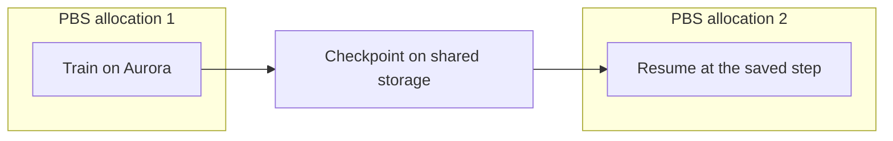
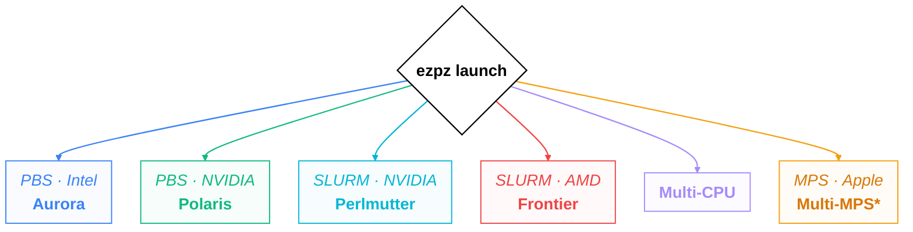
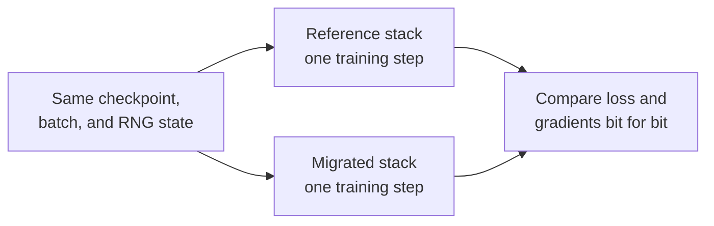
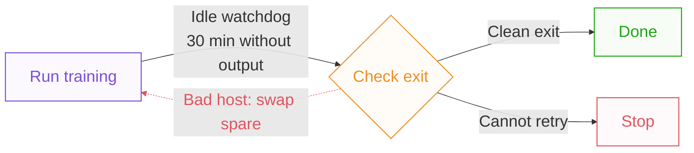
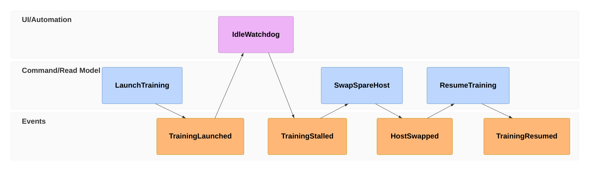
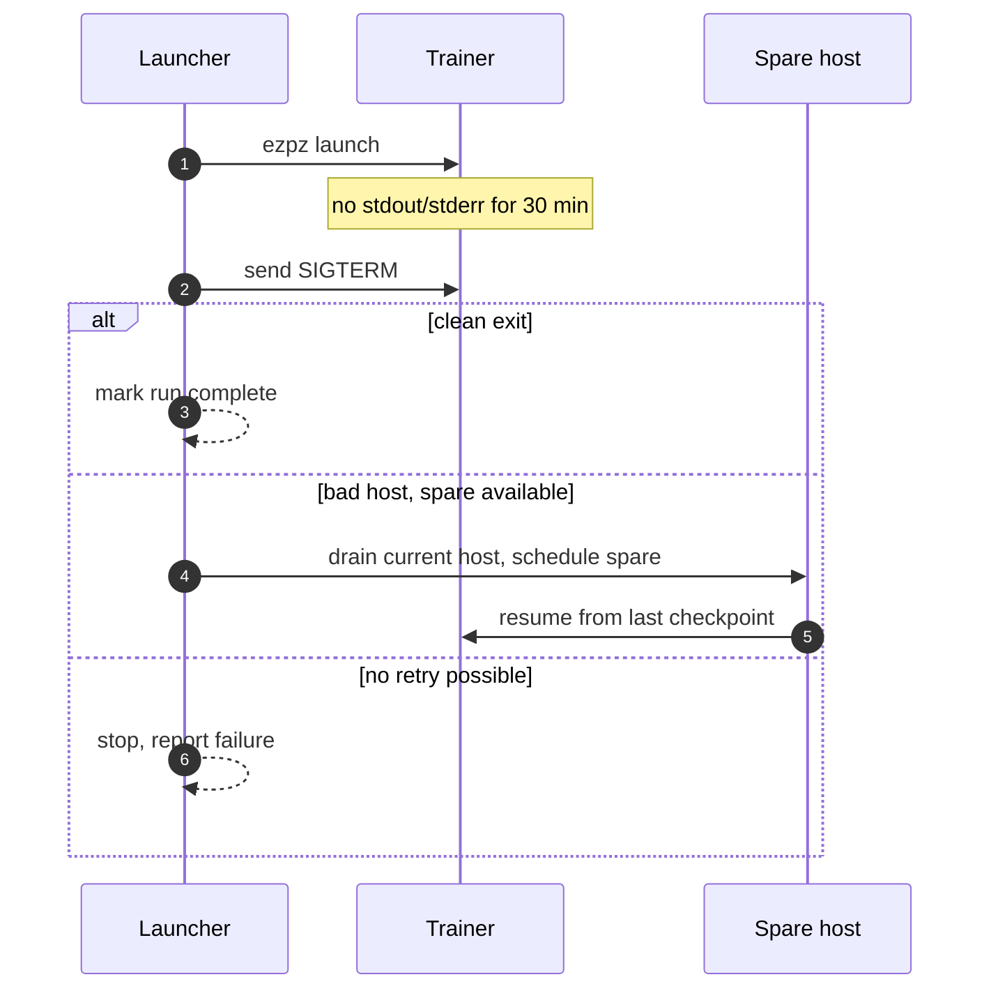
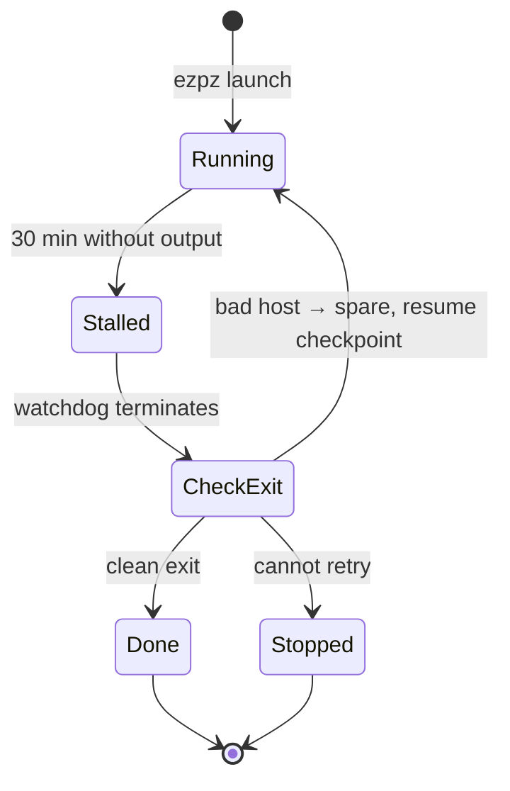
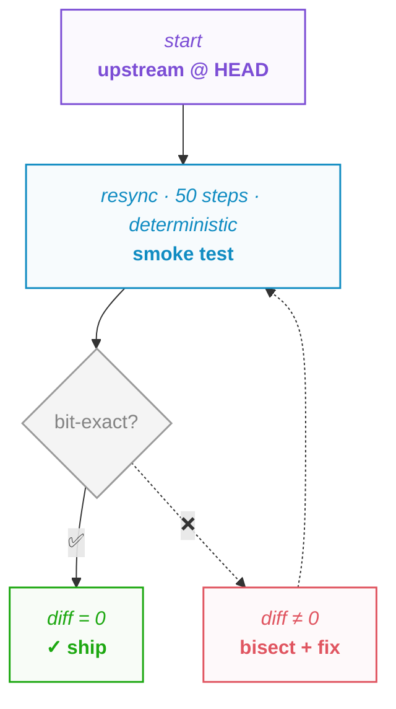
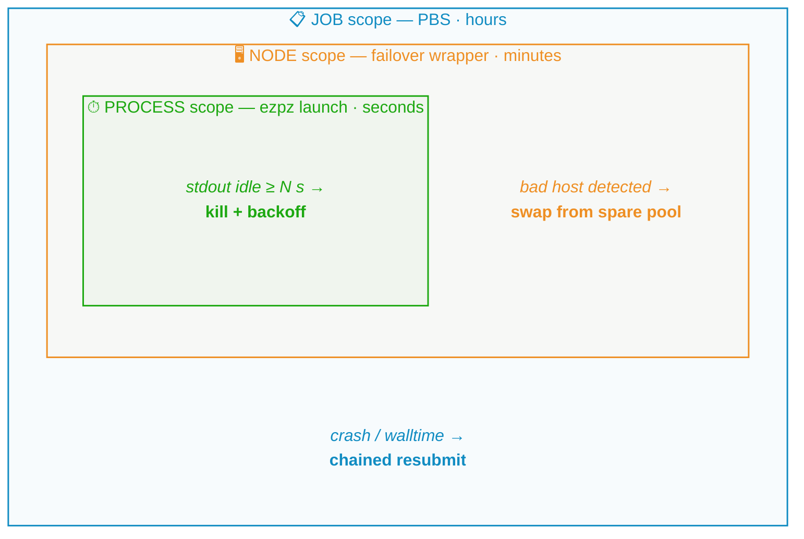

import SC26Chart from '@/components/slides/SC26Chart.astro'
import Slide from '@/components/slides/Slide.astro'
import SpeakerNotes from '@/components/slides/SpeakerNotes.astro'

{/*
    SC26 · Trillion Parameter Workshop · 2026-11-20 · 13 min

    First-cut arc:
      1. Aurora makes portability concrete.
      2. ezpz + TorchTitan run the same PyTorch program across vendors.
      3. The production result is 7.77T tokens at 2B and a more
         sample-efficient in-flight 20B run.
      4. Three failures changed validation, stability monitoring, and recovery.

    Timing target: 11:30 of prepared material, leaving 1:30 of margin.
*/}

<Slide id="title-slide">


<div class="title-panel">

<div class="eyebrow">AuroraGPT · SC26</div>

# Pre-Training AuroraGPT<br />on Intel XPUs

<p class="title-thesis">Training, validation, and recovery at scale</p>

<div class="title-authors">
    <span><strong>Sam Foreman</strong> · Nathan Nichols · Varuni Sastry · Sam Wheeler · Khalid Hossain</span>
    <span>Huihuo Zheng · Murali Emani · Filippo Simini · Marieme Ngom · Ethan Wong · Venkatram Vishwanath</span>
</div>

<div class="title-conf-line">4th Annual Trillion Parameter Workshop · November 20, 2026</div>
<div class="title-url">samf.sh/talks/2026/11/20</div>

</div>

<SpeakerNotes>
AuroraGPT pre-trains open foundation models for science on Aurora. This talk is about the software boundary: what changed when we moved production training from a project-specific stack to portable PyTorch on Intel XPUs, and the failures we found only by running it at scale.

20 seconds.
</SpeakerNotes>

</Slide>

<Slide id="aurora">

## Aurora pre-training spans multiple allocations

<p class="sc-lead"><strong>10,624 nodes</strong> · <strong>127,488 XPU tiles</strong> at full machine scale</p>



<p class="sc-detail">A restart restores the model, optimizer, data position, and random state.</p>

<SpeakerNotes>
Set the machine and software context once. Aurora is one of the largest non-NVIDIA GPU systems in production. The important difference for this talk is the stack: SYCL and oneCCL below PyTorch, not CUDA and NCCL. We also inherit the usual HPC constraints: shared storage, scheduled allocations, and restarts across job boundaries.

55 seconds. Cumulative: 1:15.
</SpeakerNotes>

</Slide>

<Slide id="portable-stack">

## One training program across vendors

<div class="sc-launch-grid">

<div>

```python
# demo.py
import torch
import ezpz
rank = ezpz.setup_torch()
size = ezpz.get_world_size()
dev = ezpz.get_torch_device()
layer = torch.nn.Linear(128, 10)
model = ezpz.wrap_model(layer.to(dev))
print(f"Rank {rank}/{size}")
```

```bash
$ ezpz launch python3 demo.py
Rank 0/24
Rank 1/24
```

</div>

<figure class="sc-launch-figure">



<figcaption><a href="https://github.com/saforem2/ezpz"><code>ezpz</code></a> picks the backend.</figcaption>

</figure>

</div>

<SpeakerNotes>
The interface is the point. The training program does not branch on the vendor. ezpz discovers the scheduler and builds the distributed environment. TorchTitan supplies FSDP, tensor and pipeline parallelism, and distributed checkpointing. Our work lives in an experiments/ezpz fork while we push reusable pieces upstream.

75 seconds. Cumulative: 2:30.
</SpeakerNotes>

</Slide>

<Slide id="production-result">

## AuroraGPT production loss

<SC26Chart kind="loss" fallback="/talks/2026-08-03/figures/all-production-loss.svg" label="Five AuroraGPT training-loss trajectories versus tokens consumed" />

<p class="sc-detail"><strong>20B:</strong> 256 and 512 nodes. <strong>2B reference:</strong> 7.77T tokens.</p>

<SpeakerNotes>
The completed 2B run is our reference: 7.77 trillion tokens. We migrated the production path to TorchTitan and ezpz rather than carrying the old Megatron-DeepSpeed fork forward. The August production snapshot shows the 20B loss trajectories alongside the 2B reference. The 7.77T number is the completed 2B total.

70 seconds. Cumulative: 3:40.
</SpeakerNotes>

</Slide>

<Slide id="loss-zoom">

## The first 600B tokens of 20B training

<SC26Chart kind="loss-zoom" fallback="/talks/2026-08-03/figures/all-production-loss.svg" label="Early training loss for the 256-node and 512-node AuroraGPT 20B runs" />

<SpeakerNotes>
This is the same production snapshot on a narrower token axis. The two 20B trajectories ran with different batch sizes.
</SpeakerNotes>

</Slide>

<Slide id="three-failures">

## Three failures changed the stack

<ol class="failure-list">
    <li class="failure-cyan"><strong>Silent loss reporting</strong><span>the curve looked healthy</span><em>bit-exact regression exposed it</em></li>
    <li class="failure-pink"><strong>80B instability</strong><span>loss still looked finite</span><em>gradient norm went nonfinite one step earlier</em></li>
    <li class="failure-orange"><strong>Silent job death</strong><span>the allocation stayed active</span><em>nine runs lost in two weeks</em></li>
</ol>


<SpeakerNotes>
These are the three concrete failures behind the rest of the talk. They sit at different layers: reporting correctness, training stability, and operations. In every case, the first symptom was misleading. The narrow fix came from strengthening the check at the layer where the failure could hide.

On Sunspot at 6,144 sequences per batch, the gradient norm went nonfinite one step before loss for mano, AdamW, and SophiaG. The cause remains unresolved.

45 seconds.
</SpeakerNotes>

</Slide>

<Slide id="bit-exact">

## Bit-exact checks exposed a loss reporting bug



<p class="sc-detail">The run looked healthy. The step outputs disagreed.</p>

<SpeakerNotes>
The dangerous migration failure was not a crash. The reported loss looked plausible and decreased normally. Aggregate curves could not catch it. A controlled, bit-exact comparison on the same checkpoint, batch, RNG state, and step did. That changed the acceptance criterion for the migrated stack: exact parity first, long-run similarity second.

85 seconds. Cumulative: 6:50.
</SpeakerNotes>

</Slide>

<Slide id="auto-retry">

## A successful launcher exit could hide a dead run



<p class="sc-detail">When training stalls, <code class="sc-cli">{'ezpz launch --auto-retry'}</code> can restart it from the last checkpoint.</p>

<SpeakerNotes>
Job 8481645 showed that the outer wrapper could mask a failed training exit. The incident log records nine earlier losses and three recovered failures, but does not provide the total jobs launched in each window. When output stalls, the launcher terminates the wedged launch, classifies the exit, swaps a bad host if a spare is available, and resumes from a checkpoint.

60 seconds.
</SpeakerNotes>

</Slide>

<Slide id="auto-retry-eventmodeling" data-draft="compare">

## Compare: eventmodeling sequence



<p class="sc-detail">The same story as event-sourcing: launch → stall → swap → resume. It shows ordering, but not the three-way decision.</p>

<SpeakerNotes>
Note: pele parses this as eventmodeling. The branch is not a first-class concept; it's implicit in the frame sequence.
</SpeakerNotes>

</Slide>

<Slide id="auto-retry-sequence" data-draft="compare">

## Compare: sequence with retry path



<p class="sc-detail">Best fit if the audience should see <em>who</em> does <em>what</em>: launcher, trainer, watchdog, spare host.</p>

<SpeakerNotes>
Comparison slide. Shows actor boundaries and the branch. Linear flow is readable; parallel reset is implicit.
</SpeakerNotes>

</Slide>

<Slide id="auto-retry-state" data-draft="compare">

## Compare: state machine



<p class="sc-detail">The most precise model of the behavior, but the visual weight goes to graph topology rather than the operational consequence.</p>

<SpeakerNotes>
Comparison slide. State diagrams compress the loop naturally; labels get long if you try to keep the operational detail.
</SpeakerNotes>

</Slide>

<Slide id="auto-retry-cards" data-draft="compare">

## Compare: outcome cards

> [!WARNING] No output for 30 minutes
> The watchdog terminates the launcher and reads the exit status it was handed — which can be “successful” even though the trainer died.

> [!SUCCESS] Done
> Clean exit — the status came from the trainer. Nothing to retry.

> [!NOTE] Bad host → swap spare
> Drain the host, swap in a spare, and `ezpz launch --auto-retry` resumes from the last checkpoint.

> [!ERROR] Stop
> No spare, or the retry budget is spent. Surface it loudly; do not silently succeed.

<SpeakerNotes>
Comparison slide. Uses the site's built-in callout components, not a one-off card layout. Reads well as a risk ladder: warning, success, retry, stop.
</SpeakerNotes>

</Slide>

<Slide id="thanks">

## Thank you

<p class="thanks-line"><span class="c-cyan">AuroraGPT</span> trains open foundation models for science.</p>
<p class="thanks-line"><span class="c-pink">`ezpz` + `TorchTitan`</span> carry the run across devices, systems, and failures.</p>

<p class="acknowledgement">
Aurora was built with HPE and Intel. Thanks to the ALCF operations and support teams, the Intel `torch.xpu` and `oneCCL` teams, and the AuroraGPT collaborators.
</p>

<div class="final-url">samf.sh/talks/2026/11/20</div>

<SpeakerNotes>
Stop here. Leave the links on screen for questions.

20 seconds. Prepared total: about 11 minutes. The remaining margin covers transitions and one interruption.
</SpeakerNotes>

</Slide>

<Slide id="eval-backup">

## Backup: held-out evaluation results

<div class="sc-eval-grid">
    <SC26Chart compact kind="hellaswag" fallback="/talks/2026/10/30/figures/eval-panel-hellaswag.svg" label="HellaSwag accuracy versus trillion tokens" />
    <SC26Chart compact kind="arc_easy" fallback="/talks/2026/10/30/figures/eval-panel-arc_easy.svg" label="ARC-Easy accuracy versus trillion tokens" />
    <SC26Chart compact kind="arc_challenge" fallback="/talks/2026/10/30/figures/eval-panel-arc_challenge.svg" label="ARC-Challenge accuracy versus trillion tokens" />
    <SC26Chart compact kind="winogrande" fallback="/talks/2026/10/30/figures/eval-panel-winogrande.svg" label="Winogrande accuracy versus trillion tokens" />
</div>

<p class="sc-backup-legend">Accuracy vs. trillion tokens. Cross = 2B MDS, circle = 2B 256N, square = 2B 512N, triangle = 20B 512N.</p>

</Slide>

<Slide id="hellaswag-backup">

## Backup: HellaSwag accuracy by checkpoint

<SC26Chart kind="hellaswag-history" fallback="/talks/2026/10/30/figures/eval-inflight.svg" label="HellaSwag accuracy by checkpoint, including 28 2B MDS evaluations and three TorchTitan runs" />

</Slide>

<Slide id="optimizer-backup">

## Backup: SophiaG at 50M tokens per batch

<div class="sc-eval-grid">
    <SC26Chart kind="optimizer-loss" fallback="/talks/2026-06-03/figures/optimizer-comparison.svg" label="Optimizer comparison: training loss and gradient norm versus tokens" />
    <SC26Chart kind="optimizer-grad" label="Optimizer gradient norms versus tokens" />
</div>

</Slide>

<Slide id="raw-mds-loss">

## Backup: 2B MDS loss across three training stages

<SC26Chart kind="mds-loss" fallback="/talks/2026-06-03/figures/loss-2b-reference.svg" label="2B MDS training loss across three training stages" />

</Slide>

<Slide id="mds-tt-overlay">

## Backup: 2B MDS and TorchTitan loss


</Slide>

<Slide id="sync-workflow">

## Backup: Bit-exact upstream-sync gate



</Slide>

<Slide id="recovery-scopes">

## Backup: Recovery at job, node, and process scope



<div class="recovery-scopes-mobile" aria-label="Recovery scopes, nested from job to node to process">
  <div class="scope-card scope-job">
    <div class="scope-label"><span class="scope-icon">▦</span> JOB scope <span class="scope-meta">PBS · hours</span></div>
    <div class="scope-detail"><em>crash / walltime</em><span aria-hidden="true">→</span><strong>chained resubmit</strong></div>
    <div class="scope-card scope-node">
      <div class="scope-label"><span class="scope-icon">⬡</span> NODE scope <span class="scope-meta">failover wrapper · minutes</span></div>
      <div class="scope-detail"><em>bad host detected</em><span aria-hidden="true">→</span><strong>swap from spare pool</strong></div>
      <div class="scope-card scope-process">
        <div class="scope-label"><span class="scope-icon">◉</span> PROCESS scope <span class="scope-meta">ezpz launch · seconds</span></div>
        <div class="scope-detail"><em>stdout idle ≥ N s</em><span aria-hidden="true">→</span><strong>kill + backoff</strong></div>
      </div>
    </div>
  </div>
</div>

</Slide>

<style is:global>{`
    #auto-retry code.sc-cli {
        font-variant-ligatures: none;
        font-feature-settings: "liga" 0, "calt" 0, "dlig" 0;
    }
    .sc-launch-grid { display: grid; grid-template-columns: minmax(0, 0.72fr) minmax(0, 1.28fr); gap: 1.5rem; align-items: center; }
    .sc-launch-grid > div { min-width: 0; }
    .sc-launch-figure { min-width: 0; margin: 0; }
    .sc-launch-figure figcaption { text-align: left; }
    /* Theme-aware hub (pele writes inline styles, so beat them with !important). */
    #portable-stack .mermaid .pele-node.hub { color: var(--foreground0); }
    #portable-stack .mermaid .pele-node.hub polygon,
    #portable-stack .mermaid .pele-node.hub rect { fill: var(--background1) !important; stroke: var(--foreground2) !important; }
    #portable-stack .mermaid .pele-node.hub .pele-label { fill: var(--foreground0) !important; }
    #portable-stack .sc-launch-grid pre { font-size: clamp(1rem, 1.6vw, 1.85rem); }
    #portable-stack .sc-launch-grid .mermaid svg { max-height: 54vh !important; }
    .sc-reference-figure { display: block; width: 100%; max-height: 68vh; object-fit: contain; }
    @media (max-width: 700px) { .sc-launch-grid { grid-template-columns: 1fr; } }

    .hellaswag-history { display: grid; grid-template-columns: minmax(0, 1.5fr) minmax(0, 1fr); align-items: center; gap: 1.3rem; }
    .hellaswag-history svg { width: min(100%, 94vh); height: auto; aspect-ratio: 289 / 190; overflow: hidden; }
    .hellaswag-key { display: grid; gap: 0.5em; font-size: clamp(1rem, 2.15vw, 1.8rem); color: var(--foreground0); }

    @layer components {
        body {
            --font-family-monospace: var(--code-font-family, var(--font-family));
            --font-family-mono: var(--code-font-family, var(--font-family));
        }
    }
    .recovery-comparison {
        display: grid;
        grid-template-columns: repeat(2, minmax(0, 1fr));
        gap: 1rem;
        margin-block: 1.2rem;
    }
    .recovery-comparison > div {
        border-inline-start: 4px solid var(--sc-rule);
        padding-inline-start: clamp(0.65rem, 2vw, 1.4rem);
        display: grid;
        align-content: start;
        gap: 0.4rem;
        font-size: clamp(1rem, 2.6vw, 2.3rem);
    }
    .recovery-comparison strong { font-size: clamp(1.4rem, 5.5vw, 5rem); line-height: 1.1; }
    .recovery-comparison > div:first-child strong { color: var(--sc-pink); }
    .recovery-comparison > div:last-child strong { color: var(--sc-green); }

    /* Lattice23-derived visual language, expressed through the site's live
       light/dark tokens. Layout stays left-aligned in both themes. */
    #title-slide,
    #aurora,
    #portable-stack,
    #production-result,
    #sample-efficiency,
    #three-failures,
    #bit-exact,
    #stability,
    #auto-retry,
    #lessons,
    #thanks {
        --sc-cyan: #00779f;
        --sc-pink: #c21f63;
        --sc-green: #187a43;
        --sc-orange: #c55500;
        --sc-purple: #7048a8;
        --sc-rule: color-mix(in srgb, var(--foreground2) 35%, transparent);
    }

    html[data-webtui-theme='custom-dark'] :is(
        #title-slide,
        #aurora,
        #portable-stack,
        #production-result,
        #sample-efficiency,
        #three-failures,
        #bit-exact,
        #stability,
        #auto-retry,
        #lessons,
        #thanks
    ) {
        --sc-cyan: #00ccff;
        --sc-pink: #ff67b3;
        --sc-green: #63ff8b;
        --sc-orange: #ff9a45;
        --sc-purple: #bd92ff;
    }

    .c-cyan { color: var(--sc-cyan); }
    .c-pink { color: var(--sc-pink); }
    .c-green { color: var(--sc-green); }
    .c-orange { color: var(--sc-orange); }
    .c-purple { color: var(--sc-purple); }

    #title-slide .slide-inner {
        justify-content: center;
        padding-left: clamp(2rem, 6vw, 6rem);
        overflow: hidden;
    }

    .title-aurora {
        position: absolute;
        inset: 0;
        width: 100%;
        height: 100%;
        object-fit: cover;
        object-position: center;
        z-index: -2;
    }

    #title-slide::after {
        content: '';
        position: absolute;
        inset: 0;
        background: linear-gradient(90deg, rgb(5 10 18 / 0.88) 0%, rgb(5 10 18 / 0.72) 48%, rgb(5 10 18 / 0.08) 82%);
        z-index: -1;
    }

    .title-panel {
        width: min(72ch, 72vw);
        padding: 1.15rem 1.45rem 1.25rem;
        border: 1px solid rgb(255 255 255 / 0.2);
        border-left: 4px solid var(--sc-cyan);
        background: rgb(15 18 24 / 0.76);
        box-shadow: 0 1.25rem 4rem rgb(0 0 0 / 0.35);
        color: #f5f7fa;
        backdrop-filter: blur(7px);
        text-align: left;
    }

    .title-panel .eyebrow {
        margin-bottom: 0.45rem;
        color: #aeb8c2;
        font-size: 0.56em;
        font-weight: 700;
        letter-spacing: 0.12em;
        text-transform: uppercase;
    }

    .title-panel h1 {
        color: #f7f9fb !important;
        font-size: clamp(2.25rem, 4.2vw, 4.5rem) !important;
        line-height: 0.98;
        letter-spacing: -0.04em;
    }

    .title-thesis {
        margin: 0.8rem 0 0;
        font-size: 0.84em;
        font-weight: 650;
    }

    .title-authors {
        display: grid;
        gap: 0.15rem;
        margin-top: 1rem;
        color: #c9d0d7;
        font-size: 0.58em;
        line-height: 1.35;
    }

    .title-authors strong { color: #fff; }

    .title-conf-line,
    .title-url {
        margin-top: 0.75rem;
        color: #aeb8c2;
        font-size: 0.56em;
    }

    .title-url {
        margin-top: 0.25rem;
        color: var(--sc-cyan);
        font-family: var(--font-family-mono, monospace);
        font-weight: 700;
    }

    .aurora-layout {
        display: grid;
        grid-template-columns: 0.9fr 1.1fr;
        gap: clamp(2rem, 5vw, 5rem);
        align-items: center;
        flex: 1;
    }

    .hero-number {
        color: var(--foreground0);
        font-size: clamp(4.4rem, 10vw, 8.6rem);
        font-weight: 850;
        line-height: 0.8;
        letter-spacing: -0.06em;
    }

    .hero-label {
        margin-top: 0.7rem;
        color: var(--sc-cyan);
        font-size: 1.05em;
        font-weight: 750;
    }

    .hero-context {
        margin-top: 1.1rem;
        color: var(--foreground2);
        font-size: 0.78em;
    }

    .aurora-contract {
        display: grid;
        gap: 0.7rem;
        padding-left: 1.1rem;
        border-left: 1px solid var(--sc-rule);
    }

    .aurora-contract > div {
        display: grid;
        grid-template-columns: 11ch 1fr;
        align-items: baseline;
        gap: 1rem;
        padding-bottom: 0.55rem;
        border-bottom: 1px solid var(--sc-rule);
    }

    .aurora-contract .contract-label,
    .micro-label {
        font-size: 0.6em;
        font-weight: 800;
        letter-spacing: 0.08em;
    }

    .aurora-contract p {
        color: var(--foreground2);
        font-size: 0.76em;
    }

    .takeaway-line {
        margin-top: auto;
        padding-top: 0.65rem;
        border-top: 1px solid var(--sc-rule);
        color: var(--foreground2);
        font-size: 0.75em;
    }

    .takeaway-line span {
        margin-right: 0.8ch;
        color: var(--foreground0);
        font-weight: 800;
    }

    .stack-grid,
    .failure-layout {
        display: grid;
        grid-template-columns: 0.9fr 1.1fr;
        gap: clamp(1.5rem, 4vw, 4rem);
        align-items: center;
    }

    #portable-stack pre {
        border: 1px solid var(--sc-rule);
        border-left: 4px solid var(--sc-cyan);
        box-shadow: none;
    }

    .code-caption {
        margin-top: 0.5rem;
        color: var(--foreground2);
        font-size: 0.62em;
    }

    #portable-stack table {
        font-size: 0.78em;
    }

    #portable-stack table th {
        color: var(--sc-cyan);
    }

    .wide-plot,
    .eval-plot,
    .retry-plot {
        display: block;
        width: 100%;
        max-height: 58vh;
        margin: 0;
        object-fit: contain;
    }

    html[data-webtui-theme='custom-dark'] .theme-plot {
        filter: invert(0.91) hue-rotate(180deg) saturate(1.15) brightness(0.95) contrast(1.03);
    }

    .result-strip {
        display: flex;
        justify-content: space-between;
        gap: 1rem;
        margin-top: 0.65rem;
        padding-top: 0.5rem;
        border-top: 1px solid var(--sc-rule);
        font-size: 0.75em;
    }

    .eval-layout {
        display: grid;
        grid-template-columns: 0.43fr 1.57fr;
        gap: 1.6rem;
        align-items: center;
        flex: 1;
    }

    .eval-number {
        padding-left: 1rem;
        border-left: 4px solid var(--sc-green);
    }

    .eval-number strong,
    .eval-number span {
        display: block;
    }

    .eval-number strong {
        color: var(--sc-green);
        font-size: clamp(4.2rem, 8vw, 7rem);
        line-height: 0.82;
        letter-spacing: -0.07em;
    }

    .eval-number span {
        margin-top: 0.5rem;
        color: var(--foreground0);
        font-size: 1.08em;
        font-weight: 800;
    }

    .eval-number p {
        margin: 0.9rem 0 0;
        color: var(--foreground1);
        font-size: 0.72em;
    }

    .eval-number small {
        display: block;
        margin-top: 1rem;
        color: var(--foreground2);
        font-size: 0.54em;
        line-height: 1.4;
    }

    .eval-plot { max-height: 61vh; }
    .eval-focus { min-width: 0; margin: 0; }
    .eval-focus svg { display: block; width: min(100%, 80vh); height: auto; aspect-ratio: 289 / 190; overflow: hidden; }
    .eval-focus figcaption { color: var(--foreground0); font-size: clamp(1rem, 2.15vw, 1.8rem); line-height: 1.18; text-align: left; }
    #eval-backup img.eval-backup-plot { width: min(100%, 76vh); height: auto; margin: 0; }

    .failure-list {
        display: grid;
        gap: 0.78rem;
        margin: 1rem 0 0;
        padding: 0;
        list-style: none;
        counter-reset: failure;
    }

    .failure-list li {
        display: grid;
        grid-template-columns: 2.2rem minmax(14rem, 0.9fr) 1.1fr;
        gap: 0.15rem 0.8rem;
        align-items: baseline;
        padding: 0.72rem 0.8rem;
        border: 1px solid var(--sc-rule);
        border-left-width: 4px;
        counter-increment: failure;
    }

    .failure-list li::before {
        grid-row: 1 / 3;
        content: counter(failure, decimal-leading-zero);
        font-size: 0.7em;
        font-weight: 850;
    }

    .failure-list .failure-cyan { border-left-color: var(--sc-cyan); }
    .failure-list .failure-cyan::before { color: var(--sc-cyan); }
    .failure-list .failure-pink { border-left-color: var(--sc-pink); }
    .failure-list .failure-pink::before { color: var(--sc-pink); }
    .failure-list .failure-orange { border-left-color: var(--sc-orange); }
    .failure-list .failure-orange::before { color: var(--sc-orange); }

    .failure-list strong {
        grid-column: 2;
        font-size: 0.92em;
    }
    .failure-list span,
    .failure-list em {
        color: var(--foreground2);
        font-size: 0.7em;
        font-style: normal;
    }
    .failure-list span { grid-column: 2; }
    .failure-list em {
        grid-column: 3;
        grid-row: 1 / 3;
        align-self: center;
        text-align: right;
    }

    .failure-rule {
        margin-top: 1rem;
        color: var(--foreground0);
        font-size: 1.05em;
        font-weight: 800;
    }

    .failure-copy {
        display: grid;
        gap: 0.1rem;
    }

    .failure-copy p {
        margin: 0.05rem 0 0.55rem;
        font-size: 0.88em;
    }

    .regression {
        position: relative;
        margin: 0;
        padding: 1rem 1.2rem;
        border: 1px solid var(--sc-rule);
        border-left: 4px solid var(--sc-cyan);
        background: color-mix(in srgb, var(--background1) 76%, transparent);
        font-size: 0.95em;
        overflow: visible;
    }

    .exact-verdict {
        position: absolute;
        right: 0.8rem;
        bottom: 0.55rem;
        color: var(--sc-green);
        font-family: var(--font-family, inherit);
        font-size: 0.7em;
        font-weight: 900;
        letter-spacing: 0.08em;
    }

    .stability-grid {
        display: grid;
        grid-template-columns: repeat(3, 1fr);
        gap: 0;
        margin-top: 1.4rem;
        border-block: 1px solid var(--sc-rule);
    }

    .stability-fact {
        display: grid;
        gap: 0.45rem;
        padding: 1rem 1.2rem;
        border-right: 1px solid var(--sc-rule);
    }

    .stability-fact:last-child { border-right: 0; }
    .stability-fact .label {
        color: var(--foreground2);
        font-size: 0.55em;
        font-weight: 800;
        letter-spacing: 0.08em;
    }
    .stability-fact strong { font-size: 1.05em; }
    .stability-fact em {
        color: var(--sc-pink);
        font-size: 1.35em;
        font-style: normal;
        font-weight: 850;
    }

    .stability-conclusion {
        display: grid;
        grid-template-columns: 1fr 1px 1fr;
        gap: 1.1rem;
        align-items: center;
        margin-top: 1.15rem;
        font-size: 0.76em;
    }

    .stability-conclusion > div {
        display: grid;
        grid-template-columns: auto 1fr;
        gap: 0.65rem;
        align-items: baseline;
    }

    .stability-conclusion > div span { font-weight: 850; }
    .stability-conclusion > div strong { font-weight: 550; }
    .stability-conclusion .divider {
        width: 1px;
        height: 2.3rem;
        background: var(--sc-rule);
    }

    .retry-layout {
        display: grid;
        grid-template-columns: 1.42fr 0.58fr;
        gap: 1.5rem;
        align-items: center;
        flex: 1;
    }

    .retry-plot { max-height: 53vh; }
    .retry-copy {
        padding-left: 1rem;
        border-left: 1px solid var(--sc-rule);
    }

    .lost-runs {
        display: flex;
        gap: 0.8rem;
        align-items: flex-end;
    }

    .lost-runs strong {
        color: var(--sc-pink);
        font-size: clamp(4rem, 7vw, 6.5rem);
        line-height: 0.78;
    }

    .lost-runs span {
        color: var(--foreground1);
        font-size: 0.72em;
        font-weight: 750;
        line-height: 1.05;
    }

    .retry-sequence {
        display: grid;
        gap: 0;
        margin: 1.1rem 0 0;
        padding: 0;
        list-style: none;
        counter-reset: retry;
    }

    .retry-sequence li {
        display: grid;
        grid-template-columns: 1.4rem 1fr;
        gap: 0.5rem;
        padding: 0.42rem 0;
        border-top: 1px solid var(--sc-rule);
        counter-increment: retry;
    }

    .retry-sequence li::before {
        content: counter(retry);
        color: var(--sc-orange);
        font-size: 0.65em;
        font-weight: 850;
    }

    .retry-sequence code { font-size: 0.66em; }

    .contracts {
        margin-top: 1.4rem;
        font-size: 0.78em;
    }

    .contracts th { color: var(--sc-cyan); }
    .contracts th:first-child,
    .contracts td:first-child { width: 18%; }

    .links-line {
        margin-top: auto;
        font-size: 0.68em;
    }

    #thanks .slide-inner { justify-content: center; }
    #thanks h2 { margin-bottom: 1.2rem; }

    .thanks-line {
        max-width: 48rem;
        margin: 0.25rem 0;
        font-size: 1.08em;
        line-height: 1.3;
    }

    .thanks-line span { font-weight: 850; }

    .acknowledgement {
        max-width: 48rem;
        margin-top: 1.4rem;
        padding-top: 0.75rem;
        border-top: 1px solid var(--sc-rule);
        color: var(--foreground2);
        font-size: 0.65em;
    }

    .final-url {
        margin-top: 0.8rem;
        color: var(--sc-cyan);
        font-family: var(--font-family-mono, monospace);
        font-size: 0.8em;
        font-weight: 750;
    }

    @media (max-width: 700px) {
        .title-panel { width: 88vw; }
        .aurora-layout,
        .stack-grid,
        .failure-layout,
        .eval-layout,
        .retry-layout,
        .stability-grid {
            grid-template-columns: 1fr;
        }

        .failure-list li { grid-template-columns: 1.5rem 1fr; }
        .failure-list em { grid-column: 2; text-align: left; }
        .stability-fact { border-right: 0; border-bottom: 1px solid var(--sc-rule); }
        .stability-conclusion { grid-template-columns: 1fr; }
        .stability-conclusion .divider { display: none; }
        .result-strip { flex-wrap: wrap; }
    }

    #title-slide .title-panel {
        width: min(68ch, 77vw);
        background: rgb(8 13 20 / 0.9);
        box-shadow: none;
    }
    #title-slide .title-panel h1 {
        font-size: clamp(2rem, 5.3vw, 5rem) !important;
    }
    #title-slide .title-thesis { color: #fff; font-size: clamp(1rem, 2.65vw, 2.6rem); }

    #title-slide ~ [is~='slide'] .slide-inner {
        text-align: left;
    }
    @media (min-width: 701px) {
        :is(#aurora, #portable-stack, #production-result, #sample-efficiency,
            #three-failures, #bit-exact, #stability, #auto-retry, #lessons, #thanks)
            .slide-inner h2 {
            font-size: clamp(2rem, 4vw, 3.5rem);
            line-height: 1.06;
        }
        :is(.hero-context, .aurora-contract p, .takeaway-line, .result-strip,
            .failure-list span, .failure-list em, .failure-copy p, .eval-number p,
            .eval-number small, .lost-runs span, .retry-sequence code, .thanks-line) {
            color: var(--foreground0);
            font-size: clamp(1rem, 2.55vw, 2.15rem);
            line-height: 1.16;
        }
        :is(#portable-stack table, #portable-stack pre, .regression, .contracts, .optimizer-results) {
            font-size: clamp(1rem, 2.4vw, 2.1rem);
            line-height: 1.18;
        }
        .eval-layout { grid-template-columns: minmax(13ch, 0.65fr) 1.35fr; }
        .eval-number small { margin-top: 0.6rem; }
        .failure-list em { text-align: left; }
        .retry-layout { grid-template-columns: 1.2fr 0.8fr; }
        .wide-plot, .eval-plot, .retry-plot { max-height: 48vh; }
    }
    #stability .slide-inner > p {
        color: var(--foreground0);
        font-size: clamp(1rem, 2.65vw, 2.4rem);
        margin: 0.75em 0;
    }
    .optimizer-results {
        display: grid;
        grid-template-columns: max-content 1fr;
        gap: 0.6em 2em;
        margin-top: 1em;
        font-size: clamp(1.2rem, 3vw, 2.5rem);
        color: var(--foreground0);
    }
    .optimizer-results dd { margin: 0; }
    .optimizer-results code { color: inherit; }

    @media (min-width: 701px) {
        .wide-plot, .eval-plot { max-height: 59vh; }
        .eval-layout { grid-template-columns: 0.54fr 1.46fr; }
        .retry-sequence li { grid-template-columns: 1.4rem minmax(0, 1fr); }
        .retry-sequence li code { justify-self: start; white-space: nowrap; }
        .failure-list strong { font-size: clamp(1.1rem, 2.7vw, 2.25rem); }
    }

    #title-slide .slide-inner {
        display: flex;
        flex-direction: column;
        justify-content: center;
        align-items: flex-start;
        height: 100%;
        min-height: 100%;
        box-sizing: border-box;
    }
    #title-slide .title-panel { margin-block: auto; }
    #title-slide .title-panel h1 { margin-block: 0 0.3em; }
    #title-slide {
        background: url('/talks/2026-10-21/figures/aurora-hero.jpg') center / cover no-repeat;
    }
    #title-slide .title-aurora { position: absolute; width: 1px; height: 1px; opacity: 0; }
    :is(#aurora, #portable-stack, #bit-exact, #auto-retry, #recovery-scopes) .mermaid {
        --mermaid-max-height: 43vh;
        margin-block: 0.9rem;
    }
    :is(#aurora, #portable-stack, #bit-exact, #auto-retry, #recovery-scopes) .mermaid svg {
        width: 100% !important;
        max-height: 43vh !important;
    }
    /* Recovery-scopes: the nested 3-level diagram is legible on desktop but
       clips on phone portrait; swap in the stacked layout below. */
    @media (orientation: portrait) and (max-aspect-ratio: 9/10) {
        /* Nested 3-scope diagram doesn't fit phone portrait; swap in the
           stacked layout authored below instead of shrinking SVG text to
           unreadable sizes. */
        #recovery-scopes .mermaid { display: none; }
        #recovery-scopes .recovery-scopes-mobile { display: flex; flex-direction: column; gap: 0.5rem; width: 100%; }
    }
    .recovery-scopes-mobile { display: none; }
    .scope-card {
        border: 1.5px solid var(--scope-color, var(--foreground2));
        color: var(--scope-color, var(--foreground0));
        background: color-mix(in srgb, var(--scope-color, transparent) 4%, transparent);
        padding: 0.55rem 0.65rem 0.65rem;
        min-width: 0;
    }
    .scope-card + .scope-card,
    .scope-card .scope-card { margin-top: 0.55rem; }
    .scope-job { --scope-color: #118cc2; }
    .scope-node { --scope-color: #ee8f24; margin-left: 0.75rem; }
    .scope-process { --scope-color: #1da811; margin-left: 0.75rem; }
    .scope-label {
        display: flex;
        align-items: baseline;
        gap: 0.35em;
        flex-wrap: wrap;
        font-size: clamp(0.8rem, 3.8vw, 1rem);
        font-weight: 700;
        letter-spacing: 0.01em;
        line-height: 1.25;
    }
    .scope-meta {
        font-weight: 500;
        font-size: 0.82em;
        opacity: 0.9;
    }
    .scope-icon { font-size: 0.85em; }
    .scope-detail {
        display: flex;
        align-items: baseline;
        gap: 0.45em;
        flex-wrap: wrap;
        margin: 0.35rem 0 0.15rem 1.5em;
        font-size: clamp(0.78rem, 3.5vw, 0.95rem);
        color: var(--foreground0);
    }
    .scope-detail strong { color: var(--scope-color); }
    .scope-card.scope-process .scope-detail { margin-left: 0; }
    .sc-lead, .sc-detail {
        color: var(--foreground0);
        font-size: clamp(1.05rem, 2.55vw, 2.2rem);
        line-height: 1.25;
    }
    #production-result img.production-loss {
        display: block;
        width: 100%;
        max-height: 62vh;
        object-fit: contain;
        margin: 0;
    }
    .sc-eval-grid { display: grid; grid-template-columns: repeat(2, minmax(0, 1fr)); gap: 0.4rem 1.1rem; }
    @media (orientation: portrait) and (max-aspect-ratio: 9/10) {
        /* Phone portrait: grid of half-width panels leaves the slide mostly
           empty. Stack to one column with equal flexible rows and let each
           chart frame fill its row. */
        .sc-eval-grid {
            grid-template-columns: 1fr;
            grid-auto-rows: 1fr;
            gap: 0.3rem;
            flex: 1 1 auto;
            min-height: 0;
        }
        .sc-eval-grid .sc26-chart,
        .sc-eval-grid .sc26-chart.compact {
            display: flex;
            flex-direction: column;
            min-height: 0;
            height: auto;
            --sc26-frame-min: 0px;
        }
        .sc-eval-grid .sc26-chart .canvas-frame,
        .sc-eval-grid .sc26-chart.compact .canvas-frame {
            height: auto;
            flex: 1 1 0;
            min-height: 0;
        }
        /* Static reference SVGs: use the portrait height budget rather than the 68vh desktop cap. */
        .sc-reference-figure { max-height: 74vh; margin-inline: auto; }
    }
    .sc-backup-legend { font-size: clamp(1rem, 2vw, 1.65rem); color: var(--foreground0); }
`}</style>
