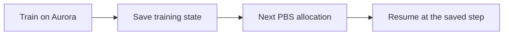
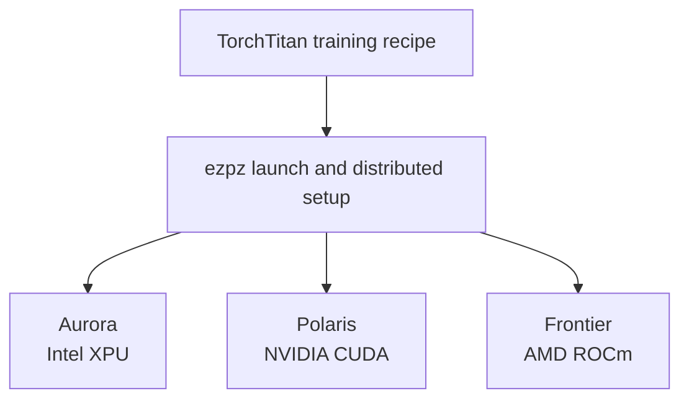
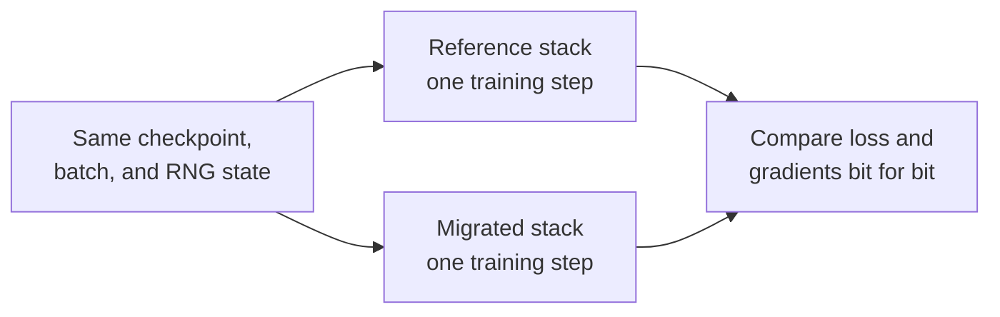
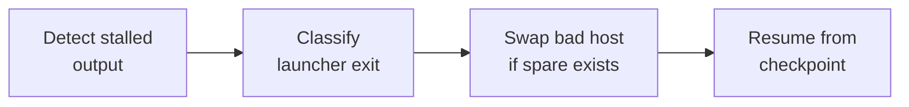

import Slide from '@/components/slides/Slide.astro'
import SpeakerNotes from '@/components/slides/SpeakerNotes.astro'

{/*
    SC26 · Trillion Parameter Workshop · 2026-11-20 · 13 min

    First-cut arc:
      1. Aurora makes portability concrete.
      2. ezpz + TorchTitan run the same PyTorch program across vendors.
      3. The production result is 7.77T tokens at 2B and a more
         sample-efficient in-flight 20B run.
      4. Three failures changed validation, stability monitoring, and recovery.

    Timing target: 11:30 of prepared material, leaving 1:30 of margin.
*/}

<Slide id="title-slide">

AuroraGPT · SC26

# Pre-Training AuroraGPT on Intel XPUs

Training, validation, and recovery at scale

    <strong>Sam Foreman</strong> · Nathan Nichols · Varuni Sastry · Sam Wheeler · Khalid Hossain
    Huihuo Zheng · Murali Emani · Filippo Simini · Marieme Ngom · Ethan Wong · Venkatram Vishwanath

4th Annual Trillion Parameter Workshop · November 20, 2026

samf.sh/talks/2026/11/20

<SpeakerNotes>
AuroraGPT pre-trains open foundation models for science on Aurora. This talk is about the software boundary: what changed when we moved production training from a project-specific stack to portable PyTorch on Intel XPUs, and the failures we found only by running it at scale.

20 seconds.
</SpeakerNotes>

</Slide>

<Slide id="aurora">

## Aurora pre-training spans multiple allocations

<strong>10,624 nodes</strong> · <strong>127,488 XPU tiles</strong> at full machine scale

A restart restores the model, optimizer, data position, and random state.

<SpeakerNotes>
Set the machine and software context once. Aurora is one of the largest non-NVIDIA GPU systems in production. The important difference for this talk is the stack: SYCL and oneCCL below PyTorch, not CUDA and NCCL. We also inherit the usual HPC constraints: shared storage, scheduled allocations, and restarts across job boundaries.

55 seconds. Cumulative: 1:15.
</SpeakerNotes>

</Slide>

<Slide id="portable-stack">

## One TorchTitan recipe across systems

The launcher sets up ranks and devices. The recipe defines the training step.

<SpeakerNotes>
The interface is the point. The training program does not branch on the vendor. ezpz discovers the scheduler and builds the distributed environment. TorchTitan supplies FSDP, tensor and pipeline parallelism, and distributed checkpointing. Our work lives in an experiments/ezpz fork while we push reusable pieces upstream.

75 seconds. Cumulative: 2:30.
</SpeakerNotes>

</Slide>

<Slide id="production-result">

## AuroraGPT production loss

<strong>20B:</strong> 256 and 512 nodes. <strong>2B reference:</strong> 7.77T tokens.

<SpeakerNotes>
The completed 2B run is our reference: 7.77 trillion tokens. We migrated the production path to TorchTitan and ezpz rather than carrying the old Megatron-DeepSpeed fork forward. The August production snapshot shows the 20B loss trajectories alongside the 2B reference. The 7.77T number is the completed 2B total.

70 seconds. Cumulative: 3:40.
</SpeakerNotes>

</Slide>

<Slide id="sample-efficiency">

## The 20B run matched the 2B peak

    

        <strong>17×</strong>
        fewer tokens
        
at comparable compute

        <small>20B training is ongoing</small>
    

    <figure class="eval-focus">
        <svg class="theme-plot" viewBox="0 38 289 190" role="img" aria-label="HellaSwag accuracy versus tokens consumed. The in-flight 20B curve reaches the 2B reference peak much earlier.">
            <defs><clipPath id="hellaswag-crop"><rect x="0" y="38" width="289" height="190" /></clipPath></defs>
            <image href="/talks/2026/10/30/figures/eval-inflight.svg" width="579.089063" height="484.236" clipPath="url(#hellaswag-crop)" />
        </svg>
        <figcaption>Tokens consumed (trillions) Triangles: 20B · Open circles: 2B reference</figcaption>
    </figure>

<SpeakerNotes>
This is the science result. At comparable compute, the in-flight 20B run reaches the fully trained 2B model's peak evaluation scores while consuming about 17 times fewer tokens. Say "in flight" and "matches peak scores" precisely. Do not describe this as a finished 20B run or a universal scaling result.

70 seconds. Cumulative: 4:50.
</SpeakerNotes>

</Slide>

<Slide id="three-failures">

## Three failures changed the stack

<ol class="failure-list">
    <li class="failure-cyan"><strong>Silent loss reporting</strong>the curve looked healthy<em>bit-exact regression exposed it</em></li>
    <li class="failure-pink"><strong>80B instability</strong>the process stayed alive<em>three optimizers reached `NaN`</em></li>
    <li class="failure-orange"><strong>Silent job death</strong>the allocation stayed active<em>nine runs lost in two weeks</em></li>
</ol>

<SpeakerNotes>
These are the three concrete failures behind the rest of the talk. They sit at different layers: reporting correctness, training stability, and operations. In every case, the first symptom was misleading. The narrow fix came from strengthening the check at the layer where the failure could hide.

35 seconds. Cumulative: 5:25.
</SpeakerNotes>

</Slide>

<Slide id="bit-exact">

## Bit-exact checks exposed a loss reporting bug

The run looked healthy. The step outputs disagreed.

<SpeakerNotes>
The dangerous migration failure was not a crash. The reported loss looked plausible and decreased normally. Aggregate curves could not catch it. A controlled, bit-exact comparison on the same checkpoint, batch, RNG state, and step did. That changed the acceptance criterion for the migrated stack: exact parity first, long-run similarity second.

85 seconds. Cumulative: 6:50.
</SpeakerNotes>

</Slide>

<Slide id="stability">

## Gradient norm failed one step before loss

80B training on Sunspot · 6,144 sequences per batch

<dl class="optimizer-results">
    <dt><code>mano</code></dt><dd>Step 5</dd>
    <dt><code>AdamW</code></dt><dd>Step 9</dd>
    <dt><code>SophiaG</code></dt><dd>Step 12</dd>
</dl>

<SpeakerNotes>
At the same 80B, GBS 6144, data-parallel 186 corner, mano reached NaN at gradient step 5, AdamW at step 9, and SophiaG at step 12. Each used its finder-recommended constant learning rate. The shared signature rules out one optimizer implementation as the explanation. In every case, grad norm failed one step before loss, so process health and a plausible loss value were both inadequate monitors. The mechanism remains unresolved. A separate fp32 activation run stayed finite for 120 steps at about one-third the throughput, with a different warmup.

75 seconds. Cumulative: 8:05.
</SpeakerNotes>

</Slide>

<Slide id="auto-retry">

## Launcher retry recovered 3 of 4 failures

<strong>Before:</strong> 9 runs lost in two weeks. <strong>After:</strong> 3 recovered, 1 lost.

<code>ezpz launch --auto-retry</code>

<SpeakerNotes>
The scheduler knew that the allocation existed. It did not know that useful training had stopped. The launcher now watches application progress, terminates a wedged launch, classifies the exit, excludes a bad host when a spare exists, and resumes from the latest checkpoint. The important design choice is that recovery lives with the launcher, where scheduler state and application state meet.

90 seconds. Cumulative: 9:35.
</SpeakerNotes>

</Slide>

<Slide id="lessons">

## Portable pre-training needs three contracts

<table class="contracts">
    <thead>
        <tr><th>Contract</th><th>Question</th><th>Proof</th></tr>
    </thead>
    <tbody>
        <tr><td><strong>Numerical</strong></td><td>Did the implementation preserve the step?</td><td>Bit-exact regression</td></tr>
        <tr><td><strong>Scientific</strong></td><td>Is the trajectory still healthy?</td><td>Online norms + evaluation</td></tr>
        <tr><td><strong>Operational</strong></td><td>Can the run survive the machine?</td><td>Watchdog + retry + checkpoint</td></tr>
    </tbody>
</table>

    [`ezpz`](https://github.com/saforem2/ezpz) ·
    [`TorchTitan`](https://github.com/pytorch/torchtitan) ·
    [`Aurora`](https://www.alcf.anl.gov/aurora)

<SpeakerNotes>
The stack has three contracts. Numerical correctness is local and exact. Scientific validity is a trajectory, not a process exit code. Operational recovery spans the launcher, scheduler, hosts, and checkpoints. Portability requires all three. A backend abstraction alone is not enough.

65 seconds. Cumulative: 10:40.
</SpeakerNotes>

</Slide>

<Slide id="thanks">

## Thank you

AuroraGPT trains open foundation models for science.

`ezpz` + `TorchTitan` carry the run across devices, systems, and failures.

Aurora was built with HPE and Intel. Thanks to the ALCF operations and support teams, the Intel `torch.xpu` and `oneCCL` teams, and the AuroraGPT collaborators.

samf.sh/talks/2026/11/20

<SpeakerNotes>
Stop here. Leave the links on screen for questions.

20 seconds. Prepared total: about 11 minutes. The remaining margin covers transitions and one interruption.
</SpeakerNotes>

</Slide>

<Slide id="eval-backup">

## Backup: held-out evaluation results

</Slide>

