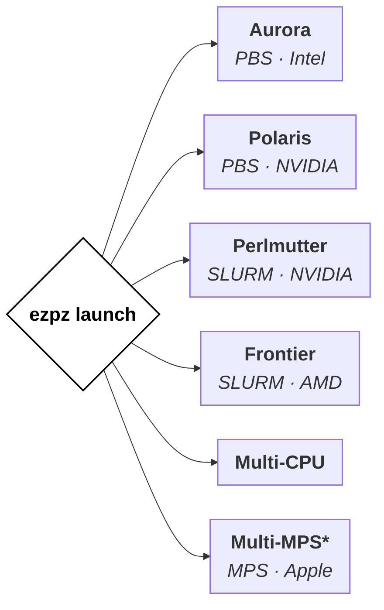
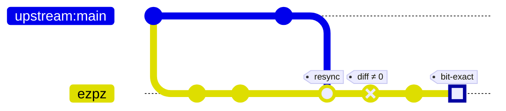
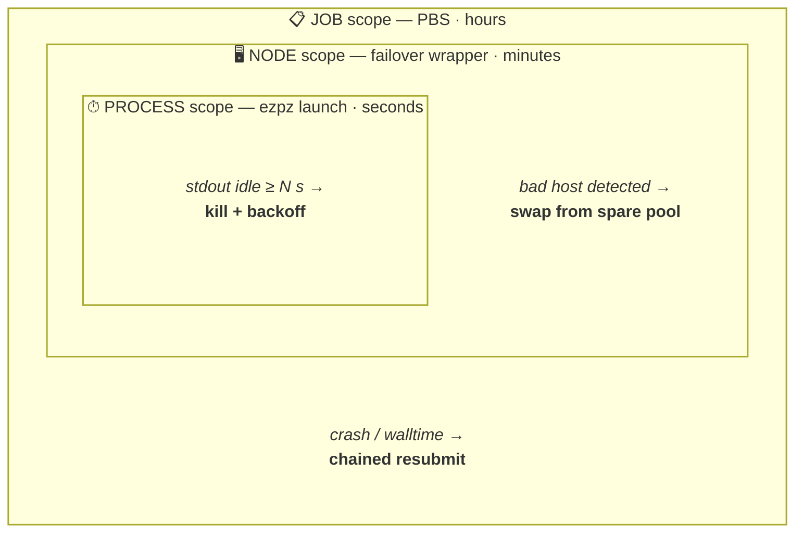

import AutoRetryCluster from '@/components/slides/AutoRetryCluster.astro'
import AutoRetryReplay from '@/components/slides/AutoRetryReplay.astro'
import SC26Chart from '@/components/slides/SC26Chart.astro'
import Slide from '@/components/slides/Slide.astro'
import SpeakerNotes from '@/components/slides/SpeakerNotes.astro'

{/*
    SC26 · Trillion Parameter Workshop · 2026-11-20 · 13 min

    First-cut arc:
      1. Aurora makes portability concrete.
      2. ezpz + TorchTitan run the same PyTorch program across vendors.
      3. The production result is 7.77T tokens at 2B and a more
         sample-efficient in-flight 20B run.
      4. Three failures changed validation, stability monitoring, and recovery.

    Timing target: 11:30 of prepared material, leaving 1:30 of margin.
*/}

<Slide id="title-slide">

<a class="title-slide-qr" href="https://samf.sh/talks/2026/11/20/"
   aria-label="QR code linking to these slides">
  
  <span>samf.sh/talks/2026/11/20</span>
</a>


<div class="title-panel">

<div class="eyebrow">AuroraGPT · SC26</div>

# Pre-Training AuroraGPT<br />on Intel XPUs

<p class="title-thesis">Training, validation, and recovery at scale</p>

<div class="title-authors">
    <span class="title-lead"><strong>Sam Foreman</strong></span>
    <span>Nathan Nichols · Varuni Sastry · Sam Wheeler · Khalid Hossain</span>
    <span>Huihuo Zheng · Murali Emani · Filippo Simini · Marieme Ngom · Ethan Wong · Venkatram Vishwanath</span>
</div>

<div class="title-conf-line">4th Annual Trillion Parameter Workshop · November 20, 2026</div>
<div class="title-url"><a href="https://samf.sh/talks/2026/11/20">samf.sh/talks/2026/11/20</a></div>
<div class="title-paper"><a href="https://www.computer.org/csdl/proceedings-article/sc-w/2026/122100a636/2lkuEi9dZFS">Conference paper ↗</a></div>

</div>

<SpeakerNotes>
AuroraGPT pre-trains open foundation models for science on Aurora. This talk is about the software boundary: what changed when we moved production training from a project-specific stack to portable PyTorch on Intel XPUs, and the failures we found only by running it at scale.

20 seconds.
</SpeakerNotes>

</Slide>

<Slide id="aurora" size="sm" aria-label="Aurora cabinets at the Argonne Leadership Computing Facility">

<div class="aurora-card">
<h2 class="aurora-title">Aurora, at production scale</h2>

<dl class="aurora-facts">
<div><dt>Racks</dt><dd>166</dd></div>
<div><dt>Nodes</dt><dd>10,624</dd></div>
<div><dt>GPUs</dt><dd>63,744<span class="aurora-fact-note">Max 1550 · 2 XPUs</span></dd></div>
<div><dt>CPUs</dt><dd>21,248<span class="aurora-fact-note">Xeon Max</span></dd></div>
<div><dt>Network</dt><dd>Slingshot<span class="aurora-fact-note">11 · 8 endpoints</span></dd></div>
<div><dt>Memory</dt><dd>20.4 PB</dd></div>
<div><dt>Storage</dt><dd>230 PB<span class="aurora-fact-note">DAOS · 31 TB/s</span></dd></div>
</dl>
<p class="hero-context">~10,000 sq ft · 600 tons · built by Intel + HPE · one of the first exascale systems</p>
<p class="aurora-credit">Aurora cabinets, Argonne Leadership Computing Facility</p>
<p class="aurora-credit aurora-credit-links"><a href="https://www.alcf.anl.gov/sites/default/files/2024-07/Aurora_FactSheet_2024.pdf">ALCF Fact Sheet (PDF)</a> · <a href="https://docs.alcf.anl.gov/">ALCF User Guides</a></p>
</div>

<SpeakerNotes>
Set the machine and software context once. Aurora is one of the largest non-NVIDIA GPU systems in production. The important difference for this talk is the stack: SYCL and oneCCL below PyTorch, not CUDA and NCCL. We also inherit the usual HPC constraints: shared storage, scheduled allocations, and restarts across job boundaries.

55 seconds. Cumulative: 1:15.
</SpeakerNotes>

</Slide>

<Slide id="portable-stack">

## One training program across vendors

<div class="sc-launch-grid">

<div>

🍋 `ezpz`: Write once, run _anywhere_.  
[[&#xe65b; github](https://github.com/saforem2/ezpz)] [[ezpz.cool](https://ezpz.cool)]

```python
# demo.py
import torch
import ezpz
rank = ezpz.setup_torch()
size = ezpz.get_world_size()
dev = ezpz.get_torch_device()
layer = torch.nn.Linear(128, 10)
model = ezpz.wrap_model(layer.to(dev))
print(f"Rank {rank}/{size}")
```

```bash
$ ezpz launch python3 demo.py  # 2N Aurora
Rank 0/24
Rank 1/24
```

</div>

<figure class="sc-launch-figure">



<figcaption><a href="https://ezpz.cool"><code>ezpz</code></a> automatically picks the backend and handles the distributed launch + setup. See <a href="https://ezpz.cool/cli/launch/">🚀 <code>ezpz launch</code></a>.</figcaption>

</figure>

</div>

<SpeakerNotes>
The interface is the point. The training program does not branch on the vendor. ezpz discovers the scheduler and builds the distributed environment. TorchTitan supplies FSDP, tensor and pipeline parallelism, and distributed checkpointing. Our work lives in an experiments/ezpz fork while we push reusable pieces upstream.

75 seconds. Cumulative: 2:30.
</SpeakerNotes>

</Slide>

<Slide id="production-result">

## AuroraGPT production loss

<SC26Chart kind="loss" fallback="/talks/2026-08-03/figures/all-production-loss.svg" label="AuroraGPT training-loss trajectories versus tokens consumed, including 2B stage-2 dolmino continuations" />

<p class="sc-detail"><strong>2B stage 2</strong> continues past 4.67T on the dolmino mix: <strong>6.08T</strong> (256N) and <strong>6.93T</strong> (512N). <strong>2B reference:</strong> 7.77T tokens. Optimizer: <strong>SophiaG</strong> at <strong>50M tokens per batch</strong>.</p>

<SpeakerNotes>
The completed 2B run is our reference: 7.77 trillion tokens. We migrated the production path to TorchTitan and ezpz rather than carrying the old Megatron-DeepSpeed fork forward. The August production snapshot shows the 20B loss trajectories alongside the 2B reference. The 7.77T number is the completed 2B total.

70 seconds. Cumulative: 3:40.
</SpeakerNotes>

</Slide>

<Slide id="bit-exact">

## Living on the bleeding edge

<p class="sc-subtitle">how to keep your sanity when the software keeps moving</p>



<p class="sc-detail">The run looked healthy. The step outputs disagreed — so every resync from <code>upstream:main</code> into <code>ezpz</code> passes a bit-exact gate before it ships, not a post-hoc plot comparison.</p>

<SpeakerNotes>
The dangerous migration failure was not a crash. The reported loss looked plausible and decreased normally. Aggregate curves could not catch it. A controlled, bit-exact comparison on the same checkpoint, batch, RNG state, and step did. Every upstream resync into ezpz now runs that comparison on a 50-step deterministic step; if the loss disagrees, we bisect before anything ships. That changed the acceptance criterion for the migrated stack: exact parity first, long-run similarity second.

85 seconds. Cumulative: 6:50.
</SpeakerNotes>

</Slide>

<Slide id="auto-retry-cluster" data-draft="compare">

## One stalled host holds up the step

<AutoRetryCluster />

<SpeakerNotes>
Illustrative replay. The healthy step saves checkpoint 3003. Step 3004 starts normally and the batch is redistributed, then one host goes quiet and the collective waits. The replay compresses 30 minutes of silence. The watchdog exits with 124, and the retry rotates in a spare before the trainer restores checkpoint 3003, re-runs the collective, saves checkpoint 3004, and deals the next batch.
</SpeakerNotes>

</Slide>

<Slide id="thanks">

## Thank you

<div class="thanks-layout">
<div class="thanks-main">

<p class="thanks-line"><span class="c-cyan">AuroraGPT</span> trains open foundation models for science.</p>
<p class="thanks-line"><span class="c-pink">`ezpz` + `TorchTitan`</span> carry the run across devices, systems, and failures.</p>

<details is-="accordion" class="callout callout-note acknowledgement" open>
<summary>Acknowledgements</summary>

This research used resources of the Argonne Leadership Computing Facility at Argonne National Laboratory, a U.S. Department of Energy Office of Science User Facility, under Contract DE-AC02-06CH11357.

Aurora was built by HPE and Intel. Thanks to the ALCF operations and user-support teams; the Intel `torch.xpu`, oneCCL, and oneAPI teams; and the AuroraGPT collaborators.

</details>

</div>

<nav class="thanks-links" aria-label="Links">
<h3 class="thanks-links-title">Links</h3>
<dl>
<div class="thanks-link-row"><dt class="thanks-link-label">This talk</dt><dd><a href="https://samf.sh/talks/2026/11/20/">samf.sh/talks/2026/11/20</a></dd></div>
<div class="thanks-link-row"><dt class="thanks-link-label">Workshop</dt><dd><a href="https://sc26.conference-program.com/presentation/?id=ws_tpw126&amp;sess=sess149">4th Annual Trillion Parameter Workshop · W181abc</a></dd></div>
<div class="thanks-link-row"><dt class="thanks-link-label">Code</dt><dd><a href="https://github.com/saforem2/ezpz">ezpz</a> · <a href="https://github.com/saforem2/torchtitan/tree/ezpz">torchtitan@ezpz</a> · <a href="https://github.com/saforem2/torchtitan/blob/293533196acc8543fdd4ea3f54ca9d38596d031b/torchtitan/experiments/ezpz/scripts/submit_agpt_2b_autoretry.sh">auto-retry launcher</a></dd></div>
<div class="thanks-link-row"><dt class="thanks-link-label">Earlier talks</dt><dd class="stacked"><a href="https://samf.sh/talks/2026/10/21/">Scaling PyTorch on Intel XPU</a><a href="https://samf.sh/talks/2026/08/03/">Pre-Training LLMs on a Supercomputer</a><a href="https://samf.sh/talks/2026/07/14/">Pre-Training AuroraGPT at Scale</a><a href="https://samf.sh/talks/2026/06/03/">Production Pre-Training at Scale</a></dd></div>
<div class="thanks-link-row"><dt class="thanks-link-label">Site</dt><dd><a href="https://samf.sh">samf.sh</a> · <a href="https://github.com/saforem2/samf.sh/tree/feat/sc26-slides/web/src/pages/talks/2026/11/20">this deck’s source</a></dd></div>
</dl>
</nav>
</div>

<SpeakerNotes>
Stop here. Leave the links on screen for questions.

20 seconds. Prepared total: about 11 minutes. The remaining margin covers transitions and one interruption.
</SpeakerNotes>

</Slide>

<Slide id="eval-backup">

## Backup: held-out evaluation results

<div class="sc-eval-grid">
    <SC26Chart compact kind="hellaswag" fallback="/talks/2026/10/30/figures/eval-panel-hellaswag.svg" label="HellaSwag accuracy versus trillion tokens" />
    <SC26Chart compact kind="arc_easy" fallback="/talks/2026/10/30/figures/eval-panel-arc_easy.svg" label="ARC-Easy accuracy versus trillion tokens" />
    <SC26Chart compact kind="arc_challenge" fallback="/talks/2026/10/30/figures/eval-panel-arc_challenge.svg" label="ARC-Challenge accuracy versus trillion tokens" />
    <SC26Chart compact kind="winogrande" fallback="/talks/2026/10/30/figures/eval-panel-winogrande.svg" label="Winogrande accuracy versus trillion tokens" />
</div>

<p class="sc-backup-legend">Accuracy vs. trillion tokens. Dashed grey = 2B MDS reference · pink = 2B 256N · blue dashed = 2B 512N · green = 20B 512N.</p>

</Slide>

<Slide id="optimizer-backup">

## Backup: SophiaG at 50M tokens per batch

<div class="sc-fill-grid">
    <SC26Chart kind="optimizer-loss" fallback="/talks/2026-06-03/figures/optimizer-comparison.svg" label="Optimizer comparison: training loss versus consumed tokens, W&B filters applied" />
    <SC26Chart kind="optimizer-grad" label="Optimizer gradient norms versus consumed tokens, W&B filters applied" />
</div>

<p class="sc-backup-legend sc-fill-caption">Same filters as the W&B report: gemma-7B tokenizer, 12 layers, rope θ=50k, zero-stage 0, no activation checkpointing, mbs=1, grad-accum ≥ 2, world size 3072/6240, torch ≥ 2.8, <code class="sc-cli">olmo-mix-1124</code>, excluding restart-from-checkpoint runs. Log scale; smoothed (TWEMA) with the raw trace faint behind. Source: <code class="sc-cli">scripts/fetch-sc26-optimizer.py</code>.</p>

</Slide>

<Slide id="post-training-backup">

## Backup: post-training the 2B

<div class="sc-post-grid">
    <figure class="sc-post-figure">
        
        <figcaption>SFT (tulu_math_uc_mix): loss / grad-norm / LR / token accuracy / entropy / tokens seen vs. global step. Final loss 0.77 over ~4.5B tokens.</figcaption>
    </figure>
    <figure class="sc-post-figure">
        
        <figcaption>GRPO on the SFT'd 2B (sum_digits, 1000 steps, 8 nodes): reward climbs ~0.4 -&gt; ~0.9; accuracy is what moves, format was already saturated.</figcaption>
    </figure>
</div>

<p class="sc-detail">SFT gives the capability (0.205 GSM8K-CoT after two-stage SFT); GRPO polishes format/accuracy on an already-solved task; the base model's ceiling is the binding constraint.</p>

<p class="sc-backup-legend">Full write-up: <a href="https://github.com/saforem2/torchtitan/blob/ezpz/torchtitan/experiments/ezpz/docs/production/POST-TRAINING-2B.md">POST-TRAINING-2B.md</a></p>

</Slide>

<Slide id="recovery-scopes">

## Backup: Recovery at job, node, and process scope



<div class="recovery-scopes-mobile" aria-label="Recovery scopes, nested from job to node to process">
  <div class="scope-card scope-job">
    <div class="scope-label"><span class="scope-icon">▦</span> JOB scope <span class="scope-meta">PBS · hours</span></div>
    <div class="scope-detail"><em>crash / walltime</em><span aria-hidden="true">→</span><strong>chained resubmit</strong></div>
    <div class="scope-card scope-node">
      <div class="scope-label"><span class="scope-icon">⬡</span> NODE scope <span class="scope-meta">failover wrapper · minutes</span></div>
      <div class="scope-detail"><em>bad host detected</em><span aria-hidden="true">→</span><strong>swap from spare pool</strong></div>
      <div class="scope-card scope-process">
        <div class="scope-label"><span class="scope-icon">◉</span> PROCESS scope <span class="scope-meta">ezpz launch · seconds</span></div>
        <div class="scope-detail"><em>stdout idle ≥ N s</em><span aria-hidden="true">→</span><strong>kill + backoff</strong></div>
      </div>
    </div>
  </div>
</div>

</Slide>

<style is:global>{`
    .sc-launch-grid { display: grid; grid-template-columns: minmax(0, 0.85fr) minmax(0, 1.15fr); gap: 1.5rem; align-items: center; }
    .sc-launch-grid > div { min-width: 0; }
    .sc-launch-figure { min-width: 0; margin: 0; }
    .sc-launch-figure figcaption { text-align: left; font-size: clamp(0.72rem, 1.05vw, 0.95rem); line-height: 1.2; margin-top: 0.15em; }
    /* Theme-aware hub (pele writes inline styles, so beat them with !important). */
    #portable-stack .mermaid .pele-node.hub { color: var(--foreground0); }
    #portable-stack .mermaid .pele-node.hub polygon,
    #portable-stack .mermaid .pele-node.hub rect { fill: var(--background1) !important; stroke: var(--foreground2) !important; }
    #portable-stack .mermaid .pele-node.hub .pele-label { fill: var(--foreground0) !important; }
    /* Backend nodes: pull fill/stroke/label from theme accents so the diagram
       tracks whichever theme is active. pele paints inline styles, so these
       must win with !important; fills are the accent at ~3% alpha. */
    #portable-stack .sc-launch-figure {
        --sc-aurora: var(--blue);
        --sc-polaris: var(--green);
        --sc-perlmutter: var(--teal);
        --sc-frontier: var(--red);
        --sc-mac: var(--purple);
        --sc-mps: var(--orange);
    }
    #portable-stack .pele-node.aurora rect,
    #portable-stack .pele-node.aurora polygon { fill: color-mix(in srgb, var(--sc-aurora) 4%, transparent) !important; stroke: var(--sc-aurora) !important; }
    #portable-stack .pele-node.aurora .pele-label { fill: var(--sc-aurora) !important; }
    #portable-stack .pele-node.polaris rect,
    #portable-stack .pele-node.polaris polygon { fill: color-mix(in srgb, var(--sc-polaris) 4%, transparent) !important; stroke: var(--sc-polaris) !important; }
    #portable-stack .pele-node.polaris .pele-label { fill: var(--sc-polaris) !important; }
    #portable-stack .pele-node.perlmutter rect,
    #portable-stack .pele-node.perlmutter polygon { fill: color-mix(in srgb, var(--sc-perlmutter) 4%, transparent) !important; stroke: var(--sc-perlmutter) !important; }
    #portable-stack .pele-node.perlmutter .pele-label { fill: var(--sc-perlmutter) !important; }
    #portable-stack .pele-node.frontier rect,
    #portable-stack .pele-node.frontier polygon { fill: color-mix(in srgb, var(--sc-frontier) 4%, transparent) !important; stroke: var(--sc-frontier) !important; }
    #portable-stack .pele-node.frontier .pele-label { fill: var(--sc-frontier) !important; }
    #portable-stack .pele-node.mac rect,
    #portable-stack .pele-node.mac polygon { fill: color-mix(in srgb, var(--sc-mac) 4%, transparent) !important; stroke: var(--sc-mac) !important; }
    #portable-stack .pele-node.mac .pele-label { fill: var(--sc-mac) !important; }
    #portable-stack .pele-node.mps rect,
    #portable-stack .pele-node.mps polygon { fill: color-mix(in srgb, var(--sc-mps) 4%, transparent) !important; stroke: var(--sc-mps) !important; }
    #portable-stack .pele-node.mps .pele-label { fill: var(--sc-mps) !important; }
    #portable-stack .pele-edge[data-id='L_EZ_AURORA_0'] { --_l: var(--sc-aurora); }
    #portable-stack .pele-edge[data-id='L_EZ_POLARIS_0'] { --_l: var(--sc-polaris); }
    #portable-stack .pele-edge[data-id='L_EZ_PM_0'] { --_l: var(--sc-perlmutter); }
    #portable-stack .pele-edge[data-id='L_EZ_FRONTIER_0'] { --_l: var(--sc-frontier); }
    #portable-stack .pele-edge[data-id='L_EZ_MAC_0'] { --_l: var(--sc-mac); }
    #portable-stack .pele-edge[data-id='L_EZ_MPS_0'] { --_l: var(--sc-mps); }
    #portable-stack .pele-edge path { stroke: var(--_l) !important; }
    #portable-stack .pele-edge .pele-marker { fill: var(--_l) !important; }
    /* Bit-exact slide: gitGraph of the resync. upstream:main takes series-1
       (neutral), ezpz takes series-2 (accent). pele resolves lanes/edges/commits
       via var(--pele-series-N) at the .pele root, so override the vars on the
       svg itself. Commit ids are hidden; the tags carry the story
       (resync, gate fails, gate passes). */
    #bit-exact svg.pele-gitGraph {
        --pele-series-1: var(--foreground2);
        --pele-series-2: var(--orange);
    }
    #bit-exact .pele-branch[data-id='ezpz'] .pele-label { fill: var(--background0) !important; }
    #bit-exact .pele-branch[data-id='upstream:main'] .pele-label { fill: var(--background0) !important; }
    #bit-exact .pele-commit-normal circle { stroke: none; }
    #bit-exact .pele-commit-reverse circle { fill: var(--red) !important; }
    #bit-exact .pele-commit-highlight rect { fill: var(--green) !important; }
    #bit-exact .pele-commit-reverse .pele-tag path { fill: color-mix(in srgb, var(--red) 14%, var(--background1)) !important; stroke: var(--red) !important; }
    #bit-exact .pele-commit-reverse .pele-tag text { fill: var(--red) !important; }
    #bit-exact .pele-commit-highlight .pele-tag path { fill: color-mix(in srgb, var(--green) 16%, var(--background1)) !important; stroke: var(--green) !important; }
    #bit-exact .pele-commit-highlight .pele-tag text { fill: var(--green) !important; }
    #bit-exact .pele-commit-merge .pele-tag path { fill: var(--background1) !important; stroke: var(--foreground2) !important; }
    #bit-exact .pele-commit-merge .pele-tag text { fill: var(--foreground0) !important; }
    /* Recovery-scopes: nested clusters job/node/proc mapped to teal/orange/green. */
    #recovery-scopes { --sc-job: var(--teal); --sc-node: var(--orange); --sc-proc: var(--green); }
    #recovery-scopes .pele-cluster.jobC rect { fill: color-mix(in srgb, var(--sc-job) 4%, transparent) !important; stroke: var(--sc-job) !important; }
    #recovery-scopes .pele-cluster.jobC .pele-cluster-label { fill: var(--sc-job) !important; }
    #recovery-scopes .pele-cluster.nodeC rect { fill: color-mix(in srgb, var(--sc-node) 5%, transparent) !important; stroke: var(--sc-node) !important; }
    #recovery-scopes .pele-cluster.nodeC .pele-cluster-label { fill: var(--sc-node) !important; }
    #recovery-scopes .pele-cluster.procC rect { fill: color-mix(in srgb, var(--sc-proc) 6%, transparent) !important; stroke: var(--sc-proc) !important; }
    #recovery-scopes .pele-cluster.procC .pele-cluster-label { fill: var(--sc-proc) !important; }
    #recovery-scopes .pele-node.jobTxt .pele-label { fill: var(--sc-job) !important; }
    #recovery-scopes .pele-node.nodeTxt .pele-label { fill: var(--sc-node) !important; }
    #recovery-scopes .pele-node.procTxt .pele-label { fill: var(--sc-proc) !important; }
    #portable-stack .sc-launch-grid pre { font-size: clamp(1rem, 1.6vw, 1.85rem); }
    @media (max-width: 700px) { .sc-launch-grid { grid-template-columns: 1fr; } }

    @layer components {
        body {
            --font-family-monospace: var(--code-font-family, var(--font-family));
            --font-family-mono: var(--code-font-family, var(--font-family));
        }
    }
    .recovery-comparison {
        display: grid;
        grid-template-columns: repeat(2, minmax(0, 1fr));
        gap: 1rem;
        margin-block: 1.2rem;
    }
    .recovery-comparison > div {
        border-inline-start: 4px solid var(--sc-rule);
        padding-inline-start: clamp(0.65rem, 2vw, 1.4rem);
        display: grid;
        align-content: start;
        gap: 0.4rem;
        font-size: clamp(1rem, 2.6vw, 2.3rem);
    }
    .recovery-comparison strong { font-size: clamp(1.4rem, 5.5vw, 5rem); line-height: 1.1; }
    .recovery-comparison > div:first-child strong { color: var(--sc-pink); }
    .recovery-comparison > div:last-child strong { color: var(--sc-green); }

    /* Lattice23-derived visual language, expressed through the site's live
       light/dark tokens. Layout stays left-aligned in both themes. */
    #title-slide,
    #aurora,
    #portable-stack,
    #production-result,
    #sample-efficiency,
    #bit-exact,
    #stability,
    #auto-retry-cluster,
    #lessons,
    #thanks {
        --sc-cyan: #00779f;
        --sc-pink: #c21f63;
        --sc-green: #187a43;
        --sc-orange: #c55500;
        --sc-purple: #7048a8;
        --sc-rule: color-mix(in srgb, var(--foreground2) 35%, transparent);
    }

    html[data-webtui-theme='custom-dark'] :is(
        #title-slide,
        #aurora,
        #portable-stack,
        #production-result,
        #sample-efficiency,
        #bit-exact,
        #stability,
        #auto-retry-cluster,
        #lessons,
        #thanks
    ) {
        --sc-cyan: #00ccff;
        --sc-pink: #ff67b3;
        --sc-green: #63ff8b;
        --sc-orange: #ff9a45;
        --sc-purple: #bd92ff;
    }

    .c-cyan { color: var(--sc-cyan); }
    .c-pink { color: var(--sc-pink); }
    .c-green { color: var(--sc-green); }
    .c-orange { color: var(--sc-orange); }
    .c-purple { color: var(--sc-purple); }

    #title-slide .slide-inner {
        justify-content: center;
        padding-left: clamp(2rem, 6vw, 6rem);
        overflow: hidden;
    }

    .title-aurora {
        position: absolute;
        inset: 0;
        width: 100%;
        height: 100%;
        object-fit: cover;
        object-position: center;
        z-index: -2;
    }

    #title-slide::after {
        content: '';
        position: absolute;
        inset: 0;
        background: linear-gradient(90deg, rgb(5 10 18 / 0.88) 0%, rgb(5 10 18 / 0.72) 48%, rgb(5 10 18 / 0.08) 82%);
        z-index: -1;
    }

    .title-panel {
        width: min(72ch, 72vw);
        padding: 1.15rem 1.45rem 1.25rem;
        border: 1px solid rgb(255 255 255 / 0.2);
        border-left: 4px solid var(--blue);
        background: rgb(15 18 24 / 0.76);
        box-shadow: 0 1.25rem 4rem rgb(0 0 0 / 0.35);
        color: #f5f7fa;
        backdrop-filter: blur(7px);
        text-align: left;
    }

    /* QR in the top-right of the title slide, same placement as the other
       decks. The artwork sits over a near-black gradient, so the QR needs a
       light chip behind it to stay scannable on both themes. */
    #title-slide .title-slide-qr {
        position: absolute;
        top: 1.4lh;
        right: 2.5ch;
        display: flex;
        flex-direction: column;
        align-items: center;
        gap: 0.35rem;
        text-decoration: none;
        color: #f5f7fa;
        z-index: 2;
    }
    #title-slide .title-slide-qr img {
        width: 7.5rem;
        height: 7.5rem;
        display: block;
        padding: 0.45rem;
        background: #fff;
        border-radius: 6px;
        box-shadow: 0 0.75rem 2rem rgb(0 0 0 / 0.45);
    }
    #title-slide .title-slide-qr span {
        font-size: 0.72rem;
        color: #e8edf3;
        white-space: nowrap;
        background: rgb(8 13 20 / 0.72);
        padding: 0.15rem 0.5rem;
        border-radius: 4px;
    }
    @media (max-width: 768px) {
        #title-slide .title-slide-qr { display: none; }
    }
    /* Global print/dark-theme rules invert .title-slide-qr img (written for
       transparent black strokes on dark slides). This QR sits on a white
       chip, so inverting it would break scanning. */
    body.slides-print-mode #title-slide .title-slide-qr img,
    html[data-webtui-theme='doe'] #title-slide .title-slide-qr img,
    html[data-webtui-theme='alcf'] #title-slide .title-slide-qr img,
    html[data-webtui-theme='custom-dark'] #title-slide .title-slide-qr img {
        filter: none !important;
    }

    .title-panel .eyebrow {
        margin-bottom: 0.45rem;
        color: #aeb8c2;
        font-size: 0.56em;
        font-weight: 700;
        letter-spacing: 0.12em;
        text-transform: uppercase;
    }

    .title-panel h1 {
        color: #f7f9fb !important;
        font-size: clamp(2.25rem, 4.2vw, 4.5rem) !important;
        line-height: 0.98;
        letter-spacing: -0.04em;
    }

    .title-thesis {
        margin: 0.8rem 0 0;
        font-size: 0.84em;
        font-weight: 650;
    }

    .title-authors {
        display: grid;
        gap: 0.15rem;
        margin-top: 1rem;
        color: #c9d0d7;
        font-size: 0.58em;
        line-height: 1.35;
    }

    .title-authors strong { color: #fff; }

    .title-authors .title-lead {
        color: #fff;
        font-size: 2em;
        font-weight: 750;
        letter-spacing: -0.01em;
        line-height: 1.15;
        margin-bottom: 0.1rem;
    }

    .title-conf-line,
    .title-url,
    .title-paper {
        margin-top: 0.75rem;
        color: #aeb8c2;
        font-size: 0.56em;
    }

    .title-url {
        margin-top: 0.25rem;
        color: var(--sc-cyan);
        font-family: var(--font-family-mono, monospace);
        font-weight: 700;
    }
    .title-url a {
        color: inherit;
        text-decoration: none;
    }
    .title-url a:hover { text-decoration: underline; }
    .title-paper {
        margin-top: 0.3rem;
        font-size: 0.8em;
        color: #aeb8c2;
    }
    .title-paper a {
        color: inherit;
        text-decoration: none;
        border-bottom: 1px solid color-mix(in srgb, currentColor 40%, transparent);
        padding-bottom: 1px;
    }
    .title-paper a:hover { color: #fff; }

    /* Aurora slide: full-bleed title-slide photo with the spec sheet in a
       frosted panel over the left third. Reuses the title-slide image so the
       deck doesn't carry two crops of the same render. */
    #aurora {
        background: #050a12 url('/talks/2026-10-21/figures/aurora-hero.jpg') 58% 46% / cover no-repeat;
    }
    #aurora .slide-inner {
        padding: 0;
        justify-content: center;
        overflow: hidden;
        /* .slide-inner stops 1lh above the bottom edge to reserve room for
           the status bar; let the gradient + card reach into that strip so
           the photo is continuous behind it. */
        bottom: 0;
        padding-bottom: 1lh;
    }
    #aurora::before {
        content: '';
        position: absolute;
        inset: 0;
        z-index: 1;
        background: linear-gradient(90deg, rgb(5 10 18 / 0.86) 0%, rgb(5 10 18 / 0.66) 30%, rgb(5 10 18 / 0.18) 58%, rgb(5 10 18 / 0) 76%);
    }
    .aurora-card {
        position: relative;
        z-index: 2;
        margin-left: clamp(1.5rem, 5vw, 5rem);
        width: min(54ch, 42vw);
        display: grid;
        gap: 0.4rem;
        padding: 0.9rem 1.1rem 0.95rem;
        background: rgb(12 17 25 / 0.78);
        border: 1px solid rgb(255 255 255 / 0.18);
        border-left: 4px solid var(--blue);
        box-shadow: 0 1.25rem 4rem rgb(0 0 0 / 0.4);
        backdrop-filter: blur(7px);
        color: #e8edf3;
        align-content: center;
    }
    .aurora-title {
        margin: 0;
        color: #f7f9fb !important;
        font-size: clamp(1.75rem, 2.9vw, 2.9rem) !important;
        line-height: 1.06;
        letter-spacing: -0.03em;
    }
    .aurora-card .aurora-facts {
        margin: 0;
        display: grid;
        grid-template-columns: repeat(2, minmax(0, 1fr));
        gap: 0.3rem 1.1rem;
        padding-block: 0.45rem;
        border-block: 1px solid rgb(255 255 255 / 0.16);
    }
    .aurora-card .aurora-facts > div {
        display: grid;
        gap: 0.08rem;
        align-content: start;
    }
    .aurora-card .aurora-facts dt {
        font-size: 0.74rem;
        font-weight: 700;
        letter-spacing: 0.14em;
        text-transform: uppercase;
        color: var(--blue);
    }
    .aurora-card .aurora-facts dd {
        margin: 0;
        white-space: nowrap;
        font-size: clamp(1.15rem, 1.65vw, 1.75rem);
        font-weight: 800;
        line-height: 1.08;
        letter-spacing: -0.02em;
        color: #fff;
        font-variant-numeric: tabular-nums;
    }
    .aurora-card .aurora-fact-note {
        display: block;
        font-size: 0.56em;
        font-weight: 500;
        letter-spacing: 0;
        line-height: 1.3;
        color: #aeb8c2;
        margin-top: 0.15em;
    }
    #aurora .hero-context {
        font-size: 0.88rem;
        line-height: 1.3;
        color: #d6dde5;
        margin: 0;
    }
    .aurora-credit {
        font-size: 0.66rem;
        color: #8b95a1;
        margin: 0;
        line-height: 1.35;
    }
    .aurora-credit + .aurora-credit { margin-top: 0.15rem; }
    .aurora-credit-links a { color: #cdd6df; }
    .aurora-credit a {
        color: inherit;
        text-decoration: underline;
        text-decoration-color: color-mix(in srgb, currentColor 45%, transparent);
        text-underline-offset: 0.15em;
    }
    .aurora-credit a:hover { color: #fff; }

    .hero-context {
        margin: 0;
        color: var(--foreground2);
        font-size: 0.72em;
        line-height: 1.35;
    }

    .takeaway-line span {
        margin-right: 0.8ch;
        color: var(--foreground0);
        font-weight: 800;
    }

    .stack-grid {
        display: grid;
        grid-template-columns: 0.9fr 1.1fr;
        gap: clamp(1.5rem, 4vw, 4rem);
        align-items: center;
    }

    #portable-stack pre {
        /* frame comes from the astro-code ::before rule; a local border would double it */
        box-shadow: none;
    }
    #portable-stack pre.astro-code::before {
        border: 2px solid oklch(from var(--lang-badge, var(--material-pink)) l c h / 0.5);
    }

    .code-caption {
        margin-top: 0.5rem;
        color: var(--foreground2);
        font-size: 0.62em;
    }

    #portable-stack table {
        font-size: 0.78em;
    }

    #portable-stack table th {
        color: var(--sc-cyan);
    }

    .wide-plot,
    .eval-plot,
    .retry-plot {
        display: block;
        width: 100%;
        max-height: 58vh;
        margin: 0;
        object-fit: contain;
    }

    html[data-webtui-theme='custom-dark'] .theme-plot {
        filter: invert(0.91) hue-rotate(180deg) saturate(1.15) brightness(0.95) contrast(1.03);
    }

    .result-strip {
        display: flex;
        justify-content: space-between;
        gap: 1rem;
        margin-top: 0.65rem;
        padding-top: 0.5rem;
        border-top: 1px solid var(--sc-rule);
        font-size: 0.75em;
    }

    .eval-layout {
        display: grid;
        grid-template-columns: 0.43fr 1.57fr;
        gap: 1.6rem;
        align-items: center;
        flex: 1;
    }

    .eval-number {
        padding-left: 1rem;
        border-left: 4px solid var(--sc-green);
    }

    .eval-number strong,
    .eval-number span {
        display: block;
    }

    .eval-number strong {
        color: var(--sc-green);
        font-size: clamp(4.2rem, 8vw, 7rem);
        line-height: 0.82;
        letter-spacing: -0.07em;
    }

    .eval-number span {
        margin-top: 0.5rem;
        color: var(--foreground0);
        font-size: 1.08em;
        font-weight: 800;
    }

    .eval-number p {
        margin: 0.9rem 0 0;
        color: var(--foreground1);
        font-size: 0.72em;
    }

    .eval-number small {
        display: block;
        margin-top: 1rem;
        color: var(--foreground2);
        font-size: 0.54em;
        line-height: 1.4;
    }

    .eval-plot { max-height: 61vh; }
    .eval-focus { min-width: 0; margin: 0; }
    .eval-focus svg { display: block; width: min(100%, 80vh); height: auto; aspect-ratio: 289 / 190; overflow: hidden; }
    .eval-focus figcaption { color: var(--foreground0); font-size: clamp(1rem, 2.15vw, 1.8rem); line-height: 1.18; text-align: left; }
    #eval-backup img.eval-backup-plot { width: min(100%, 76vh); height: auto; margin: 0; }

    .regression {
        position: relative;
        margin: 0;
        padding: 1rem 1.2rem;
        border: 1px solid var(--sc-rule);
        border-left: 4px solid var(--sc-cyan);
        background: color-mix(in srgb, var(--background1) 76%, transparent);
        font-size: 0.95em;
        overflow: visible;
    }

    .exact-verdict {
        position: absolute;
        right: 0.8rem;
        bottom: 0.55rem;
        color: var(--sc-green);
        font-family: var(--font-family, inherit);
        font-size: 0.7em;
        font-weight: 900;
        letter-spacing: 0.08em;
    }

    .stability-grid {
        display: grid;
        grid-template-columns: repeat(3, 1fr);
        gap: 0;
        margin-top: 1.4rem;
        border-block: 1px solid var(--sc-rule);
    }

    .stability-fact {
        display: grid;
        gap: 0.45rem;
        padding: 1rem 1.2rem;
        border-right: 1px solid var(--sc-rule);
    }

    .stability-fact:last-child { border-right: 0; }
    .stability-fact .label {
        color: var(--foreground2);
        font-size: 0.55em;
        font-weight: 800;
        letter-spacing: 0.08em;
    }
    .stability-fact strong { font-size: 1.05em; }
    .stability-fact em {
        color: var(--sc-pink);
        font-size: 1.35em;
        font-style: normal;
        font-weight: 850;
    }

    .stability-conclusion {
        display: grid;
        grid-template-columns: 1fr 1px 1fr;
        gap: 1.1rem;
        align-items: center;
        margin-top: 1.15rem;
        font-size: 0.76em;
    }

    .stability-conclusion > div {
        display: grid;
        grid-template-columns: auto 1fr;
        gap: 0.65rem;
        align-items: baseline;
    }

    .stability-conclusion > div span { font-weight: 850; }
    .stability-conclusion > div strong { font-weight: 550; }
    .stability-conclusion .divider {
        width: 1px;
        height: 2.3rem;
        background: var(--sc-rule);
    }

    .retry-layout {
        display: grid;
        grid-template-columns: 1.42fr 0.58fr;
        gap: 1.5rem;
        align-items: center;
        flex: 1;
    }

    .retry-plot { max-height: 53vh; }
    .retry-copy {
        padding-left: 1rem;
        border-left: 1px solid var(--sc-rule);
    }

    .lost-runs {
        display: flex;
        gap: 0.8rem;
        align-items: flex-end;
    }

    .lost-runs strong {
        color: var(--sc-pink);
        font-size: clamp(4rem, 7vw, 6.5rem);
        line-height: 0.78;
    }

    .lost-runs span {
        color: var(--foreground1);
        font-size: 0.72em;
        font-weight: 750;
        line-height: 1.05;
    }

    .retry-sequence {
        display: grid;
        gap: 0;
        margin: 1.1rem 0 0;
        padding: 0;
        list-style: none;
        counter-reset: retry;
    }

    .retry-sequence li {
        display: grid;
        grid-template-columns: 1.4rem 1fr;
        gap: 0.5rem;
        padding: 0.42rem 0;
        border-top: 1px solid var(--sc-rule);
        counter-increment: retry;
    }

    .retry-sequence li::before {
        content: counter(retry);
        color: var(--sc-orange);
        font-size: 0.65em;
        font-weight: 850;
    }

    .retry-sequence code { font-size: 0.66em; }

    .contracts {
        margin-top: 1.4rem;
        font-size: 0.78em;
    }

    .contracts th { color: var(--sc-cyan); }
    .contracts th:first-child,
    .contracts td:first-child { width: 18%; }

    .links-line {
        margin-top: auto;
        font-size: 0.68em;
    }

    #thanks .slide-inner {
        padding-inline: clamp(3.5rem, 8vw, 9rem);
    }
    #thanks h2 {
        margin-bottom: 0.9rem;
        font-size: clamp(2rem, 3.6vw, 2.6rem);
    }
    #thanks h2,
    .thanks-layout {
        width: 100%;
        max-width: none;
    }

    .thanks-line {
        max-width: 46ch;
        margin: 0.4rem 0;
        font-size: 1.18em;
        line-height: 1.32;
    }

    .thanks-line span { font-weight: 850; }

    .acknowledgement {
        width: 100%;
        margin-top: 2rem;
        margin-bottom: 0.35rem;
        font-size: 0.74em;
        line-height: 1.55;
        text-align: left;
        padding: 0.9rem 1.1rem;
    }
    .acknowledgement > summary { cursor: pointer; }
    .acknowledgement p { margin: 0 0 0.45em; }
    .acknowledgement p:last-child { margin-bottom: 0.1em; }

    /* Two-column close: statement + acknowledgements left, links rail right.
       Collapses to one column on phones/print rather than squeezing the
       link labels against the thanks-line. */
    .thanks-layout {
        display: grid;
        grid-template-columns: minmax(0, 1fr) minmax(28rem, 38rem);
        column-gap: clamp(2rem, 4vw, 4rem);
        row-gap: 1.5rem;
        align-items: start;
        width: 100%;
    }
    .thanks-main { min-width: 0; }
    .thanks-main .acknowledgement { width: 100%; }
    .thanks-links-title {
        margin: 0 0 1.1rem;
        font-size: 0.72em;
        letter-spacing: 0.16em;
        text-transform: uppercase;
        color: var(--foreground2);
    }
    .thanks-links {
        margin: 0;
        padding: 1.25rem 0 0.4rem;
        font-size: 0.82em;
        line-height: 1.45;
        text-align: left;
        border-top: 1px solid var(--sc-rule);
        /* One shared label column for every row: labels sit flush left and
           values start on a single tab stop, instead of each row sizing its
           own max-content label column. That per-row sizing is what made the
           rail read as cramped and uneven. */
        --links-label-col: 10.25rem;
        display: grid;
        grid-template-columns: var(--links-label-col) minmax(0, 1fr);
        column-gap: 1.5rem;
        align-content: start;
    }
    .thanks-links-title { grid-column: 1 / -1; }
    .thanks-links dl {
        margin: 0;
        padding: 0;
        display: grid;
        grid-column: 1 / -1;
        grid-template-columns: subgrid;
        row-gap: 1.1rem;
    }
    /* Wrapped lines land under the value (subgrid column 2), not back under
       the label. */
    .thanks-link-row { display: contents; }
    .thanks-link-row > dt,
    .thanks-link-row > dd {
        margin: 0;
    }
    .thanks-link-row dt { grid-column: 1; }
    .thanks-link-row dd { grid-column: 2; }
    .thanks-link-row dd.stacked a {
        display: block;
        padding-block: 0.05em;
        line-height: 1.32;
        text-wrap: pretty;
    }
    .thanks-link-label {
        color: var(--foreground2);
        font-size: 0.72em;
        text-transform: uppercase;
        letter-spacing: 0.08em;
        padding-top: 0.2em;
    }
    .thanks-links a {
        color: var(--sc-cyan);
        text-decoration: none;
        overflow-wrap: anywhere;
    }
    .thanks-links a:hover { text-decoration: underline; }
    @media (max-width: 900px) {
        .thanks-layout {
            grid-template-columns: 1fr;
            gap: 0.9rem;
        }
        .thanks-links {
            border-top: 1px solid var(--sc-rule);
            padding-top: 0.7rem;
        }
    }

    @media (max-width: 700px) {
        .title-panel { width: 88vw; }
        .aurora-card { width: auto; margin-inline: 6vw; }
        .stack-grid,
        .eval-layout,
        .retry-layout,
        .stability-grid {
            grid-template-columns: 1fr;
        }
        .stability-fact { border-right: 0; border-bottom: 1px solid var(--sc-rule); }
        .stability-conclusion { grid-template-columns: 1fr; }
        .stability-conclusion .divider { display: none; }
        .result-strip { flex-wrap: wrap; }
    }

    #title-slide .title-panel {
        width: min(68ch, 77vw);
        background: rgb(8 13 20 / 0.9);
        box-shadow: none;
    }
    #title-slide .title-panel h1 {
        font-size: clamp(2rem, 5.3vw, 5rem) !important;
    }
    #title-slide .title-thesis { color: #fff; font-size: clamp(1rem, 2.65vw, 2.6rem); }

    #title-slide ~ [is~='slide'] .slide-inner {
        text-align: left;
    }
    @media (min-width: 701px) {
        :is(#aurora, #portable-stack, #production-result, #sample-efficiency,
            #bit-exact, #stability, #auto-retry-cluster, #lessons, #thanks)
            .slide-inner h2 {
            font-size: clamp(2rem, 4vw, 3.5rem);
            line-height: 1.06;
        }
        :is(.hero-context, .takeaway-line, .result-strip,
            .eval-number p,
            .eval-number small, .lost-runs span, .retry-sequence code, .thanks-line) {
            color: var(--foreground0);
            font-size: clamp(1rem, 2.55vw, 2.15rem);
            line-height: 1.16;
        }
        :is(#portable-stack table, #portable-stack pre, .regression, .contracts, .optimizer-results) {
            font-size: clamp(1rem, 2.4vw, 2.1rem);
            line-height: 1.18;
        }
        .eval-layout { grid-template-columns: minmax(13ch, 0.65fr) 1.35fr; }
        .eval-number small { margin-top: 0.6rem; }
        .retry-layout { grid-template-columns: 1.2fr 0.8fr; }
        .wide-plot, .eval-plot, .retry-plot { max-height: 48vh; }
    }
    #stability .slide-inner > p {
        color: var(--foreground0);
        font-size: clamp(1rem, 2.65vw, 2.4rem);
        margin: 0.75em 0;
    }
    .optimizer-results {
        display: grid;
        grid-template-columns: max-content 1fr;
        gap: 0.6em 2em;
        margin-top: 1em;
        font-size: clamp(1.2rem, 3vw, 2.5rem);
        color: var(--foreground0);
    }
    .optimizer-results dd { margin: 0; }
    .optimizer-results code { color: inherit; }

    @media (min-width: 701px) {
        .wide-plot, .eval-plot { max-height: 59vh; }
        .eval-layout { grid-template-columns: 0.54fr 1.46fr; }
        .retry-sequence li { grid-template-columns: 1.4rem minmax(0, 1fr); }
        .retry-sequence li code { justify-self: start; white-space: nowrap; }
    }

    #title-slide .slide-inner {
        display: flex;
        flex-direction: column;
        justify-content: center;
        align-items: flex-start;
        height: 100%;
        min-height: 100%;
        box-sizing: border-box;
    }
    #title-slide .title-panel { margin-block: auto; }
    #title-slide .title-panel h1 { margin-block: 0 0.3em; }
    #title-slide {
        background: url('/talks/2026-10-21/figures/aurora-hero.jpg') center / cover no-repeat;
    }
    #title-slide .title-aurora { position: absolute; width: 1px; height: 1px; opacity: 0; }
    :is(#aurora, #bit-exact, #recovery-scopes) .mermaid {
        --mermaid-max-height: 43vh;
        margin-block: 0.9rem;
    }
    :is(#aurora, #bit-exact, #recovery-scopes) .mermaid svg {
        width: 100% !important;
        max-height: 43vh !important;
    }
    /* The bit-exact flowchart is wider than it is tall, so at phone width its
       height collapses to ~120px and the slide reads as a few stray pixels in
       the middle of a mostly-empty column. Let narrow viewports use a taller
       box and vertically centre the column so the diagram and takeaway fill
       the screen instead of bunching at the top. */
    @media (max-width: 768px) {
        #bit-exact .slide-inner {
            justify-content: center;
            gap: 0.5lh;
        }
        #bit-exact .mermaid {
            --mermaid-max-height: 38vh;
            margin-block: 0;
        }
        #bit-exact .mermaid svg {
            height: auto !important;
            max-height: 38vh !important;
        }
        #bit-exact .sc-detail {
            font-size: 1.05rem;
        }
    }
    /* The vendor diagram is a tall TB flowchart: let it use the full height
       of the slide's right column instead of the 43vh cap used elsewhere. */
    #portable-stack .sc-launch-grid .mermaid {
        margin-block: 0;
        --mermaid-max-height: 74vh;
    }
    /* Recovery-scopes: the nested 3-level diagram is legible on desktop but
       clips on phone portrait; swap in the stacked layout below. */
    @media (orientation: portrait) and (max-aspect-ratio: 9/10) {
        /* Nested 3-scope diagram doesn't fit phone portrait; swap in the
           stacked layout authored below instead of shrinking SVG text to
           unreadable sizes. */
        #recovery-scopes .mermaid { display: none; }
        #recovery-scopes .recovery-scopes-mobile { display: flex; flex-direction: column; gap: 0.5rem; width: 100%; }
    }
    .recovery-scopes-mobile { display: none; }
    .scope-card {
        border: 1.5px solid var(--scope-color, var(--foreground2));
        color: var(--scope-color, var(--foreground0));
        background: color-mix(in srgb, var(--scope-color, transparent) 4%, transparent);
        padding: 0.55rem 0.65rem 0.65rem;
        min-width: 0;
    }
    .scope-card + .scope-card,
    .scope-card .scope-card { margin-top: 0.55rem; }
    .scope-job { --scope-color: #118cc2; }
    .scope-node { --scope-color: #ee8f24; margin-left: 0.75rem; }
    .scope-process { --scope-color: #1da811; margin-left: 0.75rem; }
    .scope-label {
        display: flex;
        align-items: baseline;
        gap: 0.35em;
        flex-wrap: wrap;
        font-size: clamp(0.8rem, 3.8vw, 1rem);
        font-weight: 700;
        letter-spacing: 0.01em;
        line-height: 1.25;
    }
    .scope-meta {
        font-weight: 500;
        font-size: 0.82em;
        opacity: 0.9;
    }
    .scope-icon { font-size: 0.85em; }
    .scope-detail {
        display: flex;
        align-items: baseline;
        gap: 0.45em;
        flex-wrap: wrap;
        margin: 0.35rem 0 0.15rem 1.5em;
        font-size: clamp(0.78rem, 3.5vw, 0.95rem);
        color: var(--foreground0);
    }
    .scope-detail strong { color: var(--scope-color); }
    .scope-card.scope-process .scope-detail { margin-left: 0; }
    .sc-subtitle {
        margin: -0.4em 0 0.4em;
        color: var(--foreground1);
        font-size: clamp(0.9rem, 1.5vw, 1.4rem);
        line-height: 1.2;
        letter-spacing: 0.01em;
    }
    .sc-lead, .sc-detail {
        color: var(--foreground0);
        font-size: clamp(1.05rem, 2.55vw, 2.2rem);
        line-height: 1.25;
    }
    #production-result img.production-loss {
        display: block;
        width: 100%;
        max-height: 62vh;
        object-fit: contain;
        margin: 0;
    }
    /* The four panels share whatever height is left after the heading and
       the caption line; each frame fills its cell so the charts grow to the
       slide instead of stopping at the compact 32vh default. */
    /* Give the backup slides a definite grid row for the chart area: flex
       free-space distribution was leaving the grid at its intrinsic height
       (tile max-content), so the charts never grew. */
    #eval-backup .slide-inner,
    #optimizer-backup .slide-inner {
        justify-content: flex-start;
        gap: 0.75rem;
    }
    .sc-eval-grid { display: grid; grid-template-columns: repeat(2, minmax(0, 1fr)); grid-auto-rows: minmax(13rem, 37vh); gap: 0.75rem 1.25rem; flex: 0 0 auto; }
    .sc-eval-grid .sc26-chart { display: flex; flex-direction: column; min-height: 0; height: 100%; --sc26-frame-min: 0px; }
    .sc-eval-grid .sc26-chart .canvas-frame { flex: 1 1 auto; min-height: 0; height: auto; }
    /* Charts take whatever vertical room the heading and caption leave;
       both canvases grow together instead of sitting at a fixed clamp. */
    #optimizer-backup .sc-fill-grid { display: grid; grid-template-columns: repeat(2, minmax(0, 1fr)); grid-auto-rows: minmax(19rem, 58vh); gap: 0.6rem 1.6rem; flex: 0 0 auto; }
    #optimizer-backup .sc-fill-grid .sc26-chart { display: flex; flex-direction: column; min-height: 0; height: 100%; --sc26-frame-min: 0px; }
    #optimizer-backup .sc-fill-grid .sc26-chart .canvas-frame { flex: 1 1 auto; min-height: 0; height: auto; }
    .sc-fill-caption { flex: 0 0 auto; margin-top: 0.4lh; font-size: clamp(0.72rem, 1.1vw, 0.95rem); line-height: 1.35; }
    /* Narrow phones: stack the four eval panels 1xN. Each frame keeps a
       fixed aspect ratio instead of sharing the leftover slide height, so
       the charts remain legible instead of shrinking to ~100px tall. The
       slide-inner scrolls if the stack exceeds the viewport. */
    @media (max-width: 700px) {
        /* Phones have ~590px of usable slide height; four 16:9 panels do not
           fit under the heading, so keep the charts legible and let the
           slide scroll. Scrolling the slide-inner beats shrinking text
           below chart.js's floor. */
        .sc-eval-grid {
            display: grid;
            grid-template-columns: minmax(0, 1fr);
            grid-auto-rows: auto;
            gap: 0.35rem;
        }
        .sc-eval-grid .sc26-chart,
        .sc-eval-grid .sc26-chart.compact {
            display: flex;
            flex-direction: column;
            min-height: 0;
            height: auto;
            --sc26-frame-min: 0px;
        }
        .sc-eval-grid .sc26-chart .canvas-frame,
        .sc-eval-grid .sc26-chart.compact .canvas-frame {
            height: auto;
            flex: 0 0 auto;
            min-height: 0;
            aspect-ratio: 16 / 7;
        }
        /* iPhone-class viewports: shrink the caption so the stack fits
           without scrolling. */
        #eval-backup h2,
        #optimizer-backup h2 {
            font-size: 1.35rem;
        }
        .sc-backup-legend {
            font-size: 0.72rem;
            line-height: 1.25;
        }
    }
    /* Narrow phones: stack the optimizer panels, one chart per row, each
       frame sized from its width so the axis labels stay legible. The
       slide-inner scrolls if the stack is taller than the viewport. */
    @media (max-width: 700px) {
        #optimizer-backup .sc-fill-grid {
            grid-template-columns: minmax(0, 1fr);
            grid-auto-rows: auto;
            gap: 0.75rem;
        }
        #optimizer-backup .sc-fill-grid .sc26-chart,
        #optimizer-backup .sc-fill-grid .sc26-chart.compact {
            display: flex;
            flex-direction: column;
            min-height: 0;
            height: auto;
        }
        #optimizer-backup .sc-fill-grid .sc26-chart .canvas-frame {
            height: auto;
            flex: 0 0 auto;
            min-height: 0;
            aspect-ratio: 16 / 10;
        }
    }
    .sc-backup-legend { font-size: clamp(1rem, 2vw, 1.65rem); color: var(--foreground0); }
    .sc-post-grid { display: grid; grid-template-columns: repeat(2, minmax(0, 1fr)); gap: 0.75rem 1.5rem; flex: 0 0 auto; align-items: start; }
    .sc-post-figure { margin: 0; display: flex; flex-direction: column; gap: 0.35rem; min-width: 0; }
    .sc-post-figure img { width: 100%; height: auto; max-height: 52vh; object-fit: contain; border-radius: 4px; }
    .sc-post-figure figcaption { font-size: clamp(0.7rem, 1.15vw, 0.95rem); line-height: 1.3; color: var(--foreground1, var(--foreground0)); }
    @media (max-width: 700px) {
        .sc-post-grid { grid-template-columns: minmax(0, 1fr); }
    }
`}</style>
